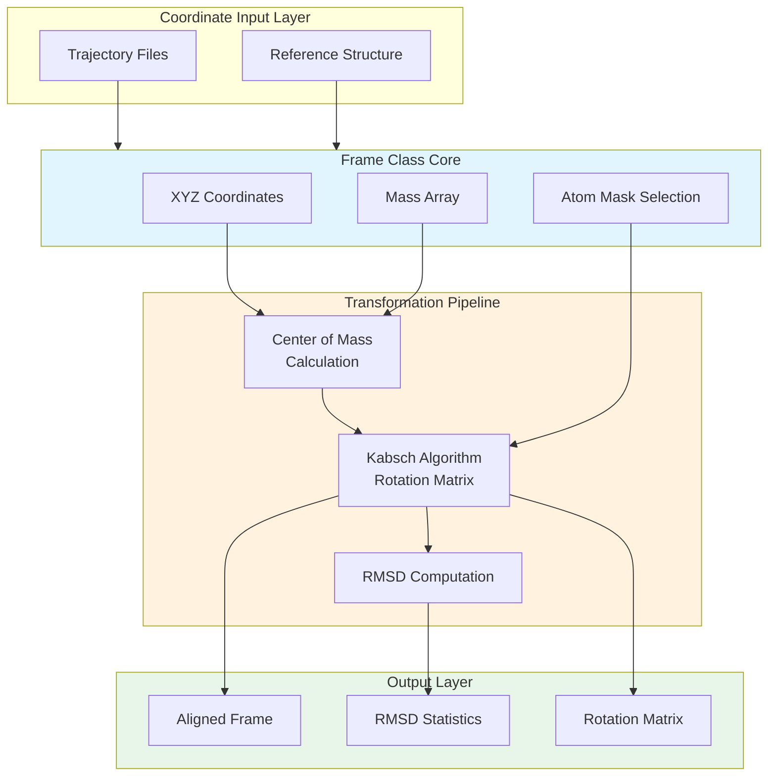
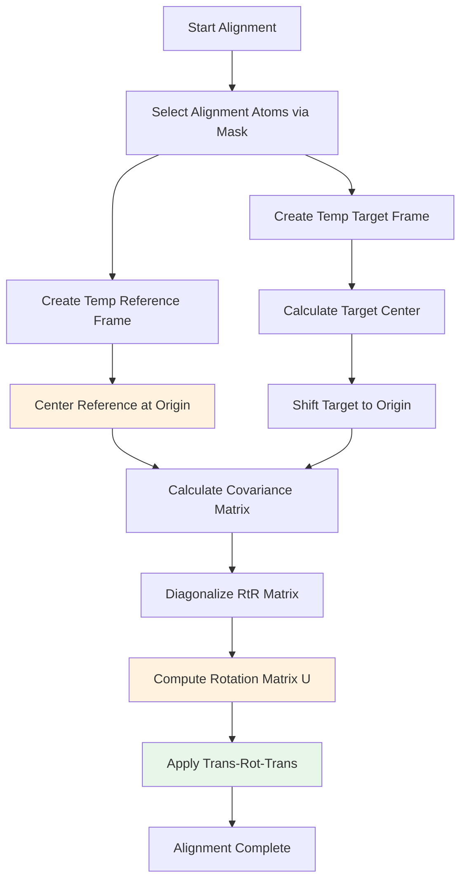

Coordinate transformations form the foundation of structural analysis in molecular dynamics, enabling quantitative comparison of atomic positions across timeframes, conformational ensembles, and reference structures. Cpptraj implements a comprehensive coordinate transformation framework centered on the **Frame** class, which provides optimized routines for Root Mean Square Deviation (RMSD) calculation, structural alignment, and coordinate rotation operations. These transformations leverage mathematical algorithms optimized for performance while supporting both mass-weighted and unweighted calculations, making them suitable for diverse analysis scenarios ranging from backbone-only alignment to full system superposition.

## Architecture Overview

The coordinate transformation architecture is built upon three core abstractions: coordinate storage in the **Frame** class, mathematical operations in **Matrix_3x3** and **Vec3** types, and flexible atom selection through **AtomMask**. This design enables efficient batch processing of trajectory frames while maintaining numerical precision for scientific analysis.



## RMSD Calculation Fundamentals

RMSD quantifies the average deviation between corresponding atomic positions in two structural states, providing a single scalar measure of structural similarity. Cpptraj implements multiple RMSD calculation strategies tailored to different analytical needs, each with specific computational trade-offs.

### Mass-Weighted vs. Unweighted RMSD

The fundamental choice in RMSD calculation involves whether to weight atomic contributions by their masses. Mass-weighted RMSD emphasizes heavier atoms (typically backbone atoms in proteins), making it less sensitive to surface sidechain fluctuations. Unweighted RMSD treats all atoms equally, providing a geometric measure of structural difference independent of atomic composition.

**Implementation**: The RMSD calculation accepts a `useMassIn` boolean parameter that determines the weighting scheme. When enabled, each coordinate contribution is multiplied by the corresponding atomic mass during both center-of-mass calculation and covariance matrix formation.

Sources: [Frame.cpp](src/Frame.cpp#L1058-L1216), [Frame.h](src/Frame.h#L262-L268)

### RMSD Calculation Variants

| Variant | Method | Description | Use Case |
|---------|--------|-------------|----------|
| **RMSD(Ref, useMass)** | Full fitting | Centers both frames, calculates optimal rotation, returns RMSD | Standard structural comparison |
| **RMSD_NoFit(Ref, useMass)** | No fitting | Direct RMSD without alignment | Comparing structures in same coordinate system |
| **RMSD_CenteredRef(Ref, useMass)** | Pre-centered | Assumes reference already centered at origin | Batch processing with common reference |
| **DISTRMSD(Ref)** | Distance-based | RMSD of inter-atomic distances | Topology-independent comparison |

Sources: [Frame.h](src/Frame.h#L262-L269), [Frame.cpp](src/Frame.cpp#L1217-L1250)

## The Kabsch Algorithm Implementation

Cpptraj employs the **Kabsch algorithm** for finding the optimal rotation matrix that minimizes RMSD between two point sets. This elegant algorithm operates through a series of linear algebra operations that efficiently solve the rotation matrix without iterative optimization.

### Mathematical Foundation

The algorithm computes the optimal rotation matrix **U** through these key steps:

1. **Center Both Structures**: Translate both the target frame and reference frame to their respective centers of mass or geometric centers (depending on mass weighting)
2. **Calculate Covariance Matrix**: Construct the 3×3 covariance matrix **R** = **Xᵀ** × **Ref**, where **X** and **Ref** are centered coordinate matrices
3. **Compute Symmetric Product**: Calculate **E** = **RᵀR** and diagonalize to obtain eigenvectors **a₁, a₂, a₃** and eigenvalues **μ₁, μ₂, μ₃**
4. **Extract Rotation Vectors**: Compute vectors **b** = **R** × **a** for each eigenvector, then normalize
5. **Determine Rotation Matrix**: Construct **U** = **E** × **Bᵀ**, where **E** is the matrix of eigenvectors and **B** is the matrix of normalized b vectors
6. **Handle Determinant**: Check the sign of (b₁ × b₂) · b₃ to ensure proper-handed rotation matrix

### Implementation Details

The Kabsch algorithm in cpptraj is implemented in `Frame::RMSD_CenteredRef()`, which receives pre-centered coordinates and computes both the RMSD value and optimal rotation matrix. The implementation explicitly handles numerical edge cases, including the determinant sign check that prevents improper rotations (reflections).

Sources: [Frame.cpp](src/Frame.cpp#L1075-L1216)

> [!TIP]
> The covariance matrix calculation in the Kabsch algorithm uses mass-weighted coordinates when `useMassIn` is true, with the mass factor applied to each term in the summation. This is critical for maintaining consistency with the center-of-mass calculation—both must use the same weighting scheme to minimize the RMSD properly.

## Centering and Translation Operations

Before RMSD calculation, both structures must be translated to a common reference point—typically the coordinate origin. Cpptraj provides flexible centering operations supporting both mass-weighted and geometric center calculations.

### Center of Mass vs. Geometric Center

The choice between center of mass and geometric center depends on the analytical objective:

**Center of Mass** (`VCenterOfMass()`): Calculates the weighted average position using atomic masses:
```
COM = (Σ mᵢrᵢ) / (Σ mᵢ)
```

**Geometric Center** (`VGeometricCenter()`): Calculates the simple arithmetic mean of coordinates:
```
GC = (Σ rᵢ) / N
```

### Translation Methods

The Frame class provides multiple translation methods for different scenarios:

- **`Translate(Vec3, AtomMask)`**: Translates only atoms specified in the mask
- **`Translate(Vec3, int, int)`**: Translates atoms within a specified index range
- **`Translate(Vec3, Unit)`**: Translates atoms within a molecular unit (residue, molecule)
- **`Translate(Vec3)`**: Translates all atoms in the frame
- **`NegTranslate(Vec3)`**: Translates by the negative of the vector (equivalent to `Translate(-Vec3)`)

The `CenterOnOrigin()` method combines center calculation with translation, returning the original center position while moving the frame to the origin. This is used during RMSD calculation to establish the common reference point.

Sources: [Frame.h](src/Frame.h#L214-L237), [Frame.cpp](src/Frame.cpp#L995-L1009)

## Rotation Operations

Once centered, the optimal rotation matrix from the Kabsch algorithm is applied to align the target frame with the reference. Cpptraj provides efficient rotation operations with flexible atom selection.

### Matrix-Based Rotation

Rotation is implemented as linear transformation of coordinate vectors using the 3×3 rotation matrix **U**:
```
r' = U × r
```

where **r** is the original coordinate vector and **r'** is the rotated coordinate. The rotation matrix preserves distances and angles while changing orientation.

### Rotation Method Variants

| Method | Scope | Description |
|--------|-------|-------------|
| **`Rotate(Matrix_3x3)`** | All atoms | Applies rotation to entire frame |
| **`Rotate(Matrix_3x3, int, int)`** | Index range | Rotates atoms within specified range |
| **`Rotate(Matrix_3x3, AtomMask)`** | Mask selection | Rotates only selected atoms |
| **`InverseRotate(Matrix_3x3)`** | All atoms | Applies inverse of rotation (transpose for orthogonal matrices) |
| **`InverseRotate(Matrix_3x3, AtomMask)`** | Mask selection | Applies inverse rotation to selected atoms |

### Combined Transformations

The `Trans_Rot_Trans()` method provides an optimized three-step transformation: translate → rotate → translate. This is commonly used in alignment operations where you translate to origin, rotate, then translate back to the reference position. The Frame class provides overloads for all-atom and mask-based transformations.

Sources: [Frame.h](src/Frame.h#L238-L253), [Frame.cpp](src/Frame.cpp#L1010-L1018)

## Structural Alignment Pipeline

The complete alignment process in cpptraj combines centering, RMSD calculation, and rotation into a unified pipeline. The `Align()` method encapsulates this workflow for typical alignment scenarios.

### Alignment Method Signature

```cpp
void Align(Frame const& REF, AtomMask const& mask)
```

This method performs:
1. Creates temporary frames containing only the masked atoms from both target and reference
2. Centers the reference at its geometric center
3. Calculates optimal rotation matrix and translation vectors using RMSD_CenteredRef
4. Applies the combined transformation using `Trans_Rot_Trans()`

### Alignment Workflow



### Practical Considerations

When performing alignments, consider these factors:

**Atom Selection**: Alignment typically uses backbone atoms (Cα, N, C, O) for proteins or a consistent subset across all frames. The mask should select atoms present in all frames to avoid mismatches.

**Mass Weighting**: For backbone-only alignment, mass weighting provides subtle differences but is often not critical. For full-system alignment including diverse atom types, mass weighting may be preferable.

**Reference Selection**: Choose a representative structure (e.g., the average structure, centroid frame, or biologically relevant conformation) as the alignment reference to minimize bias.

Sources: [Frame.h](src/Frame.h#L260), [Frame.cpp](src/Frame.cpp#L1010-L1018)

## Advanced Coordinate Transformations

Beyond basic RMSD and alignment, cpptraj provides specialized coordinate transformation methods for advanced analysis scenarios.

### Distance RMSD (DISTRMSD)

The `DISTRMSD()` method calculates RMSD based on inter-atomic distances rather than coordinates, making it invariant to overall translation and rotation. This is useful for comparing structures when alignment is ambiguous or when coordinate systems differ.

### Axis of Rotation

The `SetAxisOfRotation()` method defines a custom rotation axis between two atoms or points, enabling precise rotational manipulations around user-specified axes. This is valuable for analyzing conformational changes or applying specific rotational operations.

### Inertia Matrix

The `CalculateInertia()` method computes the inertia tensor for selected atoms, providing rotational dynamics properties. This matrix is essential for normal mode analysis and understanding rotational diffusion characteristics.

Sources: [Frame.h](src/Frame.h#L269-L275), [Frame.cpp](src/Frame.cpp#L1251-L1290), [Frame.cpp](src/Frame.cpp#L1290-L1318)

## Performance Optimization Strategies

Coordinate transformations are computationally intensive operations, especially when processing large trajectories. Cpptraj employs several optimization strategies:

### Inlined Operations

Critical coordinate manipulation functions are declared in the header file and marked for inlining by the compiler. This includes center of mass calculations, translations, and rotations, which eliminates function call overhead during tight loops.

### Memory Access Patterns

The coordinate array (`X_`) stores coordinates in the interleaved format X₀, Y₀, Z₀, X₁, Y₁, Z₁, ..., which enables efficient vectorized operations and improves cache locality during sequential processing.

### Batch Processing

For analysis requiring RMSD calculations across multiple frames, use the `RMSD_CenteredRef()` method when processing against a common reference. This avoids redundant centering of the reference structure for each comparison.

### Mask Optimization

AtomMask pre-computes selection indices, making repeated masked operations efficient. When performing multiple transformations on the same atom subset, construct the mask once and reuse it.

> [!TIP]
> When computing RMSD time series for trajectory analysis, center the reference frame once and use `RMSD_CenteredRef()` for all comparisons. This avoids the overhead of recalculating the reference center of mass for every frame, potentially reducing computation time by 20-30% for large systems.

## Integration with Analysis Commands

Coordinate transformations underpin many cpptraj analysis commands, including:

- **`rms`**: Calculates RMSD time series with optional fitting
- **`align`**: Aligns trajectory frames to a reference
- **`center`**: Centers structures on specified atom selections
- **`rotate`**: Applies explicit rotations to coordinates
- **`reference`**: Manages reference structures for comparison

These commands expose the Frame class transformation methods through the command-line interface and scripting API, enabling flexible workflow automation.

## Next Steps

Understanding coordinate transformations provides the foundation for advanced structural analysis. Continue exploring these related topics:

- **[RMSD and RMSF Calculations](10-rmsd-and-rmsf-calculations)**: Detailed analysis of fluctuation patterns and time-dependent RMSD computation
- **[Principal Component Analysis (PCA)](13-principal-component-analysis-pca)**: Coordinate transformations for dimensional reduction and essential dynamics
- **[Clustering Algorithms](17-clustering-algorithms-k-means-dbscan-hierarchical)**: Structural similarity quantification for conformational clustering
- **[Atom Selection and Mask Expressions](6-atom-selection-and-mask-expressions)**: Flexible atom selection for targeted coordinate transformations
