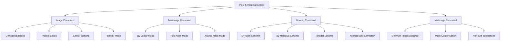
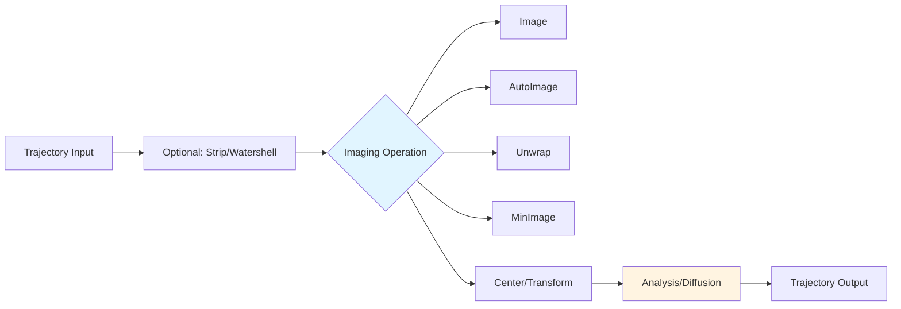

Periodic Boundary Conditions (PBC) and imaging are fundamental concepts in molecular dynamics simulation analysis. In MD simulations, systems are typically replicated in three-dimensional space to simulate bulk behavior without surface effects. This creates a "periodic" environment where particles crossing one boundary re-enter from the opposite side. The imaging functionality in CPPTRAJ handles the transformation of coordinates between different periodic images, enabling accurate analysis of molecular structures, distances, and dynamics that span multiple unit cells. This is particularly critical for membrane systems, protein-ligand complexes in solution, and any analysis requiring intact molecular structures that may cross periodic boundaries during simulation.

## Architectural Overview

CPPTRAJ's PBC and imaging system is built around the `Action_Image` and `ImageRoutines` classes that originated in PTRAJ and were adapted for the C++ implementation [README.md](README.md#L153-L159). The system supports both orthogonal and triclinic unit cells, providing multiple imaging strategies tailored to different analytical requirements and system geometries.



The imaging architecture coordinates with several other core systems including atom selection masks, trajectory processing pipelines, and coordinate transformations. The system must correctly handle box information stored in trajectory files and apply appropriate transformations based on box type and user-specified parameters.

## Image Command

The `image` command provides manual control over coordinate imaging operations, allowing precise specification of which atoms to center and how to apply periodic boundary transformations. This command is essential when you need explicit control over the imaging process or when working with systems where automatic determination might not produce optimal results.

### Orthogonal vs. Triclinic Imaging

CPPTRAJ supports imaging operations for both orthogonal (rectangular) and triclinic (non-orthogonal) unit cells. Orthogonal boxes have box vectors that are perpendicular to each other, while triclinic boxes have arbitrary angles between box vectors, requiring more complex coordinate transformations.

Test examples demonstrate both scenarios:

**Orthogonal imaging:**
```
center :2 origin
image origin center
```
[Test_Image/RunTest.sh](test/Test_Image/RunTest.sh#L36-L41)

**Triclinic imaging:**
```
center :2-11
image center triclinic
```
[Test_Image/RunTest.sh](test/Test_Image#L46-L51)

| Parameter | Description | Use Case |
|-----------|-------------|----------|
| `origin` | Use box origin as reference point | Standard orthogonal systems |
| `center` | Use center coordinates as reference | Systems needing centering around specific atoms |
| `triclinic` | Apply triclinic imaging transformations | Non-orthogonal unit cells (triclinic, dodecahedron, etc.) |

### Familiar Mode

The `familiar` option maintains the "familiar" arrangement of molecules relative to each other during imaging. This is particularly useful in non-orthogonal systems where standard imaging might place molecules in unfamiliar orientations relative to the reference structure.

```
center :2-11 origin
image origin center familiar
```
[Test_Image/RunTest.sh](test/Test_Image/RunTest.sh#L60-L64)

Familiar mode ensures that the relative spatial relationships between molecules are preserved as much as possible while still satisfying the imaging constraints. This is crucial for analyses where maintaining molecular orientation patterns is important, such as in protein-ligand binding studies or membrane protein systems.

### Center and COM Options

The imaging process can reference different coordinate centers:

1. **Center of geometric positions** - Default mode using atomic coordinates
2. **Center of mass (COM)** - Mass-weighted center calculation

Example using COM with specific mask:
```
center :2-11
image center familiar com :6
```
[Test_Image/RunTest.sh](test/Test_Image/RunTest.sh#L70-L74)

> [!TIP]
> When using `familiar` mode with `com`, ensure your reference mask includes atoms with reasonable mass values. This combination is particularly powerful for membrane systems where maintaining the orientation of transmembrane domains relative to the lipid bilayer is critical for accurate analysis.

## AutoImage Command

The `autoimage` command automatically determines optimal imaging parameters based on the system topology and user-specified criteria. This reduces the complexity of imaging operations by inferring appropriate masks and transformations from molecular structure information.

### By Vector Mode

The `byvec` mode images molecules based on a vector determination algorithm:
```
autoimage mode byvec
strip !(^1,2|:52,57,77)
```
[Test_AutoImage/RunTest.sh](test/Test_AutoImage/RunTest.sh#L19-L24)

This mode is particularly useful for membrane-spanning peptides or proteins where a principal axis (such as a helical axis) can be used to determine the optimal imaging orientation. The vector algorithm identifies the primary molecular orientation and images accordingly.

### First Atom Mode

The `firstatom` mode uses the first atom of each molecule as a reference point for imaging decisions:
```
autoimage firstatom
```
[Test_AutoImage/RunTest.sh](test/Test_AutoImage/RunTest.sh#L35-L39)

This approach is computationally efficient and works well for systems where the first atom of each molecule provides a stable reference point. It's commonly used for nucleic acid systems where the phosphate backbone provides consistent first-atom references.

### Anchor Mask Mode

The `anchor` mode allows explicit specification of a reference anchor point and origin:
```
autoimage anchor :96 origin
```
[Test_AutoImage/RunTest.sh](test/Test_AutoImage/RunTest.sh#L50-L54)

Table: AutoImage Mode Comparison

| Mode | Reference Strategy | Best For | Computational Cost |
|------|-------------------|----------|-------------------|
| `byvec` | Vector-based axis determination | Membrane proteins, helical systems | Moderate |
| `firstatom` | First atom of each molecule | Nucleic acids, structured systems | Low |
| `anchor` | User-specified anchor mask | Complex multi-component systems | Low |
| Default | Automatic molecule detection | General protein-ligand systems | Low to Moderate |

### Non-Sequential Molecules

AutoImage can handle systems with non-sequential molecule indices, automatically detecting molecular boundaries:
```
autoimage
```
[Test_AutoImage/RunTest.sh](test/Test_AutoImage/RunTest.sh#L66-L70)

This capability is essential for systems that have undergone trajectory manipulation (such as concatenation, stripping, or reordering) where molecule indices are no longer sequential in the topology.

## Unwrap Command

The `unwrap` command reverses the effects of periodic boundary imaging, reconstructing the continuous trajectory of molecules as they move through space. This is essential for diffusion calculations, tracking individual molecules across multiple images, and analyzing long-range transport properties.

### Unwrap Schemes

CPPTRAJ provides multiple unwrapping algorithms:

**By Atom scheme:**
```
unwrap byatom
```
[Test_Unwrap/RunTest.sh](test/Test_Unwrap/RunTest.sh#L9-L13)

**By Molecule scheme:**
```
unwrap bymol avgucell MyBox[avg]
```
[Test_Unwrap/RunTest.sh](test/Test_Unwrap/RunTest.sh#L25-L28)

**Toroidal scheme:**
```
unwrap scheme tor
```
[Test_Unwrap/RunTest.sh](test/Test_Unwrap/RunTest.sh#L39-L42)

Table: Unwrap Scheme Characteristics

| Scheme | Algorithm | Applications | Considerations |
|--------|-----------|-------------|----------------|
| `byatom` | Atom-by-atom reconstruction | High-precision atom tracking | Computationally intensive for large systems |
| `bymol` | Molecule-based unwrapping | Protein diffusion, lipid mobility | Requires accurate molecule definitions |
| `tor` | Toroidal view preservation | Periodic system analysis on torus | Maintains toroidal topology constraints |

### Average Box Correction

Unwrapping can incorporate average unit cell information to improve accuracy for systems with fluctuating box dimensions:

```
avgbox MyBox
unwrap bymol avgucell MyBox[avg]
```
[Test_Unwrap/RunTest.sh](test/Test_Unwrap/RunTest.sh#L21-L28)

This feature calculates the average box dimensions across the trajectory and uses these values for more consistent unwrapping, reducing artifacts from box size fluctuations that are common in NPT simulations.

> [!TIP]
> For diffusion coefficient calculations, use `unwrap` with `avgbox` to correct for box fluctuations in NPT simulations. Always specify `noimage` in subsequent distance or diffusion calculations to prevent re-imaging of unwrapped coordinates.

## MinImage Command

The `minimage` command calculates the minimum image distance between atoms or groups, accounting for periodic boundary conditions. This is essential for accurate distance measurements, interaction energy calculations, and neighbor finding in periodic systems.

```
minimage m1 :1-13 :1-13 out min.dat
minimage m2 :1-13 :1-13 maskcenter out min.dat
```
[Test_MinImage/RunTest.sh](test/Test_MinImage/RunTest.sh#L14-L17)

### Minimum Image Convention

The minimum image convention ensures that the calculated distance between two atoms is the shortest possible distance considering all periodic images. For orthorhombic boxes, this involves checking all 26 neighboring unit cells. For triclinic boxes, the algorithm is more complex due to non-orthogonal box vectors.

### Mask Center Option

The `maskcenter` option uses the center of the specified mask as the reference point for minimum image calculations:
```
minimage m2 :1-13 :1-13 maskcenter
```
[Test_MinImage/RunTest.sh](test/Test_MinImage/RunTest.sh#L17)

This is useful when you want to calculate distances between groups of atoms rather than individual atoms, where the group center provides a more meaningful measure than individual atomic distances.

## Workflow Integration

The imaging commands integrate seamlessly into CPPTRAJ's trajectory processing pipeline:



Imaging operations should typically be performed early in the processing pipeline, before coordinate-dependent analyses like RMSD, distance calculations, or diffusion measurements. The order of operations is crucial:

1. **Load trajectory** with box information
2. **Apply imaging** (`image` or `autoimage`) to center and coordinate molecules
3. **Unwrap** if continuous trajectories are needed for diffusion
4. **Apply analysis** (`distance`, `diffusion`, `rmsd`, etc.)
5. **Output** processed trajectory or analysis results

## Advanced Applications

### Distance Measurements with Imaging

Direct comparison of imaged vs. non-imaged distances:
```
distance image :507@O :499@O out ortho.dat
distance noimage :507@O :499@O out ortho.dat noimage
```
[Test_Image/RunTest.sh](test/Test_Image/RunTest.sh#L16-L18)

This demonstrates how periodic boundary conditions affect distance measurements, particularly important for systems where atoms may cross box boundaries.

### Non-Orthorhombic Systems

For triclinic boxes (e.g., dodecahedron, truncated octahedron):
```
distance image :1507@O :1676@O out nonortho.dat
distance noimage :1507@O :1676@O out nonortho.dat noimage
```
[Test_Image/RunTest.sh](test/Test_Image/RunTest.sh#L26-L28)

Non-orthorhombic systems require specialized imaging algorithms that properly account for non-orthogonal box vectors. CPPTRAJ automatically detects box type from trajectory information and applies appropriate transformations.

## Summary of PBC Commands

| Command | Primary Function | Key Options | Typical Use Case |
|---------|------------------|-------------|------------------|
| `image` | Manual coordinate imaging | `origin`, `center`, `triclinic`, `familiar`, `com` | Precise control over imaging |
| `autoimage` | Automatic imaging detection | `byvec`, `firstatom`, `anchor`, `origin` | Simplified imaging for common systems |
| `unwrap` | Reconstruct continuous trajectories | `byatom`, `bymol`, `scheme tor`, `avgucell` | Diffusion calculations, long-range tracking |
| `minimage` | Minimum image distance calculation | `maskcenter`, distance masks | Interaction analysis, neighbor finding |

## Next Steps

For comprehensive trajectory processing, understanding PBC and imaging is foundational. After mastering these concepts, you may want to explore:

- [Trajectory Processing Pipeline](7-trajectory-processing-pipeline) - Learn how imaging integrates with other trajectory operations
- [Distance and Angle Measurements](11-distance-and-angle-measurements) - Apply imaging-aware distance calculations
- [Diffusion Coefficients](26-diffusion-coefficients) - Use unwrapping for accurate diffusion analysis
- [Atom Selection and Mask Expressions](6-atom-selection-and-mask-expressions) - Create precise atom masks for imaging operations