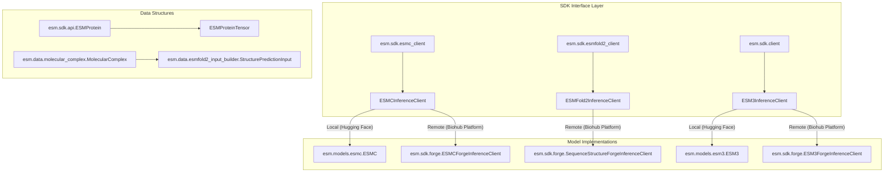

# Overview

Relevant source files

The following files were used as context for generating this wiki page:

- [README.md](README.md)
- [_assets/ESM3_README.md](_assets/ESM3_README.md)
- [_assets/esmc_graphic.png](_assets/esmc_graphic.png)
- [_assets/esmfold2_binder.png](_assets/esmfold2_binder.png)
- [_assets/esmfold2_folding.png](_assets/esmfold2_folding.png)
- [_assets/header.png](_assets/header.png)
- [esm/__init__.py](esm/__init__.py)

The ESM repository is a comprehensive suite for protein biology, providing state-of-the-art models for representation learning, structure prediction, and de novo design. It serves as a scientific engine that leverages evolutionary data to map biological relationships across scales—from atomic interactions to billion-year evolutionary spans [README.md:10-12]().

The codebase supports three primary model families:
1.  **ESMC**: A state-of-the-art protein language model that has learned representations of protein biology from training on billions of protein sequences [README.md:12-13]().
2.  **ESM3**: A frontier generative model for biology, able to jointly reason across three fundamental biological properties of proteins: sequence, structure, and function [_assets/ESM3_README.md:3-4]().
3.  **ESMFold2**: A state-of-the-art structure prediction model built on the ESMC 6B model, validated for the design of protein-protein interactions [README.md:21-22]().

## Execution Modes

The system is designed for flexibility, offering two primary execution paths:

*   **Local Inference**: Users can run models locally using the `transformers` library or native ESM implementations. This is ideal for fine-tuning or high-throughput tasks where local GPU resources are available [README.md:57-89](), [_assets/ESM3_README.md:50-87]().
*   **Remote (Biohub Platform)**: High-level SDK clients connect to the Biohub Platform (formerly "Forge") via an API key. This mode abstracts away infrastructure requirements and provides access to hosted model variants [README.md:96-126](), [_assets/ESM3_README.md:32-48]().

For detailed setup instructions, see [Getting Started & Installation](#1.1).

## System Architecture

The repository is structured to bridge high-level biological concepts (proteins, complexes) with low-level tensor operations. The following diagram illustrates how core SDK entities relate to the underlying model implementations.

### SDK to Model Mapping
"This diagram shows how SDK clients map to specific model architectures and their corresponding entry points."

**Sources:** [README.md:112-126](), [_assets/ESM3_README.md:43-48](), [_assets/ESM3_README.md:62-65]()

## Model Families

The repository provides specialized architectures for different biological tasks.

| Model Family | Primary Purpose | Key Components |
| :--- | :--- | :--- |
| **ESMC** | Sequence Embeddings | `ESMC`, `EsmSequenceTokenizer`, Sparse Autoencoders (SAEs) [README.md:12-13](), [README.md:139-141]() |
| **ESM3** | Multimodal Generation | `ESM3`, `TransformerStack`, `TokenizerCollection` [_assets/ESM3_README.md:3-4](), [_assets/ESM3_README.md:10]() |
| **ESMFold2** | Structure Prediction | `ESMFold2InputBuilder`, Diffusion-based folding [README.md:21-22]() |

For a comparison of capabilities and parameter scales, see [Model Families & Capabilities](#1.2).

## Core Subsystems

The codebase is organized into several functional domains that handle the lifecycle of protein data:

1.  **Protein Representations**: Classes like `ESMProtein` and `MolecularComplex` handle raw data parsing (PDB/mmCIF) and geometric utilities.
2.  **Tokenization**: A multi-track system that discretizes sequences, 3D structures (via VQ-VAE), and functional annotations into discrete tokens for transformer processing.
3.  **Inference SDK**: A unified interface (`esm.sdk`) for interacting with models regardless of the backend (Local, Biohub Platform, or SageMaker) [README.md:112-124](), [_assets/ESM3_README.md:32-48]().
4.  **Generation Engine**: Logic for iterative masked language modeling (MLM) and diffusion-based sampling used in de novo design [_assets/ESM3_README.md:5-6]().

### Data Flow Overview
"The transformation from raw protein data to model-ready tensors."

```mermaid
graph LR
    PDB_mmCIF["PDB/mmCIF Files"] -- "Load (e.g., ProteinChain.from_pdb)" --> ProteinChain_Obj[ProteinChain]
    ProteinChain_Obj -- "Build input (ESMFold2InputBuilder)" --> MolecularComplex_Obj[MolecularComplex]
    MolecularComplex_Obj -- "Tokenize & Encode (esm.sdk.api.ESM3InferenceClient.encode)" --> ESMProteinTensor_Obj[esm.sdk.api.ESMProteinTensor]
    ESMProteinTensor_Obj -- "Model Forward Pass (esm.models.esm3.ESM3.forward)" --> TransformerStack_Output[TransformerStack Output]
    TransformerStack_Output -- "Output Heads" --> Model_Outputs[Logits / Coordinates / Other Predictions]
```

**Sources:** [README.md:128-131](), [_assets/ESM3_README.md:5-6](), [_assets/ESM3_README.md:77-79]()

## Child Sections

*   **[Getting Started & Installation](#1.1)**: Environment setup using `pixi` or `pip`, and configuring the `Biohub Platform` access.
*   **[Model Families & Capabilities](#1.2)**: Detailed breakdown of ESMC, ESM3, and ESMFold2 versions and supported biological tasks.

**Sources:** [README.md:1-136](), [_assets/ESM3_README.md:1-124](), [esm/__init__.py:1-2]()

---