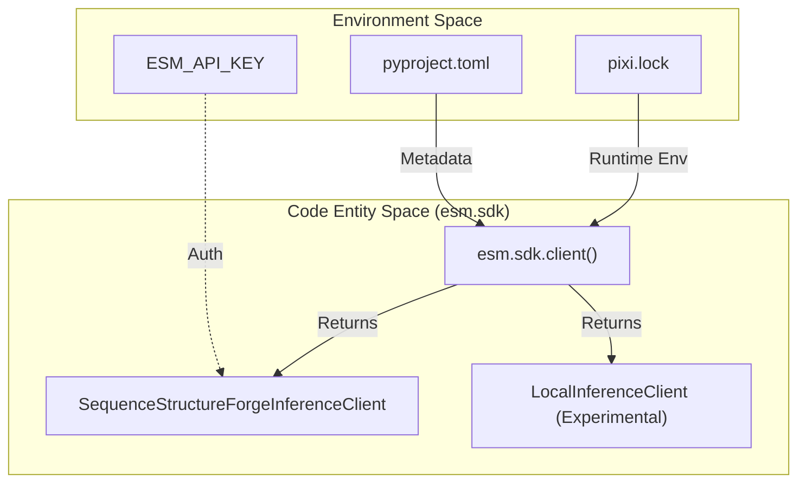
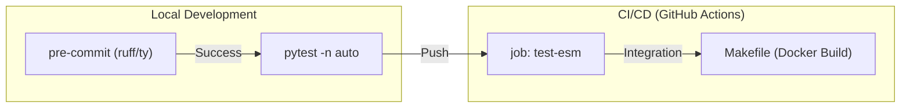

# Getting Started & Installation

<details>
<summary>Relevant source files</summary>

The following files were used as context for generating this wiki page:

- [README.md](README.md)
- [pixi.lock](pixi.lock)
- [pyproject.toml](pyproject.toml)

</details>


This page provides a comprehensive guide to setting up the ESM repository for development and research. It covers environment configuration using `pixi` and `pip`, authentication for remote inference, and the fundamental data flow between local environments and the Biohub Platform.

## 1. Environment Setup

The ESM repository supports two primary installation methods: **Pixi** (recommended for development) and **Pip** (for integration into existing environments). The project requires Python 3.12 [pyproject.toml:6-6]().

### Method A: Pixi (Recommended)
`pixi` is used to manage reproducible environments, handling both Python dependencies and system-level requirements like `cmake` and `pkg-config` [pyproject.toml:73-78]().

1.  **Install Pixi**: Follow the instructions at [pixi.sh](https://pixi.sh).
2.  **Initialize Environment**:
    ```bash
    pixi install
    ```
    This command reads `pyproject.toml` and `pixi.lock` to create a locked environment in the `.pixi` directory [pyproject.toml:68-71]().
3.  **Activate Shell**:
    ```bash
    pixi shell
    ```

### Method B: Pip
If you prefer standard pip, ensure you have Python 3.12 installed.
```bash
pip install esm@git+https://github.com/Biohub/esm.git@main
```
*Note: The project depends on a specific fork of the `transformers` library [pyproject.toml:25-25]().*

### Core Dependencies
The following key libraries are required for ESM operations:
| Library | Purpose |
| :--- | :--- |
| `torch` | Neural network backend (>=2.2.0) [pyproject.toml:24-24]() |
| `transformers` | Hugging Face models, specifically a Biohub fork [pyproject.toml:25-25]() |
| `biotite` | Protein structure parsing and manipulation [pyproject.toml:28-28]() |
| `rdkit` | Handling small molecules and ligands [pyproject.toml:29-29]() |
| `msgpack-numpy` | Efficient serialization for API requests [pyproject.toml:30-30]() |
| `ipywidgets` | Powering the interactive Jupyter UI [pyproject.toml:40-40]() |

Sources: [pyproject.toml:24-47]()

---

## 2. Configuration & Authentication

ESM supports both local model execution and remote inference via the Biohub Platform (Forge). To use remote inference, you must configure an API key.

### API Key Configuration
The SDK looks for the `ESM_API_KEY` environment variable. You can set this in your shell or via a `.env` file.

```bash
export ESM_API_KEY="your_api_key_here"
```

### Execution Modes
The system is designed to be backend-agnostic through the `esm.sdk` interfaces.

| Mode | Description | Implementation |
| :--- | :--- | :--- |
| **Local** | Models run on your local GPU/CPU. | Uses `esm.models` and `torch`. |
| **Remote** | Models run on Biohub Forge or SageMaker. | Uses `SequenceStructureForgeInferenceClient`. |

### System Initialization Flow
The following diagram illustrates how the environment and configuration are used to initialize a client.

**Client Initialization Architecture**

Sources: [pyproject.toml:1-47](), [README.md:99-102]()

---

## 3. Running Your First Example

Once installed, you can verify the setup by running a simple sequence embedding or structure prediction.

### Local Inference Example
The repository includes a `cookbook` directory with scripts for local execution. For ESMC, you can use the Hugging Face `transformers` library directly.

```python
import torch
from transformers import AutoModelForMaskedLM, AutoTokenizer
from huggingface_hub import login

# login with your Hugging Face credentials
login()

# example GFP sequence
sequences = ["MSKGEELFTGVVPILVELDGDVNGHKFSVSGEGEGDATYGKLTLKFICTTGKLPVPWPTLVTTFSYGVQCFSRYPDHMKQHDFFKSAMPEGYVQERTIFFKDDGNYKTRAEVKFEGDTLVNRIELKGIDFKEDGNILGHKLEYNYNSHNVYIMADKQKNGIKVNFKIRHNIEDGSVQLADHYQQNTPIGDGPVLLPDNHYLSTQSALSKDPNEKRDHMVLLEFVTAAGITHGMDELYK"]

model = AutoModelForMaskedLM.from_pretrained(
    "biohub/ESMC-6B",
    device_map="auto",
).eval()
tokenizer = AutoTokenizer.from_pretrained("biohub/ESMC-6B")

inputs = tokenizer(sequences, return_tensors="pt", padding=True)
inputs = {k: v.to(model.device) for k, v in inputs.items()}
with torch.inference_mode():
    output = model(**inputs)

# To return hidden states from all transformer layers:
# output = model(**inputs, output_hidden_states=True)
```
Sources: [README.md:69-94]()

### Remote SDK Example
Using the SDK to interact with ESMC via the Biohub Platform:

```python
from esm.sdk import esmc_client
from esm.sdk.api import ESMProtein, LogitsConfig

# Human carbonic anhydrase II (PDB 2CBA)
protein = ESMProtein(
    sequence=(
        "MSHHWGYGKHNGPEHWHKDFPIAKGERQSPVDIDTHTAKYDPSLKPLSVSYDQATSLRILNNGHAFNVEFDD"
        "SQDKAVLKGGPLDGTYRLIQFHFHWGSLDGQGSEHTVDKKKYAAELHLVHWNTKYGDFGKAVQQPDGLAVL"
        "GIFLKVGSAKPGLQKVVDVLDSIKTKGKSADFTNFDPRGLLPESLDYWTYPGSLTTPPLLECVTWIVLKEP"
        "ISVSSEQVLKFRKLNFNGEGEPEELMVDNWRPAQPLKNRQIKASFK"
    )
)
model = esmc_client(
    model="esmc-600m-2024-12", url="https://biohub.ai", token="<your API token>"
)

protein_tensor = model.encode(protein)
logits_output = model.logits(
    protein_tensor, LogitsConfig(sequence=True, return_embeddings=True)
)

print(logits_output.logits, logits_output.embeddings)
```
Sources: [README.md:112-134]()

---

## 4. Development Workflow

### Code Quality Tools
The project uses `ruff` for linting and `ty` (a type checker) for type checking, managed via `pre-commit` [pyproject.toml:104-140]().

*   **Linting**: `pixi run lint-all` [pyproject.toml:97-97]()
*   **Testing**: `pytest` is configured to ignore specific client tests that require remote credentials by default [pyproject.toml:49-55]().

### Testing Architecture
The test suite is split between unit tests and integration tests.

**Testing and CI Data Flow**

Sources: [pyproject.toml:49-55](), [pyproject.toml:89-98](), [pyproject.toml:104-140]()

---

## 5. Summary of Project Metadata

*   **Version**: 3.3.0 [pyproject.toml:3-3]()
*   **Python Requirement**: >=3.12, <3.13 [pyproject.toml:6-6]()
*   **Supported Platforms**: linux-64, osx-arm64 [pyproject.toml:70-70]()
*   **License**: LICENSE.md [pyproject.toml:7-7]()

Sources:
- [pyproject.toml:1-143]()
- [pixi.lock:1-87]()

---