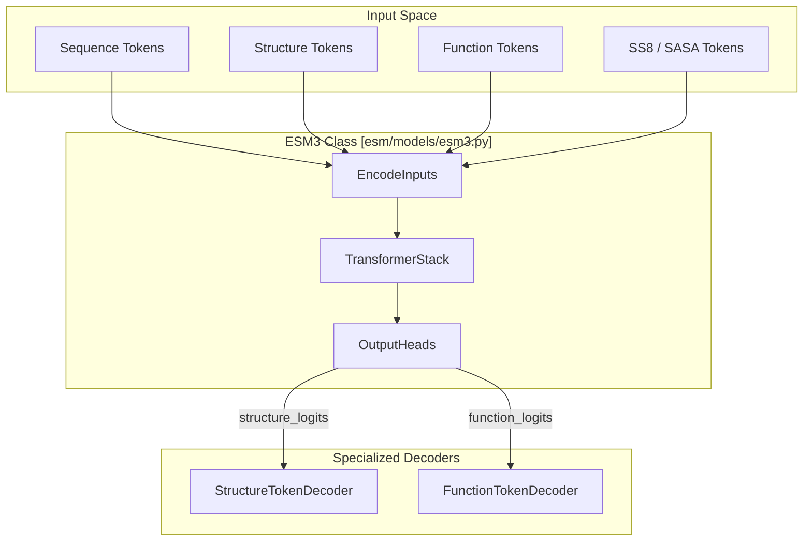
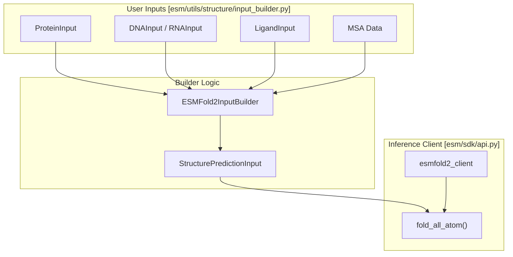

# Model Families & Capabilities

Relevant source files

The following files were used as context for generating this wiki page:

- [README.md](README.md)
- [esm/models/function_decoder.py](esm/models/function_decoder.py)
- [esm/pretrained.py](esm/pretrained.py)

This page provides a technical comparison of the three primary model families within the ESM ecosystem: **ESMC**, **ESM3**, and **ESMFold2**. These models represent a transition from sequence-only language modeling to multimodal protein design and high-fidelity structure prediction.

## Overview of Model Families

The repository supports two execution modes for these models: **Local Inference** (via Hugging Face weights and local PyTorch execution) and **Remote Inference** (via the Biohub Platform API).

| Feature | ESMC | ESM3 | ESMFold2 |
| :--- | :--- | :--- | :--- |
| **Primary Task** | Sequence Representation | Multimodal Design/Generation | Structure Prediction |
| **Architecture** | Transformer (Sequence) | Multimodal Transformer | Diffusion-based Folding |
| **Inputs** | Amino Acid Sequence | Seq, Struct, SS8, SASA, Func | Seq, MSA, Templates |
| **Scale Variants** | 300M, 600M, 6B | Open Small (v1) | 6B Backbone |
| **Key Use Case** | Embeddings, Variant Effect | De novo design, Inverse folding | High-accuracy folding |

Sources: [README.md:10-37](), [esm/utils/constants/models.py:2-13]()

---

## ESMC: Sequence Embedding Model

ESMC is the latest generation of protein language models, optimized for learning biological representations from billions of sequences [README.md:10-12](). It serves as the foundation for the ESM Atlas and SAE-based interpretability [README.md:35-37]().

### Architecture & Implementation
ESMC utilizes a standard Transformer backbone with support for **Flash Attention** to handle long-range structural dependencies efficiently [esm/models/esmc.py:61-74]().

*   **Class**: `ESMC` [esm/models/esmc.py:45-45]()
*   **Backbone**: `TransformerStack` [esm/models/esmc.py:67-74]()
*   **Output**: `ESMCOutput` containing `sequence_logits`, `embeddings`, and `hidden_states` [esm/models/esmc.py:38-42]()

### Model Scales & Factory Functions
Models can be instantiated locally using the `ESMC.from_pretrained()` method or specific factory functions in `esm.pretrained`.

| Model Constant | Parameters | Factory Function |
| :--- | :--- | :--- |
| `ESMC_300M` | 300 Million | `ESMC_300M_202412` [esm/pretrained.py:66-77]() |
| `ESMC_600M` | 600 Million | `ESMC_600M_202412` [esm/pretrained.py:79-90]() |
| `ESMC_6B` | 6 Billion | `ESMC_6B_202412` [esm/pretrained.py:92-105]() |

Sources: [esm/models/esmc.py:79-96](), [esm/pretrained.py:66-105](), [esm/utils/constants/models.py:9-11]()

---

## ESM3: Multimodal Protein Language Model

ESM3 is a generative world model capable of reasoning across multiple "tracks" of protein data simultaneously [esm/models/esm3.py:188-190](). It uses a unified vocabulary to represent sequence, structure (via VQ-VAE tokens), and function [esm/models/esm3.py:62-102]().

### Data Flow & Component Mapping
The following diagram illustrates how the `ESM3` class coordinates various sub-models to process multimodal inputs.

**ESM3 Multimodal Integration**

Sources: [esm/models/esm3.py:62-185](), [esm/models/esm3.py:211-218]()

### Key Components
*   **`EncodeInputs`**: Projects all tracks (Sequence, pLDDT, Structure, SS8, SASA, Function, Residue) into a shared `d_model` embedding space [esm/models/esm3.py:62-148]().
*   **`StructureTokenEncoder/Decoder`**: A VQ-VAE that discretizes 3D coordinates into 4096 discrete tokens [esm/models/vqvae.py:179-187](), [esm/utils/constants/esm3.py:13-20]().
*   **`FunctionTokenDecoder`**: Decodes function tokens into InterPro annotations and keyword TF-IDF vectors [esm/models/function_decoder.py:54-125]().

Sources: [esm/models/esm3.py:15-16](), [esm/pretrained.py:108-125]()

---

## ESMFold2: All-Atom Structure Prediction

ESMFold2 is built upon the ESMC 6B backbone and is optimized for predicting the structures of complex biological systems, including proteins, nucleic acids (DNA/RNA), and small-molecule ligands [README.md:21-28]().

### Capabilities
*   **Multi-chain Support**: Can fold protein-protein, protein-nucleic acid, and antibody-antigen complexes [cookbook/tutorials/esmfold2.ipynb:15-18]().
*   **Non-canonical Support**: Handles non-canonical amino acids via CCD codes and covalent modifications [cookbook/tutorials/esmfold2.ipynb:19-22]().
*   **MSA Integration**: Supports Multiple Sequence Alignments to improve prediction accuracy [cookbook/tutorials/esmfold2.ipynb:23-25]().

### System Architecture
The folding process is managed via the `ESMFold2InputBuilder` which assembles various molecular inputs into a `StructurePredictionInput` payload for the diffusion engine.

**ESMFold2 Input Assembly**

Sources: [cookbook/tutorials/esmfold2.ipynb:79-81](), [esm/utils/constants/models.py:12-14]()

---

## Model Selection Guide

| If you want to... | Use This Model | Implementation |
| :--- | :--- | :--- |
| Generate a new protein sequence for a specific fold | **ESM3** | `esm.models.esm3.ESM3` |
| Extract features for a downstream classifier | **ESMC** | `esm.models.esmc.ESMC` |
| Predict the 3D structure of a protein-DNA complex | **ESMFold2** | `esm.sdk.esmfold2_client` |
| Interpret model features using SAEs | **ESMC** | `esm.models.esmc.ESMC` |
| Perform inverse folding (Structure $\rightarrow$ Sequence) | **ESM3** | `ESM3.forward_and_sample` |

Sources: [README.md:10-37](), [esm/models/esm3.py:188-190](), [esm/models/esmc.py:45-48]()

---