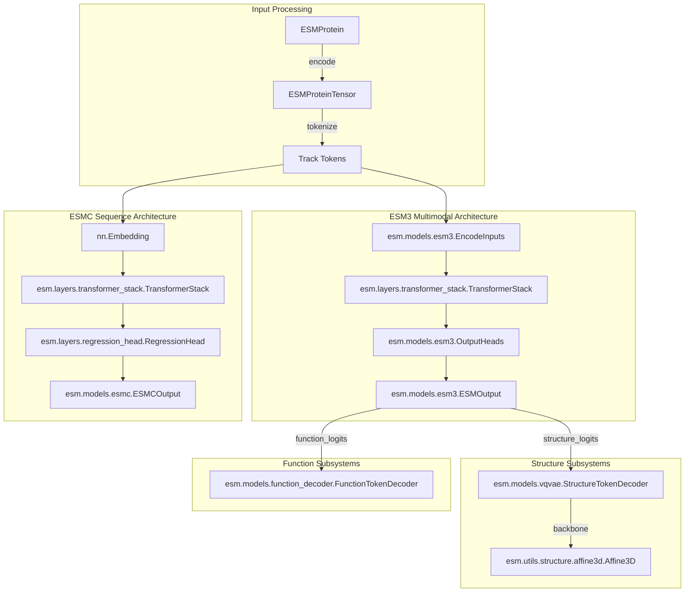

# Core Model Architectures

Relevant source files

The following files were used as context for generating this wiki page:

- [esm/layers/transformer_stack.py](esm/layers/transformer_stack.py)
- [esm/models/esm3.py](esm/models/esm3.py)
- [esm/models/esmc.py](esm/models/esmc.py)
- [esm/utils/structure/input_builder.py](esm/utils/structure/input_builder.py)

This page provides a high-level technical overview of the neural network architectures that power the ESM ecosystem. The codebase supports three primary model families: **ESM3**, a multimodal generative model; **ESMC**, a sequence-only transformer; and **ESMFold2**, a diffusion-based structure prediction model. These models are built upon a shared library of optimized transformer layers and specialized tokenizers.

## Architectural Overview

The ESM repository transitions from traditional protein language modeling to a multimodal, multi-track architecture. While **ESMC** focuses on high-efficiency sequence embeddings, **ESM3** integrates sequence, structure, and function into a unified transformer backbone. **ESMFold2** extends these capabilities to high-fidelity all-atom structure prediction.

### Component Relationship Diagram
The following diagram illustrates how the core classes and modules interact to process protein data across different model families.

**Sources:** [esm/models/esm3.py:62-185](), [esm/models/esmc.py:45-191](), [esm/models/vqvae.py:179-205](), [esm/models/function_decoder.py:54-125]()

---

## ESM3: Multimodal Generative Model

**ESM3** is a multimodal transformer designed to reason across different "tracks" of protein information simultaneously. It treats proteins as a collection of synchronized sequences: amino acids, structural coordinates (discretized), secondary structure, solvent accessibility, and functional annotations.

*   **Multimodal Embedding:** The `EncodeInputs` class [esm/models/esm3.py:62-148]() sums embeddings from all tracks, including sequence, structure tokens, SS8, SASA, and function tokens.
*   **Transformer Backbone:** A `TransformerStack` [esm/layers/transformer_stack.py:11-20]() processes the combined embeddings using rotary position embeddings and optional Flash Attention.
*   **Output Heads:** The `OutputHeads` class [esm/models/esm3.py:151-185]() provides independent regression heads for every input track, enabling the model to predict or "fill in" masked values for any modality.

For a deep dive into the multimodal tracks and forward pass, see **[ESM3 – Multimodal Protein Language Model](#2.1)**.

---

## ESMC: Efficient Sequence Embeddings

**ESMC** (ESM Central) is a sequence-only transformer architecture optimized for scale and speed. It is the successor to the ESM-2 family, providing state-of-the-art embeddings for downstream tasks and masked language modeling.

*   **Optimized Attention:** ESMC natively supports `unpad_input` and `pad_input` logic [esm/models/esmc.py:151-180]() to handle variable-length sequences efficiently when using Flash Attention.
*   **Variants:** Available in 300M, 600M, and 6B parameter variants [esm/models/esmc.py:80-96]().
*   **Output:** Returns `ESMCOutput` [esm/models/esmc.py:37-42]() containing logits, embeddings, and optionally all hidden states and attention maps.

For details on the sequence-only architecture and Flash Attention integration, see **[ESMC – Sequence Embedding Model](#2.2)**.

---

## ESMFold2: Structure Prediction

**ESMFold2** is a diffusion-based structure prediction model. Unlike the original ESMFold, which used a folding trunk, ESMFold2 leverages a diffusion process to generate all-atom coordinates.

*   **Input Handling:** Uses `StructurePredictionInput` [esm/utils/structure/input_builder.py:75-79]() to construct complex payloads including MSAs, ligands, and multi-chain information. The `serialize_structure_prediction_input` function [esm/utils/structure/input_builder.py:82-154]() handles serialization.
*   **Complex Support:** Natively handles `ProteinInput`, `DNAInput`, `RNAInput`, and `LigandInput` [esm/utils/structure/input_builder.py:22-50]().
*   **Diffusion Pipeline:** Operates on `StructurePredictionInput` to iteratively refine atomic positions.

For details on the diffusion pipeline and multi-chain support, see **[ESMFold2 – All-Atom Structure Prediction](#2.3)**.

---

## Support Architectures: VQ-VAE & Function Decoders

To enable the transformer to "see" and "write" 3D structures and complex functions, ESM3 utilizes specialized compression and expansion models.

### Structure VQ-VAE
The `StructureTokenEncoder` and `StructureTokenDecoder` [esm/models/vqvae.py:179-205]() implement a Vector Quantized Variational Autoencoder.
*   **Encoder:** Maps 3D coordinates to a discrete set of 4096 structure tokens using a `GeometricEncoderStack`.
*   **Decoder:** Reconstructs the protein backbone (`Affine3D`) from these discrete tokens.

### Function Decoder
The `FunctionTokenDecoder` [esm/models/function_decoder.py:54-125]() translates abstract function tokens into human-readable InterPro annotations and TF-IDF keyword vectors. It uses a `TransformerStack` to expand depth-8 function tokens into high-dimensional classification logits.

For details, see **[VQ-VAE Structure Tokenizer & Function Decoder](#2.4)**.

---

## Reusable Building Blocks

The models share a core library of neural network components located in `esm.layers`.

| Component | Description | File |
| :--- | :--- | :--- |
| `TransformerStack` | Reusable stack of transformer blocks with configurable geometry and attention. | [esm/layers/transformer_stack.py:10-61]() |
| `UnifiedTransformerBlock` | A single transformer layer supporting both plain and geometric attention. | [esm/layers/blocks.py]() |
| `RegressionHead` | Standard MLP head for projecting hidden states to output vocabularies. | [esm/layers/regression_head.py:13-24]() |
| `EMACodebook` | The quantization layer used in the Structure VQ-VAE. | [esm/layers/codebook.py]() |

For technical specifications of these layers, see **[Transformer Building Blocks](#2.5)**.

---
**Sources:**
- `ESM3` and `ESMOutput`: [esm/models/esm3.py:50-211]()
- `ESMC` and `ESMCOutput`: [esm/models/esmc.py:37-78]()
- `FunctionTokenDecoder`: [esm/models/function_decoder.py:54-125]()
- `StructureTokenEncoder`: [esm/models/vqvae.py:179-205]()
- `TransformerStack`: [esm/layers/transformer_stack.py:10-61]()
- `RegressionHead`: [esm/layers/regression_head.py:13-24]()
- `StructurePredictionInput`, `ProteinInput`, `DNAInput`, `RNAInput`, `LigandInput`, `serialize_structure_prediction_input`: [esm/utils/structure/input_builder.py:22-154]()

---