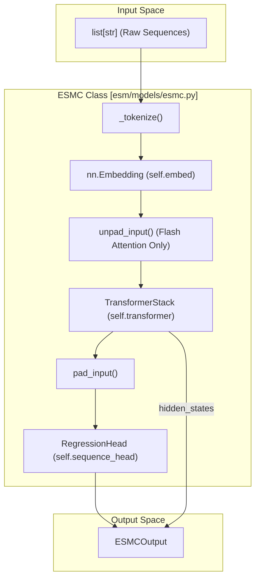

# ESMC – Sequence Embedding Model

<details>
<summary>Relevant source files</summary>

The following files were used as context for generating this wiki page:

- [esm/layers/attention.py](esm/layers/attention.py)
- [esm/layers/blocks.py](esm/layers/blocks.py)
- [esm/models/esmc.py](esm/models/esmc.py)
- [esm/utils/misc.py](esm/utils/misc.py)
- [esm/utils/structure/input_builder.py](esm/utils/structure/input_builder.py)

</details>


The **ESMC** (Evolutionary Scale Modeling - Core) is a sequence-only transformer model designed for efficient protein sequence embedding and masked language modeling. Unlike the multimodal ESM3, ESMC focuses exclusively on the amino acid sequence track, utilizing a streamlined architecture that supports high-performance inference through Flash Attention and optimized variable-length sequence handling.

## Architecture Overview

The ESMC architecture consists of a sequence embedding layer, a stack of transformer blocks, and a regression head for sequence token prediction. It is implemented in the `ESMC` class, which inherits from both `nn.Module` and `ESMCInferenceClient` [esm/models/esmc.py:45-53]().

### Key Components

| Component | Description | Code Entity |
| :--- | :--- | :--- |
| **Embedding Layer** | Maps sequence tokens to the model's hidden dimension ($d_{model}$). | `self.embed` [esm/models/esmc.py:64]() |
| **Transformer Backbone** | A stack of transformer layers with optional Flash Attention support. | `self.transformer` [esm/models/esmc.py:67-74]() |
| **Sequence Head** | A regression head that predicts logits over the 64-token amino acid vocabulary. | `self.sequence_head` [esm/models/esmc.py:76]() |
| **Tokenizer** | Handles conversion between raw strings and integer tensors. | `self.tokenizer` [esm/models/esmc.py:77]()

Sources:
- [esm/models/esmc.py:45-78]()
- [esm/layers/transformer_stack.py:17-50]()

---

## Data Flow & Forward Pass

The ESMC forward pass is optimized for batching variable-length sequences. It employs a "pad-unpad" strategy when Flash Attention is enabled to avoid redundant computation on padding tokens.

### Sequence Processing Diagram

The following diagram illustrates the flow from raw sequence input to model output, highlighting the interaction between the `ESMC` class and the underlying `TransformerStack`.

**ESMC Sequence Processing Flow**


### Implementation Details
1.  **Tokenization**: Raw sequences are tokenized using `encoding.tokenize_sequence` and stacked into a batch using `stack_variable_length_tensors` [esm/models/esmc.py:106-115]().
2.  **Unpadding**: If `use_flash_attn` is True, the model uses `unpad_input` to flatten the batch into a single sequence of non-padding tokens [esm/models/esmc.py:151-163]().
3.  **Transformer Execution**: The `TransformerStack` processes the tokens. It uses `FlashMultiHeadAttention` if enabled, which requires a boolean `sequence_id` mask [esm/layers/attention.py:99-143]().
4.  **Repadding**: After the transformer blocks, the flattened tensors are restored to their original `[B, L, D]` shape using `pad_input` before being passed to the output head [esm/models/esmc.py:171-180]().

Sources:
- [esm/models/esmc.py:123-191]()
- [esm/layers/attention.py:99-143]()
- [esm/utils/misc.py:180-210]()

---

## Flash Attention & Variable Length Support

ESMC is built to handle the high-throughput requirements of protein sequence embedding. It integrates `flash_attn` for both memory efficiency and speed.

### Flash Attention Integration
The `FlashMultiHeadAttention` class [esm/layers/attention.py:99]() implements the optimized attention mechanism. It uses `TritonRotaryEmbedding` for positional encoding [esm/layers/attention.py:108]() and calls `flash_attn_varlen_qkvpacked_func` for the core computation [esm/layers/attention.py:138]().

### Constraints
*   **Boolean Masks**: When using Flash Attention, the `sequence_id` must be a boolean mask [esm/models/esmc.py:156-158]().
*   **Attention Weights**: Flash Attention does not support returning attention weights. If `output_attentions=True` is requested, the model must fall back to standard `MultiHeadAttention` [esm/models/esmc.py:152-155]().

Sources:
- [esm/layers/attention.py:99-143]()
- [esm/models/esmc.py:151-165]()

---

## Model Outputs: ESMCOutput

The model returns an `ESMCOutput` dataclass containing the following fields:

| Field | Type | Description |
| :--- | :--- | :--- |
| `sequence_logits` | `torch.Tensor` | Logits over the amino acid vocabulary. |
| `embeddings` | `torch.Tensor` | Final hidden state of the model. |
| `hidden_states` | `torch.Tensor` | A stack of hidden states from all transformer layers. |
| `attentions` | `tuple[torch.Tensor]` | (Optional) Attention maps if Flash Attention is disabled. |

Sources:
- [esm/models/esmc.py:37-42]()

---

## Pretrained Factory & Variants

The `ESMC.from_pretrained` factory function provides a unified interface for loading different model scales.

### Loading a Model
```python
# Example: Loading the 600M variant
model = ESMC.from_pretrained("esmc_600m", device="cuda")
```

### Supported Variants
The model scale is determined by the `d_model`, `n_heads`, and `n_layers` parameters passed to the `ESMC` constructor during the loading process via `load_local_model` [esm/models/esmc.py:80-96](). Common variants include:
*   **ESMC 300M**
*   **ESMC 600M** (Default) [esm/utils/constants/models.py:10]()
*   **ESMC 6B**

Sources:
- [esm/models/esmc.py:79-96]()
- [esm/pretrained.py]()
- [esm/utils/constants/models.py:10]()

---

## SDK Interface Implementation

`ESMC` implements the `ESMCInferenceClient` interface, providing high-level methods for protein analysis:

*   **`encode(input: ESMProtein)`**: Converts an `ESMProtein` object into an `ESMProteinTensor` by tokenizing the sequence [esm/models/esmc.py:193-202]().
*   **`decode(input: ESMProteinTensor)`**: Converts tensors back into an `ESMProtein` object [esm/models/esmc.py:204-213]().
*   **`logits(...)`**: Returns the sequence logits for a given protein tensor, supporting both single and batched inputs [esm/models/esmc.py:215-224]().

Sources:
- [esm/models/esmc.py:193-224]()
- [esm/sdk/api.py]()

---