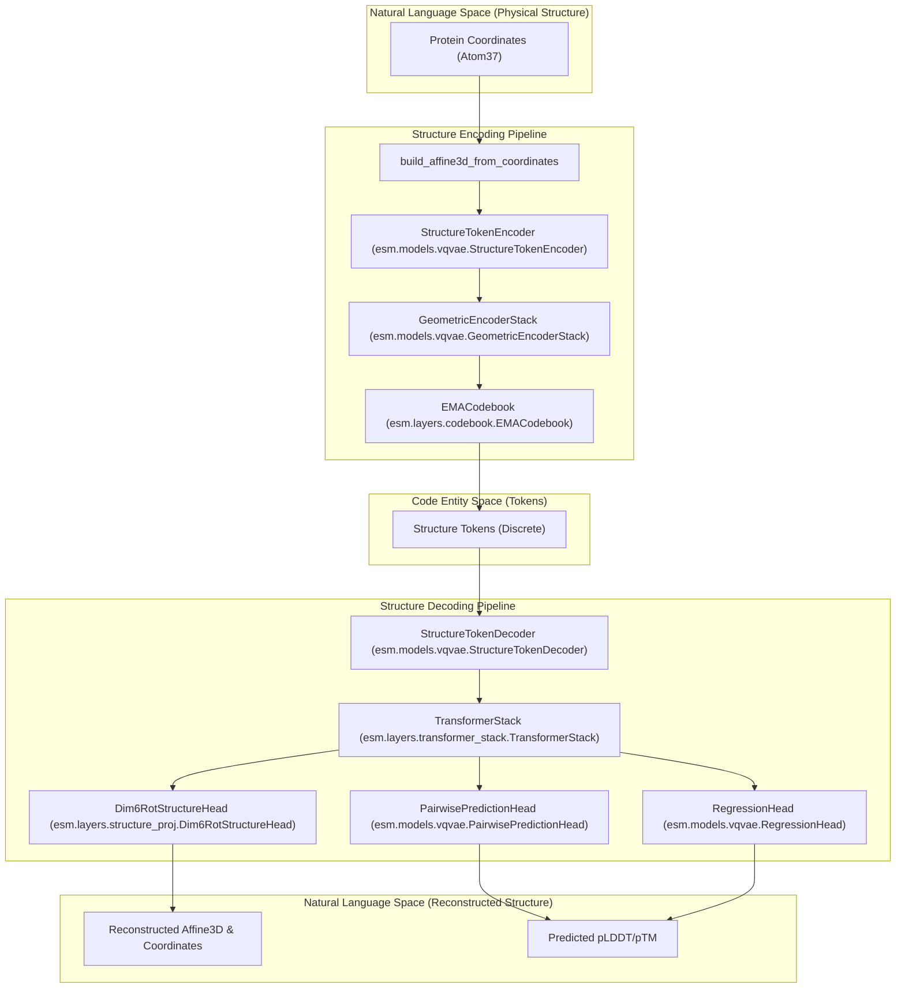
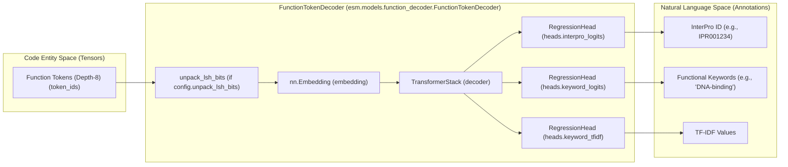

# VQ-VAE Structure Tokenizer & Function Decoder

Relevant source files

The following files were used as context for generating this wiki page:

- [esm/layers/codebook.py](esm/layers/codebook.py)
- [esm/layers/geom_attention.py](esm/layers/geom_attention.py)
- [esm/layers/rotary.py](esm/layers/rotary.py)
- [esm/layers/structure_proj.py](esm/layers/structure_proj.py)
- [esm/models/function_decoder.py](esm/models/function_decoder.py)
- [esm/models/vqvae.py](esm/models/vqvae.py)
- [esm/pretrained.py](esm/pretrained.py)
- [esm/tokenization/__init__.py](esm/tokenization/__init__.py)

The ESM3 ecosystem utilizes specialized discrete latent spaces for protein structure and functional annotations. These are implemented via a Vector Quantized Variational Autoencoder (VQ-VAE) for structural coordinates and a Multi-Head Decoder for functional keywords and InterPro entries. These components allow ESM3 to treat structure and function as discrete token tracks alongside the primary amino acid sequence.

## Structural Tokenization (VQ-VAE)

The structural tokenization system converts 3D atomic coordinates into a sequence of discrete tokens and back again. This is achieved through the `StructureTokenEncoder` and `StructureTokenDecoder` classes defined in `esm/models/vqvae.py`.

### StructureTokenEncoder
The encoder maps 3D coordinates (represented as `Affine3D` objects and `Atom37` tensors) into a discrete latent space. It utilizes a `GeometricEncoderStack` which is a transformer variant where every layer is a `UnifiedTransformerBlock` configured for geometric attention [esm/models/vqvae.py:142-160](). The `GeometricEncoderStack` inherits from `TransformerStack` but overrides the `blocks` attribute to use `UnifiedTransformerBlock` with `use_geom_attn=True` and `use_plain_attn=False` [esm/models/vqvae.py:142-157]().

**Key Components:**
- **Geometric Attention**: Uses `GeometricReasoningOriginalImpl` to compute attention weights based on both rotation and distance between residues [esm/layers/geom_attention.py:9-31]().
- **K-Nearest Neighbors (KNN)**: The encoder operates on a graph constructed from the 16 nearest neighbors for each residue [esm/models/vqvae.py:191]().
- **EMA Codebook**: A `EMACodebook` containing 4096 codes (`n_codes`) of dimension 128 (`d_out`) performs the vector quantization [esm/models/vqvae.py:187](). The `EMACodebook` manages a set of learnable embeddings and uses Exponential Moving Average (EMA) for updating them [esm/layers/codebook.py:8-33]().
- **RelativePositionEmbedding**: Used to embed relative positional information between residues [esm/models/vqvae.py:188]().

### StructureTokenDecoder
The decoder performs the inverse operation: reconstructing 3D backbone coordinates from discrete structural tokens. It is a significantly larger model than the encoder (30 layers vs 2 layers in the standard configuration) [esm/pretrained.py:44](). The decoder also uses a `TransformerStack` for processing the token embeddings [esm/models/vqvae.py:240-248]().

**Output Heads:**
- **Dim6RotStructureHead**: Predicts the 6D representation (Graham-Schmidt) of rotations and 3D translations to reconstruct the protein backbone [esm/layers/structure_proj.py:8-25]().
- **PairwisePredictionHead**: Predicts distograms and pLDDT/pTM metrics [esm/models/vqvae.py:52-70](). This head takes the output of the transformer and projects it to predict pairwise distances and other structural metrics.
- **RegressionHead**: Used for predicting pLDDT and pTM values [esm/models/vqvae.py:98-111]().

### Structure Data Flow Diagram

The following diagram illustrates the flow from physical coordinates to the discrete "Code Entity Space" (tokens) and back to reconstructed structure.

Sources: [esm/models/vqvae.py:142-220](), [esm/layers/structure_proj.py:8-63](), [esm/utils/structure/affine3d.py:10-20](), [esm/layers/codebook.py:8-33](), [esm/models/vqvae.py:230-300]()

---

## Function Token Decoder

The `FunctionTokenDecoder` is responsible for translating the discrete function tokens generated by ESM3 into human-readable InterPro annotations and keyword descriptions. Function tokens are depth-8 LSH (Locality Sensitive Hashing) encoded representations [esm/models/function_decoder.py:54-125](). The `FunctionTokenDecoderConfig` [esm/models/function_decoder.py:22-52]() defines parameters such as `d_model`, `n_heads`, `n_layers`, `function_token_vocab_size`, `function_token_depth`, `num_interpro_classes`, and `keyword_vocabulary_size`.

### Architecture
The decoder consists of a `TransformerStack` that processes the function tokens and three specialized regression heads [esm/models/function_decoder.py:92-125]():
1.  **interpro_logits**: A `RegressionHead` predicting the presence of 29,026 InterPro classes [esm/models/function_decoder.py:119-123](). The InterPro IDs are loaded from a CSV file specified in `interpro_entry_list` [esm/models/function_decoder.py:63-69]().
2.  **keyword_logits**: A binary classification head for 58,641 keywords [esm/models/function_decoder.py:107-111](). The keyword vocabulary is loaded from a file specified by `keyword_vocabulary_path` [esm/models/function_decoder.py:71-73]().
3.  **keyword_tfidf**: A head that regresses the TF-IDF value of present keywords to determine their relative importance [esm/models/function_decoder.py:112-116]().

The `TransformerStack` [esm/models/function_decoder.py:92-103]() uses `d_model`, `n_heads`, and `n_layers` from the configuration. An `nn.Embedding` layer maps the input `token_ids` to embeddings before being passed to the transformer [esm/models/function_decoder.py:85-91]().

### LSH Bit Unpacking
Function tokens are typically stored as integers. The decoder can "unpack" these into single-bit tokens to provide distinct embeddings for each bit in the LSH signature [esm/models/function_decoder.py:141-163](). This is controlled by the `unpack_lsh_bits` configuration parameter [esm/models/function_decoder.py:44](). If `unpack_lsh_bits` is `True`, the input `token_ids` are treated as LSH values, and individual bits are extracted and shifted into distinct vocabulary ranges for embedding. Otherwise, a depth-position offset is applied to the `token_ids` to ensure distinct embeddings for tokens at different depths [esm/models/function_decoder.py:164-171]().

### Function Mapping Diagram

This diagram shows how the model bridges the gap between high-dimensional functional keywords and the discrete token space used by the ESM3 transformer.

Sources: [esm/models/function_decoder.py:104-125](), [esm/models/function_decoder.py:141-171](), [esm/tokenization/function_tokenizer.py:15-20]()

---

## Pretrained Factory Functions

The VQ-VAE and Function Decoder are instantiated and loaded via factory functions in `esm/pretrained.py`. These functions handle the initialization of empty weights, loading of local `.pth` files, and mapping to the correct device [esm/pretrained.py:28-63]().

| Factory Function | Class | d_model | n_layers | n_heads | v_heads | d_out | n_codes |
| :--- | :--- | :--- | :--- | :--- | :--- | :--- | :--- |
| `ESM3_structure_encoder_v0` | `StructureTokenEncoder` | 1024 | 2 | 1 | 128 | 128 | 4096 |
| `ESM3_structure_decoder_v0` | `StructureTokenDecoder` | 1280 | 30 | 20 | N/A | N/A | N/A |
| `ESM3_function_decoder_v0` | `FunctionTokenDecoder` | 1024 | 3 | 8 | N/A | N/A | N/A |

These components are integrated into the full ESM3 model during its construction in `ESM3_sm_open_v0`, where they are passed as function pointers (`structure_encoder_fn`, `structure_decoder_fn`, `function_decoder_fn`) [esm/pretrained.py:108-119](). The `LOCAL_MODEL_REGISTRY` [esm/pretrained.py:128-136]() maps string identifiers to these factory functions, allowing for dynamic loading via `load_local_model` [esm/pretrained.py:139-150]().

### Implementation Details Table

| Feature | Structure Tokenizer | Function Decoder |
| :--- | :--- | :--- |
| **Quantization** | EMA Codebook (4096 codes) [esm/models/vqvae.py:187]() | LSH (Depth 8, 8 bits/token) [esm/models/function_decoder.py:44-52]() |
| **Attention Type** | Geometric (Rotation/Distance) [esm/models/vqvae.py:142-157]() | Plain Transformer (GELU) [esm/models/function_decoder.py:101]() |
| **Primary Class** | `StructureTokenEncoder`/`StructureTokenDecoder` [esm/models/vqvae.py:179-230]() | `FunctionTokenDecoder` [esm/models/function_decoder.py:54]() |
| **Vocab Size** | 4096 (codebook size) [esm/models/vqvae.py:187]() | ~260 (per depth) [esm/models/function_decoder.py:31]() |
| **Source File** | `esm/models/vqvae.py` | `esm/models/function_decoder.py` |

Sources: [esm/pretrained.py:28-150](), [esm/models/vqvae.py:1-192](), [esm/models/function_decoder.py:21-125]()

---