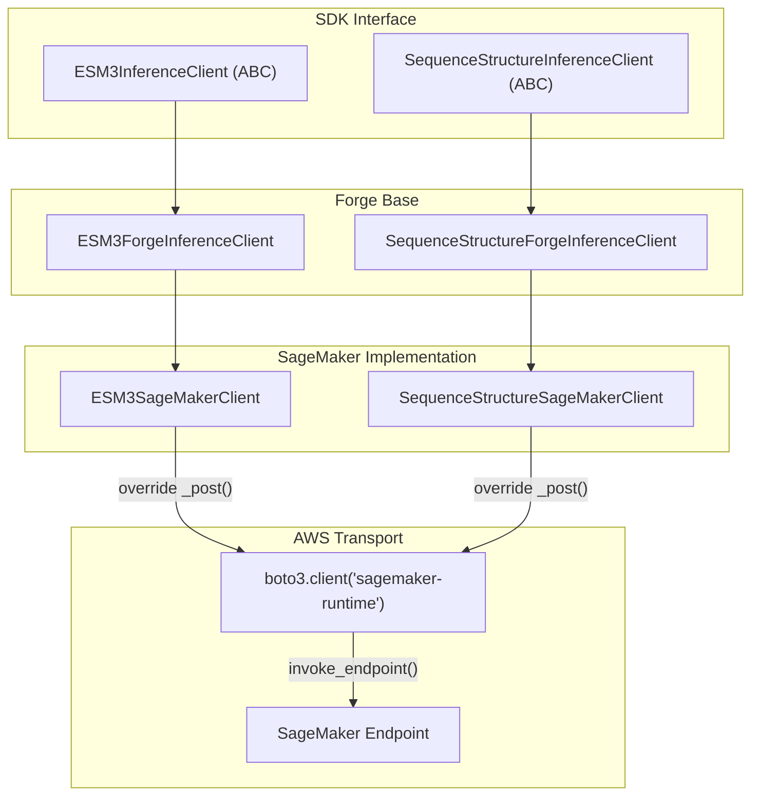
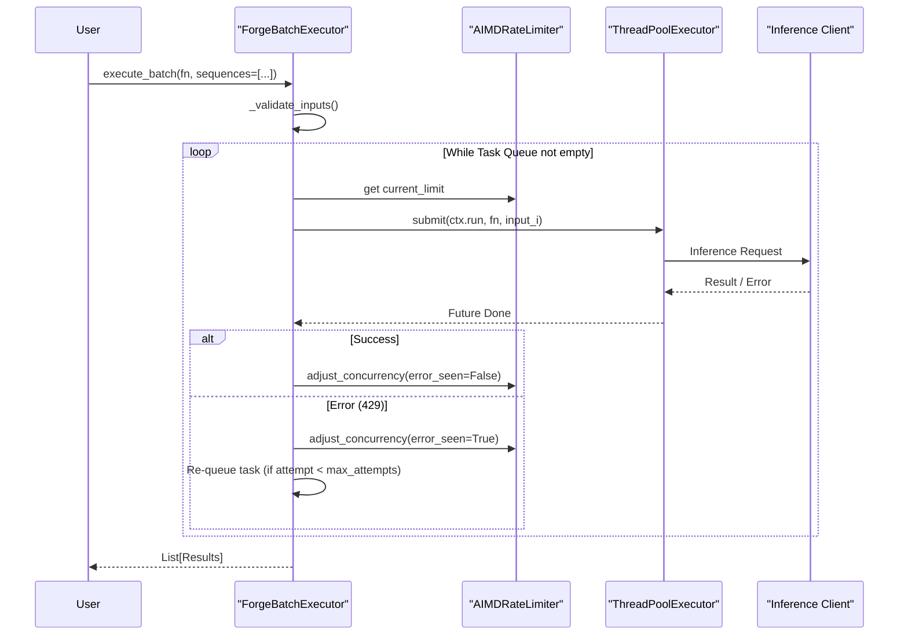

# SageMaker & Alternative Backends

<details>
<summary>Relevant source files</summary>

The following files were used as context for generating this wiki page:

- [esm/sdk/forge.py](esm/sdk/forge.py)
- [esm/sdk/sagemaker.py](esm/sdk/sagemaker.py)

</details>


This page documents the SageMaker-specific client implementations and the batch execution utilities designed to handle remote inference outside of the standard Biohub Forge platform. It covers the `ESM3SageMakerClient` and `SequenceStructureSageMakerClient`, their integration with AWS `boto3`, and the `ForgeBatchExecutor` for managed concurrency and rate limiting.

## Overview of SageMaker Clients

The SageMaker clients are specialized subclasses of the Forge clients that redirect inference requests to AWS SageMaker endpoints. Instead of using HTTP requests via `httpx`, these clients use the `boto3` SDK to invoke model endpoints hosted on AWS infrastructure [esm/sdk/sagemaker.py:11-23]().

### Client Inheritance and Data Flow

The following diagram illustrates how the SageMaker clients wrap the existing Forge client logic while overriding the transport layer (`_post` method).

**SageMaker Client Architecture**



Sources: [esm/sdk/sagemaker.py:11-120](), [esm/sdk/forge.py:1-15]()

## SageMaker Implementation Details

### Request Wrapping and Compatibility
To ensure compatibility with model servers designed for the Biohub Platform, the SageMaker clients wrap the standard request payload into an `invocations_request` dictionary [esm/sdk/sagemaker.py:28-38](). This wrapper includes metadata fields that the Forge platform usually provides:

| Field | Description | Source |
| :--- | :--- | :--- |
| `model` | The name of the model being targeted. | [esm/sdk/sagemaker.py:30]() |
| `api_ver` | Hardcoded to "v1". | [esm/sdk/sagemaker.py:34]() |
| `endpoint` | The specific API function (e.g., `generate`, `fold`). | [esm/sdk/sagemaker.py:35]() |
| `request_id` | Empty string (Forge-specific field). | [esm/sdk/sagemaker.py:31]() |
| `user_id` | Empty string (Forge-specific field). | [esm/sdk/sagemaker.py:32]() |

### The `_post` Method
The `_post` method in `ESM3SageMakerClient` and `SequenceStructureSageMakerClient` performs the following sequence:
1.  Sets the `potential_sequence_of_concern` flag [esm/sdk/sagemaker.py:26]().
2.  Wraps the request into the `invocations_request` format [esm/sdk/sagemaker.py:28-38]().
3.  Calls `self._boto3_client.invoke_endpoint` with `ContentType="application/json"` [esm/sdk/sagemaker.py:41-45]().
4.  Parses the JSON response and extracts the data nested under the endpoint key [esm/sdk/sagemaker.py:49-57]().

In `ESM3SageMakerClient`, an additional `CustomAttributes` string is passed to handle `return_bytes` flags for optimized data transfer [esm/sdk/sagemaker.py:86-107]().

Sources: [esm/sdk/sagemaker.py:25-60](), [esm/sdk/sagemaker.py:78-119]()

## Batch Execution & Rate Limiting

The `ForgeBatchExecutor` is a utility designed to handle large-scale inference tasks across any client implementing the inference interface. It manages a `ThreadPoolExecutor` and implements an Additive Increase/Multiplicative Decrease (AIMD) rate limiting strategy to handle remote endpoint pressure.

### AIMD Rate Limiter
The `AIMDRateLimiter` adjusts the number of concurrent requests based on the success or failure of previous calls [esm/sdk/base_forge_client.py:100-127]().
-   **Success**: Concurrency increases by `step_up` (default 1) until `max_concurrency` is reached [esm/sdk/base_forge_client.py:123-125]().
-   **Failure (Rate Limit)**: If a 429 error (Too Many Requests) is detected, concurrency is halved [esm/sdk/base_forge_client.py:121]().

### Batch Execution Workflow
The `execute_batch` method allows users to pass lists of inputs to a function. The executor automatically handles task queuing and retries [esm/sdk/base_forge_client.py:130-200]().

**Batch Execution Data Flow**



Sources: [esm/sdk/base_forge_client.py:130-200](), [esm/sdk/base_forge_client.py:100-127]()

## Usage Example

The `batch_executor` is typically used in conjunction with a client to perform tasks like computing pseudoperplexity for a library of sequences.

```python
from esm.sdk import esmc_client, batch_executor
from esm.sdk.api import ESMProtein

client = esmc_client(token="your_key")

def get_logits(client, sequence):
    protein = ESMProtein(sequence=sequence)
    tensor = client.encode(protein)
    return client.logits(tensor)

sequences = ["MKTLL...", "ASDFG...", ...]

with batch_executor(max_attempts=5) as executor:
    results = executor.execute_batch(get_logits, client=client, sequence=sequences)
```

Sources: [cookbook/snippets/esmc.py:78-127]()

## Key Classes and Functions

| Entity | Role | File |
| :--- | :--- | :--- |
| `ESM3SageMakerClient` | ESM3 client using boto3 transport. | [esm/sdk/sagemaker.py:62]() |
| `SequenceStructureSageMakerClient` | Folding/Inverse Folding client using boto3 transport. | [esm/sdk/sagemaker.py:11]() |
| `ForgeBatchExecutor` | Context manager for concurrent, rate-limited batch calls. | [esm/sdk/base_forge_client.py:130]() |
| `AIMDRateLimiter` | Logic for dynamic concurrency adjustment. | [esm/sdk/base_forge_client.py:100]() |
| `batch_executor` | Factory function for `ForgeBatchExecutor`. | [esm/sdk/base_forge_client.py:203]() |

Sources: [esm/sdk/sagemaker.py:1-120](), [esm/sdk/base_forge_client.py:1-205]()

---