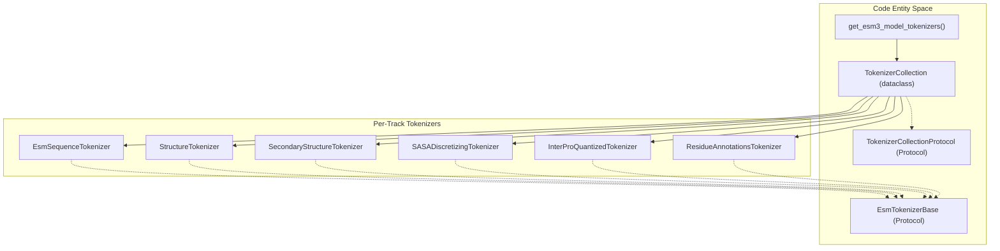
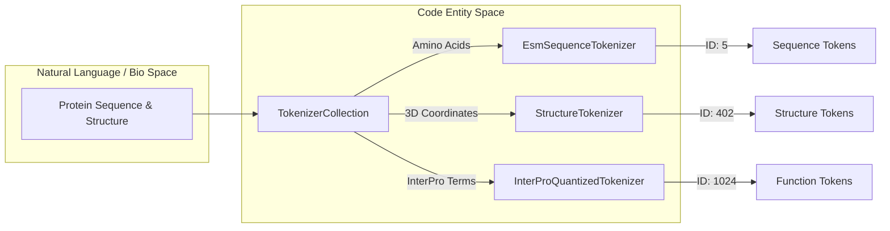

# Tokenization System

Relevant source files

The following files were used as context for generating this wiki page:

- [esm/models/vqvae.py](esm/models/vqvae.py)
- [esm/tokenization/__init__.py](esm/tokenization/__init__.py)
- [esm/tokenization/tokenizer_base.py](esm/tokenization/tokenizer_base.py)

The ESM repository utilizes a multi-track tokenization architecture to represent proteins across different modalities. Instead of a single sequence-based tokenizer, the system employs a collection of specialized tokenizers that handle sequence, structure, secondary structure, solvent accessibility (SASA), and functional annotations. This modularity allows ESM3 to process and generate multimodal protein data in a unified latent space.

The core of this system is defined in `esm/tokenization/__init__.py`, which provides the `TokenizerCollection` and the `TokenizerCollectionProtocol` to manage these tracks.

### Multi-Track Architecture

The `TokenizerCollection` aggregates the specific tokenizers required for the model's various input tracks. For ESM3 models, the `get_esm3_model_tokenizers` function initializes a complete set of these tokenizers [esm/tokenization/__init__.py:34-43]().

| Track | Tokenizer Class | Responsibility |
| :--- | :--- | :--- |
| **Sequence** | `EsmSequenceTokenizer` | Amino acid sequences and special tokens like chain breaks [esm/tokenization/sequence_tokenizer.py:10](). |
| **Structure** | `StructureTokenizer` | VQ-VAE based structural tokens [esm/tokenization/__init__.py:17](). |
| **Secondary Structure** | `SecondaryStructureTokenizer` | SS8 or SS3 classification [esm/tokenization/__init__.py:18](). |
| **SASA** | `SASADiscretizingTokenizer` | Discretized solvent accessibility bins [esm/tokenization/__init__.py:19](). |
| **Function** | `InterProQuantizedTokenizer` | LSH-quantized functional annotations [esm/tokenization/__init__.py:20](). |
| **Residue** | `ResidueAnnotationsTokenizer` | Per-residue specific annotations [esm/tokenization/__init__.py:21](). |

### Code Entity Relationship: Tokenizer Protocols

The system relies on structural typing via Python `Protocols` to ensure consistency across different tokenizer implementations. The `EsmTokenizerBase` defines the standard interface for special tokens (mask, bos, eos, pad) and the fundamental `encode`/`decode` methods [esm/tokenization/tokenizer_base.py:5-26]().

**Tokenizer Collection Registry**

**Sources:** [esm/tokenization/__init__.py:15-32](), [esm/tokenization/tokenizer_base.py:5-26]()

### Sequence Tokenization
The `EsmSequenceTokenizer` is a character-level tokenizer built on the HuggingFace `tokenizers` library using a Byte-Pair Encoding (BPE) model with no merges [esm/tokenization/sequence_tokenizer.py:10-32](). It handles the standard 20 amino acids plus special tokens:
* `<cls>`: Start of sequence [esm/tokenization/sequence_tokenizer.py:49]().
* `<eos>`: End of sequence [esm/tokenization/sequence_tokenizer.py:49]().
* `|`: Chain break token for multi-chain proteins [esm/tokenization/sequence_tokenizer.py:24]().
* `<mask|pad|unk>`: Standard MLM tokens.

For details, see [Sequence & Secondary Structure Tokenizers](#5.1).

### Structural & Functional Tracks
While the sequence track uses standard NLP-style tokenization, other tracks use specialized discretization:
* **Structure:** Uses a VQ-VAE to map 3D coordinates into discrete tokens. The `StructureTokenEncoder` [esm/models/vqvae.py:179]() is responsible for encoding local structure into these tokens.
* **Function:** Uses Locality-Sensitive Hashing (LSH) to quantize InterPro functional annotations into a depth-8 hierarchical encoding.

For details, see [Function & Residue Annotation Tokenizers](#5.2).

### Token Management Utilities
The system includes utility functions to handle special token IDs across different tracks. For instance, `get_invalid_tokenizer_ids` retrieves tokens that should typically be excluded from sampling or loss calculations (mask, pad, cls, eos) [esm/tokenization/__init__.py:52-66]().

**Data Flow: From Protein to Multi-Track Tokens**

**Sources:** [esm/tokenization/__init__.py:34-43](), [esm/tokenization/sequence_tokenizer.py:17-43]()

---
**Child Pages:**
* [Sequence & Secondary Structure Tokenizers](#5.1)
* [Function & Residue Annotation Tokenizers](#5.2)

---