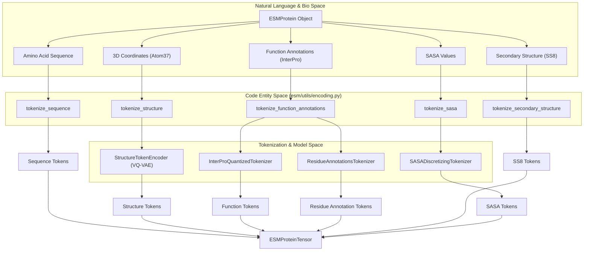
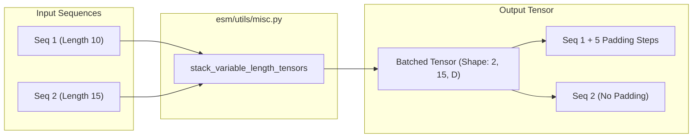

# Encoding Proteins into Tensors

Relevant source files

The following files were used as context for generating this wiki page:

- [esm/layers/attention.py](esm/layers/attention.py)
- [esm/utils/encoding.py](esm/utils/encoding.py)
- [esm/utils/generation.py](esm/utils/generation.py)
- [esm/utils/misc.py](esm/utils/misc.py)

This page documents the technical process of transforming high-level protein representations (sequence, structure, annotations) into the tensor formats required by ESM models. This pipeline involves tokenization across multiple tracks, coordinate handling, and the addition of special tokens (BOS/EOS) to facilitate multimodal transformer processing.

## Overview of the Encoding Pipeline

The encoding process bridges the gap between the `ESMProtein` SDK object and the `ESMProteinTensor` representation. Each biological "track" (Sequence, Structure, Secondary Structure, SASA, Function) is processed by its respective tokenizer or encoder.

### Data Flow: Protein to Tensor

The following diagram illustrates how different protein attributes are routed through specific code entities to produce the final tensorized representation.

**Diagram: ESMProtein to ESMProteinTensor Data Flow**

**Sources:** [esm/utils/encoding.py:35-152](), [esm/sdk/api.py:1-50]()

---

## Structural Encoding

Structure encoding is the most complex part of the pipeline, as it involves converting continuous 3D coordinates into discrete tokens using a pre-trained VQ-VAE.

### `tokenize_structure`
The `tokenize_structure` function converts raw coordinates into structural tokens and processed coordinate tensors [esm/utils/encoding.py:48-54]().
1.  **Coordinate Preparation**: It uses `ProteinChain.from_atom37` to standardize input coordinates [esm/utils/encoding.py:56-58]().
2.  **VQ-VAE Encoding**: The `StructureTokenEncoder` processes the coordinates and residue indices to produce discrete `structure_tokens` [esm/utils/encoding.py:77-79]().
3.  **Padding and Special Tokens**: If `add_special_tokens` is True, the function pads coordinates with `inf` and structure tokens with `mask_token_id`. It then explicitly sets the first and last tokens to `bos_token_id` and `eos_token_id` respectively [esm/utils/encoding.py:85-96]().

**Sources:** [esm/utils/encoding.py:48-97](), [esm/models/vqvae.py:1-50]()

---

## Function and Residue Annotation Encoding

Function annotations are encoded into two distinct tracks: one for high-level InterPro/TF-IDF keywords and another for site-specific residue annotations.

### `encode_function_annotations`
Located in `esm/utils/function/encode_decode.py`, this function performs the following steps:
1.  **Validation**: Ensures annotation indices are 1-indexed and inclusive within the sequence length [esm/utils/function/encode_decode.py:27-30]().
2.  **Label Sorting**: Iterates through `FunctionAnnotation` objects to determine if they belong to `InterProQuantizedTokenizer` (keywords/IPR terms) or `ResidueAnnotationsTokenizer` (site-specific labels) [esm/utils/function/encode_decode.py:34-49]().
3.  **Tokenization**:
    *   `ft_annotations` are passed to the function tokenizer to create a `(length, depth)` tensor [esm/utils/function/encode_decode.py:54-59]().
    *   `ra_annotations` are processed into residue annotation IDs [esm/utils/function/encode_decode.py:62-79]().

**Sources:** [esm/utils/function/encode_decode.py:13-81](), [esm/tokenization/function_tokenizer.py:1-50]()

---

## Default Token Generation

When specific tracks are missing (e.g., in unconditional generation or when only a sequence is provided), the system generates "default" tokens consisting of mask tokens bounded by BOS and EOS markers.

| Helper Function | Track | Logic |
| :--- | :--- | :--- |
| `get_default_sequence_tokens` | Sequence | `[BOS] + [MASK] * L + [EOS]` [esm/utils/encoding.py:156-169]() |
| `get_default_structure_tokens` | Structure | `[BOS] + [MASK] * L + [EOS]` [esm/utils/encoding.py:172-182]() |
| `get_default_secondary_structure_tokens` | SS8 | `[BOS] + [MASK] * L + [EOS]` [esm/utils/encoding.py:185-194]() |
| `get_default_sasa_tokens` | SASA | `[BOS] + [MASK] * L + [EOS]` [esm/utils/encoding.py:197-206]() |

**Sources:** [esm/utils/encoding.py:156-206]()

---

## Tensor Concatenation and Padding

The final step of encoding involves assembling the individual track tensors into a single batch.

### `stack_variable_length_tensors`
This utility handles the creation of batches from proteins of different lengths.
*   **Logic**: It determines the maximum dimensions across the batch and pads shorter sequences with a `constant_value` (usually 0 or a specific pad token) [esm/utils/misc.py:180-209]().
*   **Data Flow**: `[L1, D], [L2, D] -> [Batch, Max_L, D]` [esm/utils/misc.py:193-195]().

**Diagram: Batch Tensor Construction**

**Sources:** [esm/utils/misc.py:180-209]()

---

## Key Utility Functions

*   **`rbf`**: Computes Radial Basis Function encodings for distances, used in geometric featurization [esm/utils/misc.py:105-115]().
*   **`knn_graph`**: Constructs a K-Nearest Neighbors graph based on 3D coordinates, with fallbacks to sequence distance when coordinates are missing or masked [esm/utils/misc.py:135-177]().
*   **`slice_any_object`**: A polymorphic slicer that handles lists, strings, numpy arrays, and torch tensors uniformly, essential for manipulating protein fragments during encoding [esm/utils/misc.py:74-102]().

**Sources:** [esm/utils/misc.py:74-177]()

---