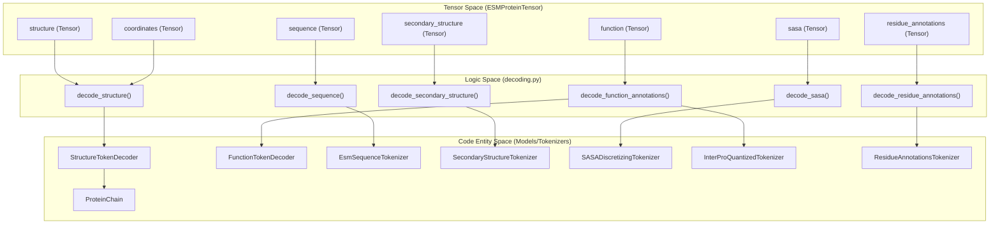
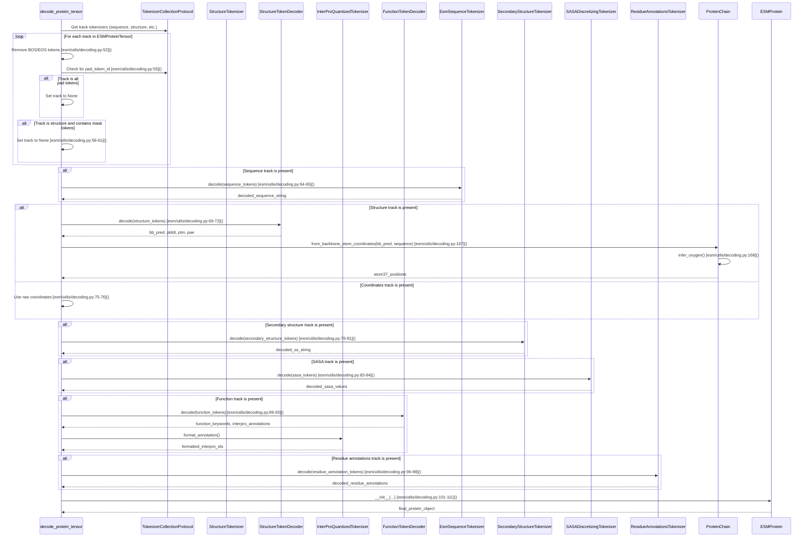

# Decoding Tensors Back to Proteins

Relevant source files

The following files were used as context for generating this wiki page:

- [esm/utils/decoding.py](esm/utils/decoding.py)
- [esm/utils/sampling.py](esm/utils/sampling.py)

The decoding pipeline is the inverse of the tokenization process, transforming discrete multi-track tensors back into human-readable protein representations. This process involves structural reconstruction from VQ-VAE latent codes, merging hierarchical function annotations, and extracting confidence metrics such as pLDDT and PAE.

## The Decoding Lifecycle

The primary entry point for this process is `decode_protein_tensor` [esm/utils/decoding.py:31-36](). This function orchestrates the conversion of an `ESMProteinTensor`—which contains tokenized tracks for sequence, structure, SASA, secondary structure, and function—into a rich `ESMProtein` object [esm/utils/decoding.py:101-111]().

### Data Flow and Entity Mapping

The following diagram illustrates how the decoding functions map to the specific components of the `ESMProteinTensor` and which model entities are responsible for the transformation.

**Tensor to Protein Entity Mapping**

**Sources:** [esm/utils/decoding.py:31-111](), [esm/utils/function/encode_decode.py:84-133]()

---

## Structural Reconstruction

Structural decoding is the most complex part of the pipeline, as it involves converting discrete indices back into 3D atomic coordinates.

### StructureTokenDecoder and Oxygen Inference
The `decode_structure` function [esm/utils/decoding.py:138-143]() takes structural tokens and passes them to the `StructureTokenDecoder` [esm/utils/decoding.py:153]().
1. **Backbone Prediction**: The decoder returns backbone coordinates (`bb_pred`) for N, CA, and C atoms [esm/utils/decoding.py:154-156]().
2. **Chain Assembly**: These coordinates are used to initialize a `ProteinChain` via `from_backbone_atom_coordinates` [esm/utils/decoding.py:167]().
3. **Oxygen Inference**: Since the VQ-VAE primarily handles backbone tokens, the carbonyl oxygen (O) positions are geometrically inferred using `chain.infer_oxygen()` [esm/utils/decoding.py:168]().
4. **Final Representation**: The result is a full Atom37 tensor representing the reconstructed backbone [esm/utils/decoding.py:169]().

### Confidence Metrics Extraction
During the decoding of the structure track, the model also provides estimates of its own prediction quality:
* **pLDDT**: Extracted from the decoder output and stripped of BOS/EOS tokens [esm/utils/decoding.py:159-161]().
* **pTM & PAE**: Extracted directly from the decoder's auxiliary heads if available [esm/utils/decoding.py:163-165]().

**Sources:** [esm/utils/decoding.py:138-171](), [esm/utils/structure/protein_chain.py:56-58]()

---

## Function and Residue Annotation Decoding

Function decoding merges two distinct types of data: global/domain-level InterPro annotations and site-specific residue annotations.

### InterPro and Keyword Merging
The `decode_function_annotations` function [esm/utils/decoding.py:89-93]() (which internally calls `decode_function_tokens` [esm/utils/function/encode_decode.py:84-91]()) uses the `FunctionTokenDecoder` to process predicted logits:
1. **Keyword Extraction**: It retrieves predicted function keywords from the decoder [esm/utils/function/encode_decode.py:125]().
2. **InterPro Formatting**: InterPro annotations are decoded and formatted back into standard IPR identifiers (e.g., "IPR001234") using the `InterProQuantizedTokenizer.format_annotation` method [esm/utils/function/encode_decode.py:126-132]().

### Residue Annotation Processing
Residue-level annotations (like active sites or binding regions) are decoded via `decode_residue_annotations` [esm/utils/decoding.py:96-98]() (which internally calls `decode_residue_annotation_tokens` [esm/utils/function/encode_decode.py:136-141]()).
* **Depth Traversal**: The function iterates through the multi-track residue annotation tensor (up to `MAX_RESIDUE_ANNOTATIONS` [esm/utils/sampling.py:12]()) [esm/utils/function/encode_decode.py:158]().
* **Label Mapping**: Token IDs are mapped back to labels using the `ResidueAnnotationsTokenizer.vocabulary` [esm/utils/function/encode_decode.py:164-165]().
* **Merging**: Contiguous residue predictions of the same type are merged into single `FunctionAnnotation` objects using `merge_annotations` [esm/utils/function/encode_decode.py:170]().

**Sources:** [esm/utils/function/encode_decode.py:84-180](), [esm/utils/decoding.py:89-99](), [esm/utils/sampling.py:12]()

---

## Handling Special Tokens and Padding

A critical step in decoding is the removal of structural markers used during model inference.

| Step | Logic | File Reference |
| :--- | :--- | :--- |
| **BOS/EOS Removal** | Slices tokens using `tokens[1:-1]` to remove Start/End markers. | [esm/utils/decoding.py:52]() |
| **Mask Detection** | If a track contains mask tokens, it is treated as `None` to prevent invalid decoding. | [esm/utils/decoding.py:58-61]() |
| **Pad Cleanup** | If a track consists entirely of pad tokens, it is discarded. | [esm/utils/decoding.py:55-56]() |
| **Sequence Cleanup** | Removes whitespace and converts internal mask strings to short format. | [esm/utils/decoding.py:130-131]() |

### Tokenizer Interaction Diagram
This diagram shows how `decode_protein_tensor` interacts with the various tokenizer classes to perform its duties.

**Decoding Interaction Diagram**

**Sources:** [esm/utils/decoding.py:31-111](), [esm/utils/encoding.py:156-182]()

---