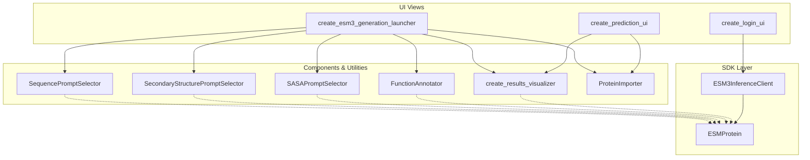
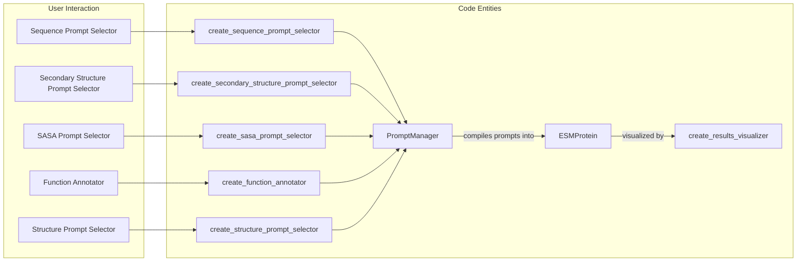

# Jupyter Widgets & Interactive UI

Relevant source files

The following files were used as context for generating this wiki page:

- [esm/widgets/components/results_visualizer.py](esm/widgets/components/results_visualizer.py)
- [esm/widgets/components/secondary_structure_prompt_selector.py](esm/widgets/components/secondary_structure_prompt_selector.py)
- [esm/widgets/components/sequence_prompt_selector.py](esm/widgets/components/sequence_prompt_selector.py)
- [esm/widgets/utils/clients.py](esm/widgets/utils/clients.py)
- [esm/widgets/views/esm3_generation_launcher.py](esm/widgets/views/esm3_generation_launcher.py)
- [esm/widgets/views/login.py](esm/widgets/views/login.py)
- [esm/widgets/views/prediction.py](esm/widgets/views/prediction.py)

The `esm.widgets` package provides a comprehensive set of Jupyter-based interactive components for interacting with ESM3 and ESMC models. These widgets facilitate complex tasks such as multi-track protein generation, property prediction, and high-quality 3D visualization directly within a notebook environment. The UI bridges the gap between high-level design intentions (e.g., "design a protein with this motif and this function") and the underlying SDK and model calls.

## System Architecture Overview

The interactive UI is built on `ipywidgets` and follows a modular pattern where views orchestrate specialized components. It interacts with the `ESM3InferenceClient` and `ESMCInferenceClient` to perform computations either locally or via the Biohub Forge platform.

### Component Relationship Diagram
This diagram illustrates how high-level UI views utilize components and SDK clients to process protein data.

**Sources:** [esm/widgets/views/esm3_generation_launcher.py:21-122](), [esm/widgets/views/prediction.py:14-41](), [esm/widgets/views/login.py:11-49]()

## Authentication & Client Initialization
Before performing inference, users must initialize a client. The UI provides a unified login interface that handles:
*   **Inference Options:** Choosing between the remote **Forge/Biohub Platform API** (full model access) or **Local** execution (supports `esm3-sm-open-v1`) [esm/widgets/views/login.py:17-24]().
*   **Token Management:** Input and persistence of `ESM_API_KEY` via environment variables [esm/widgets/views/login.py:107-112]().
*   **Client Factory:** Using `get_forge_client` or `get_local_client` to instantiate the appropriate `ESM3InferenceClient` [esm/widgets/views/login.py:143-148]().

For details, see [Authentication & Client Initialization Widgets](#8.1).

**Sources:** [esm/widgets/views/login.py:11-170](), [esm/widgets/utils/clients.py:7-8]()

## Generation & Prediction Views
The UI supports two primary workflows for protein engineering:

### 1. Multimodal Generation
The generation view allows users to "compile" a prompt by specifying a target length and adding constraints across multiple tracks (sequence, structure, function). 
*   **Generation Launcher:** The `create_esm3_generation_launcher` function orchestrates `batch_generate` calls with configurable `GenerationConfig` parameters like `temperature`, `top_p`, and `num_steps` [esm/widgets/views/esm3_generation_launcher.py:54-101]().
*   **Iterative Design:** Users can copy generated results back into the prompt for iterative refinement [esm/widgets/views/esm3_generation_launcher.py:206-212]().

### 2. Sequential Prediction
The `create_prediction_ui` function focuses on a "one-to-many" track pipeline. Given a sequence or structure, it sequentially predicts all other modalities (Structure -> SS8 -> SASA -> Function) using the `client.generate` interface [esm/widgets/views/prediction.py:89-101]().

For details, see [Generation, Prediction & Inverse Folding Views](#8.2).

**Sources:** [esm/widgets/views/esm3_generation_launcher.py:21-122](), [esm/widgets/views/prediction.py:14-160]()

## Prompt Selectors & Results Visualizer
These components handle the data entry and result inspection for `ESMProtein` objects.

### Interactive Data Mapping
This diagram shows how UI components map user interactions to specific `ESMProtein` fields and SDK operations.

**Sources:** [esm/widgets/components/sequence_prompt_selector.py:12-20](), [esm/widgets/components/secondary_structure_prompt_selector.py:13-21](), [esm/widgets/components/results_visualizer.py:21-43]()

### Key Components:
*   **Prompt Selectors:** Components like `create_sequence_prompt_selector` [esm/widgets/components/sequence_prompt_selector.py:12-20]() and `create_secondary_structure_prompt_selector` [esm/widgets/components/secondary_structure_prompt_selector.py:13-21]() allow users to define constraints on specific regions of a protein. These selectors manage ranges and values, often using a `PromptManager` [esm/widgets/utils/prompting.py:11-12]() to collect and organize user inputs.
*   **Function Annotator:** Uses a `pygtrie` to provide auto-suggestions for InterPro tags and TF-IDF keywords, allowing users to apply labels to specific residue ranges.
*   **Results Visualizer:** The `create_results_visualizer` function is a dispatching component that renders generated proteins based on modality [esm/widgets/components/results_visualizer.py:21-43](). It includes 3D structure visualization (colored by pLDDT), sequence alignment views, and SASA/SS8 charts. The `draw_function_annotations` [esm/widgets/utils/drawing/draw_function_annotations.py:11-13]() and `draw_protein_structure` [esm/widgets/utils/drawing/draw_protein_structure.py:11-13]() utilities are used for rendering.
*   **Protein Importer:** A utility for loading reference proteins from PDB IDs or local files to serve as templates for motifs.

For details, see [Prompt Selectors & Results Visualizer](#8.3).

**Sources:** [esm/widgets/components/results_visualizer.py:21-132](), [esm/widgets/utils/drawing/draw_function_annotations.py:11-13](), [esm/widgets/utils/drawing/draw_protein_structure.py:11-13]()

---