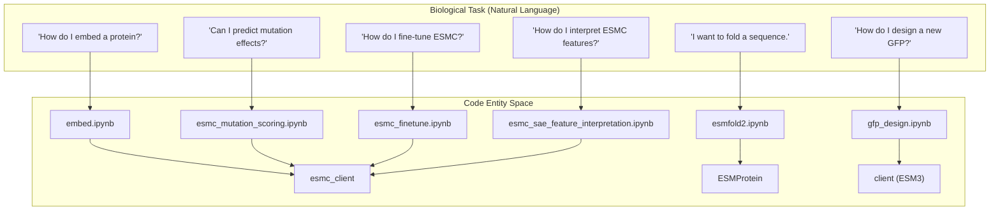

# Cookbook & Tutorials

Relevant source files

The following files were used as context for generating this wiki page:

- [cookbook/local/open_generate.ipynb](cookbook/local/open_generate.ipynb)
- [cookbook/tutorials/README.md](cookbook/tutorials/README.md)
- [cookbook/tutorials/binder_design.py](cookbook/tutorials/binder_design.py)
- [cookbook/tutorials/esmc_finetune.ipynb](cookbook/tutorials/esmc_finetune.ipynb)

The ESM repository provides a comprehensive collection of tutorials, example scripts, and code snippets designed to guide users through the capabilities of the ESMC, ESM3, and ESMFold2 model families. These resources are organized into the `cookbook/` directory, offering both high-level Jupyter notebooks for interactive exploration and low-level Python scripts for local inference.

## Overview of Resources

The documentation and examples are split into two primary categories based on the model family and the complexity of the task.

| Category | Description | Key Components |
| :--- | :--- | :--- |
| **ESMC Tutorials** | Focused on sequence-only tasks using the Evolutionary-Scale Masked Carbon (ESMC) models. | Embeddings, mutation scoring, layer sweeps, and Sparse Autoencoders (SAE). |
| **ESM3 & ESMFold2** | Multimodal generation and structural prediction tasks. | Joint sequence/structure/function design, folding, and guided generation. |
| **Local Inference** | Scripts for running models on local hardware without the Biohub API. | Raw forward passes, inverse folding, and decoding logic. |

### From Natural Language to Code: Tutorial Entry Points

The following diagram maps common biological tasks to the specific code entities and notebooks that implement them.

**Task-to-Code Mapping**

Sources: [cookbook/tutorials/embed.ipynb:1-10](), [cookbook/tutorials/esmc_mutation_scoring.ipynb:10-25](), [cookbook/tutorials/gfp_design.ipynb:9-21](), [cookbook/tutorials/esmfold2.ipynb:1-10](), [cookbook/tutorials/esmc_finetune.ipynb:1-12](), [cookbook/tutorials/esmc_sae_feature_interpretation.ipynb:1-10]()

---

## ESMC Tutorials

The ESMC (Evolutionary-Scale Masked Carbon) series focuses on efficient sequence representation. These tutorials demonstrate how to use the `esmc_client` [esm/sdk/api.py:64-67]() to interact with models like `esmc-300m`, `esmc-600m`, and `esmc-6b`.

Key workflows include:
*   **Sequence Embedding**: Using `LogitsConfig` to extract hidden states and mean-pooled representations [cookbook/tutorials/embed.ipynb:84-96]().
*   **Zero-Shot Analysis**: Computing per-position entropy and Log-Likelihood Ratios (LLRs) to identify mutation tolerance in enzymes like PETase [cookbook/tutorials/esmc_mutation_scoring.ipynb:41-52]().
*   **Layer Sweeps**: Identifying the optimal transformer layer for specific tasks (e.g., enzyme classification) rather than defaulting to the final layer [cookbook/tutorials/esmc_layer_sweep.ipynb:10-15]().
*   **Fine-tuning**: Demonstrating Parameter Efficient Fine-tuning (PEFT) with LoRA for classification or regression tasks on top of ESMC [cookbook/tutorials/esmc_finetune.ipynb:1-12]().
*   **Advanced Interpretability**: Using Sparse Autoencoders (SAE) via `SAEConfig` to extract interpretable features from the model's latent space [cookbook/tutorials/esmc_sae_feature_interpretation.ipynb:1-10]().

For detailed walkthroughs, see [ESMC Tutorials](#9.1).

Sources: [cookbook/tutorials/embed.ipynb:1-10](), [cookbook/tutorials/esmc_layer_sweep.ipynb:8-15](), [cookbook/tutorials/esmc_mutation_scoring.ipynb:10-25](), [cookbook/tutorials/esmc_finetune.ipynb:1-12](), [cookbook/tutorials/esmc_sae_feature_interpretation.ipynb:1-10]()

---

## ESM3 & ESMFold2 Tutorials

ESM3 is a multimodal model reasoning across sequence, structure, and function tracks [cookbook/local/open_generate.ipynb:7-9](). These tutorials utilize the standard `client` factory and the `ESMProtein` data class [esm/sdk/api.py:41-43]().

Key workflows include:
*   **Understanding `ESMProtein`**: Familiarizing with the `ESMProtein` class for representing proteins, including its `sequence` and `atom37_positions` attributes [cookbook/tutorials/esmprotein.ipynb:7-11]().
*   **Multimodal Prompting**: Constructing prompts using partial sequences, coordinates, or InterPro function annotations [cookbook/tutorials/esmprotein.ipynb:23-32]().
*   **Generative Design**: A case study on designing a Green Fluorescent Protein (GFP) candidate using chain-of-thought prompting [cookbook/tutorials/gfp_design.ipynb:9-21]().
*   **Guided Generation**: Implementing custom `GuidedDecodingScoringFunction` classes to optimize for metrics like pTM or specific biophysical properties [cookbook/tutorials/esm3_guided_generation.ipynb:7-17]().
*   **Structure Prediction**: Utilizing ESMFold2 for high-accuracy atomic coordinate prediction, including multi-chain complexes and ligands [cookbook/tutorials/esmfold2.ipynb:1-10]().
*   **Binder Design**: A detailed example of designing antibodies and minibinders with ESMFold2 and ESMC, implementing the protocol from the paper "Language Modeling Materializes a World Model of Protein Biology" [cookbook/tutorials/binder_design.py:10-13]().

For detailed walkthroughs, see [ESM3 & ESMFold2 Tutorials](#9.2).

Sources: [cookbook/tutorials/esmprotein.ipynb:7-32](), [cookbook/tutorials/gfp_design.ipynb:9-21](), [cookbook/tutorials/esm3_guided_generation.ipynb:7-24](), [cookbook/tutorials/esmfold2.ipynb:1-10](), [cookbook/local/open_generate.ipynb:7-9](), [cookbook/tutorials/binder_design.py:10-13]()

---

## Local Inference & Snippets

For users who prefer to run models locally without the Biohub API, the `cookbook/local/` directory provides scripts that interact directly with the model weights using the `esm.models` and `esm.pretrained` modules.

### Inference Pipeline Logic
The following diagram illustrates the local execution flow for structural tasks.

**Local Inference Workflow**

Sources: [cookbook/local/raw_forwards.py:22-46](), [cookbook/local/open_generate.ipynb:60-63]()

**Key Local Scripts:**
*   `raw_forwards.py`: Demonstrates inverse folding by encoding structure with `ESM3_structure_encoder_v0` and predicting sequence with `ESM3_sm_open_v0` [cookbook/local/raw_forwards.py:22-46]().
*   `open_generate.ipynb`: A guide to running the 1.4B parameter `esm3_sm_open_v1` model on local GPUs [cookbook/local/open_generate.ipynb:51-64]().
*   `sae_example.py`: Demonstrates handling sparse tensors and removing special tokens (BOS/EOS) from SAE activations [cookbook/snippets/sae_example.py:8-30]().

Sources: [cookbook/local/raw_forwards.py:6-17](), [cookbook/local/open_generate.ipynb:51-64](), [cookbook/snippets/sae_example.py:8-30]()

---