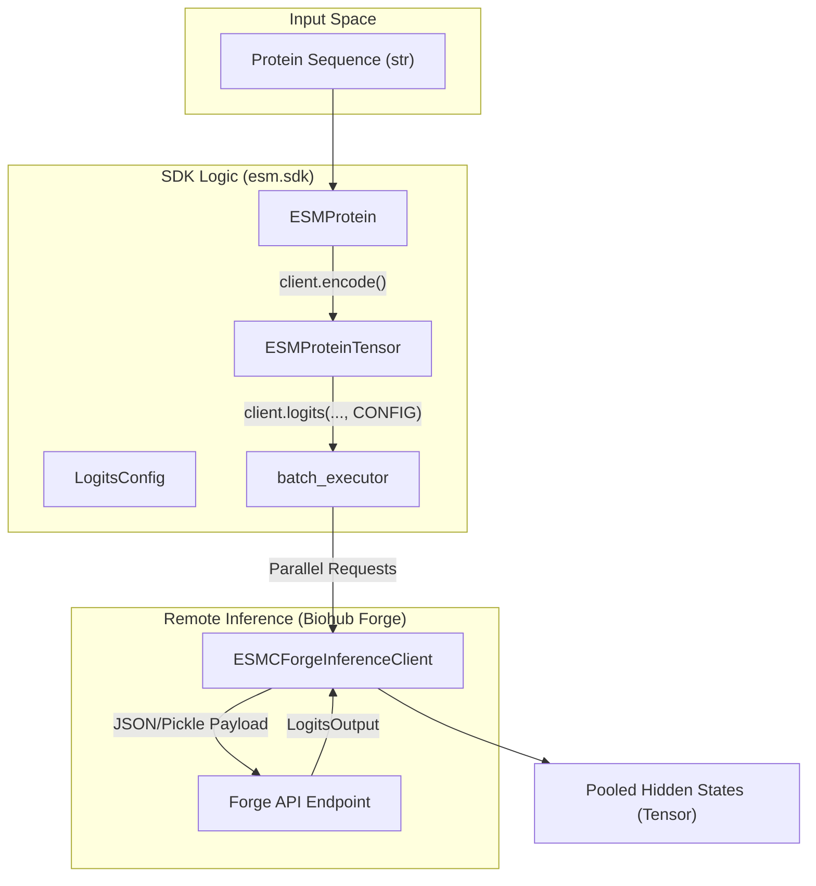
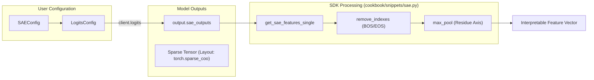

# ESMC Tutorials

Relevant source files

The following files were used as context for generating this wiki page:

- [cookbook/snippets/esmc.py](cookbook/snippets/esmc.py)
- [cookbook/snippets/sae.py](cookbook/snippets/sae.py)
- [cookbook/snippets/sae_example.py](cookbook/snippets/sae_example.py)
- [cookbook/snippets/sparse_utils.py](cookbook/snippets/sparse_utils.py)
- [cookbook/tutorials/README.md](cookbook/tutorials/README.md)
- [cookbook/tutorials/binder_design.py](cookbook/tutorials/binder_design.py)
- [cookbook/tutorials/embed.ipynb](cookbook/tutorials/embed.ipynb)
- [cookbook/tutorials/esmc_finetune.ipynb](cookbook/tutorials/esmc_finetune.ipynb)
- [cookbook/tutorials/esmc_layer_sweep.ipynb](cookbook/tutorials/esmc_layer_sweep.ipynb)
- [cookbook/tutorials/esmc_mutation_scoring.ipynb](cookbook/tutorials/esmc_mutation_scoring.ipynb)
- [cookbook/tutorials/esmc_sae_feature_interpretation.ipynb](cookbook/tutorials/esmc_sae_feature_interpretation.ipynb)
- [esm/models/esmfold2/prepare_input.py](esm/models/esmfold2/prepare_input.py)

This page provides a detailed technical walkthrough of the ESMC (Evolutionary Scale Modeling - Sequence Only) tutorial notebooks. These tutorials demonstrate how to leverage the ESMC model family for sequence embedding, mutational analysis, functional classification, and interpretable feature extraction.

The ESMC model family focuses on sequence-only transformer architectures designed for high-throughput protein representation learning [cookbook/tutorials/esmc_layer_sweep.ipynb:10-15]().

## Sequence Embedding and Hidden State Analysis

The foundational task for ESMC is generating numerical representations (embeddings) from raw protein sequences. The `embed.ipynb` notebook demonstrates how to interface with the Biohub platform to extract these representations.

### Implementation Flow
The embedding process involves three primary steps using the SDK:
1.  **Client Initialization**: Creating an `ESMCInferenceClient` (specifically `ESMCForgeInferenceClient`) using `esmc_client` [cookbook/tutorials/embed.ipynb:64-67]().
2.  **Encoding**: Converting a raw string sequence into an `ESMProtein` object and then an `ESMProteinTensor` [cookbook/tutorials/embed.ipynb:92-94]().
3.  **Logits/Embedding Retrieval**: Calling the `.logits()` method with a `LogitsConfig` that specifies which layers and pooling strategies to return [cookbook/tutorials/embed.ipynb:87-95]().

### Hidden State Strategies
For large models like **ESMC-6B** (80 layers), returning all hidden states for all positions is memory-intensive. The SDK supports two strategies:
*   **Mean-Pooling**: Returning the average hidden state across the sequence for all layers simultaneously [cookbook/tutorials/embed.ipynb:107-108]().
*   **Layer Selection**: Requesting specific layers (e.g., the `ith_hidden_layer`) to reduce payload size [cookbook/tutorials/embed.ipynb:109-111]().

### Data Flow for Sequence Embedding
The following diagram illustrates the flow from a raw sequence to a pooled embedding using the `batch_executor` for efficiency.

**Sequence Embedding Data Flow**

Sources: [cookbook/tutorials/embed.ipynb:84-97](), [cookbook/tutorials/embed.ipynb:120-126]()

---

## Mutation Scoring and Entropy Analysis

The `esmc_mutation_scoring.ipynb` tutorial focuses on zero-shot analysis of protein sequences, specifically using the **PETase** enzyme as a case study [cookbook/tutorials/esmc_mutation_scoring.ipynb:10-15]().

### Key Metrics
1.  **Positional Entropy**: Calculated from the model's predicted probability distribution at a masked position. Low entropy indicates the model is highly certain about the amino acid, suggesting a constrained/conserved site [cookbook/tutorials/esmc_mutation_scoring.ipynb:41-45]().
2.  **Log-Likelihood Ratios (LLRs)**: A comparison of the log-probability of a mutant amino acid ($x_{mut}$) versus the wild-type amino acid ($x_{wt}$):
    $$LLR = \log(P(x_{mut})) - \log(P(x_{wt}))$$
    Positive LLRs suggest the mutation is tolerated or favored by the model's learned evolutionary distribution [cookbook/tutorials/esmc_mutation_scoring.ipynb:48-51]().

### Implementation
The tutorial uses `get_esmc_model_tokenizers()` to access the vocabulary and map model outputs back to amino acid identities [cookbook/tutorials/esmc_mutation_scoring.ipynb:110-111](), [cookbook/tutorials/esmc_mutation_scoring.ipynb:199-201]().

Sources: [cookbook/tutorials/esmc_mutation_scoring.ipynb:30-51](), [cookbook/tutorials/esmc_mutation_scoring.ipynb:196-201]()

---

## Layer Sweeps for Classification

The `esmc_layer_sweep.ipynb` notebook addresses the "optimal layer" problem. Transformers build representations hierarchically, and the final layer is not always the most informative for downstream tasks like Enzyme Commission (EC) classification [cookbook/tutorials/esmc_layer_sweep.ipynb:10-12]().

### Sweep Workflow
1.  **Dataset Preparation**: Fetching curated enzymes (e.g., SwissProt) with EC labels [cookbook/tutorials/esmc_layer_sweep.ipynb:53-55]().
2.  **Multi-Layer Extraction**: Extracting mean-pooled embeddings for all layers of a model (e.g., 36 layers for ESMC-600M) [cookbook/tutorials/esmc_layer_sweep.ipynb:115-117]().
3.  **Linear Probing**: Training a simple `LogisticRegression` classifier on each layer's embeddings using cross-validation [cookbook/tutorials/esmc_layer_sweep.ipynb:92-95]().
4.  **Performance Mapping**: Plotting the Matthews Correlation Coefficient (MCC) against the layer index to find the performance peak [cookbook/tutorials/esmc_layer_sweep.ipynb:51-53]().

### Heuristics for Layer Selection
*   **Functional Properties** (stability, solubility): Recommended second-to-last layer `[-2]` [cookbook/tutorials/esmc_layer_sweep.ipynb:48-48]().
*   **High-level Similarity** (EC numbers, GO terms): Recommended layer ~3/4 of the way through the network [cookbook/tutorials/esmc_layer_sweep.ipynb:49-49]().

Sources: [cookbook/tutorials/esmc_layer_sweep.ipynb:35-55](), [cookbook/tutorials/esmc_layer_sweep.ipynb:85-101]()

---

## Fine-Tuning with PEFT (LoRA)

For tasks where zero-shot or linear probing is insufficient, the `esmc_finetune.ipynb` notebook demonstrates parameter-efficient fine-tuning (PEFT) using **LoRA** (Low-Rank Adaptation) [cookbook/tutorials/esmc_finetune.ipynb:8-11]().

### Integration with HuggingFace
The tutorial utilizes the `ESMCForSequenceClassification` class and the `peft` library [cookbook/tutorials/esmc_finetune.ipynb:40-41](), [cookbook/tutorials/esmc_finetune.ipynb:52-52]().
1.  **LoraConfig**: Defines the rank ($r$), alpha, and target modules (typically attention layers) for adaptation [cookbook/tutorials/esmc_finetune.ipynb:41-41]().
2.  **get_peft_model**: Wraps the base ESMC model with LoRA adapters, drastically reducing the number of trainable parameters [cookbook/tutorials/esmc_finetune.ipynb:41-41]().

Sources: [cookbook/tutorials/esmc_finetune.ipynb:8-12](), [cookbook/tutorials/esmc_finetune.ipynb:36-54]()

---

## SAE Feature Interpretation

The `esmc_sae_feature_interpretation.ipynb` notebook introduces **Sparse Autoencoders (SAEs)** as a tool for mechanistic interpretability [cookbook/tutorials/esmc_sae_feature_interpretation.ipynb:10-13]().

### Top-K SAE Architecture
The ESMC SAEs use a **Top-K** activation strategy:
*   **Expansion**: Dense embeddings (e.g., from ESMC-6B) are expanded into a 16,384-dimensional feature space [cookbook/tutorials/esmc_sae_feature_interpretation.ipynb:22-22]().
*   **Sparsity**: Only the top $k=64$ features are kept active per residue, forcing the model to decompose information into monosemantic "concepts" [cookbook/tutorials/esmc_sae_feature_interpretation.ipynb:20-24]().

### SAE Implementation in SDK
Users request SAE features by passing an `SAEConfig` inside a `LogitsConfig` to the `client.logits()` method [cookbook/snippets/sae.py:24-26]().

**SAE Feature Extraction Logic**

### Interpretation Workflow
1.  **Feature Extraction**: Obtain unpooled features for a protein (e.g., ATP Synthase) [cookbook/tutorials/esmc_sae_feature_interpretation.ipynb:122-126]().
2.  **Peak Identification**: Find features with high activation on specific residues (e.g., Walker A/B motifs) [cookbook/tutorials/esmc_sae_feature_interpretation.ipynb:126-127]().
3.  **Normalization**: Use `normalize_features=True` to down-weight common, non-specific features using TF-IDF-like logic [cookbook/snippets/sae_example.py:15-17]().

Sources: [cookbook/tutorials/esmc_sae_feature_interpretation.ipynb:14-33](), [cookbook/snippets/sae.py:10-41](), [cookbook/snippets/sae_example.py:8-40]()

---