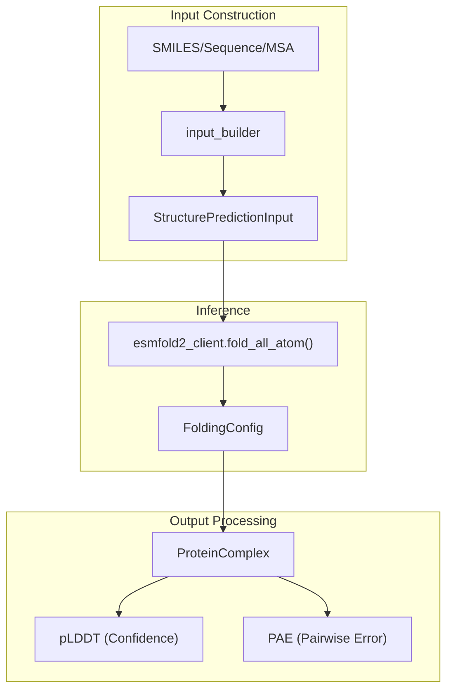
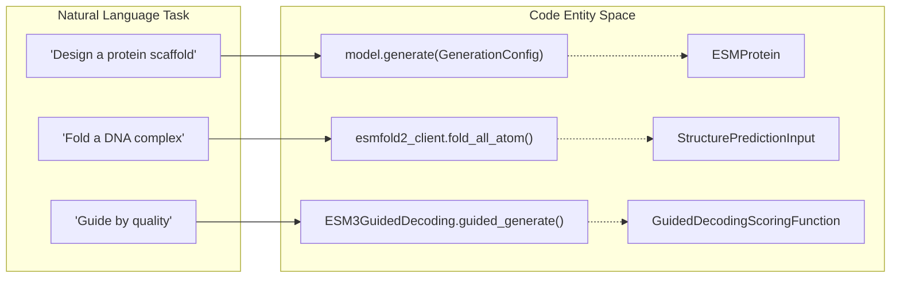

# ESM3 & ESMFold2 Tutorials

<details>
<summary>Relevant source files</summary>

The following files were used as context for generating this wiki page:

- [cookbook/local/open_generate.ipynb](cookbook/local/open_generate.ipynb)
- [cookbook/local/raw_forwards.py](cookbook/local/raw_forwards.py)
- [cookbook/snippets/esm3.py](cookbook/snippets/esm3.py)
- [cookbook/snippets/fold_invfold.py](cookbook/snippets/fold_invfold.py)
- [cookbook/tutorials/esm3_generate.ipynb](cookbook/tutorials/esm3_generate.ipynb)
- [cookbook/tutorials/esm3_guided_generation.ipynb](cookbook/tutorials/esm3_guided_generation.ipynb)
- [cookbook/tutorials/esmfold2.ipynb](cookbook/tutorials/esmfold2.ipynb)
- [cookbook/tutorials/esmprotein.ipynb](cookbook/tutorials/esmprotein.ipynb)
- [cookbook/tutorials/gfp_design.ipynb](cookbook/tutorials/gfp_design.ipynb)

</details>


This page provides a technical walkthrough of the tutorial notebooks for ESM3 and ESMFold2. These tutorials demonstrate the practical application of the multimodal ESM3 generative model and the diffusion-based ESMFold2 structure prediction model. They cover core data structures like `ESMProtein`, generative workflows for protein design, and complex folding tasks involving multiple chains and ligands.

### ESMProtein and Multimodal Tracks

The `ESMProtein` class is the central data structure for ESM3, representing a protein across five promptable tracks: sequence, structure (coordinates), secondary structure (SS8), solvent-accessible surface area (SASA), and function annotations [cookbook/tutorials/esmprotein.ipynb:23-31]().

#### Track Specifications
| Track | Description | Data Representation |
| :--- | :--- | :--- |
| **Sequence** | Amino acid sequence | 1-letter string [cookbook/tutorials/esmprotein.ipynb:101-102]() |
| **Coordinates** | 3D atomic positions | `(N, 37, 3)` tensor (Atom37 format) [cookbook/tutorials/esmprotein.ipynb:121-125]() |
| **SS8** | 8-class secondary structure | DSSP classification codes [cookbook/tutorials/esmprotein.ipynb:27-27]() |
| **SASA** | Solvent accessibility | Discretized surface area values [cookbook/tutorials/esmprotein.ipynb:28-28]() |
| **Function** | InterPro annotations | Quantized function tokens [cookbook/tutorials/esmprotein.ipynb:29-29]()

Users can instantiate `ESMProtein` from existing structures using the `ProteinChain` utility, which supports fetching from RCSB or loading local PDB/mmCIF files [cookbook/tutorials/esmprotein.ipynb:83-94]().

**Sources:** [cookbook/tutorials/esmprotein.ipynb:23-125]()

---

### ESM3 Generative Workflows

ESM3 is a generative masked language model that uses iterative sampling to fill in masked positions across tracks [cookbook/tutorials/esm3_generate.ipynb:11-12]().

#### Protein Generation Pipeline
The generation process typically follows an iterative loop where the model predicts tokens for masked positions, which are then sampled and fed back as context for the next step [cookbook/tutorials/esm3_generate.ipynb:11-12]().

1.  **Prompt Construction**: Defining a partial `ESMProtein` (e.g., a structural motif or a partial sequence) [cookbook/tutorials/esm3_generate.ipynb:78-86]().
2.  **Model Selection**: Choosing between local inference via `ESM3.from_pretrained()` or remote inference via `esm.sdk.client()` [cookbook/local/open_generate.ipynb:63-85]().
3.  **Iterative Sampling**: Executing `model.generate()` with a `GenerationConfig` specifying the target track and number of steps [cookbook/tutorials/esm3_generate.ipynb:182-185]().

#### Case Study: GFP Design
The `gfp_design.ipynb` tutorial replicates the computational chain-of-thought used to design **esmGFP** [cookbook/tutorials/gfp_design.ipynb:9-11](). It demonstrates prompting the model with structural fragments of a known GFP (PDB 1QY3) and allowing ESM3 to generate a novel scaffold that preserves the essential chromophore-binding environment [cookbook/tutorials/gfp_design.ipynb:149-151]().

**Sources:** [cookbook/tutorials/esm3_generate.ipynb:11-185](), [cookbook/local/open_generate.ipynb:63-85](), [cookbook/tutorials/gfp_design.ipynb:9-151]()

---

### Guided Generation and Constraints

Guided generation allows users to steer ESM3 outputs toward specific properties using a scoring function [cookbook/tutorials/esm3_guided_generation.ipynb:9-10]().

#### Implementation Entities
The system uses derivative-free guidance (Soft Value-Based Decoding) and constrained optimization (MDMM) [cookbook/tutorials/esm3_guided_generation.ipynb:17-18]().

*   **`GuidedDecodingScoringFunction`**: An abstract base class where users implement `__call__(protein: ESMProtein) -> float` [cookbook/tutorials/esm3_guided_generation.ipynb:79-80]().
*   **`ESM3GuidedDecoding`**: The orchestration class that wraps a model client and a scoring function to perform `guided_generate()` [cookbook/tutorials/esm3_guided_generation.ipynb:143-145]().

#### Examples of Guidance
*   **Quality Guidance**: Maximizing the Predicted Template Modeling (pTM) score [cookbook/tutorials/esm3_guided_generation.ipynb:67-70]().
*   **Hard Constraints**: Generating proteins with specific amino acid exclusions (e.g., "no Cysteines") [cookbook/tutorials/esm3_guided_generation.ipynb:22-22]().
*   **Biophysical Guidance**: Minimizing the radius of gyration to maximize globularity [cookbook/tutorials/esm3_guided_generation.ipynb:23-23]().

**Sources:** [cookbook/tutorials/esm3_guided_generation.ipynb:9-145]()

---

### ESMFold2 Structure Prediction

ESMFold2 extends the folding capabilities to multi-chain complexes, nucleic acids, and small molecules [cookbook/tutorials/esmfold2.ipynb:13-13]().

#### Input Assembly with `input_builder`
The `esm.utils.structure.input_builder` is used to construct complex biological systems [cookbook/tutorials/esmfold2.ipynb:31-31]().

*   **Protein-Nucleic Acid Complexes**: Combining `ProteinInput`, `DNAInput`, and `RNAInput` [cookbook/tutorials/esmfold2.ipynb:17-18]().
*   **Small Molecules & Modifications**: Defining ligands via SMILES strings and specifying covalent bonds between peptide and ligand atoms [cookbook/tutorials/esmfold2.ipynb:21-22]().
*   **Evolutionary Context**: Passing a Multiple Sequence Alignment (MSA) to the model to improve accuracy [cookbook/tutorials/esmfold2.ipynb:36-36]().

#### Data Flow Diagram: ESMFold2 Folding Pipeline

Title: ESMFold2 Multi-Component Folding Flow

**Sources:** [cookbook/tutorials/esmfold2.ipynb:13-81]()

---

### Local Inference Scripts

While the Biohub Platform provides remote access, the `cookbook/local` directory demonstrates running models on local hardware using Hugging Face weights [cookbook/local/open_generate.ipynb:16-16]().

#### Key Classes for Local Execution
*   **`ESM3`**: The local model implementation class [cookbook/local/open_generate.ipynb:42-42]().
*   **`huggingfacehub_login`**: Utility for authenticating and downloading weights [cookbook/local/open_generate.ipynb:60-63]().
*   **`ProteinChain`**: Used for local PDB parsing and Atom37 coordinate handling [cookbook/local/open_generate.ipynb:44-44]().

The `cookbook/local/raw_forwards.py` script provides examples of direct model interaction for inverse folding and conditioned prediction, bypassing the higher-level SDK client abstractions.

Title: Local ESM3 Raw Forward Pass
```mermaid
graph TD
    A[ProteinChain.from_rcsb("1utn")] --> B{Structure Encoder}
    B --> C[structure_tokens]
    C --> D[ESM3_sm_open_v0.forward()]
    D --> E[sequence_logits]
    E --> F[tokenizer.decode()]
    F --> G[Predicted Sequence]

    H[sequence] --> I{Sequence Tokenizer}
    I --> J[sequence_tokens (masked)]
    K[function_annotations] --> L{Function Tokenizer}
    L --> M[function_tokens]
    J & M --> D
    D --> N[structure_logits]
    D --> O[function_logits]
    N --> P{Structure Decoder}
    P --> Q[bb_coords]
    Q --> R[ProteinChain.from_backbone_atom_coordinates()]
    O --> S{Function Decoder}
    S --> T[Predicted Functions]
```
**Sources:** [cookbook/local/open_generate.ipynb:16-63](), [cookbook/local/raw_forwards.py:22-46](), [cookbook/local/raw_forwards.py:50-85](), [cookbook/local/raw_forwards.py:89-143]()

#### System Mapping: Natural Language to Code Entities

Title: Generation System Mapping

**Sources:** [cookbook/local/open_generate.ipynb:16-63](), [cookbook/tutorials/esm3_guided_generation.ipynb:55-159](), [cookbook/tutorials/esmfold2.ipynb:79-81]()

---

### Summary of Tutorial Resources

| Notebook | Focus | Primary API |
| :--- | :--- | :--- |
| `esmprotein.ipynb` | Data representation | `ESMProtein` [cookbook/tutorials/esmprotein.ipynb:16-17]() |
| `esm3_generate.ipynb` | Basic generation | `model.generate()` [cookbook/tutorials/esm3_generate.ipynb:11-12]() |
| `gfp_design.ipynb` | Functional design | `GenerationConfig` [cookbook/tutorials/gfp_design.ipynb:70-71]() |
| `esm3_guided_generation.ipynb` | Constrained sampling | `ESM3GuidedDecoding` [cookbook/tutorials/esm3_guided_generation.ipynb:55-55]() |
| `esmfold2.ipynb` | Complex folding | `fold_all_atom()` [cookbook/tutorials/esmfold2.ipynb:13-13]() |
| `open_generate.ipynb` | Local GPU execution | `ESM3.from_pretrained()` [cookbook/local/open_generate.ipynb:63-63]()

**Sources:** [cookbook/tutorials/esmprotein.ipynb](), [cookbook/tutorials/esm3_generate.ipynb](), [cookbook/tutorials/gfp_design.ipynb](), [cookbook/tutorials/esm3_guided_generation.ipynb](), [cookbook/tutorials/esmfold2.ipynb](), [cookbook/local/open_generate.ipynb]()

---