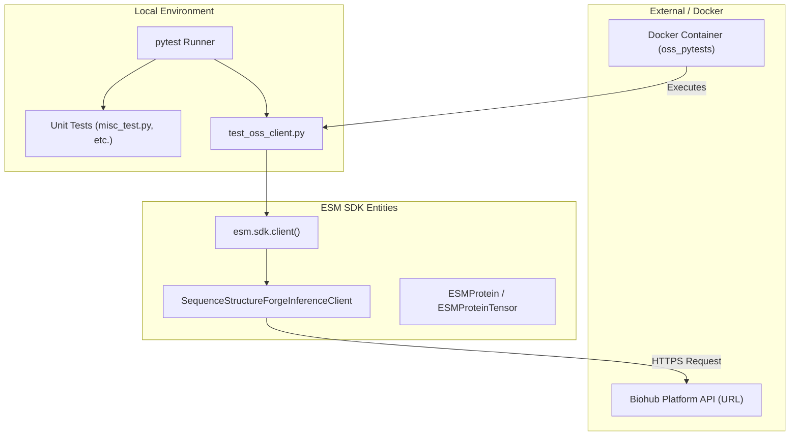
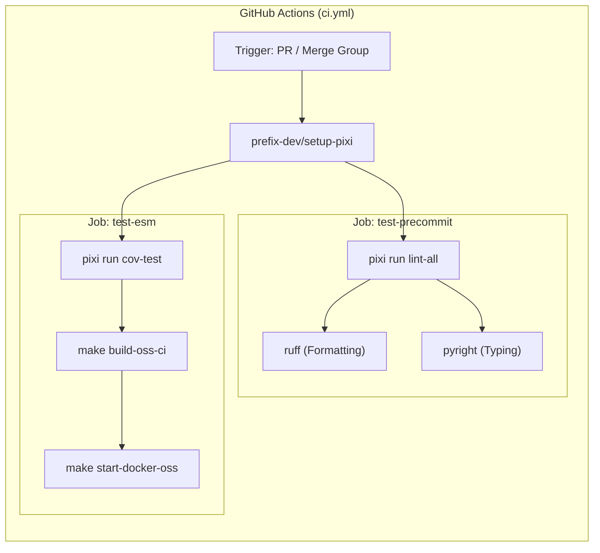

# Testing & CI/CD

Relevant source files

The following files were used as context for generating this wiki page:

- [.github/workflows/ci.yml](.github/workflows/ci.yml)
- [tests/Makefile](tests/Makefile)
- [tests/oss_pytests/test_oss_client.py](tests/oss_pytests/test_oss_client.py)

The ESM repository employs a multi-layered testing strategy to ensure the integrity of protein language models, SDK clients, and data processing utilities. The infrastructure combines local unit testing, containerized integration tests, and a GitHub Actions-based CI pipeline that enforces strict code quality standards.

## Test Infrastructure Overview

The testing framework is bifurcated into lightweight unit tests that run in the local environment and integration tests that validate client-server interactions against the Biohub Platform.

### Unit & Inline Testing
The codebase utilizes `pytest` as its primary test runner. Unit tests are distributed throughout the repository, often residing alongside the modules they verify (e.g., `misc_test.py`, `sampling_test.py`). These tests cover core logic such as:
*   **Tokenization & Data Handling:** Validating `ProteinComplex` and `MolecularComplex` transformations.
*   **Model Components:** Testing individual transformer blocks and geometric encoders.
*   **Generation Logic:** Verifying iterative sampling schedules and track-specific unmasking.

### Integration & SDK Testing
Integration tests for the Open Source Software (OSS) clients are located in `tests/oss_pytests/` [tests/oss_pytests/test_oss_client.py:1-91](). These tests verify the `ESM3InferenceClient` and `ESMCInferenceClient` implementations by performing real network requests to the Biohub API.

Key integration test areas include:
*   **Client Factory:** Ensuring `esm.sdk.client()` correctly initializes the appropriate backend [tests/oss_pytests/test_oss_client.py:29-29]().
*   **End-to-End Workflows:** Verifying the `encode` -> `logits` -> `forward_and_sample` -> `decode` lifecycle [tests/oss_pytests/test_oss_client.py:32-48]().
*   **Folding:** Validating structure prediction via `SequenceStructureForgeInferenceClient.fold()` [tests/oss_pytests/test_oss_client.py:85-90]().

For details, see [Test Suite](#10.1).

### Code-to-System Mapping: Test Execution
The following diagram illustrates how the test infrastructure interacts with the core SDK and external endpoints.

**Test System Architecture**

Sources: [tests/oss_pytests/test_oss_client.py:6-17](), [tests/oss_pytests/test_oss_client.py:29-29](), [tests/oss_pytests/test_oss_client.py:85-87](), [tests/Makefile:13-21]()

## CI Pipeline & Code Quality

The Continuous Integration (CI) pipeline is defined in `.github/workflows/ci.yml` [.github/workflows/ci.yml:1-87]() and is triggered on every pull request to ensure that no regressions are introduced.

### Workflow Jobs
The pipeline is divided into two primary jobs:
1.  **test-precommit:** Focuses on static analysis and formatting. It uses `pixi run lint-all` to execute `ruff` for linting and `pyright` for type checking [.github/workflows/ci.yml:20-36]().
2.  **test-esm:** Handles dynamic execution. It runs the standard test suite with coverage reporting (`pixi run cov-test`) and executes the Docker-based integration tests [.github/workflows/ci.yml:38-65]().

### Dockerized Integration
To ensure environment parity, the CI pipeline builds a Docker image for the OSS tests using `tests/oss_pytests/Dockerfile` [tests/Makefile:9-9](). The `Makefile` in the `tests/` directory orchestrates the build and run process, passing sensitive credentials like `ESM_API_KEY` as environment variables [tests/Makefile:13-21]().

### Pipeline Logic Flow
The diagram below maps the GitHub Actions workflow steps to the specific tools and environment configurations used.

**CI Workflow & Tooling**

Sources: [.github/workflows/ci.yml:20-21](), [.github/workflows/ci.yml:35-35](), [.github/workflows/ci.yml:53-53](), [.github/workflows/ci.yml:63-64](), [tests/Makefile:6-11]()

### Quality Enforcement
*   **Coverage Reporting:** The pipeline generates a coverage report (`pytest-coverage.txt`) and automatically posts it as a comment on the Pull Request using `MishaKav/pytest-coverage-comment` [.github/workflows/ci.yml:73-81]().
*   **Concurrency:** To save resources, the workflow cancels in-progress runs on the same branch if a new commit is pushed [.github/workflows/ci.yml:15-17]().

For details, see [CI Pipeline & Code Quality](#10.2).

## Related Pages
- [Test Suite](#10.1) — Detailed documentation of `pytest` marks, test file organization, and Docker configuration.
- [CI Pipeline & Code Quality](#10.2) — Deep dive into `pixi` task definitions, linting rules, and GHA secret management.

---