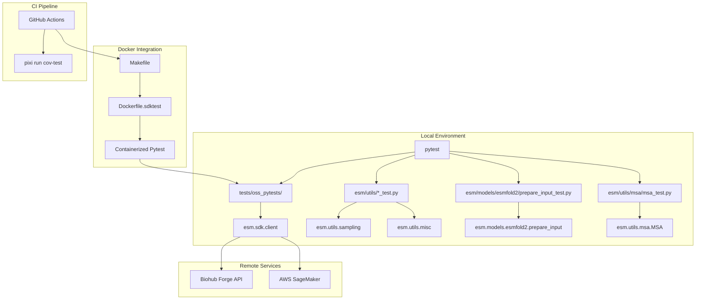

# Test Suite

<details>
<summary>Relevant source files</summary>

The following files were used as context for generating this wiki page:

- [.github/workflows/ci.yml](.github/workflows/ci.yml)
- [.gitignore](.gitignore)
- [esm/models/esmfold2/prepare_input_test.py](esm/models/esmfold2/prepare_input_test.py)
- [esm/utils/misc_test.py](esm/utils/misc_test.py)
- [esm/utils/msa/msa_test.py](esm/utils/msa/msa_test.py)
- [esm/utils/sampling_test.py](esm/utils/sampling_test.py)
- [tests/oss_pytests/Dockerfile](tests/oss_pytests/Dockerfile)
- [tests/oss_pytests/requirements.txt](tests/oss_pytests/requirements.txt)
- [tests/oss_pytests/test_oss_client.py](tests/oss_pytests/test_oss_client.py)
- [tests/oss_pytests/test_placeholder.py](tests/oss_pytests/test_placeholder.py)

</details>


The ESM repository employs a multi-layered testing strategy to ensure the reliability of its protein language models, SDK clients, and structural utility functions. This infrastructure includes standard unit tests, specialized integration tests for the Open Source Software (OSS) clients, and Docker-based containerized testing for CI/CD environments.

## Overview of Testing Layers

The test suite is divided into four primary categories:
1.  **OSS Pytests**: Validates the SDK's ability to communicate with remote inference backends.
2.  **Docker Integration Tests**: Ensures environment parity and cross-platform reliability using containerization.
3.  **Inline Unit Tests**: Co-located with the source code to verify algorithmic correctness of utilities (e.g., sampling, structure manipulation).
4.  **CI/CD Pipeline**: Orchestrates the execution of all tests, including linting and coverage reporting.

### Test Architecture and Data Flow

The following diagram illustrates how different test entities interact with the codebase and remote services.

**Test System Interaction Map**

Sources: [.github/workflows/ci.yml:52-65](), [tests/oss_pytests/Dockerfile:1-19]()

---

## OSS Client Tests (`tests/oss_pytests`)

The OSS test suite specifically targets the public-facing SDK interfaces. These tests require an active connection to an inference backend, typically configured via environment variables `URL` and `ESM_API_KEY` [[tests/oss_pytests/test_oss_client.py:19-20]]().

### Key Test Files
*   **`test_oss_client.py`**: Validates the core `client` factory and its ability to handle `ESM3`, `ESMC`, and `ESMFold2` workflows [[tests/oss_pytests/test_oss_client.py:24-91]]().
*   **`test_placeholder.py`**: A placeholder test file, currently skipped, indicating that there are no other tests in this specific suite beyond `test_oss_client.py` [[tests/oss_pytests/test_placeholder.py:1-6]]().
*   **`test_output_attentions.py`**: Verifies that attention weights can be extracted from the transformer backbones and that they maintain numerical consistency with the standard forward pass.

### Client Validation Logic
The `test_oss_esm3_client` function exercises the full lifecycle of a protein generation request:
1.  **Initialization**: Creates a client using `esm.sdk.client` [[tests/oss_pytests/test_oss_client.py:29]]().
2.  **Encoding**: Converts an `ESMProtein` into an `ESMProteinTensor` [[tests/oss_pytests/test_oss_client.py:32]]().
3.  **Logits & Sampling**: Requests raw logits and performs a `forward_and_sample` operation to verify tensor shapes [[tests/oss_pytests/test_oss_client.py:39-48]]().
4.  **Generation**: Executes a multi-step iterative generation for a specific track (e.g., "sequence") [[tests/oss_pytests/test_oss_client.py:50-52]]().

Sources: [tests/oss_pytests/test_oss_client.py:6-17](), [tests/oss_pytests/test_oss_client.py:24-54](), [tests/oss_pytests/test_placeholder.py:1-6]()

---

## Docker Integration and Makefile

To ensure tests run in a clean, reproducible environment, the repository provides a Docker-based integration layer. This is particularly important for the `test-esm` job in GitHub Actions.

### Implementation Details
*   **`Dockerfile`**: Based on `python:3.12-slim`, it installs the `esm` package and `pytest` dependencies from `requirements.txt` [[tests/oss_pytests/Dockerfile:2-13]](). The default command runs `pytest -v test_oss_client.py` [[tests/oss_pytests/Dockerfile:19]]().
*   **`Makefile`**: Simplifies the build and execution process.
    *   `build-oss-ci`: Builds the image tagged as `oss_pytests:${DOCKER_TAG}`.
    *   `start-docker-oss`: Runs the container, passing through necessary environment variables like `ESM_API_KEY` and `URL`.

Sources: [tests/oss_pytests/Dockerfile:1-19]()

---

## Inline Unit Tests

The codebase uses inline `*_test.py` files to verify internal logic without requiring remote API access.

### Molecular Complex Roundtrips
`molecular_complex_test.py` ensures that structural data remains consistent across different formats. It specifically tests the `MolecularComplex` class's ability to handle:
*   **CIF Roundtrips**: `from_mmcif` -> `to_blob` -> `from_blob` -> `to_mmcif`.
*   **Chain Separation**: Verifying that ligands are correctly assigned to separate chains from proteins based on `label_asym_id`.
*   **Entity Categories**: Ensuring "polymer" (protein) and "non-polymer" (ligand) types are preserved.

### Sampling and Utilities
*   **`sample_logits`**: `sampling_test.py` verifies the `sample_logits` function across various temperatures and batch sizes [[esm/utils/sampling_test.py:7-35]]().
*   **`merge_annotations`**: `misc_test.py` tests the logic for merging overlapping or adjacent functional annotations, including the `merge_gap_max` parameter [[esm/utils/misc_test.py:7-36]]().
*   **`msa_test.py`**: Contains tests for the `MSA` class, focusing on deletion handling, A3M parsing, and how deletions are preserved or dropped during operations like slicing, padding, stacking, and concatenation [[esm/utils/msa/msa_test.py:1-175]](). It also verifies the `a3m_deletion_counts` utility [[esm/utils/msa/msa_test.py:46-52]]() and the `msa_to_res_type_and_deletions` function [[esm/utils/msa/msa_test.py:73-74]]().
*   **`prepare_input_test.py`**: Tests the `ESMFold2` input preparation, specifically `build_chains_from_input` and `compute_token_bonds`, ensuring correct handling of ligand SMILES strings and bond generation [[esm/models/esmfold2/prepare_input_test.py:6-32]]().

Sources: [esm/utils/sampling_test.py:1-39](), [esm/utils/misc_test.py:1-36](), [esm/utils/msa/msa_test.py:1-175](), [esm/models/esmfold2/prepare_input_test.py:1-32]()

---

## Pytest Configuration and CI Integration

The testing workflow is orchestrated by GitHub Actions in `.github/workflows/ci.yml`.

### CI Pipeline Steps
1.  **Environment Setup**: Uses `prefix-dev/setup-pixi` to manage dependencies [[.github/workflows/ci.yml:27-32]]().
2.  **Formatting & Typing**: Runs `pixi run lint-all` to execute Ruff and Pyright [[.github/workflows/ci.yml:34-35]]().
3.  **Local Tests**: Executes `pixi run cov-test` for inline unit tests [[.github/workflows/ci.yml:52-53]]().
4.  **Remote Integration**: Builds the Docker container and runs the OSS client tests against the Biohub API [[.github/workflows/ci.yml:55-65]]().
5.  **Coverage Reporting**: Generates a summary and comments on Pull Requests using `MishaKav/pytest-coverage-comment` [[.github/workflows/ci.yml:73-87]]().

**Code Entity to Test Entity Mapping**
```mermaid
classDiagram
    direction LR
    class "ESMProtein" as ESMProtein
    class "ESMProteinTensor" as ESMProteinTensor
    class "ESM3InferenceClient" as ESM3InferenceClient
    class "ESMCInferenceClient" as ESMCInferenceClient
    class "SequenceStructureForgeInferenceClient" as SequenceStructureForgeInferenceClient
    class "MSA" as MSA
    class "MolecularComplex" as MolecularComplex
    class "sample_logits()" as sample_logits
    class "merge_annotations()" as merge_annotations
    class "build_chains_from_input()" as build_chains_from_input
    class "compute_token_bonds()" as compute_token_bonds

    class "test_oss_client.py" as TestOSSClient {
        test_oss_esm3_client()
        test_oss_esmc_client()
        test_oss_sequence_structure_forge_inference_client()
    }
    class "test_placeholder.py" as TestPlaceholder {
        test_placeholder()
    }
    class "msa_test.py" as TestMSA {
        test_a3m_deletion_counts_vectorized()
        test_from_a3m_records_deletions()
        test_deletions_flow_through_featurization()
        test_stack_carries_deletions()
        test_concat_carries_deletions_without_join_token()
    }
    class "molecular_complex_test.py" as TestMolecularComplex
    class "sampling_test.py" as TestSampling {
        test_sample_logits()
    }
    class "misc_test.py" as TestMisc {
        test_merge_annotations()
        test_merge_annotations_gap()
    }
    class "prepare_input_test.py" as TestPrepareInput {
        test_smiles_ligand_bonds_match_molecular_graph()
    }

    TestOSSClient --> ESMProtein
    TestOSSClient --> ESMProteinTensor
    TestOSSClient --> ESM3InferenceClient
    TestOSSClient --> ESMCInferenceClient
    TestOSSClient --> SequenceStructureForgeInferenceClient
    TestMSA --> MSA
    TestMolecularComplex --> MolecularComplex
    TestSampling --> sample_logits
    TestMisc --> merge_annotations
    TestPrepareInput --> build_chains_from_input
    TestPrepareInput --> compute_token_bonds

    note for TestOSSClient "Integration (Remote)"
    note for TestPlaceholder "Unit (Skipped)"
    note for TestMSA "Unit (MSA)"
    note for TestMolecularComplex "Unit (Structure)"
    note for TestSampling "Unit (Algorithm)"
    note for TestMisc "Unit (Utility)"
    note for TestPrepareInput "Unit (ESMFold2 Input)"
```
Sources: [.github/workflows/ci.yml:19-87](), [tests/oss_pytests/test_oss_client.py:6-17](), [esm/utils/sampling_test.py:4-5](), [esm/utils/misc_test.py:1-36](), [esm/utils/msa/msa_test.py:1-175](), [esm/models/esmfold2/prepare_input_test.py:1-32]()

---