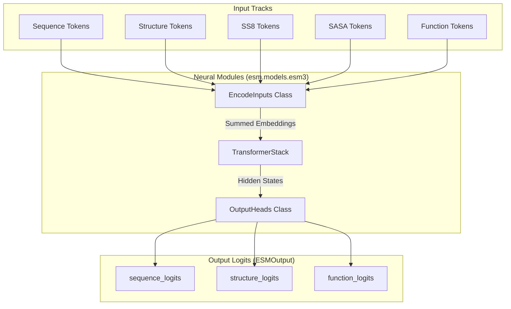

# Glossary

<details>
<summary>Relevant source files</summary>

The following files were used as context for generating this wiki page:

- [LICENSE.md](LICENSE.md)
- [README.md](README.md)
- [cookbook/tutorials/binder_design.ipynb](cookbook/tutorials/binder_design.ipynb)
- [esm/models/esmfold2/processor.py](esm/models/esmfold2/processor.py)
- [esm/sdk/api.py](esm/sdk/api.py)
- [esm/tokenization/function_tokenizer.py](esm/tokenization/function_tokenizer.py)
- [esm/utils/constants/esm3.py](esm/utils/constants/esm3.py)
- [esm/utils/constants/models.py](esm/utils/constants/models.py)
- [esm/utils/encoding.py](esm/utils/encoding.py)
- [esm/utils/function/tfidf.py](esm/utils/function/tfidf.py)
- [esm/utils/generation.py](esm/utils/generation.py)
- [esm/utils/residue_constants.py](esm/utils/residue_constants.py)
- [esm/utils/types.py](esm/utils/types.py)

</details>


This page provides technical definitions for domain-specific terms, abbreviations, and architectural concepts used throughout the ESM codebase. It serves as a reference for onboarding engineers to understand the mapping between biological concepts and their implementation in code.

## 1. Core Model Entities

### ESMC (Evolutionary Scale Modeling - Sequence)
The latest generation of sequence-only protein language models. Unlike ESM2, ESMC is designed for stronger long-range structural understanding and scales up to 6B parameters [README.md:12-13](). It uses a standard transformer architecture with optional Flash Attention support [esm/models/esmc.py:67-74]().
*   **Code Pointer:** `ESMC` class in [esm/models/esmc.py:45-45]().

### ESM3 (Multimodal Protein Language Model)
A multimodal generative model that operates on multiple "tracks" of protein data, including sequence, structure, secondary structure, SASA, and function annotations [esm/models/esm3.py:188-209]().
*   **Code Pointer:** `ESM3` class in [esm/models/esm3.py:188-188]().

### ESMFold2
A state-of-the-art structure prediction model built on top of the ESMC 6B backbone [README.md:21-21](). It supports all-atom folding of proteins, nucleic acids, and ligands [cookbook/tutorials/esmfold2.ipynb:13-13]().
*   **Code Pointer:** `esmfold2_client` factory in [esm/sdk/__init__.py]() (not directly provided in snippets, but implied by usage).

Sources: [README.md:12-13](), [README.md:21-21](), [esm/models/esmc.py:45-45](), [esm/models/esmc.py:67-74](), [esm/models/esm3.py:188-209](), [cookbook/tutorials/esmfold2.ipynb:13-13]()

---

## 2. Biological Data Representations

### Atom37
A standardized 3D coordinate representation where every amino acid residue is represented by exactly 37 possible atom positions (following the AlphaFold/AlphaFold2 convention) [esm/utils/structure/protein_chain.py:143-154](). This allows for fixed-size tensor operations regardless of the specific residue type.
*   **Code Pointer:** `atom37_positions` attribute in `ProteinChain` [esm/utils/structure/protein_chain.py:152-152]().

### SASA (Solvent Accessible Surface Area)
A measure of how much of a residue's surface is exposed to the surrounding solvent. In ESM3, this is discretized into 15 bins for tokenization [esm/utils/constants/esm3.py:77-93]().
*   **Code Pointer:** `SASADiscretizingTokenizer` in [esm/tokenization/sasa_tokenizer.py:15-15]().

### pLDDT (predicted Local Distance Difference Test)
A per-residue confidence score (0-100) predicted by the model. It indicates the model's local confidence in the predicted structure [esm/sdk/api.py:36-36]().
*   **Code Pointer:** `plddt` attribute in `ESMProtein` [esm/sdk/api.py:36-36]().

### InterPro
A database of protein families, domains, and functional sites. InterPro IDs are used as a form of function annotation in ESM3 [esm/tokenization/function_tokenizer.py:30-35]().
*   **Code Pointer:** `InterProQuantizedTokenizer` in [esm/tokenization/function_tokenizer.py:29-29]().

Sources: [esm/sdk/api.py:36-36](), [esm/utils/structure/protein_chain.py:152-152](), [esm/tokenization/sasa_tokenizer.py:15-15](), [esm/utils/constants/esm3.py:77-93](), [esm/tokenization/function_tokenizer.py:29-29](), [esm/tokenization/function_tokenizer.py:30-35]()

---

## 3. Technical & Implementation Terms

### Tracks
In the context of ESM3, a "track" refers to one of the parallel streams of data (sequence, structure, etc.) that the model processes simultaneously [esm/sdk/api.py:29-35]().
*   **Code Pointer:** `ESMProtein` dataclass attributes like `sequence`, `secondary_structure`, `sasa`, `function_annotations`, `coordinates` [esm/sdk/api.py:29-35]().

### VQ-VAE (Vector Quantized Variational Autoencoder)
Used to compress continuous 3D protein structures into discrete "structure tokens" that the transformer can process [esm/models/vqvae.py](). The `StructureTokenEncoder` quantizes the input coordinates, and the `StructureTokenDecoder` reconstructs them.
*   **Code Pointer:** `StructureTokenEncoder` [esm/models/vqvae.py:16-16]() and `StructureTokenDecoder` [esm/models/vqvae.py:16-16]().

### LSH (Locality Sensitive Hashing)
Used in the `InterProQuantizedTokenizer` to encode and decode InterPro function annotations into discrete tokens. It maps high-dimensional TF-IDF vectors to a lower-dimensional space, allowing for efficient similarity searches and tokenization [esm/tokenization/function_tokenizer.py:30-35]().
*   **Code Pointer:** `lsh.LSHTokenized` class used within `InterProQuantizedTokenizer` [esm/tokenization/function_tokenizer.py:83-90]().

### TF-IDF (Term Frequency-Inverse Document Frequency)
A numerical statistic reflecting how important a word is to a document in a collection or corpus. In ESM, it's used to represent function keywords, which are then processed by LSH for tokenization [esm/tokenization/function_tokenizer.py:120-124]().
*   **Code Pointer:** `tfidf.TFIDFModel` class used within `InterProQuantizedTokenizer` [esm/tokenization/function_tokenizer.py:120-124](), defined in [esm/utils/function/tfidf.py:13-13]().

### `ESMProtein`
A dataclass representing a protein, holding various biological "tracks" such as sequence, secondary structure, SASA, function annotations, and 3D coordinates, along with predicted metrics like pLDDT [esm/sdk/api.py:27-49](). It provides methods for loading from PDB/ProteinChain/ProteinComplex and converting to PDB/ProteinChain/ProteinComplex [esm/sdk/api.py:68-181]().
*   **Code Pointer:** `ESMProtein` class definition [esm/sdk/api.py:27-49]().

### `ESMProteinTensor`
A dataclass that holds the tokenized tensor representations of an `ESMProtein` object, ready for input into the model. It contains tensors for sequence, structure, secondary structure, SASA, function, and residue annotations, along with attention masks and other metadata [esm/sdk/api.py:20-20]().
*   **Code Pointer:** `ESMProteinTensor` class definition [esm/sdk/api.py:20-20]().

### `StructurePredictionInput`
A dataclass used by ESMFold2 to define the input for structure prediction, including protein sequences, optional distogram conditioning, and covalent bonds [esm/models/esmfold2/types.py:10-10](). It can handle multiple protein chains and other molecular entities.
*   **Code Pointer:** `StructurePredictionInput` class definition [esm/models/esmfold2/types.py:10-10]().

### `ESMFold2InputBuilder`
A utility class responsible for preparing and cleaning input data for the ESMFold2 model. It handles tasks like grouping identical protein sequences, converting chainbreak tokens, and managing modifications [esm/models/esmfold2/processor.py:86-184]().
*   **Code Pointer:** `ESMFold2InputBuilder` class definition [esm/models/esmfold2/processor.py:184-184]().

Sources: [esm/sdk/api.py:20-20](), [esm/sdk/api.py:27-49](), [esm/sdk/api.py:29-35](), [esm/sdk/api.py:68-181](), [esm/models/vqvae.py:16-16](), [esm/tokenization/function_tokenizer.py:30-35](), [esm/tokenization/function_tokenizer.py:83-90](), [esm/tokenization/function_tokenizer.py:120-124](), [esm/utils/function/tfidf.py:13-13](), [esm/models/esmfold2/types.py:10-10](), [esm/models/esmfold2/processor.py:86-184](), [esm/models/esmfold2/processor.py:184-184]()

---

## 4. Architectural Mapping Diagrams

### Diagram 1: Protein Data Lifecycle
This diagram maps the transition from biological file formats to SDK objects and finally to model-ready tensors.

```mermaid
graph TD
    subgraph "Natural Language & Files"
        PDB["PDB/mmCIF File"]
        SEQ["AA Sequence String"]
    end

    subgraph "SDK Entity Space (esm.sdk.api)"
        PC[ProteinChain]
        EPC[ESMProtein]
    end

    subgraph "Code Implementation (esm.utils.encoding)"
        TOK[tokenize_sequence()]
        STR_TOK[tokenize_structure()]
    end

    subgraph "Model Tensor Space"
        EPT[ESMProteinTensor]
    end

    PDB -->|"ProteinChain.from_pdb()"| PC
    PC -->|"ESMProtein.from_protein_chain()"| EPC
    SEQ -->|"ESMProtein(sequence=...)"| EPC
    EPC --> TOK
    EPC --> STR_TOK
    TOK --> EPT
    STR_TOK --> EPT
```
Sources: [esm/sdk/api.py:27-136](), [esm/utils/structure/protein_chain.py:143-163](), [esm/utils/encoding.py:1-50]()

### Diagram 2: ESM3 Multimodal Architecture
This diagram bridges the conceptual "Tracks" to the specific neural network modules in `esm/models/esm3.py`.


Sources: [esm/models/esm3.py:62-148](), [esm/models/esm3.py:151-185](), [esm/models/esm3.py:211-230]()

---

## 5. Summary Table of Key Classes

| Term | Class/Entity | File Path | Description |
| :--- | :--- | :--- | :--- |
| **Protein Container** | `ESMProtein` | [esm/sdk/api.py:27-48]() | High-level SDK object containing all tracks (sequence, coords, etc.) |
| **Tensor Container** | `ESMProteinTensor` | [esm/sdk/api.py:20-20]() | PyTorch tensor representation of a protein for model input |
| **Transformer** | `TransformerStack` | [esm/layers/transformer_stack.py:14-14]() | The core neural backbone used by both ESM3 and ESMC |
| **Sequence Head** | `RegressionHead` | [esm/layers/regression_head.py:13-13]() | Linear layer that maps transformer outputs to token vocabularies |
| **Structure Decoder**| `StructureTokenDecoder`| [esm/models/vqvae.py:16-16]() | Converts structure tokens back into 3D coordinates |
| **Function Decoder** | `FunctionTokenDecoder` | [esm/models/function_decoder.py:54-54]() | Decodes function tokens into InterPro and keyword annotations |
| **Function Tokenizer** | `InterProQuantizedTokenizer` | [esm/tokenization/function_tokenizer.py:29-29]() | Tokenizes InterPro IDs and keywords using TF-IDF and LSH |
| **TF-IDF Model** | `TFIDFModel` | [esm/utils/function/tfidf.py:13-13]() | Implements Term-Frequency / Inverse Document Frequency for keyword vectorization |
| **ESMFold2 Input Builder** | `ESMFold2InputBuilder` | [esm/models/esmfold2/processor.py:184-184]() | Prepares and cleans input for ESMFold2 structure prediction |

Sources: [esm/sdk/api.py:20-20](), [esm/sdk/api.py:27-48](), [esm/models/esm3.py:51-185](), [esm/models/esmc.py:38-42](), [esm/models/function_decoder.py:54-125](), [esm/tokenization/function_tokenizer.py:29-29](), [esm/utils/function/tfidf.py:13-13](), [esm/models/esmfold2/processor.py:184-184]()