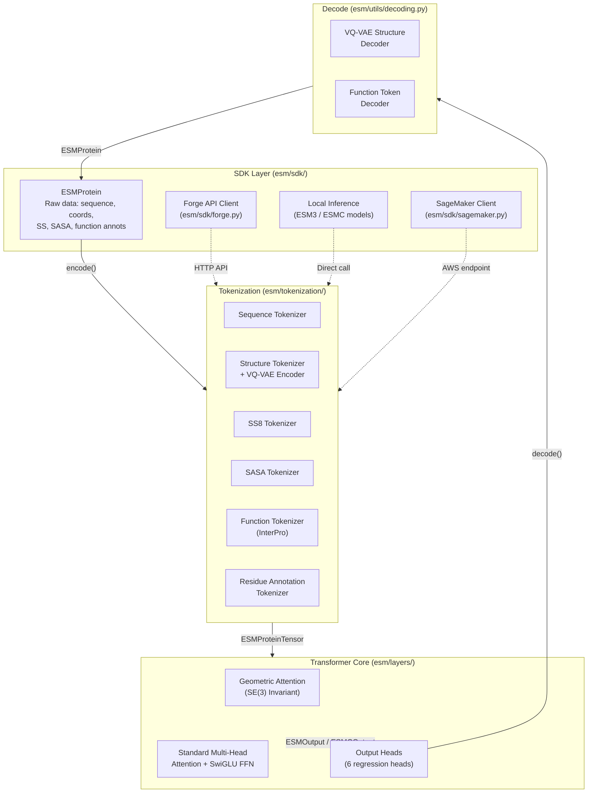

ESM is EvolutionaryScale's open-source framework for protein modeling, built around two complementary model families: **ESM3**, a multimodal generative model that jointly reasons across sequence, structure, and function, and **ESM C**, a representation model that creates rich biological embeddings with dramatically improved efficiency over predecessors. The `esm` Python package (v3.2.4) provides a unified SDK for both local inference and cloud-based API access, enabling everything from rapid prototyping on a single GPU to large-scale batch processing on Forge or AWS SageMaker. Whether you are designing novel proteins from partial prompts or extracting embeddings for downstream prediction tasks, this repository gives you the tools and abstractions to do so through a consistent, typed interface.

Sources: [README.md](/README.md#L1-L50), [esm/__init__.py](/esm/__init__.py#L1-L2), [pyproject.toml](/pyproject.toml#L1-L10)

## Two Model Families, One Framework

The ESM ecosystem is organized around two distinct but interoperable model families, each designed for a different primary use case. **ESM3** is a generative masked language model: you provide partial information across any combination of tracks (sequence, structure, secondary structure, SASA, function), and the model iteratively samples masked positions until all tracks are complete. **ESM C** is a representation model: it encodes protein sequences into high-quality embeddings that can be used for downstream tasks like property prediction, variant effect analysis, or similarity search. Both families share the same `ESMProtein` data model and SDK abstractions, so switching between them or composing their outputs requires minimal code changes.

Sources: [esm/models/esm3.py](/esm/models/esm3.py#L118-L125), [esm/models/esmc.py](/esm/models/esmc.py#L29-L50)

### ESM3: Multimodal Generative Model

ESM3 operates as a **generative masked language model** over discrete token sequences. It jointly reasons across six input tracks — sequence, structure tokens, secondary structure (SS8), solvent-accessible surface area (SASA), function annotations (InterPro), and residue annotations — and can be prompted with any subset of these tracks partially filled. The model's transformer backbone uses geometric attention in its initial layers to condition on 3D structure, enabling SE(3)-invariant reasoning over atomic coordinates. At its largest scale, ESM3 was trained with 1.07×10²⁴ FLOPs on 2.78 billion proteins, and the open-source 1.4B parameter variant (`esm3-sm-open-v1`) is available for local inference.


Sources: [README.md](/README.md#L69-L86), [esm/models/esm3.py](/esm/models/esm3.py#L44-L97)

### ESM C: Representation Model

ESM C (Cambrian) is a **sequence-to-embedding** model designed as a drop-in replacement for ESM2, but with major efficiency gains. The 300M parameter ESM C delivers similar performance to ESM2 650M, while the 600M variant rivals ESM2 3B. ESM C uses a standard transformer stack (without geometric attention layers), making it lighter and faster. It exposes `encode()` → `logits()` → `embeddings` as its primary workflow, and supports Flash Attention for further acceleration on GPU. ESM C is available in open-weight variants (300M, 600M) and a larger 6B model via Forge API or SageMaker.

Sources: [README.md](/README.md#L147-L155), [esm/models/esmc.py](/esm/models/esmc.py#L29-L65)

## Model Comparison

| Feature | ESM3 | ESM C |
|---------|------|-------|
| **Primary Purpose** | Controllable protein generation | Protein representation learning |
| **Input Modalities** | Sequence + Structure + SS + SASA + Function + Residue | Sequence only |
| **Output Tracks** | All 6 tracks + embeddings | Sequence logits + embeddings + hidden states |
| **Geometric Attention** | Yes (initial layers) | No |
| **Generation** | Iterative masked sampling | Not supported |
| **Open Weights** | 1.4B (`esm3-sm-open-v1`) | 300M, 600M |
| **Forge API Sizes** | 1.4B, 7B, 98B | 6B |
| **SageMaker** | — | 300M, 600M, 6B |
| **Flash Attention** | — | Yes (auto-detected) |
| **Core API** | `ESM3InferenceClient` | `ESMCInferenceClient` |

| ESM3 Model | Parameters | d_model | Heads | Layers | Release |
|------------|-----------|---------|-------|--------|---------|
| esm3-large-2024-03 | 98B | — | — | — | 2024-03 |
| esm3-medium-2024-08 | 7B | — | — | — | 2024-08 |
| esm3-small-2024-08 (open) | 1.4B | 1536 | 24 | 48 | 2024-08 |

| ESM C Model | Parameters | d_model | Heads | Layers | Release |
|-------------|-----------|---------|-------|--------|---------|
| esmc-6b-2024-12 | 6B | — | — | 80 | 2024-12 |
| esmc-600m-2024-12 | 600M | 1152 | 18 | 36 | 2024-12 |
| esmc-300m-2024-12 | 300M | 960 | 15 | 30 | 2024-12 |

Sources: [README.md](/README.md#L52-L67), [esm/pretrained.py](/esm/pretrained.py#L77-L117), [esm/models/esm3.py](/esm/models/esm3.py#L118-L138), [esm/models/esmc.py](/esm/models/esmc.py#L29-L50)

## High-Level Architecture

The following diagram shows the major components of ESM and how data flows from raw protein input through tokenization, the transformer core, and output decoding back to a rich `ESMProtein` object. The shaded region represents the model's internal forward pass; everything outside it is the SDK layer that handles encoding, generation orchestration, and decoding.



> [!TIP]
> The `encode()` → `forward()` → `decode()` pipeline is the fundamental pattern. When you call `model.generate()`, it orchestrates this pipeline multiple times via iterative masked sampling, progressively unmasking tokens until the target track is complete.

Sources: [esm/sdk/api.py](/esm/sdk/api.py#L200-L260), [esm/models/esm3.py](/esm/models/esm3.py#L200-L350), [esm/tokenization/__init__.py](/esm/tokenization/__init__.py#L1-L67), [esm/layers/transformer_stack.py](/esm/layers/transformer_stack.py#L1-L50)

## Project Structure

The repository is organized into four main subsystems: the **model implementations**, the **SDK and deployment clients**, the **tokenization pipeline**, and the **utility layers**. Tutorials and cookbook examples live in the top-level `cookbook/` directory.

```
esm/
├── models/              # Model architectures
│   ├── esm3.py          # ESM3 multimodal generative model
│   ├── esmc.py          # ESM C representation model
│   ├── function_decoder.py   # InterPro function token decoder
│   └── vqvae.py         # VQ-VAE structure encoder/decoder
│
├── sdk/                 # Client SDK for inference
│   ├── api.py           # ESMProtein, ESMProteinTensor, client ABCs
│   ├── forge.py         # Forge API remote client
│   ├── sagemaker.py     # AWS SageMaker deployment client
│   └── __init__.py      # esm.sdk.client() factory function
│
├── tokenization/        # Input/output tokenizers
│   ├── sequence_tokenizer.py
│   ├── structure_tokenizer.py
│   ├── ss_tokenizer.py
│   ├── sasa_tokenizer.py
│   ├── function_tokenizer.py
│   └── residue_tokenizer.py
│
├── layers/              # Neural network building blocks
│   ├── attention.py     # Standard multi-head attention
│   ├── geom_attention.py # SE(3) geometric attention
│   ├── blocks.py        # UnifiedTransformerBlock
│   ├── transformer_stack.py  # Transformer stack
│   ├── rotary.py        # Rotary position embeddings
│   └── ffn.py           # SwiGLU feed-forward network
│
├── utils/               # Encoding, decoding, sampling, constants
├── pretrained.py        # Model registry and from_pretrained loaders
└── widgets/             # Jupyter notebook visualization tools

cookbook/
├── tutorials/           # Step-by-step notebook tutorials
├── snippets/            # Minimal code examples for ESM3, ESM C, folding
└── local/               # Local inference examples with raw forward passes
```

Sources: [esm/pretrained.py](/esm/pretrained.py#L123-L135), [esm/tokenization/__init__.py](/esm/tokenization/__init__.py#L1-L67), [esm/sdk/__init__.py](/esm/sdk/__init__.py#L1-L37)

## Deployment Options

The `esm` SDK provides three deployment paths, all sharing the same `ESM3InferenceClient` or `ESMCInferenceClient` interface. This means you can swap a local model for a Forge client with a single line change — no other code modifications needed.

| Deployment | How to Instantiate | Best For |
|------------|-------------------|----------|
| **Local** | `ESM3.from_pretrained("esm3-sm-open-v1").to("cuda")` | Rapid prototyping, full model access, offline use |
| **Forge API** | `esm.sdk.client("esm3-medium-2024-08", token=...)` | Largest models (98B, 6B), no GPU required, batch execution |
| **SageMaker** | `ESM3SageMakerClient(endpoint_name=..., model=...)` | Commercial use, dedicated GPU, AWS integration |

> [!TIP]
> Forge and SageMaker clients both support async methods via `async_` prefix (e.g., `async_generate`, `async_encode`) for concurrent workloads. Use the `batch_executor()` context manager for high-throughput Forge jobs.

Sources: [esm/sdk/__init__.py](/esm/sdk/__init__.py#L1-L37), [esm/sdk/forge.py](/esm/sdk/forge.py#L1-L50), [README.md](/README.md#L104-L130)

## Reading Guide

This documentation is organized into three sections. Start with **Get Started** to set up your environment and learn the core data model, then move to **Deep Dive** for architectural details, or jump to **Buzz** for the latest updates and community information.

**Get Started** (recommended reading order):
1. [Overview](1-overview) — You are here
2. [Quick Start](2-quick-start) — Install, configure, and run your first inference
3. [ESMProtein Data Model](3-esmprotein-data-model) — Understand the `ESMProtein` / `ESMProteinTensor` types

**Deep Dive** (explore based on your interest):
- **Model internals**: [Architecture Overview](7-architecture-overview) → [ESM3 Multimodal Generative Model](8-esm3-multimodal-generative-model) or [ESM C Representation Model](9-esm-c-representation-model)
- **Tokenization**: [Sequence and Structure Tokenizers](10-sequence-and-structure-tokenizers) → [VQ-VAE Structure Encoding](11-vq-vae-structure-encoding) → [Function and Residue Annotation Tokens](12-function-and-residue-annotation-tokens)
- **Transformer core**: [Geometric Attention and SE(3) Invariance](13-geometric-attention-and-se-3-invariance) → [Transformer Stack Design](14-transformer-stack-design) → [Rotary Embeddings and SwiGLU](15-rotary-embeddings-and-swiglu)
- **Generation**: [Iterative Masked Sampling](16-iterative-masked-sampling) → [Noise Schedules and Unmasking Strategies](17-noise-schedules-and-unmasking-strategies) → [Generation Configuration Reference](18-generation-configuration-reference)
- **SDK and deployment**: [Forge API Client](19-forge-api-client) → [Local Inference Client](20-local-inference-client) → [SageMaker and Batch Execution](21-sagemaker-and-batch-execution)
