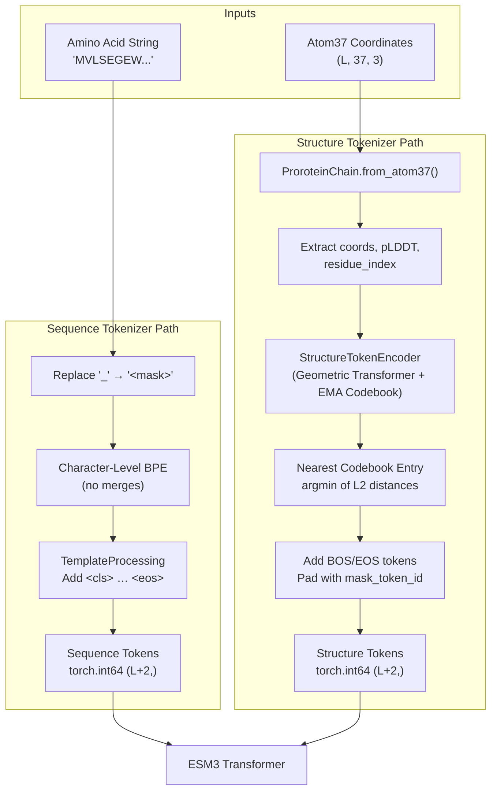

ESM3 is a multimodal protein model that operates on discrete tokens across six parallel tracks. Two of those tracks — **sequence** and **structure** — are the foundational modalities: sequence captures the linear amino acid chain, while structure encodes the three-dimensional backbone geometry. This page examines how raw biological inputs are converted into integer token IDs that the transformer can process, and how the two tokenizers embody fundamentally different design philosophies — one a straightforward character-level vocabulary, the other a learned VQ-VAE codebook operating on 3D coordinates.

## The Tokenizer Protocol: A Unified Contract

Before examining the individual tokenizers, it is essential to understand the contract they all satisfy. Every tokenizer in ESM3 implements the `EsmTokenizerBase` protocol, which defines a minimal interface of special tokens and encode/decode methods:

| Protocol Member | Purpose |
|---|---|
| `mask_token` / `mask_token_id` | Placeholder for unknown or to-be-predicted positions |
| `bos_token` / `bos_token_id` | Beginning-of-sequence marker |
| `eos_token` / `eos_token_id` | End-of-sequence marker |
| `pad_token` / `pad_token_id` | Padding for batch alignment |
| `chain_break_token` / `chain_break_token_id` | Delimiter between protein chains in a complex |
| `encode()` | Convert raw input → token IDs |
| `decode()` | Convert token IDs → raw input |
| `all_token_ids` | Complete set of valid token IDs |
| `special_token_ids` | IDs reserved for control, not data |

Because `EsmTokenizerBase` is a `@runtime_checkable` Protocol (not an abstract base class), tokenizers are free to inherit from whatever parent makes sense — `PreTrainedTokenizerFast` for sequence, or a plain class for structure — while still being substitutable wherever the protocol is required. This duck-typing design allows the `TokenizerCollection` dataclass to aggregate all six tokenizers behind a single `TokenizerCollectionProtocol`, letting downstream code treat them uniformly.

Sources: [tokenizer_base.py](/esm/tokenization/tokenizer_base.py#L1-L26), [__init__.py](/esm/tokenization/__init__.py#L1-L67)

## EsmSequenceTokenizer: Character-Level Amino Acid Encoding

The `EsmSequenceTokenizer` converts a protein sequence string (e.g., `"MVLSEGEW..."`) into a sequence of integer token IDs. Despite inheriting from HuggingFace's `PreTrainedTokenizerFast` and technically using a BPE (Byte-Pair Encoding) backend, it performs **no subword merging whatsoever** — the BPE merges list is intentionally empty. This makes it a pure character-level tokenizer where each amino acid symbol maps to exactly one token ID.

### Vocabulary Layout

The vocabulary is defined as a fixed list of 33 tokens in `esm/utils/constants/esm3.py`:

| Index Range | Tokens | Count | Description |
|---|---|---|---|
| 0 | `<cls>` | 1 | BOS /CLS marker |
| 1 | `<pad>` | 1 | Padding |
| 2 | `<eos>` | 1 | End-of-sequence |
| 3 | `<unk>` | 1 | Unknown character |
| 4–25 | `L A G V S E R T I D P K Q N F Y M H W C X B U Z` | 22 | Standard + rare amino acids |
| 26 | `O` | 1 | Pyrrolysine |
| 27 | `.` | 1 | Gap (alignment placeholder) |
| 28 | `-` | 1 | Gap variant |
| 29 | `\|` | 1 | Chain break delimiter |
| 30–32 | (reserved/unused in standard vocab) | — | — |
| 31 | `\|` (chain_break_token) | — | Same as index 29 |
| 32 | `<mask>` | 1 | Mask token for generation |

The 20 canonical amino acids occupy positions 4–23 in frequency-sorted order (Leucine most common at index 4), followed by non-standard residues `X`, `B`, `U`, `Z`, and `O`. The chain break token `|` enables multi-chain proteins to be represented as a single token sequence with explicit chain boundaries.

### Template Processing

When `add_special_tokens=True` (the default), the tokenizer applies `TemplateProcessing` to wrap the encoded sequence:

```
<cls> [amino_acid_tokens] <eos>
```

This means a sequence of length *L* produces a token tensor of length *L + 2*. The BOS token is aliased to `<cls>` — the `bos_token` property explicitly returns `self.cls_token`, and `bos_token_id` returns `self.cls_token_id`, reflecting the convention that ESM3 never uses a separate BOS symbol distinct from CLS.

### Encoding Flow

The `tokenize_sequence` function in `encoding.py` provides the canonical path from raw string to tensor:

1. Replace all underscore mask placeholders (`_`) with the `<mask>` token string
2. Call `sequence_tokenizer.encode()` which applies the character-level BPE mapping plus template processing
3. Wrap the resulting list as a `torch.int64` tensor

> [!TIP]
> When constructing default (fully masked) sequence tokens, the pattern is: fill a tensor of length *L+2* with `mask_token_id`, then set index 0 to `bos_token_id` and index −1 to `eos_token_id`. This is how ESM3 represents "generate this sequence from scratch."

Sources: [sequence_tokenizer.py](/esm/tokenization/sequence_tokenizer.py#L1-L135), [esm3.py](/esm/utils/constants/esm3.py#L1-L131), [encoding.py](/esm/utils/encoding.py#L46-L60)

## StructureTokenizer: Coordinate-Derived Discrete Codes

The `StructureTokenizer` is architecturally distinct from the sequence tokenizer. It does **not** perform string-to-ID mapping — indeed, its `encode()` and `decode()` methods explicitly raise `NotImplementedError`. Instead, it serves as a **registry of special token IDs** for the structure track, while the actual encoding and decoding of 3D coordinates is delegated to the `StructureTokenEncoder` and `StructureTokenDecoder` neural networks (detailed in [VQ-VAE Structure Encoding](11-vq-vae-structure-encoding)).

### Vocabulary Layout

The structure vocabulary consists of a VQ-VAE codebook of size 4096 plus 5 special tokens appended after the codebook entries:

| Token | ID | Purpose |
|---|---|---|
| Data tokens | 0 – 4095 | VQ-VAE codebook entries (learned 3D structure prototypes) |
| `MASK` | 4096 | Unknown / to-be-predicted structure |
| `EOS` | 4097 | End-of-sequence |
| `BOS` | 4098 | Beginning-of-sequence |
| `PAD` | 4099 | Padding |
| `CHAINBREAK` | 4100 | Chain boundary delimiter |
| `UNDEFINED` | 955 | Special marker within codebook range |

The total vocabulary size is **4101** (4096 + 5). Notice that the special token IDs are computed as offsets from the codebook size, ensuring they never collide with learned codebook entries. The `STRUCTURE_UNDEFINED_TOKEN` (955) is notable — it lives within the codebook range and represents residues where backbone coordinates could not be determined.

### Why No String Representation

The string-access properties (`mask_token`, `bos_token`, etc.) all raise `NotImplementedError` with the message "Structure tokens are defined on 3D coordinates, not strings." This is a deliberate design decision: structure tokens are produced by a neural encoder that maps continuous 3D coordinate tensors to discrete indices, and there is no meaningful human-readable string for a codebook entry. Only the integer ID interface is valid.

Sources: [structure_tokenizer.py](/esm/tokenization/structure_tokenizer.py#L1-L84), [esm3.py](/esm/utils/constants/esm3.py#L14-L38)

## Encoding Pipeline: From Raw Inputs to Token Tensors

The following diagram shows how raw protein data flows through both tokenizers into the unified token representation consumed by the ESM3 transformer:



### Structure Encoding in Detail

The `tokenize_structure` function orchestrates the structure encoding pipeline. Given an atom37 coordinate tensor of shape `(L, 37, 3)` and an optional reference sequence:

1. **ProteinChain construction**: Coordinates are wrapped into a `ProteinChain` object via `from_atom37()`, which extracts the N, CA, C backbone atoms and builds SE(3) frame representations.
2. **Encoder input extraction**: The chain produces `(1, L, 37, 3)` coordinates, `(1, L)` pLDDT scores, and `(1, L)` residue indices — all moved to the encoder's device.
3. **VQ-VAE encoding**: The `StructureTokenEncoder.encode()` method runs a geometric transformer over local KNN neighborhoods (k=16) of backbone frames, projects to a 128-dimensional latent space, then performs nearest-neighbor lookup in the EMA codebook to obtain `(1, L)` integer indices.
4. **Special token insertion**: BOS (4098) is prepended and EOS (4097) is appended, with the interior positions initialized to `mask_token_id` (4096) before being overwritten by the encoder output.

> [!TIP]
> The structure encoder requires the first 3 backbone atoms (N, CA, C) in the atom37 dimension — it explicitly slices `coords[..., :3, :]` before building affine frames. If your input coordinates lack these atoms, the encoder will produce undefined results.

Sources: [encoding.py](/esm/utils/encoding.py#L62-L108), [vqvae.py](/esm/models/vqvae.py#L252-L328)

## Decoding Pipeline: From Token Tensors Back to Biology

Decoding reverses the encoding process, but the two tracks differ significantly in complexity:

### Sequence Decoding

Sequence decoding is a direct table lookup — `sequence_tokenizer.decode()` maps each integer ID back to its character, then post-processing strips `<cls>`/`<eos>` and replaces `<mask>` with the underscore placeholder `_`. This is lossless: encoding then decoding reproduces the original string exactly (modulo mask placeholders).

### Structure Decoding

Structure decoding is **generative**, not lookup-based. The `StructureTokenDecoder` is a 30-layer transformer that takes structure token IDs as input and produces:

| Output | Description |
|---|---|
| `bb_pred` | Predicted backbone atom coordinates (N, CA, C) |
| `plddt` | Per-residue confidence score |
| `ptm` | Predicted TM-score (global quality) |
| `predicted_aligned_error` | Pairwise predicted aligned error matrix |

The decoder validates that BOS and EOS tokens are correctly positioned before processing, and strips them from the output coordinates. After decoding, `ProteinChain.from_backbone_atom_coordinates()` reconstructs the full atom37 representation and infers oxygen atom positions. This means structure decoding is inherently **lossy** — the VQ-VAE compression from continuous 3D to discrete codes introduces quantization error, and the decoder's reconstruction adds further approximation.

Sources: [decoding.py](/esm/utils/decoding.py#L1-L150), [vqvae.py](/esm/models/vqvae.py#L330-L438)

## Comparative Design Analysis

The following table highlights the fundamental architectural differences between the two tokenizers:

| Dimension | Sequence Tokenizer | Structure Tokenizer |
|---|---|---|
| **Input modality** | String (characters) | 3D coordinates (tensors) |
| **Vocabulary size** | 33 | 4101 (4096 codebook + 5 special) |
| **Mapping mechanism** | Deterministic character → ID table | Learned VQ-VAE encoder (neural network) |
| **Encode/decode** | Lossless, table lookup | Lossy, neural encode + neural decode |
| **Special token IDs** | Fixed positions 0–32 in vocab | Offset from codebook size (4096–4100) |
| **String representation** | Full (every token is a character) | None (raise `NotImplementedError`) |
| **Parent class** | `PreTrainedTokenizerFast` | Plain class (protocol only) |
| **Reversibility** | Exact round-trip | Approximate round-trip |
| **Vocabulary source** | Hand-defined constant | Learned via EMA codebook updates |

This dichotomy reflects a deeper principle: sequence is inherently discrete (nature already tokenizes proteins as amino acids), while structure is inherently continuous and must be discretized through learned quantization. The VQ-VAE acts as a "perceptual codec" for 3D geometry, analogous to how image codecs compress pixel grids into compact codes.

Sources: [sequence_tokenizer.py](/esm/tokenization/sequence_tokenizer.py#L1-L135), [structure_tokenizer.py](/esm/tokenization/structure_tokenizer.py#L1-L84), [esm3.py](/esm/utils/constants/esm3.py#L1-L131)

## Tokenizer Assembly and Model Integration

Tokenizers are not instantiated independently in production use — they are assembled via factory functions in `esm/tokenization/__init__.py`:

- **`get_esm3_model_tokenizers(model)`** returns a `TokenizerCollection` containing all six tokenizers (sequence, structure, secondary_structure, sasa, function, residue_annotations) for the specified ESM3 model variant.
- **`get_esmc_model_tokenizers()`** returns only an `EsmSequenceTokenizer`, reflecting ESM-C's representation-only architecture that lacks the structure track.

The `TokenizerCollection` is passed into the `ESM3` model constructor and stored as `self.tokenizers`. During encoding, `esm/utils/encoding.py` uses the appropriate tokenizer from the collection; during decoding, `esm/utils/decoding.py` uses both the tokenizers (for special token ID lookups) and the neural decoders (`StructureTokenDecoder`, `FunctionTokenDecoder`).

The helper function `get_invalid_tokenizer_ids()` extracts the set of token IDs that should be excluded from sampling — for sequence tokenizers this includes mask, pad, CLS, and EOS; for all others it includes mask, pad, BOS, and EOS. These invalid IDs are used during generation to prevent the model from producing special tokens as predictions.

Sources: [__init__.py](/esm/tokenization/__init__.py#L1-L67), [pretrained.py](/esm/pretrained.py#L1-L135)

## Next Steps

Now that you understand how sequence and structure are tokenized, the natural progression is:

- **[VQ-VAE Structure Encoding](11-vq-vae-structure-encoding)** — Deep dive into the geometric transformer, KNN neighborhood construction, and EMA codebook that make structure tokenization work.
- **[Function and Residue Annotation Tokens](12-function-and-residue-annotation-tokens)** — How the remaining four tokenizer tracks discretize functional annotations.
- **[Encode-Decode Pipeline](22-encode-decode-pipeline)** — The end-to-end pipeline that orchestrates all six tokenizers together for protein encoding and reconstruction.