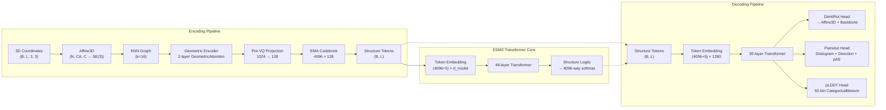

The VQ-VAE (Vector Quantized Variational Autoencoder) structure encoding pipeline is the mechanism by which ESM3 converts continuous 3D protein backbone coordinates into discrete integer tokens, and vice versa. This discretization is the foundation that allows ESM3's transformer core to treat structure as a native token track—alongside sequence, secondary structure, and function—enabling joint multimodal generation. The encoder compresses local backbone geometry into a **4096-entry codebook** of 128-dimensional vectors, while the decoder reconstructs full backbone atom coordinates from those tokens along with confidence metrics (pLDDT, pAE, pTM).

Sources: [vqvae.py](esm/models/vqvae.py#L1-L438), [esm3.py](esm/utils/constants/esm3.py#L13-L24)

## Architectural Overview

The VQ-VAE is architecturally split into two independent networks—**StructureTokenEncoder** and **StructureTokenDecoder**—that share only the codebook vocabulary size constant. This separation is deliberate: the encoder runs once at input time to tokenize coordinates, while the decoder runs once at output time to convert generated tokens back into 3D structure. Neither network participates in ESM3's main forward pass; instead, ESM3 operates purely on the resulting integer tokens through an embedding table.



Sources: [vqvae.py](esm/models/vqvae.py#L179-L322), [vqvae.py](esm/models/vqvae.py#L325-L438), [esm3.py](esm/models/esm3.py#L61-L148)

## Encoder Architecture

The **StructureTokenEncoder** transforms raw backbone coordinates into discrete structure tokens through a multi-stage pipeline that prioritizes **local geometric reasoning** over global sequence context. The encoder's design philosophy is that each structure token should capture the local neighborhood geometry around a residue, not the entire protein's fold topology.

### Pretrained Configuration

| Parameter | Value | Description |
|-----------|-------|-------------|
| `d_model` | 1024 | Internal embedding dimension |
| `n_heads` | 1 | Scalar attention heads (geometric attn dominates) |
| `v_heads` | 128 | Vector attention heads for geometric reasoning |
| `n_layers` | 2 | Geometric encoder layers |
| `d_out` | 128 | Codebook vector dimension |
| `n_codes` | 4096 | Codebook vocabulary size |
| `knn` | 16 | K-nearest neighbor count |

Sources: [pretrained.py](esm/pretrained.py#L24-L34)

### Coordinate-to-Affine Conversion

The encoder begins by converting the three backbone atoms (N, CA, C) at each residue into an **Affine3D** rigid body frame. This frame is constructed via Graham-Schmidt orthogonalization: the CA atom defines the translation, the CA→N vector defines one axis, and the CA→C vector defines the plane. Residues with invalid or missing coordinates receive an identity rotation and a "black hole" translation computed from the average of all valid residues in the protein, preventing numerical collapse in the geometric attention mechanism.

Sources: [affine3d.py](esm/utils/structure/affine3d.py#L512-L561), [affine3d.py](esm/utils/structure/affine3d.py#L417-L429)

### KNN Graph Construction and Local Neighborhood Encoding

Rather than applying global attention across the full sequence, the encoder builds a **k-nearest-neighbor graph** (k=16) in 3D space using Cα coordinates. This design choice is critical: it means each residue's token reflects the geometric arrangement of its 16 spatially closest neighbors, creating a receptive field that is **structurally local but sequence-independent**. Two residues far apart in sequence but adjacent in 3D space will share mutual context.

The encoding process operates in five precisely defined steps:

1. **KNN edge discovery**: For each of (B, L) residues, find 16 nearest neighbors in structure space → (B, L, 16) edges
2. **Neighborhood reshaping**: Reshape to (B×L, 16), treating each local neighborhood as an independent mini-sequence
3. **Geometric reasoning**: Pass each neighborhood through a 2-layer `GeometricEncoderStack` (a `TransformerStack` using only `GeometricReasoningOriginalImpl` blocks with `use_geom_attn=True, use_plain_attn=False`), enabling all-to-all communication within the 16-frame neighborhood
4. **Query extraction**: Take the embedding at index 0 of each neighborhood (the query node itself, guaranteed to be first because self-distance is 0 and KNN results are sorted) → (B×L, d_model)
5. **Reshape**: Restore to (B, L, d_model)

The input to the geometric transformer is a **relative positional embedding** computed from residue indices, with a bin size of 32 (covering relative positions from -32 to +32). This provides the encoder with sequential context even though the attention topology is spatial.

Sources: [vqvae.py](esm/models/vqvae.py#L193-L263), [vqvae.py](esm/models/vqvae.py#L265-L289)

### Vector Quantization with EMA Codebook

After the geometric encoder produces (B, L, 1024)-dimensional embeddings, a linear projection maps them to the codebook dimension (128). The **EMACodebook** then performs nearest-neighbor lookup across its 4096 entries using squared Euclidean distance:

```
distances = ||z||² - 2·z·E^T + ||E||²
encoding_indices = argmin(distances)
```

The codebook employs a **straight-through estimator** for gradient flow: the forward pass uses the quantized vectors from the codebook, but gradients bypass the quantization via `(embeddings - z).detach() + z`. A **commitment loss** of `0.25 * MSE(z, embeddings.detach())` encourages encoder outputs to remain close to their assigned codebook vectors.

> [!TIP]
> The EMA codebook update is marked `assert False, "Not implemented"` in the current codebase—the codebook is frozen during inference and relies entirely on its pretrained state. The `_init_embeddings` method performs one-shot initialization by tiling and shuffling the first batch of inputs, but this path is only active during initial training with `self._need_init=True`.

Sources: [codebook.py](esm/layers/codebook.py#L8-L91), [vqvae.py](esm/models/vqvae.py#L291-L322)

## Token Vocabulary and Special Tokens

Structure tokens occupy the integer range `[0, 4099]`—4096 codebook entries plus 5 special tokens. The `StructureTokenizer` class provides a convenience interface for accessing special token IDs but deliberately raises `NotImplementedError` on string-level `encode`/`decode` methods, since structure tokens are defined over 3D coordinates rather than character sequences.

| Token | ID | Purpose |
|-------|----|---------|
| Codebook entries | 0–4095 | Quantized local structure codes |
| `MASK` | 4096 | Unknown/hidden structure (used during generation) |
| `EOS` | 4097 | End of sequence boundary |
| `BOS` | 4098 | Beginning of sequence boundary |
| `PAD` | 4099 | Padding for variable-length batches |
| `CHAINBREAK` | 4100 | Separator between chains in multi-chain proteins |
| `UNDEFINED` | 955 | Hard-coded undefined structure token |

When ESM3 embeds structure tokens for its main transformer, it uses an `nn.Embedding(4096 + 5, d_model)` table that covers the full vocabulary including special tokens.

Sources: [structure_tokenizer.py](esm/tokenization/structure_tokenizer.py#L1-L84), [esm3.py](esm/utils/constants/esm3.py#L13-L31), [esm3.py](esm/models/esm3.py#L79)

## Decoder Architecture

The **StructureTokenDecoder** is a substantially larger network than the encoder—a 30-layer, 1280-dimension transformer stack that reconstructs full backbone geometry from discrete tokens. Its size reflects the inherent asymmetry of the problem: encoding only needs to distinguish between 4096 structure types, while decoding must recover continuous 3D coordinates with high fidelity.

### Pretrained Configuration

| Parameter | Value | Description |
|-----------|-------|-------------|
| `d_model` | 1280 | Decoder hidden dimension |
| `n_heads` | 20 | Standard attention heads |
| `n_layers` | 30 | Transformer layers (no geometric attention) |
| `scale_residue` | False | No residue scaling in decoder |

Sources: [pretrained.py](esm/pretrained.py#L37-L45)

### Three Output Heads

The decoder produces three categories of output from its final hidden states:

**1. Backbone Structure Head (Dim6RotStructureHead)**: This head predicts per-residue rigid body transformations using a **6D rotation representation** (two 3D vectors normalized and orthogonalized via Graham-Schmidt), which has been shown to be the most continuous rotation representation for neural networks. The head projects hidden states through an FFN → LayerNorm → linear projection to 9 + 14 dimensions (3 translation + 6 rotation + 14 torsion angles). The translation is scaled by a factor of 10. Backbone atom coordinates (N, CA, C) are then recovered by applying the predicted affine transform to the canonical backbone atom positions in the local frame: N=(0.5256, 1.3612, 0.0000), CA=(0, 0, 0), C=(-1.5251, 0, 0).

**2. Pairwise Prediction Head**: Produces a (B, L, L, K) tensor where K=288 = 64 (distogram bins) + 96 (direction bins: 16×6) + 64 (predicted aligned error bins). This head first downprojects the per-residue embeddings, then constructs pairwise features via `cat([q_i * k_j, q_i - k_j])` and processes them through a 2-layer MLP.

**3. pLDDT Head**: A `RegressionHead` producing 50-bin logits, interpreted as a `CategoricalMixture` distribution whose mean provides the per-residue confidence score.

Sources: [vqvae.py](esm/models/vqvae.py#L325-L438), [structure_proj.py](esm/layers/structure_proj.py#L8-L63), [physics.py](esm/utils/constants/physics.py#L1-L5)

### Decoding Constraints

The decoder enforces strict token format requirements: structure tokens must begin with a BOS token and end with an EOS token (verified by assertions during decoding). Any negative token values are rejected. Special tokens (≥4096) are excluded from pAE computation via `aa_mask=~special_tokens_mask`.

Sources: [vqvae.py](esm/models/vqvae.py#L380-L424)

## Encoding and Decoding Pipelines

### Encoding: Coordinates → Tokens

The `tokenize_structure` function orchestrates the full encoding pipeline:

1. Convert coordinates to a `ProteinChain` object (using atom37 representation)
2. Call `chain.to_structure_encoder_inputs()` to prepare (coordinates, plddt, residue_index)
3. Run `structure_encoder.encode(coordinates, residue_index=residue_index)` → quantized vectors + token indices
4. Pad the token sequence with BOS (index 0) and EOS (last index) special tokens
5. Return coordinates, pLDDT, and structure tokens as a tuple

> [!TIP]
> Structure tokens with mask values are never decoded—the `decode_protein_tensor` function explicitly checks `if torch.any(tokens == track_tokenizer.mask_token_id): setattr(input, track.name, None)`, short-circuiting the entire structure decoding path. This means partially masked structure tracks are treated as entirely absent.

Sources: [encoding.py](esm/utils/encoding.py#L48-L97), [decoding.py](esm/utils/decoding.py#L31-L111)

### Decoding: Tokens → Coordinates

The `decode_structure` function reverses the pipeline:

1. Validate BOS/EOS token placement
2. Run `structure_decoder.decode(structure_tokens)` → dict with `bb_pred`, `plddt`, `ptm`, `predicted_aligned_error`
3. Extract backbone coordinates, stripping BOS/EOS positions
4. Construct a `ProteinChain` from backbone atom coordinates, inferring oxygen atoms
5. Return atom37 positions as a tensor alongside pLDDT, pTM, and pAE

Sources: [decoding.py](esm/utils/decoding.py#L138-L169)

## Geometric Attention in the Encoder

The encoder's `GeometricEncoderStack` is a specialized `TransformerStack` where every block uses **geometric attention exclusively** (`use_geom_attn=True, use_plain_attn=False`). This is a distinct mode from ESM3's main transformer, which combines both standard and geometric attention.

Geometric attention computes attention weights from two SE(3)-invariant terms: a **rotation term** (dot product of rotation-transformed queries and keys) and a **distance term** (Euclidean distance between affine-transformed query and key positions). The combined attention weight is:

```
A_ij = rotation_term_weight · (q_rot_i · k_rot_j) / √3 
     - distance_term_weight · ||q_dist_i - k_dist_j|| / √3
```

Both weight factors are learned per-head via `softplus`-parameterized scalars, allowing different heads to specialize in either rotational or distance-based geometric reasoning. Values are rotated but not translated into the global frame, then rotated back to the local frame after attention aggregation.

Sources: [geom_attention.py](esm/layers/geom_attention.py#L9-L149), [vqvae.py](esm/models/vqvae.py#L142-L159)

## Integration with ESM3

Within the ESM3 model, structure tokens serve as one of eight input tracks that are summed to form the transformer input embedding. The `EncodeInputs` module embeds structure tokens via `nn.Embedding(4096 + 5, d_model)` and adds them directly to sequence, pLDDT, secondary structure, SASA, function, and residue annotation embeddings. On the output side, the `OutputHeads` module projects the final hidden state through a `RegressionHead(d_model, 4096)` to produce structure logits for next-token prediction.

Structure tokens are automatically aligned with sequence-level special tokens: BOS, EOS, PAD, and CHAINBREAK tokens in the sequence track force corresponding special tokens in the structure track via masked fill operations. Any unset structure tokens (represented as -1) are replaced with the structure MASK token.

Sources: [esm3.py](esm/models/esm3.py#L61-L148), [esm3.py](esm/models/esm3.py#L343-L359)

## Module Reference

| Module | File | Role |
|--------|------|------|
| `StructureTokenEncoder` | [vqvae.py](esm/models/vqvae.py#L179-L322) | Coordinates → discrete tokens via geometric encoder + VQ |
| `StructureTokenDecoder` | [vqvae.py](esm/models/vqvae.py#L325-L438) | Tokens → coordinates + confidence via 30-layer transformer |
| `EMACodebook` | [codebook.py](esm/layers/codebook.py#L8-L91) | 4096-entry vector quantization with straight-through gradients |
| `Dim6RotStructureHead` | [structure_proj.py](esm/layers/structure_proj.py#L8-L63) | Hidden states → SE(3) affine transforms + backbone atoms |
| `GeometricEncoderStack` | [vqvae.py](esm/models/vqvae.py#L142-L159) | 2-layer geometric-only transformer for local structure encoding |
| `PairwisePredictionHead` | [vqvae.py](esm/models/vqvae.py#L52-L95) | Pairwise distogram, direction, and pAE prediction |
| `CategoricalMixture` | [vqvae.py](esm/models/vqvae.py#L114-L139) | Binned mixture distribution for pLDDT decoding |
| `StructureTokenizer` | [structure_tokenizer.py](esm/tokenization/structure_tokenizer.py#L5-L84) | Special token ID accessor (no string encode/decode) |
| `RelativePositionEmbedding` | [vqvae.py](esm/models/vqvae.py#L17-L49) | Binned relative position encoding (±32 residues) |

## Next Steps

The VQ-VAE is one component of ESM3's multi-track tokenization system. To understand how structure tokens interact with other modalities and how the transformer processes them:

- **[Geometric Attention and SE(3) Invariance](13-geometric-attention-and-se-3-invariance)** — Deep dive into the geometric attention mechanism used in both the VQ-VAE encoder and ESM3's main transformer
- **[Function and Residue Annotation Tokens](12-function-and-residue-annotation-tokens)** — How function annotations are tokenized alongside structure
- **[Encode-Decode Pipeline](22-encode-decode-pipeline)** — End-to-end walkthrough of encoding raw protein data and decoding model outputs