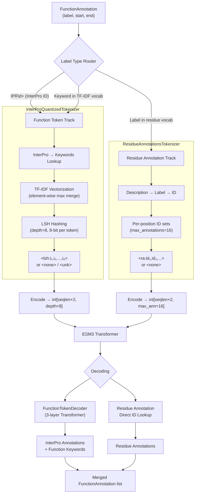
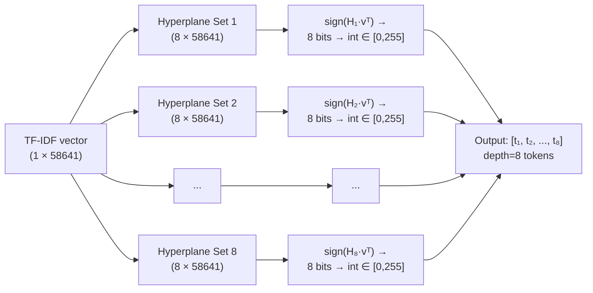
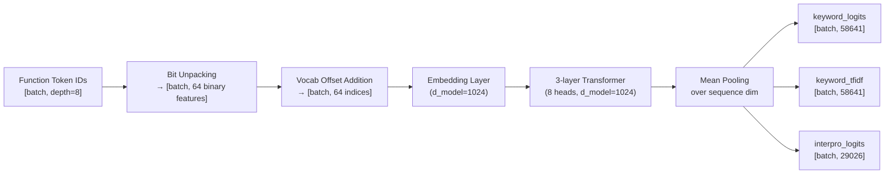

ESM3 represents protein function not as a single monolithic label, but through **two parallel tokenization tracks** that capture function at different granularities: the **InterProQuantizedTokenizer** compresses InterPro domain annotations and free-text function keywords into multi-token LSH hashes, while the **ResidueAnnotationsTokenizer** maps site-specific residue-level descriptors into a fixed-vocabulary categorical encoding. Together, these two tracks form the function annotation modality of ESM3's multimodal input, enabling the model to reason about both domain-scale functional regions and per-residue functional sites within a unified token framework.

Sources: [function_tokenizer.py](esm/tokenization/function_tokenizer.py#L29-L35), [residue_tokenizer.py](esm/tokenization/residue_tokenizer.py#L15-L16), [tokenizer_base.py](esm/tokenization/tokenizer_base.py#L1-L26)

## Architectural Overview

The function annotation pipeline follows a dual-track design: both tokenizers accept `FunctionAnnotation` objects (a label with 1-indexed inclusive start/end positions), expand range annotations into positional label sets, and emit per-position token strings. These strings are then encoded into integer tensors of distinct rank—**depth × sequence_length** for function tokens and **max_annotations × sequence_length** for residue annotations—before being fed into ESM3's transformer stack as separate input tracks.



The router that splits annotations by type lives in `encode_function_annotations`, which checks each `FunctionAnnotation.label` against three registries: the InterPro index, the TF-IDF keyword vocabulary, and the residue annotation label set. An annotation that matches none of these raises a `ValueError`.

Sources: [encode_decode.py](esm/utils/function/encode_decode.py#L13-L51), [__init__.py](esm/tokenization/__init__.py#L24-L31), [types.py](esm/utils/types.py#L14-L27)

## The FunctionAnnotation Data Model

Both tokenization tracks share a single input type—`FunctionAnnotation`—which is a frozen dataclass representing a labeled range over the protein sequence. Its fields use **1-indexed inclusive** coordinates, consistent with biological convention.

| Field | Type | Description |
|-------|------|-------------|
| `label` | `str` | An InterPro ID (e.g. `IPR000006`), a function keyword, or a residue annotation descriptor |
| `start` | `int` | Start position, 1-indexed inclusive |
| `end` | `int` | End position, 1-indexed inclusive |

The `__len__` method returns `end - start + 1`, making it straightforward to filter annotations by minimum length during decoding.

Sources: [types.py](esm/utils/types.py#L14-L33)

## InterProQuantizedTokenizer: TF-IDF → LSH Pipeline

The `InterProQuantizedTokenizer` is the more architecturally complex of the two tokenizers. It solves a fundamental representation problem: InterPro annotations and free-text function keywords form a large, sparse label space (29,026 InterPro entries, 58,641 keywords) that cannot be directly tokenized into a compact vocabulary. Instead, it projects this space through a **TF-IDF → Locality-Sensitive Hashing (LSH)** pipeline that produces a fixed-depth multi-token representation at each sequence position.

### Step 1: Range Expansion into Positional Label Sets

The `tokenize` method first expands range annotations into per-position label sets. For a `FunctionAnnotation(label="IPR000006", start=10, end=50)`, every position from 9 to 49 (0-indexed) receives `"IPR000006"` in its label set. Positions with no annotations receive the `<none>` sentinel. Positions where hashing fails (empty TF-IDF vector) receive `<unk>`.

> [!TIP]
> Annotations tend to be repetitive over long stretches of a protein sequence. The tokenizer caches hash computations via `functools.cache` keyed on `frozenset(labels)`, so identical label combinations at different positions share a single LSH computation. This is a significant performance optimization for proteins with long conserved domains.

Sources: [function_tokenizer.py](esm/tokenization/function_tokenizer.py#L147-L204)

### Step 2: Label Resolution and TF-IDF Encoding

Each positional label set is processed by `_function_text_hash`, which splits labels into InterPro IDs and keywords. InterPro IDs are resolved through the `interpro2keywords` mapping—a CSV-backed dictionary that expands each InterPro entry into its associated keyword list. Keywords from all sources are then encoded into a single TF-IDF vector.

The critical design choice here is the **element-wise maximum** merge strategy: when multiple InterPro tags contribute TF-IDF vectors, they are combined via `vec.maximum(vec_)` rather than addition. This prevents a cluster of similar tags from "washing out" the signal of a single distinctive tag, preserving discriminative power in the LSH projection.

| Merge Strategy | Behavior | Why Not Used |
|----------------|----------|--------------|
| Element-wise max | Takes the stronger signal per keyword dimension | — **(selected)** |
| Addition | Accumulates signal across tags | Similar tags amplify noise |
| Average | Distributes signal evenly | Dilutes distinctive features |

The TF-IDF model itself uses sublinear term frequency (`1 + log(tf)`) weighted by inverse document frequency, with L2 normalization—matching `sklearn`'s `TfidfVectorizer(sublinear_tf=True)` convention.

Sources: [function_tokenizer.py](esm/tokenization/function_tokenizer.py#L206-L247), [tfidf.py](esm/utils/function/tfidf.py#L13-L54)

### Step 3: Locality-Sensitive Hashing

The normalized TF-IDF vector is projected through the `LSHTokenized` module, which applies **8 independent hash tables** (controlled by `depth=8`), each producing an 8-bit token. Each `LSHTable` computes `sign(hyperplane @ vec.T)` across `n_bits` random hyperplanes, then packs the resulting bits into an integer token via `bits.T @ (1 << arange(n_bits))`. The result is a vector of `depth` integers, each in `[0, 256)`.



The hyperplanes are **not randomly initialized at runtime**—they are loaded from a pre-computed `.npz` file (`data/hyperplanes_8bit_58641.npz`) to ensure deterministic tokenization across runs and between training and inference. The `LSHTokenized` constructor will raise `FileNotFoundError` if this file is missing and `allow_create_hyperplanes` is `False`.

> [!TIP]
> The LSH design means that semantically similar function annotations (those sharing many keywords) hash to similar token sequences, while dissimilar annotations diverge. This locality-preserving property is critical for the model's ability to generalize across function space—it can learn smooth decision boundaries in LSH token space rather than memorizing sparse one-hot labels.

Sources: [lsh.py](esm/utils/function/lsh.py#L7-L72), [function_tokenizer.py](esm/tokenization/function_tokenizer.py#L82-L90), [esm3.py](esm/utils/constants/esm3.py#L122-L122)

### Vocabulary Structure

The function token vocabulary is constructed as a flat list with three regions:

| Region | Tokens | Count | Index Range |
|--------|--------|-------|-------------|
| Special tokens | `<pad>`, `<motif>`, `<unk>` | 3 | 0–2 |
| None sentinel | `<none>` | 1 | 3 |
| LSH tokens | `<lsh:0>` through `<lsh:255>` | 256 | 4–259 |

The total vocabulary size is **260** (3 special + 1 none + 256 LSH). The `_lsh_token_vocab_offset` is 4, meaning LSH integer values are shifted by this offset when encoding into token IDs. A `<lsh:5,12,200,1,88,45,3,99>` token at a sequence position is encoded as a length-8 integer vector `[9, 16, 204, 5, 92, 49, 7, 103]` (each LSH value + 4 offset).

Sources: [function_tokenizer.py](esm/tokenization/function_tokenizer.py#L126-L139), [function_tokenizer.py](esm/tokenization/function_tokenizer.py#L281-L292)

### Keyword Dropout

During training, the tokenizer supports **keyword dropout** via the `p_keyword_dropout` parameter. When non-zero, a random binary mask is applied to the keyword dimension of the TF-IDF vector before hashing: `vec.data *= 1 - np.take(keyword_mask, vec.indices)`. This acts as a regularization strategy, forcing the model to not over-rely on any specific subset of keywords for function prediction.

Sources: [function_tokenizer.py](esm/tokenization/function_tokenizer.py#L151-L188), [function_tokenizer.py](esm/tokenization/function_tokenizer.py#L241-L243)

### Keyword Extraction from InterPro Text

The `_keywords_from_text` helper converts InterPro/GO free-text descriptions into bag-of-n-grams (unigrams and bigrams). Text is first split on `", "`, then sanitized (lowercased, punctuation removed, hyphens replaced with spaces), and finally decomposed into individual words and consecutive word pairs. A curated `_EXCLUDED_TERMS` set filters out pervasive but uninformative terms like `"binding domain"`, `"molecular function"`, and `"cellular component"`.

Sources: [function_tokenizer.py](esm/tokenization/function_tokenizer.py#L368-L429)

## ResidueAnnotationsTokenizer: Direct Categorical Encoding

The `ResidueAnnotationsTokenizer` takes a fundamentally different approach. Rather than hashing, it maintains a **direct categorical vocabulary** of residue-level annotation labels loaded from a CSV file. Each unique label (after deduplication via `label_clean`) becomes a token `<ra:id>` in the vocabulary, sorted by descending frequency.

### Vocabulary Structure

| Region | Tokens | Description |
|--------|--------|-------------|
| Special tokens | `<pad>`, `<motif>`, `<unk>` | Control tokens (indices 0–2) |
| None sentinel | `<none>` | No annotation at this position (index 3) |
| Annotation tokens | `<ra:id>` | One per unique cleaned label (index 4+) |

The offset into the annotation region is `len(special_tokens) + 1 = 4`. The `vocabulary` property returns the human-readable label strings rather than the `<ra:id>` token strings, providing a lookup from vocab index to descriptive name.

Sources: [residue_tokenizer.py](esm/tokenization/residue_tokenizer.py#L41-L68)

### Multi-Annotation Encoding

Unlike function tokens where multiple labels at a position are merged through TF-IDF before hashing, residue annotations preserve **multiple simultaneous labels** per position. The tokenizer collects all annotation IDs into a set per position, then encodes them into a fixed-width tensor of shape `[seqlen, max_annotations]` where `max_annotations = 16`. IDs are left-aligned and padded with `<pad>` if fewer than 16 annotations exist at a position.

The `tokenize` method receives its input through a `Sample` dictionary containing `interpro_site_descriptions`, `interpro_site_starts`, `interpro_site_ends`, and `interpro_site_residues`. It validates that residue identities match the reference sequence, and on any mismatch returns a full `<pad>` sequence—effectively marking the sample as unannotated rather than introducing errors.

Sources: [residue_tokenizer.py](esm/tokenization/residue_tokenizer.py#L73-L183), [esm3.py](esm/utils/constants/esm3.py#L92-L92)

## Encoding: From Tokens to Tensors

Both tokenizers follow the `EsmTokenizerBase` protocol, which mandates `encode` and `decode` methods along with special token properties. The encoding step converts string token lists into integer tensors suitable for model input.

### Function Token Encoding

The `InterProQuantizedTokenizer.encode` method produces a tensor of shape `[seqlen, depth]` where `depth = 8`. When `add_special_tokens=True`, BOS and EOS rows (filled with `<pad>` ID) are prepended and appended, yielding `[seqlen+2, 8]`. The `batch_encode` method handles variable-length sequences by stacking with right-padding.

### Residue Annotation Encoding

The `ResidueAnnotationsTokenizer.encode` method produces a tensor of shape `[seqlen, max_annotations]` where `max_annotations = 16`. Multi-ID tokens like `<ra:5,12,45>` are split into individual IDs and placed into the annotation slots, truncated to 16 entries. With special tokens, the output shape becomes `[seqlen+2, 16]`.

| Property | Function Tokens | Residue Annotations |
|----------|----------------|-------------------|
| Output rank | 2D | 2D |
| Shape (no special) | `[seqlen, 8]` | `[seqlen, 16]` |
| Shape (with special) | `[seqlen+2, 8]` | `[seqlen+2, 16]` |
| Multi-label strategy | LSH hash (lossy) | ID list (lossless) |
| Vocab size | 260 | Variable (special + none + labels) |
| Mask token | `<pad>` | `<pad>` |
| BOS/EOS token | `<pad>` | `<pad>` |

Note that both tokenizers use `<pad>` as the BOS, EOS, mask, and chain break token—function and residue annotation tracks do not use dedicated boundary tokens.

Sources: [function_tokenizer.py](esm/tokenization/function_tokenizer.py#L249-L311), [residue_tokenizer.py](esm/tokenization/residue_tokenizer.py#L167-L183), [encoding.py](esm/utils/encoding.py#L206-L229)

## Decoding: From Model Outputs to Annotations

Decoding is architecturally asymmetric between the two tracks. Function tokens require a learned **FunctionTokenDecoder** (a 3-layer Transformer with classification heads), while residue annotations decode through direct ID lookup.

### FunctionTokenDecoder

The `FunctionTokenDecoder` is a standalone Transformer module that takes encoded function token IDs and produces three output heads:

| Head | Output Shape | Purpose |
|------|-------------|---------|
| `keyword_logits` | `[batch, 58641]` | Binary classification of function keywords |
| `keyword_tfidf` | `[batch, 58641]` | Regression of TF-IDF values per keyword |
| `interpro_logits` | `[batch, 29026]` | Binary classification of InterPro annotations |

The decoder first unpacks LSH tokens into individual bits. Each 8-bit token is decomposed into 8 binary values via bitwise AND with `1 << bit_position`, yielding `depth × bits_per_token = 64` binary features. These are shifted into non-overlapping vocabulary ranges (each bit gets a 2-entry vocab: 0 or 1 plus offset) so that each bit-position pair receives a distinct embedding. This **bit-level unpacking** ensures the decoder can learn position-aware representations within each LSH token.



During decoding, sigmoid-activated predictions are thresholded (default `annotation_threshold=0.1` for InterPro, `keywords_threshold=0.5` for keywords), filtered to only positions that contain actual function tokens (not `<pad>`, `<none>`, or `<unk>`), and then converted into `FunctionAnnotation` objects. Adjacent positions with the same label are merged via `merge_annotations` with a configurable gap tolerance (`annotation_gap_merge_max=3`), and annotations shorter than `annotation_min_length=5` are discarded.

Sources: [function_decoder.py](esm/models/function_decoder.py#L54-L176), [function_decoder.py](esm/models/function_decoder.py#L182-L282)

### Residue Annotation Decoding

Residue annotation decoding is far simpler: the `decode_residue_annotation_tokens` function iterates over each of the 16 annotation depth slots, finds nonzero token IDs, and looks up the corresponding label from `residue_annotations_tokenizer.vocabulary`. Adjacent same-label positions are merged and short annotations filtered using the same `merge_annotations` and length-threshold logic as function tokens.

Notably, the `ResidueAnnotationsTokenizer.decode` method raises `NotImplementedError` with a redirect to the utility function, enforcing that decoding must go through the dedicated pipeline rather than the tokenizer itself.

Sources: [encode_decode.py](esm/utils/function/encode_decode.py#L136-L181), [residue_tokenizer.py](esm/tokenization/residue_tokenizer.py#L185-L188)

### Unified Decoding in the SDK

The top-level `decode_protein_tensor` function in the SDK merges both tracks: it calls `decode_function_annotations` for the function token track and `decode_residue_annotations` for the residue annotation track, then concatenates the resulting `FunctionAnnotation` lists into a single `function_annotations` field on the output `ESMProtein`.

Sources: [decoding.py](esm/utils/decoding.py#L31-L111), [decoding.py](esm/utils/decoding.py#L206-L233)

## The InterPro Ontology Interface

Both tokenizers depend on the `InterPro` utility class, which provides structured access to the InterPro database. It loads a TSV of entries (with `ENTRY_AC`, `ENTRY_TYPE`, `ENTRY_NAME` columns), constructs a hierarchy as a `networkx.DiGraph` from the parent-child tree file, and optionally maps InterPro IDs to GO terms via the InterPro2GO file.

| InterProEntryType | Description | Approximate Count |
|-------------------|-------------|-------------------|
| `ACTIVE_SITE` | Catalytic or binding active sites | 133 |
| `BINDING_SITE` | Ligand binding sites | 75 |
| `CONSERVED_SITE` | Evolutionarily conserved sites | 728 |
| `DOMAIN` | Structural/functional domains | 14,053 |
| `FAMILY` | Protein families | 21,942 |
| `HOMOLOGOUS_SUPERFAMILY` | Homologous superfamilies | 3,446 |
| `PTM` | Post-translational modifications | 17 |
| `REPEAT` | Repeated sequence motifs | 374 |

The hierarchy graph is parsed from a custom indentation-based format where each level of `--` prefix indicates depth in the tree, enabling traversal of the InterPro parent-child relationships.

Sources: [interpro.py](esm/utils/function/interpro.py#L57-L178), [esm3.py](esm/utils/constants/esm3.py#L115-L130)

## Data Assets and Constants

The function and residue annotation tokenizers depend on several pre-computed data files shipped with the repository:

| File | Purpose | Size Indicator |
|------|---------|---------------|
| `entry_list_safety_29026.list` | InterPro entry catalog (TSV) | 29,026 entries |
| `keyword_vocabulary_safety_filtered_58641.txt` | Function keyword vocabulary (line-delimited) | 58,641 terms |
| `keyword_idf_safety_filtered_58641.npy` | IDF weights for each keyword | 58,641 values |
| `interpro_29026_to_keywords_58641.csv` | InterPro → keywords mapping | 29,026 rows |
| `ParentChildTreeFile.txt` | InterPro hierarchy tree | Full taxonomy |
| `hyperplanes_8bit_58641.npz` | Pre-computed LSH hyperplanes | 8 tables × (8 × 58641) |

The `_safety_filtered` suffix indicates these vocabularies have been curated to remove potentially problematic entries. The `data_root` function resolves paths by downloading from HuggingFace (`EvolutionaryScale/esm3-sm-open-v1`) when not running in internal infrastructure.

Sources: [esm3.py](esm/utils/constants/esm3.py#L95-L131)

## Tokenizer Integration: TokenizerCollection

Both tokenizers are instantiated together in the `TokenizerCollection` dataclass, which aggregates all six ESM3 tokenizers. The `get_esm3_model_tokenizers` factory creates them with default parameters, ensuring consistent configuration across the pipeline.

```python
TokenizerCollection(
    function=InterProQuantizedTokenizer(),         # depth=8, lsh_bits=8
    residue_annotations=ResidueAnnotationsTokenizer(),  # max_annotations=16
    # ... plus sequence, structure, ss, sasa tokenizers
)
```

Sources: [__init__.py](esm/tokenization/__init__.py#L24-L46)

## Comparison: Function Tokens vs. Residue Annotations

| Dimension | Function Tokens | Residue Annotations |
|-----------|----------------|-------------------|
| **Input scope** | InterPro domains + free-text keywords | Site-level residue descriptors |
| **Encoding strategy** | Lossy: TF-IDF → LSH compression | Lossless: direct categorical ID |
| **Multi-label handling** | Merged into single hash | Preserved as ID list (up to 16) |
| **Vocabulary type** | Fixed (256 LSH + 4 special) | Variable (depends on label count in CSV) |
| **Output tensor shape** | `[L+2, 8]` | `[L+2, 16]` |
| **Decoding requirement** | Learned 3-layer Transformer decoder | Direct table lookup |
| **Decoding outputs** | InterPro labels + keyword ranges | Residue descriptor ranges |
| **Locality preservation** | Yes (LSH preserves similarity) | No (arbitrary ID assignment) |
| **Keyword dropout** | Supported (training regularization) | Not applicable |
| **Typical annotation scale** | Domain/family level (spanning many residues) | Site level (1–few residues) |

This dual-track design reflects a deliberate architectural trade-off: function tokens sacrifice precise label recovery for compressibility and locality preservation, enabling the model to learn smooth representations over function space. Residue annotations preserve exact labels but lack the semantic smoothing that LSH provides, making them better suited for precise site-level predictions.

Sources: [function_tokenizer.py](esm/tokenization/function_tokenizer.py#L29-L366), [residue_tokenizer.py](esm/tokenization/residue_tokenizer.py#L15-L237)

## Next Steps

- To understand how these token tensors flow through ESM3's geometric attention layers, see [Geometric Attention and SE(3) Invariance](13-geometric-attention-and-se-3-invariance).
- For the other tokenization tracks that feed into the same transformer, see [Sequence and Structure Tokenizers](10-sequence-and-structure-tokenizers) and [VQ-VAE Structure Encoding](11-vq-vae-structure-encoding).
- For the full encode/decode pipeline that orchestrates all tokenizers together, see [Encode-Decode Pipeline](22-encode-decode-pipeline).