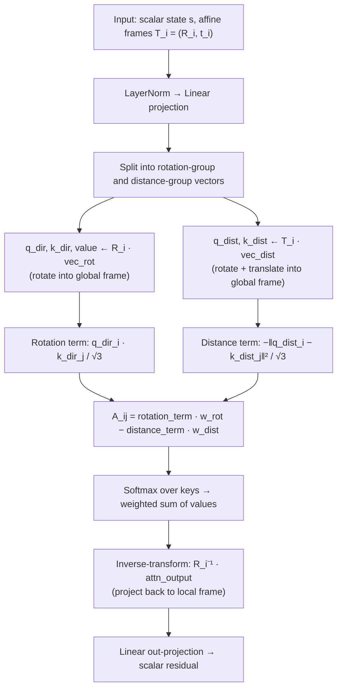
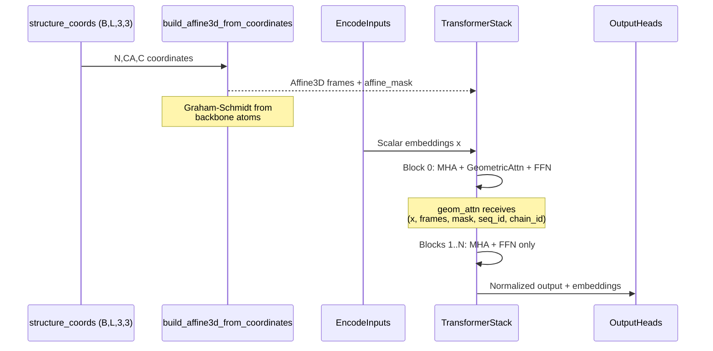

ESM3's distinguishing architectural innovation is its **geometric attention** mechanism — a structurally-aware attention layer that operates directly on 3D rigid-body frames (affine transformations) rather than treating structure as a flattened sequence of coordinates. This mechanism is the key to ESM3's ability to jointly reason over sequence and structure: it computes attention scores from rotation-invariant directional signals and SE(3)-invariant distance signals, then propagates vector-valued messages through the attention graph while maintaining equivariance with respect to the local coordinate frame at each residue. The result is an attention mechanism whose outputs are provably invariant under simultaneous rotation and translation of the entire input structure — the defining property of SE(3) invariance.

Sources: [geom_attention.py](/esm/layers/geom_attention.py#L9-L31), [affine3d.py](/esm/utils/structure/affine3d.py#L270-L276)

## From Backbone Atoms to Local Frames

Every geometric attention computation begins with constructing a **local rigid-body frame** at each residue from its backbone atoms (N, CA, C). The function `build_affine3d_from_coordinates` takes coordinates of shape `(B, L, 3, 3)` and produces an `Affine3D` object — a pair of a 3D translation vector and a rotation — along with a boolean mask indicating which residues have valid coordinates.

The frame construction uses a Graham-Schmidt orthogonalization procedure consistent with AlphaFold2's convention: the CA atom defines the origin, the C→CA vector defines the first axis, and the N atom (projected into the plane) defines the second axis. Residues with missing or invalid coordinates receive a **"black hole" affine** — an identity rotation centered at the average position of all valid atoms — rather than a zero rotation, which would cause catastrophic collapse in the distance/direction attention computation. This design choice is critical: a zero rotation matrix would map all query/key vectors to the origin, producing degenerate attention patterns.

Sources: [affine3d.py](/esm/utils/structure/affine3d.py#L512-L560), [affine3d.py](/esm/utils/structure/affine3d.py#L417-L429)

## The Affine3D Algebra

The `Affine3D` dataclass is the foundational algebraic object underpinning geometric attention. It encapsulates a rigid-body transformation T = (R, t) where R is a rotation and t is a translation, supporting two rotation representations — `RotationMatrix` (3×3 matrix, 12-element flat tensor) and `RotationQuat` (quaternion, 4-element tensor). The core operations that geometric attention relies on are:

| Operation | Formula | Geometric Meaning |
|---|---|---|
| `apply(p)` | R·p + t | Transform point p from local to global frame |
| `rot.apply(p)` | R·p | Rotate vector p (no translation) |
| `invert()` | (R^T, -R^T·t) | Inverse transformation (global → local) |
| `compose(other)` | R₁·R₂, R₁·t₂ + t₁ | Sequential transformation |

The distinction between `apply` (rotation + translation) and `rot.apply` (rotation only) is the central mechanism by which geometric attention separates **directional** information from **positional** information — a distinction that directly maps to the two terms in the attention score.

Sources: [affine3d.py](/esm/utils/structure/affine3d.py#L348-L384), [affine3d.py](/esm/utils/structure/affine3d.py#L86-L178)

## The Geometric Attention Mechanism

The `GeometricReasoningOriginalImpl` module implements geometric attention with a precise mathematical formulation. The pseudocode from the module's docstring captures the essence:

```
ATTN(A, v) := (softmax_j A_ij) v_j
make_rot_vectors(x) := R(i→g) Linear(x).reshape(..., 3)    # rotation only
make_vectors(x)    := T(i→g) Linear(x).reshape(..., 3)    # rotation + translation

v       ← make_rot_vectors(x)
q_dir, k_dir ← make_rot_vectors(x)
q_dist, k_dist ← make_vectors(x)

A_ij    ← dot(q_dir_i, k_dir_j) − ||q_dist_i − k_dist_j||²
x       ← x + Linear(T(g→i) ATTN(A, v))
```

The mechanism proceeds in four phases:



**Phase 1 — Projection**: The input scalar state `s` is layer-normalized and projected through a single linear layer into a high-dimensional space that is then split into two groups. The rotation group (`vec_rot`) contains queries, keys, and values for the directional term — these are 3D vectors per head that will be *rotated only* into the global frame. The distance group (`vec_dist`) contains queries and keys for the positional term — these will be *rotated and translated* into the global frame.

**Phase 2 — Frame transformation**: Rotation-group vectors are transformed via `affine.rot.apply()` (rotation only), while distance-group vectors are transformed via `affine.apply()` (rotation + translation). This separation is the architectural key to SE(3) invariance: the rotation term depends only on the *orientation* of local frames relative to each other, while the distance term depends on the *positions* of residues in 3D space.

**Phase 3 — Attention scoring**: The attention logit for residue i attending to residue j is computed as:

**A_ij = w_rot · (q_dir_i · k_dir_j) / √3 − w_dist · ‖q_dist_i − k_dist_j‖² / √3**

The first term is a dot product of direction vectors (favoring aligned orientations), the second term is a negative squared distance (favoring spatial proximity). The per-head learnable parameters `distance_scale_per_head` and `rotation_scale_per_head` — initialized to zero and passed through softplus — allow the network to independently calibrate the relative importance of directional versus positional information for each attention head. The √3 normalization factor accounts for the dimensionality of the 3D vector space.

**Phase 4 — Inverse transform and output**: The attention-weighted values (which are vectors in the global frame) are transformed back into each residue's local frame via `affine.rot.invert().apply()`, then flattened and projected through a linear layer to produce a scalar residual that is added to the input state.

> [!TIP]
> The values are rotated but *not translated* into the global frame (`affine.rot.apply`), which means they carry only orientational information. The inverse rotation then projects them back into the local frame, ensuring that the output depends only on the *relative* orientations between residues — not on absolute position or orientation in space.

Sources: [geom_attention.py](/esm/layers/geom_attention.py#L9-L149), [affine3d.py](/esm/utils/structure/affine3d.py#L379-L384)

## Why This Is SE(3) Invariant

SE(3) is the special Euclidean group — the group of all rigid-body transformations (rotations + translations) in 3D space. An attention mechanism is SE(3)-invariant if its scalar outputs do not change when the entire input structure is simultaneously rotated and translated. The geometric attention mechanism achieves this through two independent invariance arguments:

**Rotation term invariance**: Under a global rotation R_g applied to all frames, each local rotation R_i becomes R_g · R_i. The query and key direction vectors transform as (R_g · R_i) · q_dir_i. The dot product (R_g · R_i · q_dir_i) · (R_g · R_j · k_dir_j) = q_dir_i^T · R_i^T · R_g^T · R_g · R_j · k_dir_j = q_dir_i^T · R_i^T · R_j · k_dir_j, which is independent of R_g because R_g^T · R_g = I.

**Distance term invariance**: Under a global transformation (R_g, t_g), each frame T_i becomes T_g ∘ T_i. The distance-group vectors transform as R_g · R_i · q_dist_i + (R_g · t_i + t_g). The squared distance ‖(R_g · R_i · q_dist_i + R_g · t_i + t_g) − (R_g · R_j · k_dist_j + R_g · t_j + t_g)‖² = ‖R_g · (R_i · q_dist_i + t_i − R_j · k_dist_j − t_j)‖² = ‖R_i · q_dist_i + t_i − R_j · k_dist_j − t_j‖², which is independent of (R_g, t_g) because rotations preserve norms.

**Output invariance**: Since the attention weights A_ij are SE(3)-invariant, the attention output in the global frame is SE(3)-equivariant (it rotates with the structure). The final inverse rotation R_i^T projects this back into the local frame, yielding an output that depends only on relative geometry — making the overall residual SE(3)-invariant.

> [!TIP]
> The attention *bias* (derived from sequence_id and chain_id masking) is also SE(3)-invariant by construction, since it depends only on discrete token identity, not on coordinates. This means the full attention computation — including masking for padding, bin-packing, and chain separation — maintains the invariance guarantee end-to-end.

Sources: [geom_attention.py](/esm/layers/geom_attention.py#L52-L63), [geom_attention.py](/esm/layers/geom_attention.py#L103-L128)

## Integration into the Transformer Stack

Geometric attention does not replace standard multi-head attention — it *augments* it. The `UnifiedTransformerBlock` contains three parallel sub-layers applied sequentially: (1) standard multi-head attention with rotary embeddings, (2) geometric attention (if enabled), and (3) a SwiGLU feed-forward network. Each produces a residual that is added to the input, scaled by a `residue_scaling_factor` proportional to √(n_layers / 36) for depth-wise normalization.

The `TransformerStack` controls which layers receive geometric attention through the `n_layers_geom` parameter. Only the **first** `n_layers_geom` blocks in the stack are configured with `use_geom_attn=True`, while all blocks always include standard attention. This design reflects the observation that geometric inductive bias is most valuable in the early layers, where local structural patterns must be rapidly communicated across the sequence, while deeper layers can rely on the standard attention mechanism to refine learned representations.

| Parameter | Role | Default in ESM3 Open Small |
|---|---|---|
| `v_heads` | Number of geometric attention heads | Configured per model variant |
| `n_layers_geom` | Number of initial blocks with geometric attention | 1 (first block only) |
| `mask_and_zero_frameless` | Zero-out output for residues without valid frames | `True` |
| `distance_scale_per_head` | Learnable per-head weight for distance term | Initialized to 0 (softplus → ~0.69) |
| `rotation_scale_per_head` | Learnable per-head weight for rotation term | Initialized to 0 (softplus → ~0.69) |

Sources: [transformer_stack.py](/esm/layers/transformer_stack.py#L10-L62), [blocks.py](/esm/layers/blocks.py#L51-L157), [geom_attention.py](/esm/layers/geom_attention.py#L46-L50)

## Attention Masking and Chain Separation

Geometric attention incorporates three distinct masking mechanisms that work together to prevent information leakage while maintaining SE(3) invariance:

**Sequence ID masking** ensures that tokens from different packed sequences within the same batch cannot attend to each other — a requirement for efficient bin-packing. **Chain ID masking** prevents cross-chain attention in multi-chain protein complexes, enforcing that geometric messages propagate only within a single polypeptide chain. **Affine masking** (via `affine_mask`) prevents attention to residues that lack valid structural coordinates, replacing their attention logits with `-inf` to produce zero attention weights.

The `mask_and_zero_frameless` flag provides an additional safety mechanism: after the attention output is computed and inverse-transformed, any position lacking a valid affine frame has its output explicitly zeroed. This prevents any spurious signal from propagating through residues where the geometric computation is undefined.

Sources: [geom_attention.py](/esm/layers/geom_attention.py#L52-L63), [geom_attention.py](/esm/layers/geom_attention.py#L145-L148)

## Comparison: Standard Attention vs. Geometric Attention

| Aspect | Standard Multi-Head Attention | Geometric Attention |
|---|---|---|
| **Input modality** | Scalar token embeddings | Scalar embeddings + 3D affine frames |
| **Positional encoding** | Rotary embeddings (sequence-relative) | Intrinsic 3D geometry (rotation + distance) |
| **Score function** | q·k / √d | w_rot·(q_dir·k_dir)/√3 − w_dist·‖q_dist−k_dist‖²/√3 |
| **Value type** | Scalar vectors (d_head-dim) | 3D vector messages per head |
| **SE(3) invariance** | Not applicable (no geometry) | Proven by construction |
| **Chain awareness** | Via sequence_id mask | Via chain_id + sequence_id + affine_mask |
| **Frame requirement** | None | Valid backbone coordinates (N, CA, C) |
| **Implementation** | FlashAttention compatible | Custom PyTorch (no FlashAttention) |

Sources: [attention.py](/esm/layers/attention.py#L16-L83), [geom_attention.py](/esm/layers/geom_attention.py#L9-L149)

## Structure Head: Predicting Frame Updates

Downstream of the transformer stack, the `Dim6RotStructureHead` module predicts updates to the affine frames using a **6D rotation representation** rather than quaternions. This choice is informed by evidence that the Graham-Schmidt orthogonalization of two 3D vectors provides a more continuous rotation parameterization than quaternions for neural network prediction. The head projects the hidden state into 9 dimensions (6 for rotation via two unnormalized 3D vectors, 3 for translation) plus torsion angle predictions. The rotation vectors are normalized via Graham-Schmidt and composed with the existing affine frame, producing updated residue positions in 3D space.

Sources: [structure_proj.py](/esm/layers/structure_proj.py#L8-L63)

## Forward Data Flow: End-to-End

The complete data path from raw coordinates through geometric attention and back to structure prediction is orchestrated by the `ESM3.forward()` method:



The affine frames are constructed once from the input coordinates and then **shared across all geometric attention layers** without update — the frames serve as a fixed geometric scaffold against which the scalar representations evolve through the transformer layers.

Sources: [esm3.py](/esm/models/esm3.py#L260-L374), [transformer_stack.py](/esm/layers/transformer_stack.py#L64-L94)

---

**Next steps**: To understand how geometric attention fits into the broader transformer architecture, see [Transformer Stack Design](14-transformer-stack-design). For the positional encoding used in the standard attention pathway that runs alongside geometric attention, see [Rotary Embeddings and SwiGLU](15-rotary-embeddings-and-swiglu). For the tokenization pipeline that produces the structure coordinates fed into `build_affine3d_from_coordinates`, see [VQ-VAE Structure Encoding](11-vq-vae-structure-encoding).