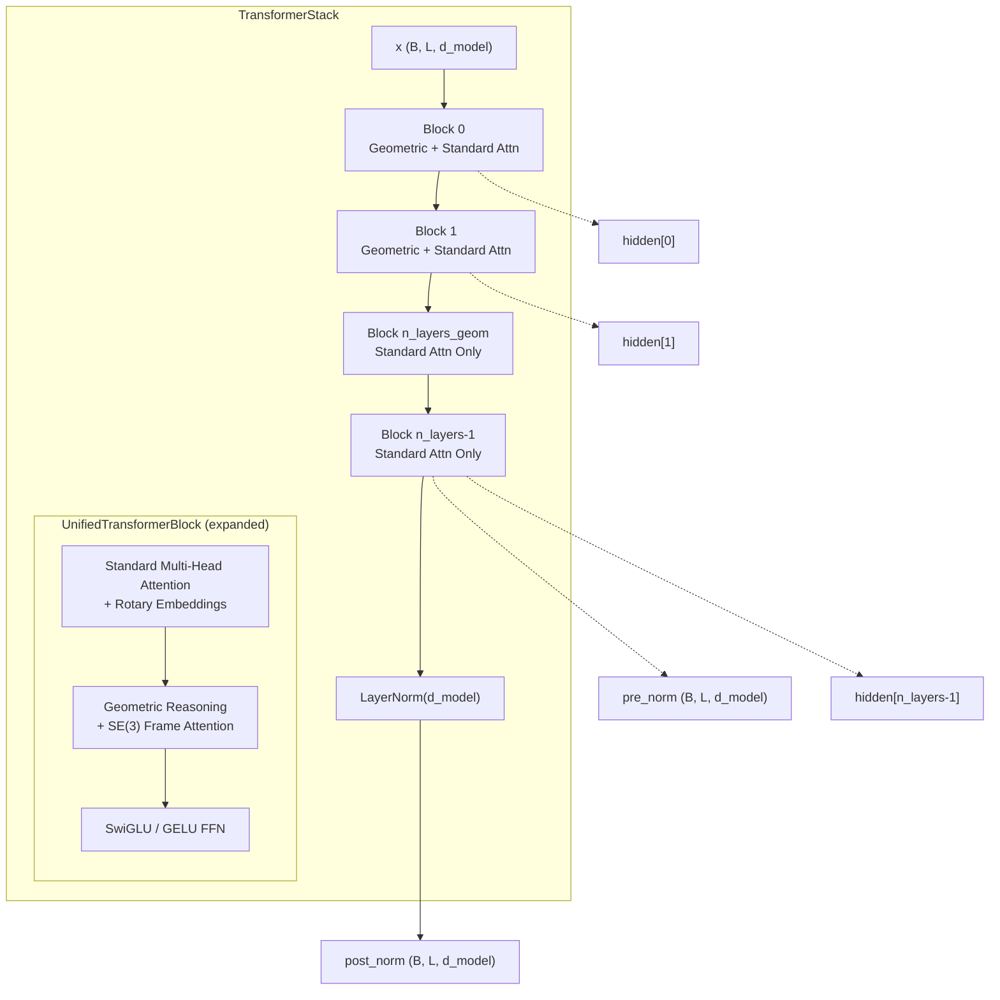
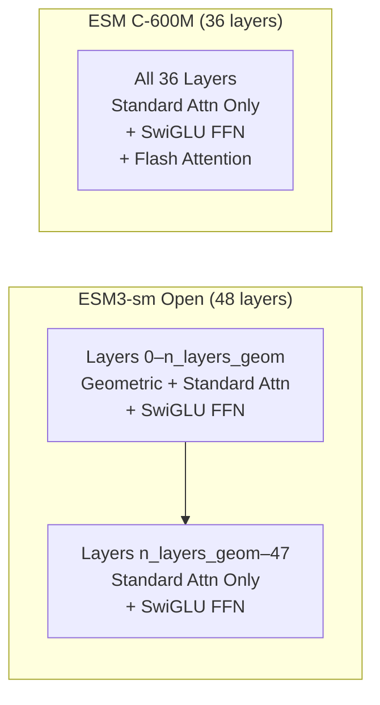

The `TransformerStack` is the computational backbone of every ESM model — a carefully engineered sequence of `UnifiedTransformerBlock` layers that orchestrates both standard multi-head attention and SE(3)-invariant geometric reasoning within a single unified architecture. This page examines the stack's structural design, its dual-attention block internals, the depth-wise residue scaling that stabilizes deep training, and how the two model families (ESM3 and ESM C) configure the same stack for radically different capabilities.

## Architecture at a Glance

The transformer stack follows a **post-norm residual architecture** where each `UnifiedTransformerBlock` applies one or both attention mechanisms followed by a feed-forward network, all wrapped in scaled residual connections. A final `LayerNorm` is applied after the last block. The stack returns three outputs — the post-norm representation, the pre-norm embedding, and a list of all per-layer hidden states — enabling downstream heads to consume whichever representation level suits their task.



The key architectural insight is that **the first `n_layers_geom` blocks are geometric-aware** — they receive `Affine3D` frames and `chain_id` information to perform structure-aware attention — while subsequent blocks operate on the sequence representation alone. This creates a natural division of labor: early layers integrate 3D structural context into the representation, and later layers refine the fused representation through standard attention.

Sources: [transformer_stack.py](esm/layers/transformer_stack.py#L10-L94), [blocks.py](esm/layers/blocks.py#L51-L157)

## UnifiedTransformerBlock: The Dual-Attention Building Block

Every layer in the stack is a `UnifiedTransformerBlock`, parameterized by a single boolean `use_geom_attn` that determines whether the geometric attention sub-layer is instantiated. The block's forward pass applies up to three operations sequentially, each with a **scaled residual connection**:

```python
# Pseudocode from the actual forward pass
if self.use_plain_attn:
    r1 = self.attn(x, sequence_id)
    x = x + r1 / self.scaling_factor     # scaled residual

if self.use_geom_attn:
    r2 = self.geom_attn(x, frames, frames_mask, sequence_id, chain_id)
    x = x + r2 / self.scaling_factor     # scaled residual

r3 = self.ffn(x) / self.scaling_factor
x = x + r3                               # FFN residual
```

The execution order matters: **standard attention runs first**, producing a sequence-contextualized representation that is then refined by geometric attention (if present), and finally transformed by the FFN. This ordering ensures that geometric reasoning operates on tokens that already carry contextual sequence information, rather than raw embeddings.

| Sub-layer | When Active | Input Dependency | SE(3) Invariant |
|-----------|-------------|-----------------|------------------|
| Multi-Head Attention | Always (`use_plain_attn=True`) | `x`, `sequence_id` | No (rotary position only) |
| Geometric Attention | First `n_layers_geom` blocks | `x`, `Affine3D`, `affine_mask`, `sequence_id`, `chain_id` | Yes |
| SwiGLU / GELU FFN | Always | `x` | N/A (point-wise) |

> [!TIP]
> The geometric attention and standard attention are **additive, not gating-based** — both contribute independently to the residual stream. This means a block with both attentances performs two full attention passes per layer, which has significant compute implications for deep stacks (48 layers in ESM3-sm).

Sources: [blocks.py](esm/layers/blocks.py#L117-L157), [blocks.py](esm/layers/blocks.py#L73-L115)

## Depth-Wise Residue Scaling

Deep transformer stacks suffer from signal explosion: each residual addition accumulates magnitude, causing instability in later layers. ESM addresses this with **depth-aware residue scaling**, where each residual contribution is divided by a factor proportional to the square root of the network depth:

```python
residue_scaling_factor = math.sqrt(n_layers / 36) if scale_residue else 1.0
```

The constant 36 is the depth of the reference architecture (ESM3-sm uses 48 layers, ESM C-600M uses 36). This means:

| Model | n_layers | Scaling Factor | Effect |
|-------|----------|---------------|--------|
| ESM3-sm Open | 48 | √(48/36) ≈ **1.155** | Residuals dampened ~13% |
| ESM C-600M | 36 | √(36/36) = **1.0** | No scaling (reference) |
| ESM C-300M | 30 | √(30/36) ≈ **0.913** | Residuals amplified ~9% |

The scaling factor applies uniformly to **all three residual connections** within a block — both attention outputs and the FFN output. The FFN output is pre-divided before addition (`x = x + r3`), while attention outputs are divided at the addition site (`x = x + r1 / self.scaling_factor`). This subtle difference means the FFN's contribution is consistently scaled, while the attention scaling is explicit at the addition point.

Sources: [transformer_stack.py](esm/layers/transformer_stack.py#L50-L52), [blocks.py](esm/layers/blocks.py#L146-L156)

## Stack Configuration Across Model Families

The same `TransformerStack` class serves both ESM3 and ESM C, but with fundamentally different configurations that reflect their divergent design goals. ESM3 is a **multimodal generative model** requiring structural reasoning, while ESM C is a **representation model** focused on sequence understanding.



| Parameter | ESM3-sm Open | ESM C-600M | ESM C-300M |
|-----------|-------------|------------|------------|
| `d_model` | 1536 | 1152 | 960 |
| `n_heads` | 24 | 18 | 15 |
| `v_heads` | 256 | **None** | **None** |
| `n_layers` | 48 | 36 | 30 |
| `n_layers_geom` | default (1) | **0** | **0** |
| `scale_residue` | True | True | True |
| `mask_and_zero_frameless` | **True** | False | False |
| `qk_layernorm` | True | True | True |
| `ffn_type` | "swiglu" | "swiglu" | "swiglu" |
| `expansion_ratio` | 8/3 | 8/3 | 8/3 |
| `use_flash_attn` | False | True | True |

The `mask_and_zero_frameless=True` setting in ESM3 is particularly important: it ensures that positions without valid structural frames (i.e., residues with no 3D coordinates) have their geometric attention outputs zeroed out, preventing invalid structural signals from propagating. ESM C disables this because it never receives structural frames (`n_layers_geom=0`).

> [!TIP]
> ESM C's `v_heads=None` and `n_layers_geom=0` completely eliminate geometric attention overhead. This makes ESM C's stack a pure sequence transformer with Flash Attention, which is significantly faster per-layer than ESM3's dual-attention blocks. When choosing between models, remember that ESM3's geometric layers add both compute and memory cost proportional to `v_heads`.

Sources: [esm3.py](esm/models/esm3.py#L205-L207), [esmc.py](esm/models/esmc.py#L66-L73), [pretrained.py](esm/pretrained.py#L95-L111), [pretrained.py](esm/pretrained.py#L77-L92), [pretrained.py](esm/pretrained.py#L59-L74)

## Feed-Forward Network Design

Each `UnifiedTransformerBlock` contains an FFN sub-layer configured as either **SwiGLU** (default) or **GELU**. The SwiGLU variant follows the PaLM/LLaMA pattern: LayerNorm → Linear up-projection → SwiGLU activation → Linear down-projection. A critical detail is the **hidden dimension correction**:

```python
def swiglu_correction_fn(expansion_ratio: float, d_model: int) -> int:
    return int(((expansion_ratio * d_model) + 255) // 256 * 256)
```

Because SwiGLU splits its intermediate representation in half (`x.chunk(2, dim=-1)`), the up-projection must produce `2 × corrected_hidden_dim` outputs. The correction rounds the hidden dimension up to the nearest multiple of 256, which ensures hardware-friendly tensor shapes for efficient matrix multiplication on GPUs.

| FFN Type | Up-projection Size | Activation | Down-projection Size |
|----------|-------------------|------------|---------------------|
| SwiGLU | `2 × round256(expansion_ratio × d_model)` | `SiLU(x1) * x2` | `d_model` |
| GELU | `expansion_ratio × d_model` | `GELU` | `d_model` |

For ESM3-sm with `d_model=1536` and `expansion_ratio=8/3`: the corrected hidden dim is `round256(4096) = 4096`, so the up-projection maps 1536 → 8192, and after the SwiGLU split-and-gate, the down-projection maps 4096 → 1536.

Sources: [blocks.py](esm/layers/blocks.py#L10-L48)

## Data Flow Through the Stack

The forward signature of `TransformerStack.forward` reveals the complete data contract between the multimodal encoder and the transformer core:

```python
def forward(
    self,
    x: torch.Tensor,                    # (B, L, d_model) - fused multimodal embeddings
    sequence_id: torch.Tensor | None,    # (B, L) - pack boundaries for attention masking
    affine: Affine3D | None,             # SE(3) frames for geometric attention
    affine_mask: torch.Tensor | None,    # (B, L) - valid frame positions
    chain_id: torch.Tensor | None,       # (B, L) - chain boundaries for geometric masking
) -> tuple[torch.Tensor, torch.Tensor, list[torch.Tensor]]:
```

The `sequence_id` tensor serves a dual purpose: in standard attention it creates an attention mask where tokens can only attend to others with the same sequence ID (enabling packed-batch training), and in Flash Attention mode it doubles as a boolean pad mask. The `chain_id` tensor is exclusively used by geometric attention to prevent cross-chain attention within multi-chain protein complexes — a structural constraint that ensures geometric reasoning respects chain boundaries.

When `chain_id` is not provided, the stack defaults to a homogeneous chain (`torch.ones(...)`), meaning all positions belong to the same chain. This default is safe for single-chain proteins and for ESM C, which never uses geometric attention.

Sources: [transformer_stack.py](esm/layers/transformer_stack.py#L64-L94)

## Output Representations and Downstream Consumption

The stack returns a triple `(post_norm, pre_norm, hiddens)` that serves different downstream consumers:

- **`post_norm`** — The `LayerNorm`-ed final layer output. This is the primary representation fed to the `OutputHeads` (ESM3) or `sequence_head` (ESM C) for logit computation. The post-norm ensures stable gradient magnitudes for downstream linear layers.
- **`pre_norm`** — The raw final layer output *before* the terminal `LayerNorm`. ESM3's `OutputHeads` receives both representations: `post_norm` for logits and `pre_norm` for the `embeddings` field, preserving the un-normalized representation for embedding-based downstream tasks.
- **`hiddens`** — A list of all per-layer hidden states. ESM C stacks these into a `(n_layers, B, L, D)` tensor exposed as `hidden_states` in `ESMCOutput`, enabling layer-wise analysis and representation extraction at arbitrary depths.

This three-output design is a deliberate architectural choice: the post-norm output is optimal for supervised prediction heads, while the pre-norm output and per-layer hiddens support representation learning workflows where the normalization statistics of the final LayerNorm might discard useful signal.

Sources: [transformer_stack.py](esm/layers/transformer_stack.py#L62-L94), [esm3.py](esm/models/esm3.py#L160-L178), [esmc.py](esm/models/esmc.py#L154-L173)

## Where to Go Next

The transformer stack sits at the intersection of several architectural subsystems. To understand the full picture:

- **[Geometric Attention and SE(3) Invariance](13-geometric-attention-and-se-3-invariance)** — Deep dive into how `GeometricReasoningOriginalImpl` computes rotation-invariant and distance-aware attention scores using `Affine3D` frames.
- **[Rotary Embeddings and SwiGLU](15-rotary-embeddings-and-swiglu)** — The positional encoding strategy in `MultiHeadAttention` and the Triton-optimized variant in `FlashMultiHeadAttention`.
- **[ESM3 Multimodal Generative Model](8-esm3-multimodal-generative-model)** — How the `EncodeInputs` module fuses multimodal tokens before they enter the stack, and how `OutputHeads` decode the stack's output.
- **[ESM C Representation Model](9-esm-c-representation-model)** — How ESM C leverages the stack in pure-sequence mode with Flash Attention for efficient representation extraction.