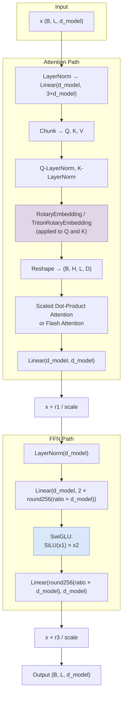

The ESM transformer architecture integrates two synergistic mechanisms—**Rotary Position Embeddings (RoPE)** and **SwiGLU feed-forward networks**—that together define how positional information propagates through attention and how non-linear feature transformations occur in each block. These are not incidental design choices; they form the positional encoding and activation backbone shared across both the ESM3 multimodal generative model and the ESMC representation model, with a dual-path implementation (PyTorch-native vs. Triton-accelerated) that adapts to hardware capability at runtime.

## Rotary Position Embeddings: Architecture and Implementation

Rotary Position Embeddings encode absolute position by rotating query and key vectors in a 2D subspace for each dimension pair, such that the dot product of any two vectors depends only on their relative distance. This property makes RoPE naturally compatible with the attention mechanism: the attention score between position *m* and position *n* is a function of *m − n* alone, without requiring explicit relative position bias tables or learned position embeddings. The ESM codebase implements RoPE through two classes—`RotaryEmbedding` for the standard PyTorch path and `TritonRotaryEmbedding` for the Flash Attention path—both rooted in the LLaMA 2 / GPT-NeoX lineage.

The core mathematical operation is the **half-rotation**. Given an input vector *x* split into two halves along the feature dimension, the rotation produces `concat(−x₂, x₁)` for the GPT-NeoX style (first-half/second-half split) or an interleaved variant for the GPT-J style (`(x[..., ::2], x[..., 1::2])`). The `rotate_half` function dispatches between these two modes via the `interleaved` flag. The actual rotary application then computes `x[..., :ro_dim] * cos + rotate_half(x[..., :ro_dim]) * sin`, where `cos` and `sin` are precomputed from the frequency matrix, and the remaining dimensions `x[..., ro_dim:]` pass through unchanged. This means RoPE can be applied to a **fraction** of the head dimension (`ro_dim = cos.shape[-1] * 2`), leaving the rest unrotated—a flexibility that matters when the rotary dimension differs from the full head width.

Sources: [rotary.py](esm/layers/rotary.py#L36-L65), [rotary.py](esm/layers/rotary.py#L68-L81)

### Frequency Computation and Caching Strategy

The inverse frequency spectrum is computed as `inv_freq = 1 / (base ** (arange(0, dim, 2) / dim))`, where `base` defaults to 10000.0 and `dim` is the rotary dimension (set to `d_model // n_heads`, i.e., the per-head dimension). This produces `dim / 2` frequency components that span from low-frequency (long-range positional correlation) to high-frequency (fine-grained local position). The `_update_cos_sin_cache` method lazily computes and caches the `cos` and `sin` tensors whenever the sequence length grows, the device changes, the dtype changes, or the model transitions between training and inference mode. This caching is critical for efficiency: recomputation is triggered only when necessary, and the cached tensors are sliced by `seqlen_offset` during autoregressive generation to apply the correct positional shift without re-indexing.

A precision-critical detail is the `pos_idx_in_fp32` flag. When a model is trained in pure bf16 (not mixed precision), `inv_freq` would be bf16, causing position indices like 1995.0 to round to 2000.0—destroying positional fidelity for long sequences. The flag forces position indices and the frequency outer product into fp32 regardless of the model's parameter dtype, then downcasts the final `cos`/`sin` back to the target dtype. Additionally, the `scaling_factor` parameter enables **linear position scaling** for context extension: dividing the position index `t` by `scaling_factor` effectively stretches the rotary period, allowing the same frequency spectrum to cover longer sequences at reduced positional resolution.

Sources: [rotary.py](esm/layers/rotary.py#L125-L197)

### Dual Implementation: PyTorch vs. Triton

The codebase provides two rotary embedding backends that are selected at the attention module level:

| Aspect | `RotaryEmbedding` (PyTorch) | `TritonRotaryEmbedding` (Triton) |
|---|---|---|
| **Used by** | `MultiHeadAttention` | `FlashMultiHeadAttention` |
| **Input format** | Separate `q`, `k` tensors `(B, S, H, D)` | Packed `qkv` tensor `(N, 3, H, D)` |
| **Sequence handling** | Direct sequence dimension | `cu_seqlens` + `max_seqlen` (varlen) |
| **Kernel** | Pure PyTorch (`apply_rotary_emb_torch`) | Triton kernel (`apply_triton_rotary`) |
| **In-place** | Configurable via `_inplace` | Always in-place |
| **Fallback** | Always available | Graceful `ImportError` fallback |

The `TritonRotaryEmbedding` subclass inherits all initialization and caching logic from `RotaryEmbedding` but overrides `forward` to accept the packed QKV format used by Flash Attention. It applies the Triton rotary kernel separately to `qkv[:, 0]` (queries) and `qkv[:, 1]` (keys), leaving values untouched. The `cu_seqlens` (cumulative sequence lengths) and `max_seqlen` parameters allow the kernel to handle variable-length sequences packed into a single batch—essential for the unpadded representation that Flash Attention requires.

Sources: [rotary.py](esm/layers/rotary.py#L198-L264), [attention.py](esm/layers/attention.py#L38-L46), [attention.py](esm/layers/attention.py#L85-L115)

### Integration Point: Attention Module

Within `MultiHeadAttention`, rotary embeddings are applied **after** QK LayerNorm but **before** the head reshaping for scaled dot-product attention. The `_apply_rotary` method first unflattens the merged `(H*D)` dimension into `(H, D)`, applies the rotary transformation via `self.rotary(q, k)`, then flattens back. This ordering—LayerNorm → Rotary → Reshape → Attention—ensures that the rotation operates on normalized queries and keys, stabilizing the magnitude of the rotated vectors. The `FlashMultiHeadAttention` variant follows the same logical order but operates on the packed representation, applying rotary via `self.rotary(qkv_N3HD, cu_seqlens, max_seqlen)` before passing to `flash_attn_varlen_qkvpacked_func`.

> [!TIP]
> When tracing the data flow through attention, note that `d_head = d_model // n_heads = 64` for all current ESM model configurations (ESM3: 1536/24, ESMC-600M: 1152/18, ESMC-300M: 960/15). This means the rotary dimension is always 64, producing 32 frequency components per head—sufficient for the typical protein sequence lengths ESM processes.

Sources: [attention.py](esm/layers/attention.py#L16-L82), [attention.py](esm/layers/attention.py#L85-L122)

## SwiGLU: Gated Linear Units with Swish Activation

The SwiGLU activation function replaces the standard ReLU or GELU in the feed-forward network with a **gated architecture** that multiplicatively combines a Swish-activated pathway with a linear gating pathway. Concretely, given an input *x* split into two halves: `SwiGLU(x) = SiLU(x₁) * x₂`. This design, introduced by Shazeer (2020) and adopted in LLaMA, PaLM, and other large-scale transformers, consistently outperforms standard FFN activations in terms of downstream quality per FLOP—the gating mechanism provides a richer gradient signal and a more expressive non-linearity than a single activation function.

The ESM codebase contains two `SwiGLU` class definitions. The one in `esm/layers/ffn.py` is explicitly marked **"NOT CURRENTLY USED"**—it is a standalone module without the surrounding FFN scaffold. The active implementation lives in `esm/layers/blocks.py`, where it is embedded within the `swiglu_ln_ffn` factory function that constructs the complete pre-norm FFN subnetwork.

Sources: [ffn.py](esm/layers/ffn.py#L1-L30), [blocks.py](esm/layers/blocks.py#L15-L38)

### The Complete FFN Pipeline: LayerNorm → Project → Gate → Project

The `swiglu_ln_ffn` function constructs a sequential `nn.Module` with four stages: **LayerNorm** → **Linear expansion (2×)** → **SwiGLU** → **Linear projection**. The expansion layer projects from `d_model` to `swiglu_correction_fn(expansion_ratio, d_model) * 2`—note the `* 2` factor. Because SwiGLU splits its input in half, the effective hidden width after gating is `swiglu_correction_fn(expansion_ratio, d_model)`, which then projects back to `d_model`. The `swiglu_correction_fn` rounds the expansion to the nearest multiple of 256, a hardware-aligned alignment that ensures tensor operations hit efficient memory access patterns on GPU tensor cores.

The default `expansion_ratio` in `TransformerStack` is **8/3 ≈ 2.667**, notably smaller than the conventional 4× used in vanilla FFNs. When combined with the `* 2` overhead of SwiGLU's split, the actual linear layer width becomes `2 * round256(8/3 * d_model)`. For ESM3 with `d_model = 1536`, this yields `2 * round256(4096) = 2 * 4096 = 8192` input features to the SwiGLU, producing an effective hidden dimension of 4096 after the split—approximately 2.67× expansion, as intended. This is parameter-efficient compared to a 4× GELU FFN (which would need 6144 hidden units) while maintaining competitive expressivity through the gating mechanism.

Sources: [blocks.py](esm/layers/blocks.py#L10-L38), [transformer_stack.py](esm/layers/transformer_stack.py#L37-L38)

### SwiGLU vs. GELU: A Configurable Choice

The `UnifiedTransformerBlock` exposes an `ffn_type` parameter accepting `"swiglu"` or `"gelu"`, with `"swiglu"` as the default. The GELU variant, constructed by `gelu_ln_ffn`, follows the standard pre-norm FFN pattern: LayerNorm → Linear(d_model, hidden_dim) → GELU → Linear(hidden_dim, d_model), where `hidden_dim = int(expansion_ratio * d_model)` without the 2× overhead or 256-alignment. This configurability exists to support potential model variants, though all currently released ESM checkpoints use SwiGLU.

| Property | SwiGLU FFN | GELU FFN |
|---|---|---|
| **Activation** | `SiLU(x₁) * x₂` (gated) | `GELU(x)` (ungated) |
| **Expansion factor** | `2 × round256(ratio × d)` → effective `round256(ratio × d)` | `int(ratio × d)` |
| **Linear layers** | 2 (expansion + projection) | 2 (expansion + projection) |
| **Parameters** | Higher (due to 2× expansion input) | Lower |
| **Expressivity per FLOP** | Higher (gating provides richer gradient) | Lower |
| **Hardware alignment** | 256-aligned hidden dim | Unaligned hidden dim |
| **Default ratio** | 8/3 | 4.0 |

Sources: [blocks.py](esm/layers/blocks.py#L30-L48), [blocks.py](esm/layers/blocks.py#L109-L114)

## End-to-End Data Flow: Position Encoding Through the Block

The following diagram illustrates how rotary embeddings and SwiGLU interact within a single `UnifiedTransformerBlock` forward pass:

The residual connections use **depth-wise scaling** via `residue_scaling_factor = sqrt(n_layers / 36)`, which attenuates the residual contribution in deeper models to prevent activation explosion. Both the attention residual (`r1`) and the FFN residual (`r3`) are divided by this factor before addition, ensuring stable training across the 48-layer ESM3 and 36-layer ESMC configurations.

Sources: [blocks.py](esm/layers/blocks.py#L117-L157), [transformer_stack.py](esm/layers/transformer_stack.py#L50-L52)

## XPos Extension: Length-Extrapolatable Position Encoding

The `RotaryEmbedding` class includes built-in support for **XPos** (Sun et al., 2022), a rotary embedding variant that applies an exponential decay scale to enable length extrapolation. When `scale_base` is set (recommended value: 512), the class computes a per-position scale factor `scale^(pos − seq_len/2) / scale_base` that multiplies the cosine/sine for queries and divides for keys. This creates a natural attention decay: tokens far apart attend less strongly, which improves generalization to sequences longer than those seen during training. In the current ESM codebase, `scale_base` defaults to `None` (disabled), meaning XPos is available but not activated in the released checkpoints. The `forward` method explicitly asserts failure if XPos scaling is enabled but not fully implemented in the call path, serving as a guard against partial configuration.

Sources: [rotary.py](esm/layers/rotary.py#L78-L80), [rotary.py](esm/layers/rotary.py#L179-L196), [rotary.py](esm/layers/rotary.py#L229-L231)

## Design Rationale and Architectural Consequences

The combination of RoPE and SwiGLU is not arbitrary—it reflects a coherent architectural philosophy shared with LLaMA-family models. RoPE eliminates the need for learned position embeddings (which must be sized to a maximum sequence length and generalize poorly), while SwiGLU provides a more parameter-efficient non-linearity than deep GELU FFNs. Together they reduce the total parameter count per layer while maintaining or improving model quality, which is critical for protein-scale models where sequences can reach thousands of residues.

> [!TIP]
> The rotary dimension in ESM is always equal to the full head dimension (`d_head = 64`), meaning RoPE is applied to all head features rather than a partial subset. This is a stronger positional signal than partial rotary configurations (e.g., applying RoPE to only half the head dimension), and it means every attention score carries full positional dependence. For very long protein sequences, this full-dimensional rotation may limit extrapolation—which is precisely the scenario XPos was designed to address.

The 256-alignment in `swiglu_correction_fn` is a subtle but important optimization. NVIDIA tensor cores achieve peak throughput when matrix dimensions are multiples of 8 (fp16/bf16) or 16 (int8), and rounding to 256 provides generous alignment margin while keeping the expansion ratio close to the theoretical 8/3. The cost is at most 255 extra features in the expanded dimension—a negligible parameter overhead (< 0.3% for d_model ≥ 960) that pays dividends in sustained hardware utilization across training and inference.

Sources: [blocks.py](esm/layers/blocks.py#L10-L12), [rotary.py](esm/layers/rotary.py#L136-L143)

## Where to Go Next

The rotary embeddings and SwiGLU feed-forward networks operate within the broader transformer stack that orchestrates their interaction with geometric attention and layer-level scaling. For the complete picture of how these components are stacked and configured, see [Transformer Stack Design](14-transformer-stack-design). For the geometric attention mechanism that runs in parallel with the standard attention in ESM3's early layers, see [Geometric Attention and SE(3) Invariance](13-geometric-attention-and-se-3-invariance). For the iterative masked sampling procedure that drives generation through these transformer blocks, see [Iterative Masked Sampling](16-iterative-masked-sampling).
