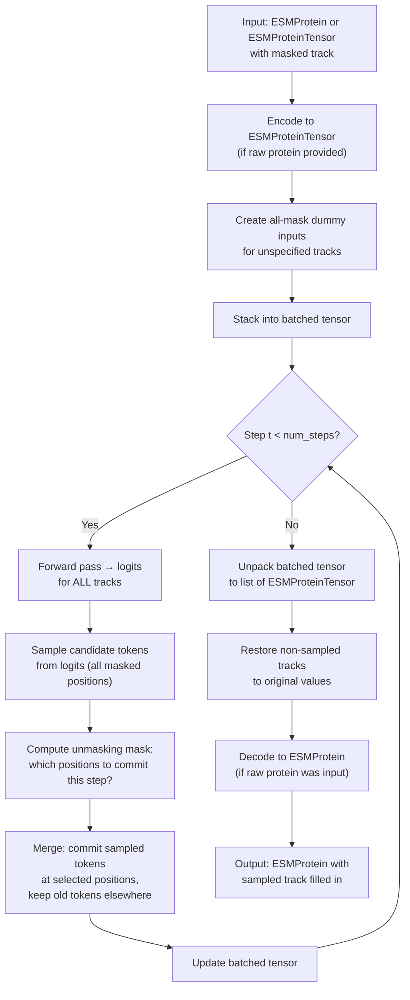

Iterative Masked Sampling is the core generation mechanism that powers ESM3's ability to synthesize novel protein sequences, structures, and functional annotations. Unlike autoregressive models that generate tokens left-to-right in a single pass, ESM3 begins with a fully masked input and progressively unmasks tokens over multiple forward passes, guided by a noise schedule and an unmasking strategy. This process mirrors the masked language modeling objective used during training, making generation a natural extension of the model's pretraining paradigm — a design philosophy inherited from the MaskGIT family of image generators, adapted here for the multi-track, multi-modal reality of protein data.

Sources: [generation.py](esm/utils/generation.py#L355-L534), [api.py](esm/sdk/api.py#L292-L326)

## The Iterative Loop: From All-Mask to Fully Sampled

At the heart of ESM3 generation lies the `iterative_sampling_tokens` function, which orchestrates a fixed number of decoding steps. On each step, the model performs a full forward pass over the current (partially masked) protein tensor, computes logits for every position, samples candidate tokens, and then selectively commits only a subset of those candidates based on a schedule-determined budget. Positions that are not selected remain masked and are reconsidered in subsequent steps. The process terminates when all mask tokens have been replaced or the configured step count is exhausted.

The following diagram illustrates the full lifecycle of a single generation call:



Sources: [generation.py](esm/utils/generation.py#L355-L534), [generation.py](esm/utils/generation.py#L130-L166)

## How the Unmasking Mask is Computed

The critical decision in each iteration is *which* masked positions to reveal. This is governed by two interacting controls: the **noise schedule** determines *how many* tokens to unmask at step *t*, and the **unmasking strategy** determines *which* tokens among the currently masked ones get priority.

### Step Budget Calculation

On each step, the noise schedule maps the progress ratio `(step + 1) / num_steps` to a fraction of tokens that should remain masked. The difference between the currently masked count and this target yields the number of tokens to sample this round:

```
still_masked = count of currently masked positions
perc_masked_after_this_step = schedule((step + 1) / num_steps)
num_tokens_masked_after = round(perc_masked_after_this_step × total_to_sample)
num_to_sample = still_masked - num_tokens_masked_after
```

A small epsilon (0.1) is added before rounding to avoid off-by-one errors from floating point imprecision — a practical detail that prevents the model from "stranding" a single mask token across many steps.

### Strategy: Entropy vs. Random

Once the budget is known, the strategy decides *which* positions fill it:

| Strategy | Selection Criterion | Behavior | Best For |
|----------|--------------------|----------|----------|
| **`entropy`** | Unmask positions with **lowest** logit entropy first | Commits the most confident predictions early, letting the model condition on them for later, harder decisions | Precise, high-fidelity generation |
| **`random`** | Uniformly random selection among masked positions | Introduces stochastic diversity in the order of commitment, producing more varied outputs | Exploratory or diverse generation |

The entropy strategy extracts per-position entropy from the forward pass output, masks out non-sampleable positions (already unmasked, BOS/EOS, padding), and selects the top-k lowest-entropy positions. The random strategy simply shuffles the masked indices and takes the first `num_to_sample`.

Sources: [generation.py](esm/utils/generation.py#L241-L330), [generation.py](esm/utils/generation.py#L226-L238)

## Temperature Annealing

Temperature controls the sharpness of the categorical distribution from which tokens are sampled. ESM3 supports an optional **temperature annealing** mechanism that progressively reduces temperature over decoding steps, transitioning from exploratory sampling early on to near-greedy selection at the end:

```python
annealed_temperature = max(initial_temperature - step_ratio, 0.001) ** 2
```

where `step_ratio = step / max(1, num_steps - 1)`. The quadratic decay means the temperature drops slowly at first and then steeply, allowing the model to lock in coherent local structure before refining details. When `temperature_annealing=True` (the default when using `use_generative_unmasking_strategy`), the per-step temperature overrides the base `GenerationConfig.temperature`.

Sources: [generation.py](esm/utils/generation.py#L350-L352), [generation.py](esm/utils/generation.py#L454-L459)

## The GenerationConfig API

The `GenerationConfig` dataclass is the primary control surface for iterative masked sampling. It specifies *what* to generate, *how* to unmask, and *how* to sample:

| Parameter | Type | Default | Description |
|-----------|------|---------|-------------|
| `track` | `str` | `""` | Which protein track to sample: `"sequence"`, `"structure"`, `"secondary_structure"`, `"sasa"`, or `"function"` |
| `schedule` | `str` | `"cosine"` | Noise schedule controlling the unmasking pace: `"cosine"` or `"linear"` |
| `strategy` | `str` | `"random"` | Unmasking strategy: `"entropy"` or `"random"` |
| `num_steps` | `int` | `20` | Total number of iterative decoding steps |
| `temperature` | `float` | `1.0` | Sampling temperature for the categorical distribution |
| `temperature_annealing` | `bool` | `True` | Whether to decay temperature quadratically over steps |
| `top_p` | `float` | `1.0` | Nucleus sampling threshold (1.0 = disabled) |
| `invalid_ids` | `Sequence[int]` | `[]` | Token IDs to exclude from sampling |
| `condition_on_coordinates_only` | `bool` | `True` | If True, clear structure tokens and condition only on coordinates |

Two convenience methods provide preset configurations:

- **`use_entropy_based_unmasking_strategy()`** — Sets `schedule="cosine"`, `strategy="entropy"`, `temperature_annealing=False`. Produces deterministic, high-confidence outputs.
- **`use_generative_unmasking_strategy()`** — Sets `schedule="cosine"`, `strategy="random"`, `temperature_annealing=True`. Produces diverse, creative outputs.

> [!TIP]
> When `num_steps` exceeds the number of masked tokens, the system automatically clamps it to the mask count — so you can safely set a high `num_steps` without worrying about over-stepping short sequences.

Sources: [api.py](esm/sdk/api.py#L293-L326), [generation.py](esm/utils/generation.py#L390-L393)

## Track-Specific Sampling Behavior

Different protein tracks require distinct sampling treatments due to their token structure:

**Integer token tracks** (`sequence`, `structure`, `secondary_structure`) are sampled via `sample_logits`, which applies temperature scaling, top-p filtering, and invalid-ID masking before drawing from the resulting categorical distribution. When temperature is 0, the distribution collapses to argmax (greedy decoding).

**SASA** is sampled as a soft expectation over discretized bins rather than a hard token selection, producing continuous float values. The entropy is computed separately to handle potential `-inf` logits from invalid-ID masking.

**Function tokens** have a multi-dimensional structure `(L, D)` where `D` is the InterPro quantization depth. A special `<none>` threshold (`p_none_threshold=0.05`) gates whether a position receives any function annotation at all — when the average probability of `<none>` across all depth dimensions exceeds the threshold, the entire position is set to `<none>`, suppressing spurious predictions.

**Residue annotations** use multi-hot binary prediction (Bernoulli, not categorical), so they are sampled by selecting the top-K annotations above a probability threshold rather than from a softmax distribution.

**Coordinates and residue annotations** cannot be iteratively sampled — the system returns an `ESMProteinError` if either is specified as the generation track.

Sources: [generation.py](esm/utils/generation.py#L423-L428), [sampling.py](esm/utils/sampling.py#L153-L196), [sampling.py](esm/utils/sampling.py#L199-L237), [sampling.py](esm/utils/sampling.py#L260-L290)

## The Merging Step: Selective Token Commitment

After sampling candidate tokens for *all* masked positions, the iterative loop must decide which candidates to actually commit. This is the **merge step**, implemented as a `torch.where` operation:

```python
new_track_samples = torch.where(
    where_to_sample,   # Boolean mask: True at positions to commit
    new_track_samples, # Candidate tokens from this forward pass
    old_track_samples  # Existing tokens (already committed or still masked)
)
```

This design ensures that previously committed tokens are never overwritten — once a position is unmasked, its value is frozen for the remainder of generation. Only positions selected by the unmasking mask transition from masked to sampled. This monotonic commitment property is what gives iterative masked sampling its coherence: each step builds upon a growing foundation of resolved tokens.

Sources: [generation.py](esm/utils/generation.py#L499-L509)

## Batched Execution and Per-Prompt Isolation

Although the forward pass is batched for efficiency, sampling is performed **per-prompt** because different prompts may have different `GenerationConfig` settings. The system slices the batched forward output, trims logits to the correct sequence length for each prompt, applies per-prompt temperature annealing, and then computes the unmasking mask individually. Errors are tracked per-prompt — if one prompt fails (e.g., has no mask tokens), it is recorded as an `ESMProteinError` and skipped in subsequent steps without affecting other prompts in the batch.

> [!TIP]
> The current implementation asserts batch size 1 within `_get_iterative_sampling_mask_for_prompt_and_step`. When using the local inference client with batched generation, the system processes each prompt individually inside the per-prompt loop, so this is not a practical limitation — but it means the batch forward pass is the only true parallelism; the sampling and unmasking decisions are sequential over the batch dimension.

Sources: [generation.py](esm/utils/generation.py#L410-L509), [generation.py](esm/utils/generation.py#L262-L265)

## Practical Generation Patterns

The iterative masked sampling framework enables several distinct protein design workflows through simple configuration choices:

**Sequence design** — Provide a partially masked sequence (using `_` as the mask character) and generate the missing residues. Lower temperature and entropy-based unmasking produce sequences closer to the training distribution; higher temperature with random unmasking explores more novel territory.

**Structure prediction (folding)** — Provide a full sequence with all other tracks masked, and generate the `structure` track. The cosine schedule with entropy strategy typically yields the most physically plausible folds.

**Inverse folding** — Provide coordinates (and optionally set `condition_on_coordinates_only=True` to bypass structure tokens), mask the sequence track, and generate a sequence compatible with the given backbone.

**Chain-of-thought generation** — Generate tracks in a sequence of separate `generate` calls, feeding the output of one as the input to the next. A common ordering is `secondary_structure → structure → sequence`, which lets the model first establish a coarse structural sketch before committing to atomic-level detail.

Sources: [esm3.py](cookbook/snippets/esm3.py#L49-L137), [api.py](esm/sdk/api.py#L432-L438)

## Relationship to Surrounding Systems

Iterative masked sampling sits at the center of ESM3's generation pipeline, consuming logits from the transformer forward pass and producing updated token tensors. The noise schedules that govern its pacing are documented in detail in [Noise Schedules and Unmasking Strategies](17-noise-schedules-and-unmasking-strategies), and the full parameter reference for `GenerationConfig` and `SamplingConfig` is available in [Generation Configuration Reference](18-generation-configuration-reference). The encode-decode machinery that wraps around iterative sampling (converting `ESMProtein` ↔ `ESMProteinTensor`) is covered in [Encode-Decode Pipeline](22-encode-decode-pipeline).