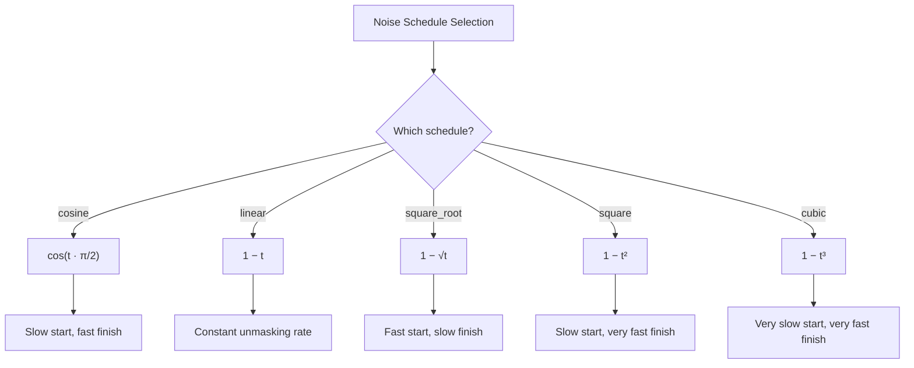
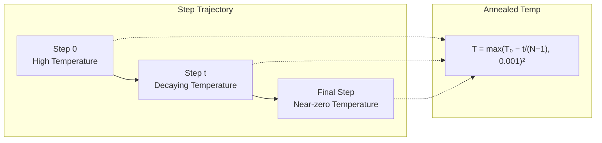
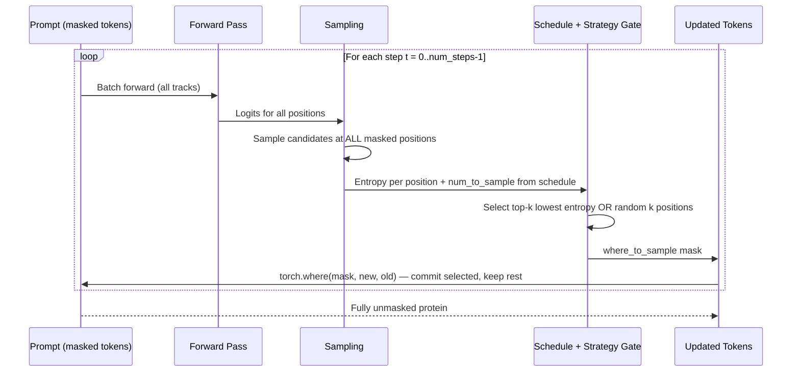

ESM3 generates protein tracks through **iterative masked sampling**: at each decoding step, the model predicts logits for all masked positions, samples candidate tokens, then unmasks only a carefully chosen subset before proceeding to the next step. Two interlocking mechanisms govern this process — **noise schedules** control *how many* tokens to unmask per step, while **unmasking strategies** control *which* tokens to unmask. Together, they determine the trajectory from a fully masked input to a complete protein, and their configuration has a profound impact on generation quality, diversity, and coherence.

## From MaskGIT to Protein Generation

ESM3's iterative decoding is architecturally inspired by the MaskGIT (Masked Generative Image Transformer) paradigm, adapted to the multi-track discrete token structure of protein data. In MaskGIT, a cosine schedule controls the fraction of tokens remaining masked at each step, and low-confidence positions are unmasked first. ESM3 generalizes this idea: the `GenerationConfig` exposes both `schedule` and `strategy` as independent, composable parameters, allowing developers to decouple the *rate* of unmasking from the *selection criterion*.

The generation loop lives in `iterative_sampling_tokens`, which orchestrates the full decode across `num_steps` forward passes. At each step `t`, the system computes `perc_masked_after_this_step = schedule((t + 1) / num_steps)`, then derives `num_to_sample = still_masked - floor(perc_masked_after_this_step * total_to_sample)`. This means the schedule function maps normalized step progress `[0, 1]` to a *remaining-mask fraction*, and the number of tokens actually unmasked is the delta between consecutive schedule values — positions that transition from "still masked" to "should be unmasked" by this step's schedule target.

Sources: [noise_schedules.py](esm/utils/noise_schedules.py#L1-L34), [generation.py](esm/utils/generation.py#L280-L296), [api.py](esm/sdk/api.py#L293-L326)

## The Schedule Registry

Five schedule functions are registered in `NOISE_SCHEDULE_REGISTRY`, each mapping a normalized time step `t ∈ [0, 1]` to the fraction of tokens that should remain masked. All functions return `1.0` at `t = 0` (everything masked) and `0.0` at `t = 1` (nothing masked), but they traverse this range with very different curvature:

| Schedule | Formula | `t=0.25` | `t=0.50` | `t=0.75` | Behavioral Profile |
|---|---|---|---|---|---|
| **cosine** | `cos(t · π/2)` | 0.924 | 0.707 | 0.383 | Few tokens early, accelerating unmasking. Matches MaskGIT. |
| **linear** | `1 − t` | 0.750 | 0.500 | 0.250 | Uniform unmasking rate across all steps. |
| **square_root** | `1 − √t` | 0.500 | 0.293 | 0.134 | Aggressive early unmasking, then refinement. |
| **square** | `1 − t²` | 0.938 | 0.750 | 0.438 | Very conservative early, rapid late unmasking. |
| **cubic** | `1 − t³` | 0.984 | 0.875 | 0.578 | Extremely conservative early, burst at end. |

The **cosine schedule** is the default and the only schedule officially validated for ESM3 generation through `GenerationConfig`'s field validator (which restricts selection to `"cosine"` or `"linear"`). The remaining three schedules (`square_root`, `square`, `cubic`) exist in the registry for experimental use — they can be accessed when constructing configs programmatically or bypassing the validator, but their behavior in the iterative loop has not been officially characterized for protein generation quality.

> [!TIP]
> The schedule function controls the *remaining mask fraction*, not the *per-step unmask count* directly. Because `num_to_sample = still_masked - round(schedule((step+1)/num_steps) * total_to_sample)`, concave-down schedules (cosine, square, cubic) produce few unmaskings in early steps and many in later steps — the model first commits to "easy" positions and leaves "hard" ones for later when context is richer. Convex-up schedules (square_root) do the opposite, which can prematurely lock in uncertain tokens.

Sources: [noise_schedules.py](esm/utils/noise_schedules.py#L1-L34), [generation.py](esm/utils/generation.py#L280-L296), [api.py](esm/sdk/api.py#L297-L299)

## Unmasking Strategies: Entropy vs. Random

While the schedule determines *how many* tokens to unmask at each step, the **strategy** determines *which* of the still-masked positions get selected. ESM3 implements two strategies, both operating within the set of positions that are currently masked (excluding BOS, EOS, and padding):

### Entropy-Based Unmasking (`strategy="entropy"`)

The entropy strategy unmaskes the positions where the model is **most confident** first. After each forward pass, the entropy of the logit distribution is computed per position via `torch.distributions.Categorical(logits=log_probs).entropy`. Positions with the **lowest entropy** are selected for unmasking — these are positions where the model's prediction is sharp and unambiguous. This implements a greedy confidence-based ordering: the model "locks in" easy decisions early, providing increasingly rich context for harder positions in subsequent steps.

For the function track, which has a multi-dimensional token structure `(B, L, D)`, entropies are summed across the depth dimension to produce a scalar per position before ranking. The entropy values are masked with `torch.finfo.max` at non-masked positions so they are excluded from `topk` selection.

### Random Unmasking (`strategy="random"`)

The random strategy selects positions uniformly at random from the set of still-masked positions. The masked indices are shuffled via `torch.randperm`, and the first `num_to_sample` indices are chosen. This introduces stochastic diversity into the unmasking order — different runs with the same prompt can produce different generation trajectories, even at temperature 0.

### Comparative Behavior

| Aspect | Entropy Strategy | Random Strategy |
|---|---|---|
| **Selection criterion** | Lowest logit entropy (highest confidence) | Uniform random among masked positions |
| **Determinism** | Deterministic given same logits | Stochastic per run |
| **Generation diversity** | Lower — converges to high-confidence modes | Higher — explores alternative paths |
| **Quality (pTM)** | Typically higher — model commits to coherent structure | More variable — may lock in uncertain tokens early |
| **Use case** | Precise scaffolding, motif-preserving design | Exploratory design, diverse candidate generation |
| **Temperature annealing** | Disabled by default (not needed) | Enabled by default (compensates for random ordering) |

Sources: [generation.py](esm/utils/generation.py#L298-L330), [sampling.py](esm/utils/sampling.py#L153-L196), [api.py](esm/sdk/api.py#L303-L326)

## Temperature Annealing

Temperature annealing is a complementary mechanism that linearly decays the sampling temperature across decoding steps. The annealed temperature at step `t` is computed as `max(initial_temperature - t / (num_steps - 1), 0.001)²`, producing a quadratic decay toward near-zero temperature. At early steps, the high temperature encourages diverse sampling; at later steps, the low temperature forces near-greedy argmax selection, refining the protein toward its most probable completion.

The annealing schedule is controlled by the `temperature_annealing` flag in `GenerationConfig`. When using `use_generative_unmasking_strategy()`, annealing is enabled with `schedule="cosine"` and `strategy="random"` — the combination of random unmasking order with decreasing temperature allows the model to explore broadly in early steps then converge in later steps. When using `use_entropy_based_unmasking_strategy()`, annealing is disabled because the entropy-based ordering already provides a natural convergence path: positions are unmasked in confidence order, so temperature can remain constant.

> [!TIP]
> The quadratic decay in `_get_annealed_temperature` means temperature drops slowly at first then plummets. For a 20-step generation with `temperature=1.0`, the temperature at step 10 is `(1.0 - 10/19)² ≈ 0.028` — effectively greedy by the halfway point. If you need more exploration in later steps, consider disabling annealing and using a fixed temperature > 0.

Sources: [generation.py](esm/utils/generation.py#L350-L352), [generation.py](esm/utils/generation.py#L454-L459), [api.py](esm/sdk/api.py#L309-L326)

## The Iterative Sampling Loop in Detail

The complete unmasking pipeline is orchestrated by `iterative_sampling_tokens`, which processes a batch of `ESMProteinTensor` inputs through the following loop:

1. **Initialize**: Compute `total_to_sample` (the count of masked, non-special tokens) for each prompt. If `num_steps` exceeds the number of masked tokens, it is clamped down.
2. **Forward pass**: Call `_batch_forward` to get logits for all tracks across the entire batch.
3. **Per-prompt sampling**: For each prompt, apply temperature annealing if enabled, construct a `SamplingConfig` with the current temperature, and call `_sample_per_prompt` to produce candidate tokens at *all* masked positions.
4. **Schedule-gated selection**: Call `_get_iterative_sampling_mask_for_prompt_and_step` to compute `where_to_sample` — a boolean mask indicating which positions should be committed this step. This mask is determined by the schedule (how many) and strategy (which ones).
5. **Selective commit**: Use `torch.where(where_to_sample, new_track_samples, old_track_samples)` to blend: positions marked for unmasking take the newly sampled values; all others retain their previous state (either still-masked or previously unmasked).
6. **Iterate**: Repeat for `max_num_steps`, returning completed proteins as soon as their per-prompt step count is exhausted.

The critical blending step at stage 5 ensures that previously unmasked tokens are never overwritten — the model's commitments are irrevocable within a single generation run. This monotonic unmasking property is what makes the process a *schedule-guided refinement* rather than a diffusion-like denoising.

Sources: [generation.py](esm/utils/generation.py#L355-L534), [generation.py](esm/utils/generation.py#L226-L330)

## Preset Configurations and API Surface

The `GenerationConfig` dataclass provides two convenience methods that set schedule, strategy, and temperature annealing together as coherent presets:

| Preset Method | Schedule | Strategy | Temp Annealing | Intended Use |
|---|---|---|---|---|
| `use_entropy_based_unmasking_strategy()` | `cosine` | `entropy` | `False` | High-quality, deterministic generation. Best for scaffolding and motif preservation. |
| `use_generative_unmasking_strategy()` | `cosine` | `random` | `True` | Diverse, exploratory generation. Best for candidate enumeration and broad design space exploration. |

The default `GenerationConfig` values (without calling either preset) are `schedule="cosine"`, `strategy="random"`, `temperature_annealing=True`, and `num_steps=20`. This matches the generative unmasking preset, reflecting the design philosophy that the default should encourage diversity.

It is worth noting that the `schedule` field validator in `GenerationConfig` only permits `"cosine"` and `"linear"`, even though the `NOISE_SCHEDULE_REGISTRY` contains five entries. To use the experimental schedules (`square_root`, `square`, `cubic`), you must bypass the validator — for example, by directly modifying the attribute after construction or by using `attr.evolve` on an existing config.

Sources: [api.py](esm/sdk/api.py#L293-L326), [noise_schedules.py](esm/utils/noise_schedules.py#L28-L34)

## Interaction with Track-Specific Entropy Computation

The entropy used for the `"entropy"` strategy is computed per-track in `_compute_track_metadata`, which derives it from `torch.distributions.Categorical(logits=log_probs).entropy`. Different tracks produce entropy tensors of different dimensionalities:

- **Scalar tracks** (sequence, structure, secondary_structure, sasa): entropy is shape `(B, L)` — directly usable for top-k selection.
- **Function track**: entropy is initially shape `(B, L, D)` where `D` is the function token depth; it is summed across `D` to produce `(B, L)` before selection in `_get_iterative_sampling_mask_for_prompt_and_step`. The resulting `where_to_sample` mask is then expanded back to `(B, L, D)` to apply uniformly across all depth dimensions of the function tokens.

This depth-aware handling ensures that a function position is unmasked atomically — all `D` sub-tokens at a position are committed together, maintaining the coherence of the InterPro quantized representation.

Sources: [generation.py](esm/utils/generation.py#L298-L330), [generation.py](esm/utils/generation.py#L786-L823)

## Practical Guidance

**Choosing a schedule**: The cosine schedule is the well-tested default. Its slow-start property means the model builds a coarse scaffold of high-confidence positions before filling in details, which mirrors the hierarchical nature of protein structure (secondary structure elements form first, then loop regions). The linear schedule can be useful for debugging or when you want uniform computational budget across steps. The experimental schedules should be approached with caution — `square_root` unmaskes aggressively early, which can lead to incoherent local structure, while `cubic` defers almost all unmasking to the final steps, creating a computational bottleneck.

**Choosing a strategy**: Use `entropy` when generation quality is paramount and you want reproducible outputs (given the same random seed for the initial forward pass). Use `random` when you need to sample the design space and generate diverse candidates. The `random` strategy with temperature annealing is particularly effective for iterative refinement workflows where you generate many candidates and filter by downstream metrics.

**Setting `num_steps`**: The default of 20 steps provides diminishing returns beyond that point. For short sequences (< 100 residues), fewer steps (8–12) may suffice. For very long sequences, increasing to 30–50 steps can improve coherence. The system automatically clamps `num_steps` to the number of masked tokens if you over-specify, so there is no risk of running empty steps.

For the complete parameter reference, see [Generation Configuration Reference](18-generation-configuration-reference). For the broader context of how iterative sampling fits into the ESM3 generation pipeline, see [Iterative Masked Sampling](16-iterative-masked-sampling).
