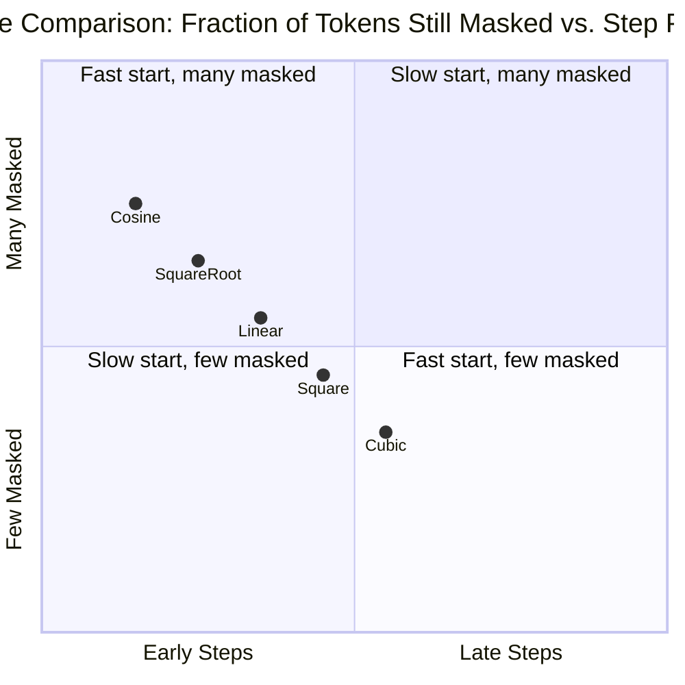
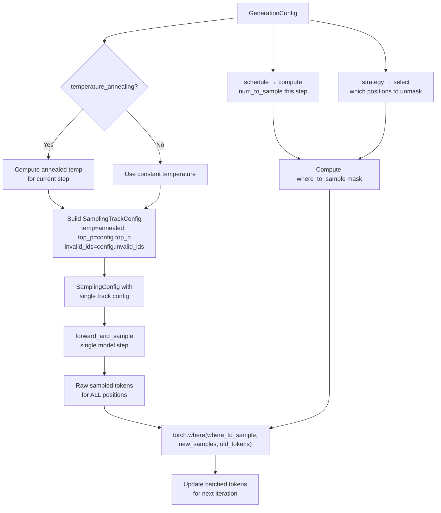

ESM3's generation pipeline is governed by two complementary configuration layers: **GenerationConfig** controls the high-level iterative decoding strategy (which track to sample, how many steps, which unmasking schedule), while **SamplingConfig** governs the low-level per-step token selection (temperature, top-p, valid token filtering). Understanding both layers—and how they compose during the iterative masked sampling loop—is essential for steering protein generation toward desired outcomes. This reference documents every configurable parameter, its default, its valid range, and its precise effect on the generation loop.

Sources: [api.py](/esm/sdk/api.py#L293-L326), [generation.py](/esm/utils/generation.py#L355-L534)

## GenerationConfig — High-Level Decoding Control

`GenerationConfig` is the primary configuration object passed to `client.generate()` and `client.batch_generate()`. It specifies *what* to generate (the track), *how many* iterative decoding steps to take, and *which strategy* determines the order of token unmasking. Every parameter has a carefully chosen default that works well for general-purpose generation, but each can be tuned for specific design goals.

```python
from esm.sdk.api import GenerationConfig

config = GenerationConfig(
    track="sequence",
    schedule="cosine",
    strategy="random",
    num_steps=20,
    temperature=1.0,
    temperature_annealing=True,
    top_p=1.0,
    condition_on_coordinates_only=True,
    only_compute_backbone_rmsd=False,
    invalid_ids=[],
)
```

Sources: [api.py](/esm/sdk/api.py#L293-L326)

### Parameter Reference

| Parameter | Type | Default | Valid Values | Description |
|---|---|---|---|---|
| `track` | `str` | `""` | `"sequence"`, `"structure"`, `"secondary_structure"`, `"sasa"`, `"function"` | Which protein track to iteratively sample. **Not** `"coordinates"` or `"residue_annotations"` — those are derived or handled via separate logic. |
| `invalid_ids` | `Sequence[int]` | `[]` | Any list of integer token IDs | Token IDs to exclude from the sampling vocabulary for the selected track. Useful for suppressing specific residues or structural tokens. |
| `schedule` | `str` | `"cosine"` | `"cosine"`, `"linear"` | Controls the *rate* at which masked tokens are revealed across steps. Cosine unmaskes more tokens early; linear unmaskes at a constant rate. |
| `strategy` | `str` | `"random"` | `"random"`, `"entropy"` | Controls *which* masked positions to unmask each step. `"entropy"` prioritizes lowest-entropy (most confident) positions; `"random"` selects uniformly at random. |
| `num_steps` | `int` | `20` | `1` to sequence length | Number of iterative forward-and-sample rounds. Diminishing returns beyond ~20. Auto-reduced if fewer masked positions exist than `num_steps`. |
| `temperature` | `float` | `1.0` | `0.0` to `∞` | Sampling temperature applied at each step. `0.0` yields greedy (argmax) decoding. Higher values increase stochasticity. |
| `temperature_annealing` | `bool` | `True` | `True`, `False` | When `True`, temperature decays quadratically from `temperature` toward `0.001` over `num_steps`. Produces diverse early samples that converge to confident predictions. |
| `top_p` | `float` | `1.0` | `0.0` to `1.0` | Nucleus sampling threshold. Tokens with cumulative probability ≤ `top_p` are retained; the rest are masked to `-inf` before sampling. `1.0` disables filtering. |
| `condition_on_coordinates_only` | `bool` | `True` | `True`, `False` | When `True` and coordinates are provided, structure tokens are cleared so the model conditions solely on 3D coordinates rather than pre-encoded structure tokens. |
| `only_compute_backbone_rmsd` | `bool` | `False` | `True`, `False` | If `True`, only backbone atoms are considered when computing RMSD during evaluation. Does not affect generation behavior directly. |

Sources: [api.py](/esm/sdk/api.py#L293-L326), [generation.py](/esm/utils/generation.py#L368-L398)

### Preset Strategies

`GenerationConfig` provides two convenience methods that bundle mutually compatible parameter choices into proven configurations. These presets encode architectural insights about how schedule, strategy, and annealing interact—calling them overwrites the relevant fields.

| Method | Schedule | Strategy | Annealing | Use Case |
|---|---|---|---|---|
| `use_entropy_based_unmasking_strategy()` | `"cosine"` | `"entropy"` | `False` | Deterministic, high-fidelity generation. Lowest-entropy positions are resolved first, creating a cascade of confident predictions. Best for structure prediction and refinement. |
| `use_generative_unmasking_strategy()` | `"cosine"` | `"random"` | `True` | Creative, diverse generation. Random unmasking with annealing encourages exploration in early steps and convergence in later ones. Best for *de novo* protein design. |

```python
config = GenerationConfig(track="sequence")
config.use_entropy_based_unmasking_strategy()  # Deterministic refinement
# Equivalent to: schedule="cosine", strategy="entropy", temperature_annealing=False

config = GenerationConfig(track="structure")
config.use_generative_unmasking_strategy()    # Creative design
# Equivalent to: schedule="cosine", strategy="random", temperature_annealing=True
```

Sources: [api.py](/esm/sdk/api.py#L315-L326)

## SamplingConfig — Per-Step Token Selection

While `GenerationConfig` orchestrates the iterative loop, `SamplingConfig` governs what happens *inside* each step: how raw logits are converted to token selections. It is organized by track, where each track can receive an independent `SamplingTrackConfig`. This is the configuration passed to `client.forward_and_sample()` for power users who want single-step control.

```python
from esm.sdk.api import SamplingConfig, SamplingTrackConfig

sampling_config = SamplingConfig(
    sequence=SamplingTrackConfig(temperature=0.8, top_p=0.95, topk_logprobs=5),
    structure=SamplingTrackConfig(temperature=1.0, top_p=1.0),
    secondary_structure=None,   # Skip sampling this track
    sasa=None,
    function=None,
)
```

Sources: [api.py](/esm/sdk/api.py#L337-L366)

### SamplingTrackConfig Parameter Reference

| Parameter | Type | Default | Description |
|---|---|---|---|
| `temperature` | `float` | `1.0` | Softmax temperature for categorical sampling. `0.0` → greedy argmax; `1.0` → standard sampling; `>1.0` → flatter, more random distribution. |
| `top_p` | `float` | `1.0` | Nucleus sampling cutoff. Only tokens whose cumulative softmax probability ≤ `top_p` are considered. `1.0` disables nucleus filtering. |
| `only_sample_masked_tokens` | `bool` | `True` | When `True`, only positions currently holding a mask token are resampled; unmasked positions are preserved. `False` allows resampling of all non-special positions. |
| `invalid_ids` | `Sequence[int]` | `[]` | Token IDs to exclude from the sampling vocabulary. These are masked to `-inf` in the logit tensor before softmax. |
| `topk_logprobs` | `int` | `0` | Number of top-k log probabilities and token IDs to return per position. `0` disables. Maximum allowed is 32 (per-track `MAX_TOPK` constant). |

Sources: [api.py](/esm/sdk/api.py#L337-L343), [api.py](/esm/utils/constants/api.py#L1-L5)

### Track-Specific Defaults and Constraints

When `iterative_sampling_tokens` internally constructs a `SamplingConfig` from a `GenerationConfig`, it creates a single `SamplingTrackConfig` for the target track and leaves all others as `None`. The default sampling config factory provides baseline settings per track:

| Track | Default `only_sample_masked_tokens` | Default `temperature` | Default `top_p` | Max `topk_logprobs` |
|---|---|---|---|---|
| `sequence` | `True` | `1.0` | `1.0` | 32 |
| `structure` | `True` | `1.0` | `1.0` | 32 |
| `secondary_structure` | `False` | `1.0` | `1.0` | 32 |
| `sasa` | `False` | `1.0` | `1.0` | 32 |
| `function` | `False` | `1.0` | `1.0` | 32 |

The `only_sample_masked_tokens` flag is `False` for `secondary_structure`, `sasa`, and `function` because these tracks use specialized sampling logic (argmax-based for function with `<none>` filtering, threshold-based for residue annotations, continuous-bin expectation for SASA) where resampling all positions is the expected behavior.

> [!TIP]
> Setting `topk_logprobs > 0` for a track returns both the top-k log probabilities and the corresponding token IDs in the `ForwardAndSampleOutput`. This is invaluable for analyzing model confidence and exploring alternative predictions, but increases output size—use judiciously in batched settings.

Sources: [sampling.py](/esm/utils/sampling.py#L109-L131), [api.py](/esm/utils/constants/api.py#L1-L5)

## Noise Schedules — Unmasking Rate Control

The `schedule` parameter in `GenerationConfig` selects a noise schedule function that maps the current step ratio `t = step / num_steps` (a value in `[0, 1]`) to the *fraction of tokens still masked* after that step. The schedule determines how aggressively tokens are revealed during iterative decoding. Although the registry contains five functions, `GenerationConfig` validates against only `"cosine"` and `"linear"`.



| Schedule | Formula | Behavior | Generation Effect |
|---|---|---|---|
| `cosine` | `cos(t · π/2)` | Unmasks many tokens early, fewer late | Rapid coarse structure → fine refinement. Default for both presets. |
| `linear` | `1 - t` | Unmasks a constant fraction per step | Uniform pace throughout decoding. More predictable step-to-step changes. |

The cosine schedule originates from the MaskGIT paper and is the default because its front-loaded unmasking aligns well with how ESM3's multimodal predictions coalesce: early steps establish the global scaffold, and later steps refine local details. The number of tokens unmasked at step `s` is computed as `still_masked - round(schedule((s+1) / num_steps) * total_to_sample + 0.1)`, where a small epsilon prevents rounding errors.

Sources: [noise_schedules.py](/esm/utils/noise_schedules.py#L1-L34), [generation.py](/esm/utils/generation.py#L282-L296)

## Temperature Annealing — From Exploration to Convergence

When `temperature_annealing=True` (the default for the generative preset), the effective temperature at each step decays quadratically from the initial `temperature` toward `0.001`:

```
annealed_temp(step) = max(initial_temp - step / max(1, num_steps - 1), 0.001)²
```

This creates a generation trajectory that begins with high stochasticity (exploring diverse token candidates) and progressively tightens toward near-greedy selection (locking in confident predictions). The quadratic decay means the transition from exploration to exploitation is smooth rather than abrupt.

| Step Ratio | Effective Temp (initial=1.0) | Sampling Behavior |
|---|---|---|
| 0.0 | 1.000 | Full stochasticity — diverse candidates |
| 0.25 | 0.562 | Moderate exploration |
| 0.50 | 0.250 | Narrowing selection |
| 0.75 | 0.062 | Near-greedy — high confidence |
| 1.0 | 0.000001 | Effectively argmax |

When `temperature_annealing=False` (the entropy-based preset), the temperature remains constant at `config.temperature` throughout all steps. This is appropriate when using entropy-based unmasking, because the strategy itself already handles the confidence ordering—positions are resolved from most-certain to least-certain, making annealing redundant.

> [!TIP]
> Setting `temperature=0.0` with `temperature_annealing=False` produces fully deterministic greedy decoding. However, partial temperature 0 (where some positions are 0 and others are not) is not supported and will raise an assertion error.

Sources: [generation.py](/esm/utils/generation.py#L350-L352), [generation.py](/esm/utils/generation.py#L454-L459), [sampling.py](/esm/utils/sampling.py#L185-L189)

## Unmasking Strategies — Position Selection Logic

The `strategy` parameter controls *which* masked positions are selected for unmasking at each step. After the schedule determines *how many* positions to unmask, the strategy determines *which ones*.

### Entropy-Based Strategy (`"entropy"`)

At each step, the model computes per-position entropy from the logit distributions. The `num_to_sample` positions with the **lowest entropy** (highest confidence) are selected for unmasking. This creates a cascade effect: resolving confident positions first provides stronger conditioning for adjacent uncertain positions in subsequent steps.

```python
# Internal logic (simplified):
track_entropy = entropy_forward_output[track]       # (B, L) or (B, L, D)
if track == "function":
    track_entropy = track_entropy.sum(-1)            # (B, L, D) → (B, L)
track_entropy.masked_fill_(~sampling_mask, max_val)  # Exclude non-masked
_, indices = track_entropy.topk(num_to_sample, largest=False)
where_to_sample = sampling_mask & is_top_k
```

### Random Strategy (`"random"`)

At each step, the masked positions are randomly shuffled, and the first `num_to_sample` are selected. This provides no positional bias, which increases output diversity across runs—ideal for generative design where you want to explore the solution space rather than converge to a single prediction.

```python
# Internal logic (simplified):
masked_indices = sampling_mask.nonzero()
shuffled = masked_indices[torch.randperm(len(masked_indices))]
selected = shuffled[:num_to_sample]
```

Sources: [generation.py](/esm/utils/generation.py#L298-L330)

## Configuration Composition in the Iterative Loop

The following diagram shows how `GenerationConfig` and `SamplingConfig` compose during `iterative_sampling_tokens`—the core generation routine. `GenerationConfig` parameters are used to derive a per-step `SamplingTrackConfig` that governs each forward-and-sample call.



The key insight is that `GenerationConfig` parameters are **not** passed directly to the sampling functions. Instead, at each step `t`, the iterative loop: (1) computes the annealed temperature if enabled, (2) constructs a `SamplingTrackConfig` from the `GenerationConfig` fields, (3) wraps it in a `SamplingConfig` for the target track, (4) runs a full forward-and-sample to get predictions for *all* positions, then (5) uses the schedule and strategy to select *which* of those predictions to commit. This means `top_p` and `temperature` from `GenerationConfig` affect the per-step sampling, while `schedule` and `strategy` control the inter-step commitment logic.

Sources: [generation.py](/esm/utils/generation.py#L410-L534)

## Unsupported Tracks and Edge Cases

The iterative sampling loop explicitly rejects certain track combinations and handles edge conditions that are important to be aware of:

| Scenario | Behavior |
|---|---|
| `track="coordinates"` | Raises `ESMProteinError(500)` — coordinates are not iteratively sampled; they are decoded from structure tokens via the VQ-VAE decoder. |
| `track="residue_annotations"` | Raises `ESMProteinError(500)` — residue annotations are multi-hot Bernoulli predictions, not categorical, and are derived from the function track logits using threshold-based selection. |
| `num_steps > number of masked tokens` | `num_steps` is automatically reduced to the count of masked positions. No warning is emitted. |
| Input has no masked positions in the target track | Raises `ValueError("Cannot sample {track} when input has no masks.")` — at least one mask token must be present to begin generation. |
| `topk_logprobs > MAX_TOPK (32)` | `validate_sampling_config` emits a warning (or raises if `on_invalid="raise"`). Output is truncated to the maximum. |
| Function track with `invalid_ids` | A warning is issued: `"For function sampling, invalid_ids sampling config is not supported."` The parameter is ignored for function tokens. |

Sources: [generation.py](/esm/utils/generation.py#L423-L428), [generation.py](/esm/utils/generation.py#L390-L393), [generation.py](/esm/utils/generation.py#L277-L278), [sampling.py](/esm/utils/sampling.py#L133-L150), [generation.py](/esm/utils/generation.py#L642-L643)

## Practical Configuration Recipes

The following table maps common generation goals to recommended `GenerationConfig` settings. These are starting points—fine-tune `temperature` and `top_p` based on your specific sequence length and desired diversity.

| Goal | Track | Schedule | Strategy | Annealing | Temperature | Notes |
|---|---|---|---|---|---|---|
| Sequence from structure | `"sequence"` | `"cosine"` | `"entropy"` | `False` | `1.0` | Inverse folding: use `entropy` for high-fidelity sequence recovery. |
| Structure from sequence | `"structure"` | `"cosine"` | `"entropy"` | `False` | `1.0` | Structure prediction: entropy resolves confident positions first. |
| De novo sequence design | `"sequence"` | `"cosine"` | `"random"` | `True` | `1.0` | Creative: random unmasking + annealing explores diverse sequences. |
| De novo structure design | `"structure"` | `"cosine"` | `"random"` | `True` | `1.0` | Creative structure generation with convergence. |
| High-temperature exploration | `"sequence"` | `"cosine"` | `"random"` | `True` | `1.5` | Broader diversity at cost of local coherence. |
| Low-temperature refinement | `"sequence"` | `"cosine"` | `"entropy"` | `False` | `0.5` | Sharper predictions, less variety. |
| Partial track inpainting | `"sequence"` | `"cosine"` | `"entropy"` | `False` | `1.0` | Mask only specific residues; entropy preserves context fidelity. |

Sources: [api.py](/esm/sdk/api.py#L293-L326), [generation.py](/esm/utils/generation.py#L350-L352)

---

**Next steps**: For the mathematical foundations of the iterative masked sampling loop, see [Iterative Masked Sampling](16-iterative-masked-sampling). For a deep dive into how noise schedules control unmasking dynamics, see [Noise Schedules and Unmasking Strategies](17-noise-schedules-and-unmasking-strategies). To put these configurations into practice with the Forge API, see [Forge API Client](19-forge-api-client) or [Local Inference Client](20-local-inference-client).