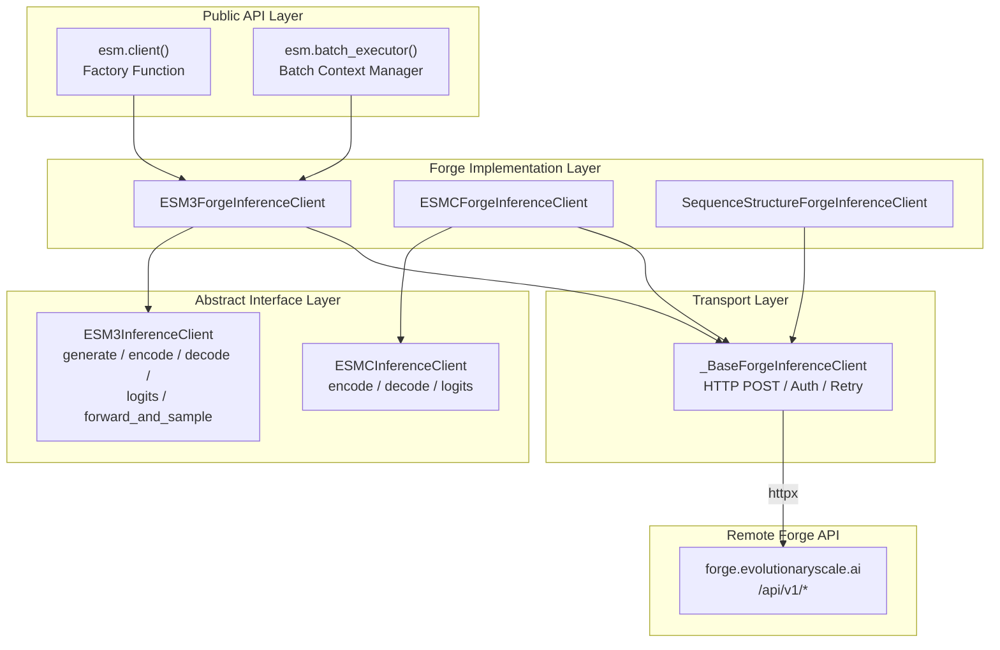
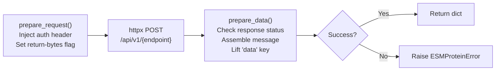

The **Forge API Client** is the remote inference gateway to EvolutionaryScale's cloud-hosted ESM models. It provides a fully-featured Python SDK that mirrors the abstract inference interfaces defined in `ESM3InferenceClient` and `ESMCInferenceClient`, translating every local method call into an authenticated HTTP request against the Forge REST API at `https://forge.evolutionaryscale.ai`. The SDK ships three specialized client classes—**ESM3ForgeInferenceClient** for multimodal generative inference, **ESMCForgeInferenceClient** for representation-level inference, and **SequenceStructureForgeInferenceClient** for folding and inverse folding—all built on a shared HTTP transport layer with automatic retry, connection pooling, and both synchronous and asynchronous execution paths.

Sources: [__init__.py](esm/sdk/__init__.py#L1-L37), [forge.py](esm/sdk/forge.py#L1-L33)

## Architecture Overview

The Forge client follows a layered architecture where abstract interfaces define the contract, a shared base class handles HTTP transport, and concrete clients implement request/response serialization for each model family. Every public method exists in both synchronous and `async_` variants, and all are decorated with an automatic retry mechanism that handles transient server errors.



The factory function `esm.client()` returns an `ESM3ForgeInferenceClient` by default, reading the API token from the `ESM_API_KEY` environment variable. The `esm.batch_executor()` returns a `ForgeBatchExecutor` context manager for parallel batch workloads. Both the ESM3 and ESM-C clients use **multiple inheritance**—combining their respective abstract interface with `_BaseForgeInferenceClient`—to enforce the full API contract while reusing the HTTP transport.

Sources: [__init__.py](esm/sdk/__init__.py#L9-L23), [api.py](esm/sdk/api.py#L431-L532), [base_forge_client.py](esm/sdk/base_forge_client.py#L10-L33)

## Client Initialization and Authentication

All three Forge clients share a common initialization pattern through `_BaseForgeInferenceClient`. The **token** parameter is mandatory—an empty string triggers an immediate `RuntimeError`. The token is stored as a Bearer credential in the `Authorization` header and attached to every outgoing request.

```python
from esm.sdk import client

# Recommended: token from environment variable ESM_API_KEY
forge_client = client(model="esm3-sm-open-v1")

# Explicit token and custom endpoint
forge_client = client(
    model="esm3-sm-open-v1",
    url="https://forge.evolutionaryscale.ai",
    token="your_api_token_here",
    request_timeout=300,
)
```

| Parameter | Type | Default | Description |
|---|---|---|---|
| `model` | `str` | `"esm3-sm-open-v1"` | Model identifier for the Forge API |
| `url` | `str` | `"https://forge.evolutionaryscale.ai"` | Forge server URL |
| `token` | `str` | `""` (reads `ESM_API_KEY` env var) | API authentication token |
| `request_timeout` | `int \| None` | `None` | Per-request timeout in seconds (None = wait indefinitely) |
| `min_retry_wait` | `int` | `1` | Minimum seconds before first retry |
| `max_retry_wait` | `int` | `10` | Maximum seconds between retries |
| `max_retry_attempts` | `int` | `5` | Maximum number of retry attempts |

> [!TIP]
> Always use the `esm.client()` factory for ESM3 models and construct `ESMCForgeInferenceClient` directly only when working with ESM-C models. The factory reads `ESM_API_KEY` from your environment automatically, avoiding the common mistake of passing an empty token.

The base client lazily instantiates `httpx.Client` and `httpx.AsyncClient` on first access, supporting both sync and async usage from the same instance. It also implements the context manager protocol (`__enter__`/`__exit__` and `__aenter__`/`__aexit__`) for proper connection cleanup.

Sources: [__init__.py](esm/sdk/__init__.py#L9-L23), [base_forge_client.py](esm/sdk/base_forge_client.py#L10-L68), [forge.py](esm/sdk/forge.py#L66-L93)

## ESM3ForgeInferenceClient — High-Level Endpoints

`ESM3ForgeInferenceClient` is the primary client for ESM3 multimodal generative models. It implements the full `ESM3InferenceClient` interface with six core operations, each available in synchronous and asynchronous variants.

### Generate

The **generate** endpoint is the highest-level API—it accepts either an `ESMProtein` (raw track space) or `ESMProteinTensor` (tokenized space) and iteratively fills the specified track according to a `GenerationConfig`. When called with `ESMProtein`, the client internally calls the `/api/v1/generate` endpoint; when called with `ESMProteinTensor`, it calls `/api/v1/generate_tensor` instead.

```python
from esm.sdk.api import ESMProtein, GenerationConfig

protein = ESMProtein(sequence="_______________")  # 15 mask tokens
config = GenerationConfig(track="sequence", num_steps=20, temperature=1.0)

# Synchronous
result = forge_client.generate(protein, config)

# Asynchronous
result = await forge_client.async_generate(protein, config)
```

The generate method includes a safety guard: if `num_steps` exceeds the sequence length, it is automatically capped and a warning is printed. Additionally, when generating tracks other than `"function"` or `"residue_annotations"`, the input's `function_annotations` are preserved in the output since function token encoding/decoding is lossy.

### Encode and Decode

**Encode** converts an `ESMProtein` in raw representation (sequence strings, coordinate tensors) into an `ESMProteinTensor` in tokenized representation. **Decode** performs the inverse, converting tokenized data back to raw tracks including predicted `plddt` and `ptm` metrics. These are the two halves of the [Encode-Decode Pipeline](22-encode-decode-pipeline).

```python
# Encode: raw → tokenized
protein_tensor = forge_client.encode(ESMProtein(sequence="MKWVTFISL"))

# Decode: tokenized → raw
protein = forge_client.decode(protein_tensor)
```

### Forward and Sample

**forward_and_sample** is the power-user endpoint. It runs a single forward pass through the model and samples tokens according to a per-track `SamplingConfig`. Unlike `generate`, it does not iterate—it performs exactly one forward pass, returning `ForwardAndSampleOutput` with sampled tokens, log-probabilities, entropy, top-k predictions, and optional embeddings. The request uses the `Accept: application/x-es-pickle` header to negotiate efficient binary serialization of tensor data.

```python
from esm.sdk.api import ESMProteinTensor, SamplingConfig, SamplingTrackConfig

sampling_config = SamplingConfig(
    sequence=SamplingTrackConfig(temperature=0.5, top_p=0.9),
    return_mean_embedding=True,
    return_per_residue_embeddings=True,
)
output = forge_client.forward_and_sample(protein_tensor, sampling_config)
# output.protein_tensor  — sampled ESMProteinTensor
# output.mean_embedding  — sequence-level embedding
# output.entropy         — per-track entropy ForwardTrackData
```

### Logits

The **logits** endpoint returns raw model logits and is primarily intended for advanced use cases. The API discourages frequent use because logit tensors are very large. The `return_bytes=True` default enables efficient binary transfer via base64-encoded pickle serialization, which is then decoded client-side using `deserialize_tensors`.

### Batch Generate

`batch_generate` and `async_batch_generate` parallelize multiple `generate` calls. The synchronous variant uses a `ThreadPoolExecutor`, while the asynchronous variant uses `asyncio.gather`. Individual failures are captured as `ESMProteinError` results rather than raising exceptions for the entire batch.

Sources: [forge.py](esm/sdk/forge.py#L285-L928), [api.py](esm/sdk/api.py#L291-L428)

## ESM3ForgeInferenceClient — Endpoint Summary

| Endpoint | Sync Method | Async Method | Input Type | Output Type | API Path |
|---|---|---|---|---|---|
| Generate (raw) | `generate()` | `async_generate()` | `ESMProtein` | `ESMProtein` | `/api/v1/generate` |
| Generate (token) | `generate()` | `async_generate()` | `ESMProteinTensor` | `ESMProteinTensor` | `/api/v1/generate_tensor` |
| Encode | `encode()` | `async_encode()` | `ESMProtein` | `ESMProteinTensor` | `/api/v1/encode` |
| Decode | `decode()` | `async_decode()` | `ESMProteinTensor` | `ESMProtein` | `/api/v1/decode` |
| Forward & Sample | `forward_and_sample()` | `async_forward_and_sample()` | `ESMProteinTensor` | `ForwardAndSampleOutput` | `/api/v1/forward_and_sample` |
| Logits | `logits()` | `async_logits()` | `ESMProteinTensor` | `LogitsOutput` | `/api/v1/logits` |
| Batch Generate | `batch_generate()` | `async_batch_generate()` | `Sequence[ProteinType]` | `Sequence[ProteinType]` | (parallelized `generate`) |

Sources: [forge.py](esm/sdk/forge.py#L621-L928)

## ESMCForgeInferenceClient — Representation Model Client

`ESMCForgeInferenceClient` implements the `ESMCInferenceClient` interface for ESM-C representation models. Unlike ESM3, ESM-C operates exclusively on the **sequence track**—it does not process structure, secondary structure, SASA, or function tokens. This constraint is reflected in its simplified encode/decode/logits implementations.

```python
from esm.sdk.forge import ESMCForgeInferenceClient

esmc_client = ESMCForgeInferenceClient(
    model="esmc-300m-2024-12",
    token=os.environ.get("ESM_API_KEY", ""),
)

# Encode: only sequence is processed
protein_tensor = esmc_client.encode(ESMProtein(sequence="MKWVTFISL"))
# protein_tensor.sequence is populated; all other tracks are None

# Logits: only sequence logits are available
logits_output = esmc_client.logits(protein_tensor, LogitsConfig(sequence=True))
```

| Endpoint | Input Type | Output Type | Tracks Processed |
|---|---|---|---|
| Encode | `ESMProtein` | `ESMProteinTensor` | sequence only |
| Decode | `ESMProteinTensor` | `ESMProtein` | sequence only |
| Logits | `ESMProteinTensor` | `LogitsOutput` | sequence only |

Sources: [forge.py](esm/sdk/forge.py#L931-L1117)

## SequenceStructureForgeInferenceClient — Folding Endpoints

`SequenceStructureForgeInferenceClient` provides three specialized endpoints for structure prediction and MSA retrieval, independent of the ESM3/ESM-C generation APIs.

### Fold

**fold** predicts 3D coordinates from a protein sequence. It sends the sequence to `/api/v1/fold` and returns an `ESMProtein` with `coordinates`, `ptm`, and `plddt` populated.

### Inverse Fold

**inverse_fold** generates a protein sequence from 3D coordinates—the structure-to-sequence direction. It accepts coordinates as a `torch.Tensor`, an `InverseFoldingConfig` for sampling parameters, and returns an `ESMProtein` with the predicted sequence.

### MSA Retrieval

**_fetch_msa** retrieves a multiple sequence alignment for a given sequence via `/api/v1/msa`. This is a long-running operation (the client prints "Fetching MSA ... this may take a few minutes"). The `|` and `:` characters are both accepted as chainbreak tokens and are normalized internally.

| Endpoint | Sync Method | Async Method | Input | Output |
|---|---|---|---|---|
| Fold | `fold()` | `async_fold()` | sequence `str` | `ESMProtein` with coordinates |
| Inverse Fold | `inverse_fold()` | `async_inverse_fold()` | coordinates `Tensor` + `InverseFoldingConfig` | `ESMProtein` with sequence |
| MSA | `_fetch_msa()` | `_async_fetch_msa()` | sequence `str` | `MSA` object |

Sources: [forge.py](esm/sdk/forge.py#L65-L283)

## HTTP Transport and Request Pipeline

All Forge clients route requests through `_BaseForgeInferenceClient._post()` (synchronous) and `_BaseForgeInferenceClient._async_post()` (asynchronous). The pipeline follows a consistent sequence:



The `prepare_request` method merges the Bearer token into headers and optionally sets the `return-bytes: true` header for endpoints that support binary serialization. The `prepare_data` method checks `response.is_success`, and on failure raises `ESMProteinError` with the HTTP status code and response body. On success, it calls `assemble_message` to parse the response, and lifts the `"data"` key if the response uses Next.js-style nesting. Any `warning_messages` in the response are printed to stderr in red.

> [!TIP]
> The Forge API uses a Next.js-style response envelope where outputs may be nested under `data.outputs`. The client's `prepare_data` method auto-lifts this nesting. If you inspect raw HTTP responses, expect this indirection; the SDK handles it transparently.

Sources: [base_forge_client.py](esm/sdk/base_forge_client.py#L70-L162)

## Automatic Retry Mechanism

Every public client method is decorated with `@retry_decorator`, which wraps the call in a `tenacity`-based retry loop. The decorator inspects the function at decoration time to determine whether it is a coroutine, and applies the appropriate sync or async wrapper.

**Retry triggers** — The decorator retries on `ESMProteinError` exceptions (or return values) with HTTP status codes `{429, 500, 502, 504}`. These correspond to rate-limiting and transient server failures. Client errors (4xx other than 429) are **not** retried.

**Retry timing** — Uses `wait_incrementing` with a configurable start (`min_retry_wait`, default 1s) and maximum (`max_retry_wait`, default 10s), incrementing by 1 second per attempt. The maximum number of attempts is controlled by `max_retry_attempts` (default 5).

**Skip mechanism** — A `ContextVar` named `skip_retries_var` allows callers to disable retries for specific operations, useful in batch contexts where you want to handle failures explicitly.

**Error callback** — On final failure after all retry attempts, `return_last_value` returns the last `ESMProteinError` as a value rather than raising it, matching the client's pattern of returning `ESMProtein | ESMProteinError` unions.

```python
from esm.sdk.retry import skip_retries_var

# Disable retries for a specific call
token = skip_retries_var.set(True)
try:
    result = forge_client.generate(protein, config)
finally:
    skip_retries_var.reset(token)
```

Sources: [retry.py](esm/sdk/retry.py#L1-L86)

## Configuration Data Types

The Forge client relies on several `attrs`-defined configuration classes from `esm.sdk.api`. These are serialized directly into the JSON request body for each endpoint.

### GenerationConfig

Controls the iterative generation process for the `generate` endpoint.

| Field | Type | Default | Description |
|---|---|---|---|
| `track` | `str` | `""` | Target track to generate (sequence, structure, etc.) |
| `invalid_ids` | `Sequence[int]` | `[]` | Token IDs to exclude from sampling |
| `schedule` | `str` | `"cosine"` | Unmasking schedule: `"cosine"` or `"linear"` |
| `strategy` | `str` | `"random"` | Token selection strategy: `"random"` or `"entropy"` |
| `num_steps` | `int` | `20` | Number of iterative decoding steps |
| `temperature` | `float` | `1.0` | Sampling temperature |
| `temperature_annealing` | `bool` | `True` | Whether to anneal temperature across steps |
| `top_p` | `float` | `1.0` | Nucleus sampling threshold |
| `condition_on_coordinates_only` | `bool` | `True` | Condition generation on coordinates only |

Two convenience methods configure common strategies: `use_entropy_based_unmasking_strategy()` sets cosine schedule + entropy strategy + no annealing, and `use_generative_unmasking_strategy()` sets cosine schedule + random strategy + annealing enabled. See [Iterative Masked Sampling](16-iterative-masked-sampling) and [Noise Schedules and Unmasking Strategies](17-noise-schedules-and-unmasking-strategies) for the underlying theory.

### SamplingConfig and SamplingTrackConfig

Control the single-pass `forward_and_sample` endpoint, with per-track granularity.

| SamplingTrackConfig Field | Type | Default | Description |
|---|---|---|---|
| `temperature` | `float` | `1.0` | Sampling temperature for this track |
| `top_p` | `float` | `1.0` | Nucleus sampling threshold |
| `only_sample_masked_tokens` | `bool` | `True` | Only sample at masked positions |
| `invalid_ids` | `Sequence[int]` | `[]` | Token IDs to exclude |
| `topk_logprobs` | `int` | `0` | Number of top-k log probabilities to return |

`SamplingConfig` aggregates five optional `SamplingTrackConfig` instances (sequence, structure, secondary_structure, sasa, function) plus flags for `return_per_residue_embeddings` and `return_mean_embedding`.

### InverseFoldingConfig

| Field | Type | Default | Description |
|---|---|---|---|
| `invalid_ids` | `Sequence[int]` | `[]` | Token IDs to exclude |
| `temperature` | `float` | `0.1` | Sampling temperature (low for deterministic output) |
| `seed` | `int \| None` | `None` | Random seed for reproducibility |
| `decode_in_residue_index_order` | `bool` | `False` | Decode in residue index order |

### LogitsConfig

| Field | Type | Default | Description |
|---|---|---|---|
| `sequence` | `bool` | `False` | Return sequence logits |
| `structure` | `bool` | `False` | Return structure logits (not supported on Forge) |
| `secondary_structure` | `bool` | `False` | Return SS logits (not supported on Forge) |
| `sasa` | `bool` | `False` | Return SASA logits (not supported on Forge) |
| `function` | `bool` | `False` | Return function logits (not supported on Forge) |
| `return_embeddings` | `bool` | `False` | Return per-residue embeddings |
| `return_mean_embedding` | `bool` | `False` | Return mean-pooled embedding |
| `return_hidden_states` | `bool` | `False` | Return hidden states |
| `ith_hidden_layer` | `int` | `-1` | Which transformer layer to extract (-1 = last) |

Sources: [api.py](esm/sdk/api.py#L291-L428)

## Error Handling

The Forge client uses `ESMProteinError` as its unified error type. It subclasses both `Exception` and `ProteinType`, carrying an `error_code` (HTTP status) and `error_msg`. Two error handling patterns coexist:

**Returned as value** — Most high-level methods (`generate`, `encode`, `decode`, `fold`, `inverse_fold`) catch `ESMProteinError` internally and return it as a value from their `ProteinType | ESMProteinError` union. This lets callers inspect failures without try/except:

```python
result = forge_client.generate(protein, config)
if isinstance(result, ESMProteinError):
    print(f"Error {result.error_code}: {result.error_msg}")
else:
    print(f"Generated sequence: {result.sequence}")
```

**Raised as exception** — The transport layer (`_post`, `_async_post`) raises `ESMProteinError` on HTTP failures or unexpected exceptions. The retry decorator catches these and may re-raise after exhausting attempts. Lower-level methods like `forward_and_sample` and `logits` propagate exceptions rather than returning them as values.

The `ESMProteinError` is also used as a validation guard: `_validate_protein_tensor_input` raises `ValueError` if an `ESMProteinError` is accidentally passed where an `ESMProteinTensor` is expected, preventing silent misuse of error results as model inputs.

Sources: [api.py](esm/sdk/api.py#L286-L289), [forge.py](esm/sdk/forge.py#L53-L63), [base_forge_client.py](esm/sdk/base_forge_client.py#L85-L132)

## Data Serialization

The Forge client handles bidirectional conversion between Python objects and JSON payloads. This involves several serialization patterns:

**Tensors → Lists**: `maybe_list()` converts `torch.Tensor` instances to nested Python lists for JSON serialization, with `convert_nan_to_none=True` replacing NaN values with `None` (since JSON has no NaN representation).

**Lists → Tensors**: `maybe_tensor()` performs the reverse conversion, with `convert_none_to_nan=True` restoring `None` values to NaN in the resulting tensor.

**Function annotations**: `FunctionAnnotation` objects are serialized as tuples via `to_tuple()` and deserialized back via the constructor.

**Binary logits**: For the `logits` and `forward_and_sample` endpoints, the client can request binary serialization via the `Accept: application/x-es-pickle` header and the `return-bytes: true` custom header. Binary responses are base64-encoded pickle payloads decoded by `deserialize_tensors`, which is significantly more efficient than JSON for large tensors.

Sources: [forge.py](esm/sdk/forge.py#L35-L50), [forge.py](esm/sdk/forge.py#L597-L619)

## Batch Execution

Beyond the per-client `batch_generate` method, the SDK provides a dedicated `ForgeBatchExecutor` context manager via `esm.batch_executor()`. This is designed for high-throughput workloads that need progress tracking and resilience beyond what `batch_generate` offers.

```python
from esm.sdk import batch_executor

with batch_executor(max_attempts=10, show_progress=True) as executor:
    executor.execute_batch(fn, **kwargs)
```

| Parameter | Type | Default | Description |
|---|---|---|---|
| `max_attempts` | `int` | `10` | Maximum retry attempts before giving up |
| `show_progress` | `bool` | `True` | Display a tqdm progress bar |

Sources: [__init__.py](esm/sdk/__init__.py#L26-L37)

## What's Next

- **Local Inference**: To run ESM models without network dependencies, see [Local Inference Client](20-local-inference-client) for the offline inference path using `esm.pretrained`.
- **Encode-Decode Internals**: For details on the tokenization pipeline that Forge's encode/decode endpoints invoke server-side, see [Encode-Decode Pipeline](22-encode-decode-pipeline).
- **Generation Theory**: To understand the iterative masked sampling algorithms behind `generate`, see [Iterative Masked Sampling](16-iterative-masked-sampling) and [Generation Configuration Reference](18-generation-configuration-reference).
- **Scale Deployment**: For SageMaker-based batch execution, see [SageMaker and Batch Execution](21-sagemaker-and-batch-execution).
