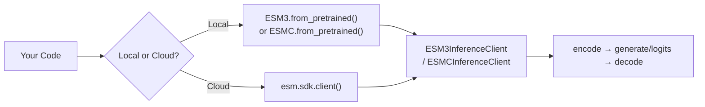
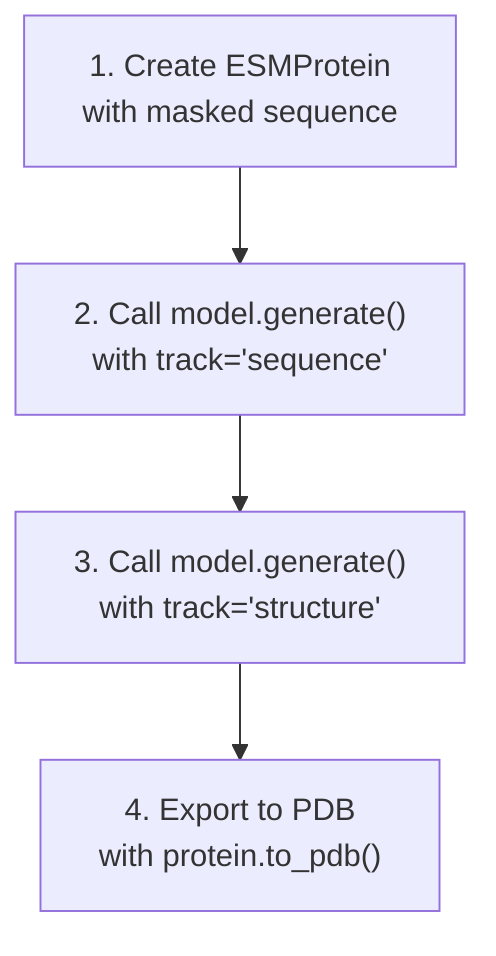
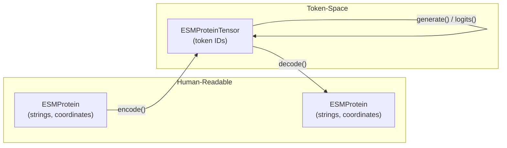

Get from zero to your first protein generation in under five minutes. This page walks you through installing the `esm` library, choosing between the two model families, and running your first inference — whether on local hardware or through the cloud API.

## Prerequisites and Installation

The `esm` package requires **Python 3.12** and **PyTorch ≥ 2.2**. Install everything with a single command:

```bash
pip install esm
```

For accelerated attention on NVIDIA GPUs, optionally install Flash Attention:

```bash
pip install flash-attn --no-build-isolation
```

That's it — all core dependencies (transformers, biotite, BioPython, scikit-learn, etc.) are pulled in automatically.

> [!TIP]
> If you're on macOS ARM or Linux x86_64, you can also use the bundled **pixi** environment. Running `pixi install` from the repo root creates an isolated conda-like environment with pinned versions of every dependency, including build tools.

Sources: [pyproject.toml](/pyproject.toml#L6-L9), [pyproject.toml](/pyproject.toml#L21-L45), [README.md](/README.md#L33-L36)

## Choose Your Model Family

ESM ships two distinct model families, each optimized for a different primary task:

| | **ESM3** (Generative) | **ESM C** (Representation) |
|---|---|---|
| **Purpose** | Controllable protein *generation* — fold, inverse-fold, design | Protein *representation* — embeddings, logits, hidden states |
| **Input Modalities** | Sequence + Structure + Function (multimodal) | Sequence only |
| **Key Method** | `generate()` with `GenerationConfig` | `logits()` with `LogitsConfig` |
| **Open Models** | `esm3-sm-open-v1` (1.4B params) | `esmc-300m` (300M), `esmc-600m` (600M) |
| **Largest via Forge** | `esm3-large-2024-03` (98B) | `esmc-6b-2024-12` (6B) |
| **Client Class** | `ESM3InferenceClient` | `ESMCInferenceClient` |

**New to ESM?** Start with **ESM3** if you want to design or complete proteins; start with **ESM C** if you need embeddings for downstream ML tasks.


Sources: [README.md](/README.md#L50-L69), [README.md](/README.md#L128-L146), [esm/sdk/api.py](/esm/sdk/api.py#L435-L520)

## Two Ways to Run: Local vs. Forge API

Every model in the ESM ecosystem can be accessed through one of two interchangeable clients. The API surface is identical — swap one line and the rest of your code stays the same.



### Local Inference (Open Weights)

Model weights are downloaded from the HuggingFace Hub on first use and cached locally. You'll need a HuggingFace account with a **Read** access token.

```python
from huggingface_hub import login
from esm.models.esm3 import ESM3
from esm.sdk.api import ESM3InferenceClient

login()  # One-time: authenticates with HuggingFace Hub

# Downloads weights, instantiates model on GPU
model: ESM3InferenceClient = ESM3.from_pretrained("esm3-sm-open-v1").to("cuda")
```

The `from_pretrained()` class method handles weight download, device placement, and automatic bfloat16 conversion on CUDA devices.

Sources: [esm/models/esm3.py](/esm/models/esm3.py#L247-L261), [esm/pretrained.py](/esm/pretrained.py#L93-L110), [README.md](/README.md#L71-L80)

### Forge API (Cloud Inference)

For larger models that don't fit on local hardware, use the **EvolutionaryScale Forge** cloud service. Get an API token at [forge.evolutionaryscale.ai](https://forge.evolutionaryscale.ai).

```python
import esm
from esm.sdk.api import ESM3InferenceClient

model: ESM3InferenceClient = esm.sdk.client(
    model="esm3-medium-2024-08",
    token="<your-forge-token>",       # or set ESM_API_KEY env var
)
```

The `esm.sdk.client()` factory returns an `ESM3ForgeInferenceClient` that implements the same `ESM3InferenceClient` interface — so all `.generate()`, `.encode()`, `.decode()`, and `.logits()` calls work identically to local inference. An async variant (`async_generate`, `async_encode`, etc.) is also available for concurrent workloads.

> [!TIP]
> Set the `ESM_API_KEY` environment variable to your Forge token. Then `esm.sdk.client()` picks it up automatically — no need to pass `token=` explicitly. The cookbook snippets use this pattern: `if os.environ.get("ESM_API_KEY", ""): main(client())`.

Sources: [esm/sdk/__init__.py](/esm/sdk/__init__.py#L5-L24), [esm/sdk/forge.py](/esm/sdk/forge.py#L1-L30), [README.md](/README.md#L96-L111), [cookbook/snippets/esm3.py](/cookbook/snippets/esm3.py#L200-L207)

## Your First Generation (ESM3)

ESM3 is a **masked language model** that jointly reasons over sequence, structure, and function. You prompt it with partial (masked) inputs, and it iteratively fills in the blanks. The underscore character `_` represents a masked position.

### Step-by-step: Sequence Completion



```python
from esm.models.esm3 import ESM3
from esm.sdk.api import ESM3InferenceClient, ESMProtein, GenerationConfig

model: ESM3InferenceClient = ESM3.from_pretrained("esm3-sm-open-v1").to("cuda")

# Step 1: Define a partial Carbonic Anhydrase sequence.
# Underscores are masked positions the model will fill in.
prompt = "___________________________________________________DQATSLRILNNGHAFNVEFDDSQDKAVLKGGPLDGTYRLIQFHFHWGSLDGQGSEHTVDKKKYAAELHLVHWNTKYGDFGKAVQQPDGLAVLGIFLKVGSAKPGLQKVVDVLDSIKTKGKSADFTNFDPRGLLPESLDYWTYPGSLTTPP___________________________________________________________"
protein = ESMProtein(sequence=prompt)

# Step 2: Generate the sequence (iteratively unmasks the sequence track).
protein = model.generate(
    protein,
    GenerationConfig(track="sequence", num_steps=8, temperature=0.7)
)

# Step 3: Predict the 3D structure for the completed sequence.
protein = model.generate(
    protein,
    GenerationConfig(track="structure", num_steps=8)
)

# Step 4: Save the result as a PDB file.
protein.to_pdb("./my_first_generation.pdb")
```

### Understanding `GenerationConfig`

The `GenerationConfig` controls how iterative unmasking proceeds. Here are the parameters you'll touch most often:

| Parameter | Type | Default | Description |
|---|---|---|---|
| `track` | `str` | `""` | Which modality to generate: `"sequence"`, `"structure"`, `"secondary_structure"`, `"sasa"`, or `"function"` |
| `num_steps` | `int` | `20` | Number of iterative unmasking rounds (diminishing returns past ~20) |
| `temperature` | `float` | `1.0` | Sampling temperature; lower = more conservative, higher = more diverse |
| `schedule` | `str` | `"cosine"` | Unmasking schedule: `"cosine"` (fast early, slow late) or `"linear"` |
| `strategy` | `str` | `"random"` | Which tokens to unmask first: `"random"` or `"entropy"` (lowest-entropy first) |
| `top_p` | `float` | `1.0` | Nucleus sampling threshold |

Sources: [esm/sdk/api.py](/esm/sdk/api.py#L295-L330), [README.md](/README.md#L82-L94), [cookbook/snippets/esm3.py](/cookbook/snippets/esm3.py#L42-L56)

## Your First Embedding (ESM C)

ESM C produces rich numerical representations of protein sequences — useful for property prediction, similarity search, or as input to downstream models.

```python
from esm.models.esmc import ESMC
from esm.sdk.api import ESMProtein, ESMProteinTensor, LogitsConfig

model = ESMC.from_pretrained("esmc-300m").to("cuda")

# Encode a protein sequence into token tensors.
protein = ESMProtein(sequence="MKWVTFISLLFLFSSAYSRGVFRRDAHKSE")
protein_tensor: ESMProteinTensor = model.encode(protein)

# Run forward pass to get logits and embeddings.
output = model.logits(
    protein_tensor,
    LogitsConfig(sequence=True, return_embeddings=True)
)

print(f"Logits shape:   {output.logits.sequence.shape}")
print(f"Embedding shape: {output.embeddings.shape}")
```

The `LogitsConfig` controls what the model returns:

| Parameter | Default | Description |
|---|---|---|
| `sequence` | `False` | Return per-position sequence logits |
| `return_embeddings` | `False` | Return final-layer embeddings |
| `return_hidden_states` | `False` | Return hidden states from every layer |
| `ith_hidden_layer` | `-1` | Index of a specific hidden layer to extract (`-1` = all layers) |

Sources: [esm/models/esmc.py](/esm/models/esmc.py#L83-L105), [esm/models/esmc.py](/esm/models/esmc.py#L161-L226), [cookbook/snippets/esmc.py](/cookbook/snippets/esmc.py#L21-L46), [esm/sdk/api.py](/esm/sdk/api.py#L383-L399)

## The Core Data Flow

Both ESM3 and ESM C share a common **encode → compute → decode** pipeline. Understanding this three-stage flow is the key to using the SDK effectively:



| Stage | Input | Output | Method | When to Use |
|---|---|---|---|---|
| **Encode** | `ESMProtein` | `ESMProteinTensor` | `client.encode()` | Converting raw protein data to tokens |
| **Compute** | `ESMProteinTensor` | `ESMProteinTensor` or `LogitsOutput` | `client.generate()` / `client.logits()` | Running model inference |
| **Decode** | `ESMProteinTensor` | `ESMProtein` | `client.decode()` | Converting tokens back to human-readable form |

The high-level `generate()` method chains all three stages automatically when you pass an `ESMProtein` directly — it encodes, iteratively samples, and decodes in one call. Power users can operate at the `ESMProteinTensor` level for fine-grained control over multi-step chain-of-thought generation.

Sources: [esm/sdk/api.py](/esm/sdk/api.py#L30-L132), [esm/sdk/api.py](/esm/sdk/api.py#L435-L470), [esm/models/esm3.py](/esm/models/esm3.py#L500-L540)

## Common Tasks at a Glance

Here are the five most frequent operations you'll perform, with the minimal code for each:

| Task | Key Code |
|---|---|
| **Sequence completion** | `model.generate(protein, GenerationConfig(track="sequence", num_steps=8))` |
| **Structure prediction** | `model.generate(protein, GenerationConfig(track="structure", num_steps=len(protein)//16))` |
| **Inverse folding** | Set `protein.sequence = None`, then `model.generate(protein, GenerationConfig(track="sequence"))` |
| **Function prediction** | `model.generate(protein, GenerationConfig(track="function", num_steps=len(protein)//16))` |
| **Get embeddings** | `model.logits(model.encode(protein), LogitsConfig(return_embeddings=True)).embeddings` |

Sources: [cookbook/snippets/esm3.py](/cookbook/snippets/esm3.py#L42-L104), [README.md](/README.md#L82-L94)

## Troubleshooting

| Problem | Cause | Solution |
|---|---|---|
| `Model not found in local model registry` | Misspelled model name | Use exact names: `"esm3-sm-open-v1"`, `"esmc-300m"`, `"esmc-600m"` |
| `huggingface_hub.errors.LocalEntryNotFoundError` | Not authenticated with HuggingFace | Run `huggingface_hub.login()` with a Read token |
| CUDA out-of-memory on ESM3 | 1.4B model requires ~6 GB VRAM | Use `.to("cpu")` for inference (slower), or switch to Forge API |
| `flash-attn` import errors | Flash Attention not compiled for your GPU | Install with `pip install flash-attn --no-build-isolation`, or pass `use_flash_attn=False` |
| `ESMProteinError` from Forge | Invalid input (e.g., no masked positions) | Ensure the target track has `_` (sequence) or `None` (coordinates) for positions to generate |

Sources: [esm/pretrained.py](/esm/pretrained.py#L122-L126), [esm/models/esmc.py](/esm/models/esmc.py#L36-L42), [cookbook/snippets/esm3.py](/cookbook/snippets/esm3.py#L175-L198)

## Where to Go Next

You're set up and running — here's the recommended reading path to deepen your understanding:

1. **[ESMProtein Data Model](3-esmprotein-data-model)** — Master the `ESMProtein` / `ESMProteinTensor` classes, track fields, and conversion methods
2. **[Architecture Overview](7-architecture-overview)** — Understand how ESM3 and ESM C differ architecturally under the hood
3. **[Forge API Client](19-forge-api-client)** — Production patterns: batching, async, retry, and rate limiting
4. **[Local Inference Client](20-local-inference-client)** — GPU optimization, batched generation, and memory management
5. **[Iterative Masked Sampling](16-iterative-masked-sampling)** — The algorithm behind `generate()` and how schedule/strategy affect output quality