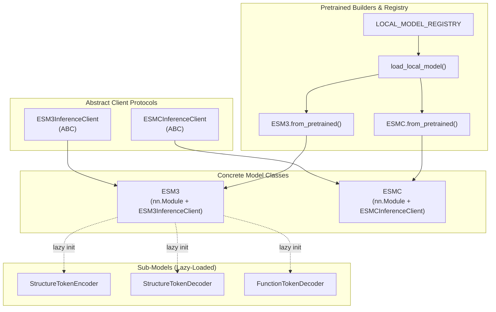
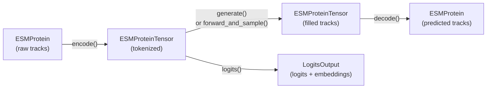

The Local Inference Client enables you to run ESM models entirely on your own hardware—no API keys, no network calls, no rate limits. Both the **ESM3** multimodal generative model and the **ESM C** representation model ship as `nn.Module` subclasses that directly implement their respective inference client interfaces (`ESM3InferenceClient` and `ESMCInferenceClient`), meaning the same `encode` → `generate` → `decode` workflow you use with the [Forge API Client](19-forge-api-client) works identically locally. This architectural decision—models *are* clients—eliminates the need for a separate local wrapper and ensures your code is portable across local and remote execution with zero refactoring.

Sources: [esm3.py](esm/models/esm3.py#L181-L184), [esmc.py](esm/models/esmc.py#L44-L53), [api.py](esm/sdk/api.py#L431-L501)

## Architecture: Models as Inference Clients

The central design principle is that every model class inherits from both `nn.Module` and an abstract inference client. This dual inheritance means the model object itself satisfies the client protocol—there is no adapter layer, no proxy, and no indirection. When you call `model.encode(protein)`, the model directly invokes its tokenizers and structure encoder; when you call `model.generate(protein, config)`, it runs iterative sampling on the same object that holds the transformer weights.



The `ESM3` class holds lazy references to its sub-models (`_structure_encoder`, `_structure_decoder`, `_function_decoder`). These heavy sub-models are only instantiated when first accessed via `get_structure_encoder()`, `get_structure_decoder()`, or `get_function_decoder()`, which is critical for VRAM management—you can load only what you need and explicitly free memory with `torch.cuda.empty_cache()` between stages.

Sources: [esm3.py](esm/models/esm3.py#L181-L258), [esmc.py](esm/models/esmc.py#L44-L98), [pretrained.py](esm/pretrained.py#L114-L134)

## Loading a Local Model

There are two equivalent entry points for loading a pretrained model, both backed by the same `LOCAL_MODEL_REGISTRY`:

| Entry Point | Syntax | Auto-casts to bfloat16 | Use Case |
|---|---|---|---|
| **Class method** | `ESM3.from_pretrained("esm3_sm_open_v1")` | ✅ (on CUDA) | Recommended — type-safe, concise |
| **Registry function** | `load_local_model("esm3_sm_open_v1", device)` | ❌ (raw model) | When you need float32 or custom device control |
| **ESMC class method** | `ESMC.from_pretrained("esmc_300m")` | ✅ (on CUDA) | Same convenience for ESM C models |

The `from_pretrained` class methods are the idiomatic choice. They auto-detect CUDA availability, load weights from the local data root, and upcast to `bfloat16` when running on GPU—matching the precision the models were trained with. The `load_local_model` function gives you the raw model without dtype conversion, which is useful when you need full float32 precision or want to apply custom quantization.

### Available Local Models

| Model Key | Architecture | Parameters | Tracks |
|---|---|---|---|
| `esm3_sm_open_v1` | ESM3 (small, open) | 1.4B | Sequence, Structure, SS, SASA, Function |
| `esmc_300m` | ESM C | 300M | Sequence (representation-focused) |
| `esmc_600m` | ESM C | 600M | Sequence (representation-focused) |
| `esm3_structure_encoder_v0` | VQ-VAE Encoder | — | Structure → Tokens |
| `esm3_structure_decoder_v0` | VQ-VAE Decoder | — | Tokens → Coordinates |
| `esm3_function_decoder_v0` | Function Decoder | — | Function Tokens → InterPro |

The model name normalization layer handles alias resolution transparently—`"esm3-open"`, `"esm3-open-2024-03"`, and `"esm3-sm-open-v1"` all resolve to the same `ESM3_OPEN_SMALL` key in the registry.

Sources: [pretrained.py](esm/pretrained.py#L95-L134), [models.py](esm/utils/constants/models.py#L1-L29)

## The High-Level API: encode → generate → decode

The high-level API mirrors the [Forge API Client](19-forge-api-client) exactly. You work with two data types—`ESMProtein` (human-readable) and `ESMProteinTensor` (tokenized)—and three core operations that form a complete inference pipeline:



**`encode(ESMProtein) → ESMProteinTensor`** tokenizes every provided track using the model's attached tokenizers. For ESM3, this includes running the structure encoder (VQ-VAE) to convert 3D coordinates into discrete structure tokens. Any track left as `None` in the input is passed through as `None` in the output—you only pay the computational cost for the tracks you provide.

**`generate(ProteinType, GenerationConfig) → ProteinType`** runs iterative masked sampling to fill in the target track. When given an `ESMProtein`, it internally calls `encode` → `batch_generate` → `decode`; when given an `ESMProteinTensor`, it skips the encoding/decoding steps and operates directly in token space. The `GenerationConfig` controls which track to generate (`track`), the unmasking schedule (`cosine` or `linear`), the unmasking strategy (`random` or `entropy`), and sampling parameters (`temperature`, `top_p`).

**`decode(ESMProteinTensor) → ESMProtein`** is the inverse of encode—it runs the structure decoder and function decoder to convert tokenized representations back to human-readable coordinates and function annotations.

> [!TIP]
> For ESM3, always call `torch.cuda.empty_cache()` between encode/generate and decode stages. The structure and function decoders are large sub-models loaded lazily; freeing the main model's KV-cache before decoding prevents avoidable out-of-memory errors on consumer GPUs.

Sources: [esm3.py](esm/models/esm3.py#L376-L501), [api.py](esm/sdk/api.py#L293-L334), [raw_forwards.py](cookbook/local/raw_forwards.py#L88-L151)

## The Low-Level API: forward, logits, and forward_and_sample

When the high-level `generate` abstraction doesn't give you enough control, the low-level API exposes the raw forward pass and per-step sampling. This is the escape hatch for power users building custom chain-of-thought pipelines, guided generation, or research experiments.

### Raw Forward Pass

The `forward()` method accepts individual token tensors and returns an `ESMOutput` containing logits for **all six tracks simultaneously**—sequence, structure, secondary structure, SASA, function, and residue annotations—plus the embedding tensor. Any unspecified token input defaults to the mask token for that track, so you can run forward with partial inputs:

```python
output = model.forward(
    sequence_tokens=sequence_tokens,    # Provided
    function_tokens=function_tokens,    # Provided
    # structure_tokens, ss8, sasa default to mask tokens
)
```

This is the most VRAM-efficient way to get multi-track predictions in a single pass, since there is no iterative sampling overhead.

### Logits Endpoint

The `logits(ESMProteinTensor, LogitsConfig)` method wraps the forward pass with `torch.no_grad()` and `torch.autocast(bfloat16)` context managers, then filters the output to only return the tracks you requested via `LogitsConfig`. This is the right entry point when you need embeddings, hidden states, or selective logit tracks:

| `LogitsConfig` Field | Effect |
|---|---|
| `sequence=True` | Return sequence logits |
| `structure=True` | Return structure logits |
| `return_embeddings=True` | Return per-residue embeddings |
| `return_hidden_states=True` | Return all layer hidden states |
| `ith_hidden_layer=5` | Return only hidden state from layer 5 |
| `return_mean_embedding=True` | Return mean-pooled embedding |

> [!TIP]
> Unlike the Forge API (which only supports `sequence` logits due to bandwidth constraints), the local client can return logits for **all tracks** including structure, secondary structure, SASA, and function. This makes local inference the only way to access full multi-track logit distributions for custom sampling strategies.

### Forward and Sample

The `forward_and_sample(ESMProteinTensor, SamplingConfig)` method runs a single forward pass and then samples tokens according to per-track `SamplingTrackConfig` settings. Each track can be independently configured with its own `temperature`, `top_p`, `invalid_ids`, and `topk_logprobs`. This returns a `ForwardAndSampleOutput` containing both the logits and the sampled `ESMProteinTensor`, along with entropy, probabilities, and top-k logprobs for analysis.

Sources: [esm3.py](esm/models/esm3.py#L260-L374), [esm3.py](esm/models/esm3.py#L503-L599), [api.py](esm/sdk/api.py#L337-L429)

## ESM C: Representation Model Local Inference

The ESM C model (`ESMC` class) implements the simpler `ESMCInferenceClient` interface, which exposes `encode`, `decode`, and `logits` but not `generate` or `forward_and_sample`—ESM C is a representation model, not a generative one. The workflow is straightforward:

```python
model = ESMC.from_pretrained("esmc_300m")  # or "esmc_600m"
protein = ESMProtein(sequence="MKWVTFISLLFLFSSAYSRGVFRRDAHKSE")
protein_tensor = model.encode(protein)
output = model.logits(protein_tensor, LogitsConfig(
    sequence=True, return_embeddings=True, return_hidden_states=True
))
# output.embeddings: per-residue representations
# output.hidden_states: all layer hidden states [n_layers, B, L, D]
```

ESM C leverages Flash Attention when available (detected at import time via `flash_attn`), using the unpad/pad paradigm to skip computation on padding tokens. The `from_pretrained` method auto-detects this and configures the model accordingly. When Flash Attention is active, the `sequence_id` parameter must be a boolean mask rather than integer IDs.

The `raw_model` property on both ESM3 and ESMC returns `self`—the underlying `nn.Module`. This is useful when you need to access model internals like `model.transformer` or `model.embed` for custom forward passes that bypass the client interface entirely.

Sources: [esmc.py](esm/models/esmc.py#L44-L226), [esmc.py](cookbook/snippets/esmc.py#L54-L70)

## Registering Custom Models

The `LOCAL_MODEL_REGISTRY` is a simple `dict[str, ModelBuilder]` that maps model names to builder functions with the signature `Callable[[torch.device | str], nn.Module]`. The `register_local_model` function lets you add your own fine-tuned or modified models to the registry so they can be loaded via `from_pretrained`:

```python
from esm.pretrained import register_local_model

def my_custom_esm3(device: torch.device | str = "cpu"):
    model = ESM3(
        d_model=1536, n_heads=24, v_heads=256, n_layers=48,
        structure_encoder_fn=ESM3_structure_encoder_v0,
        structure_decoder_fn=ESM3_structure_decoder_v0,
        function_decoder_fn=ESM3_function_decoder_v0,
        tokenizers=get_esm3_model_tokenizers("esm3_sm_open_v1"),
    ).eval()
    state_dict = torch.load("path/to/my_weights.pth", map_location=device)
    model.load_state_dict(state_dict)
    return model

register_local_model("esm3_custom_v1", my_custom_esm3)
# Now: ESM3.from_pretrained("esm3_custom_v1") works
```

This extensibility pattern means the local inference path is not limited to the published pretrained weights—you can inject any compatible architecture into the same client interface.

Sources: [pretrained.py](esm/pretrained.py#L21-L134)

## Complete Workflow Examples

### ESM3: Folding, Inverse Folding, and Function Prediction

The high-level `generate` API handles all three tasks with the same call signature, differing only in which track you target and which tracks you leave as `None` (masked):

| Task | Input Tracks | `track` Config | Output |
|---|---|---|---|
| **Folding** | sequence, (optional: function) | `"structure"` | 3D coordinates |
| **Inverse folding** | coordinates | `"sequence"` | Amino acid sequence |
| **Function prediction** | sequence, coordinates | `"function"` | InterPro annotations |

The number of iterative sampling steps (`num_steps`) scales with sequence length. A practical heuristic is `num_steps = sequence_length // 16` for structure and function tracks, while sequence generation typically converges in 8–20 steps regardless of length.

### Chain-of-Thought Generation

One of the most powerful patterns enabled by local inference is multi-step chain-of-thought generation, where you iteratively predict one track conditioned on the previous predictions:

```python
# Function → Secondary Structure → Structure → Sequence
protein_tensor = client.encode(cot_protein)
for track in ["secondary_structure", "structure", "sequence"]:
    protein_tensor = client.generate(
        protein_tensor,
        GenerationConfig(track=track, schedule="cosine", num_steps=10),
    )
final_protein = client.decode(protein_tensor)
```

Each `generate` call fills in one track while preserving the previously predicted tracks, building up a complete protein representation step by step. This pattern is only practical locally because it requires multiple sequential forward passes—each contingent on the last—which would be prohibitively slow over a remote API.

Sources: [esm3.py](cookbook/snippets/esm3.py#L38-L137), [raw_forwards.py](cookbook/local/raw_forwards.py#L21-L151)

## VRAM and Performance Considerations

The ESM3 small open model requires significant GPU memory. The main transformer (~1.4B parameters in bfloat16) consumes approximately 2.8 GB for weights alone, but inference also requires KV-cache allocation proportional to sequence length and number of layers. The sub-models add further overhead when decoded:

| Component | Approximate VRAM (bf16) | When Loaded |
|---|---|---|
| ESM3 main model | ~2.8 GB weights + KV-cache | `from_pretrained()` |
| Structure encoder | ~0.1 GB | First `encode()` with coordinates |
| Structure decoder | ~2.5 GB | First `decode()` with structure tokens |
| Function decoder | ~0.3 GB | First `decode()` with function tokens |

The lazy-loading design of sub-models is intentional—you pay for decoders only when you call `decode()`. For raw forward passes (e.g., embedding extraction), you never load the decoders at all. The `bfloat16` autocast applied by `from_pretrained` on CUDA devices halves the memory footprint compared to float32 with negligible quality impact, since the models were trained in this precision.

Sources: [esm3.py](esm/models/esm3.py#L220-L258), [esm3.py](esm/models/esm3.py#L503-L526), [pretrained.py](esm/pretrained.py#L95-L111)

## What to Read Next

- **[Forge API Client](19-forge-api-client)** — Compare the remote API client interface with the local client described here; both share the same `ESM3InferenceClient` / `ESMCInferenceClient` protocols.
- **[Iterative Masked Sampling](16-iterative-masked-sampling)** — Understand the generation algorithm that powers `generate()` and `batch_generate()` under the hood.
- **[Generation Configuration Reference](18-generation-configuration-reference)** — Deep dive into every parameter of `GenerationConfig` and `SamplingConfig` for fine-tuned control.
- **[Encode-Decode Pipeline](22-encode-decode-pipeline)** — Detailed walkthrough of how tokenization, structure encoding/decoding, and function decoding compose into the `encode` → `decode` round-trip.