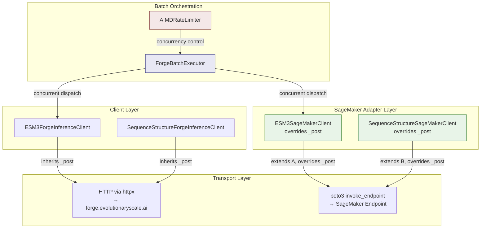
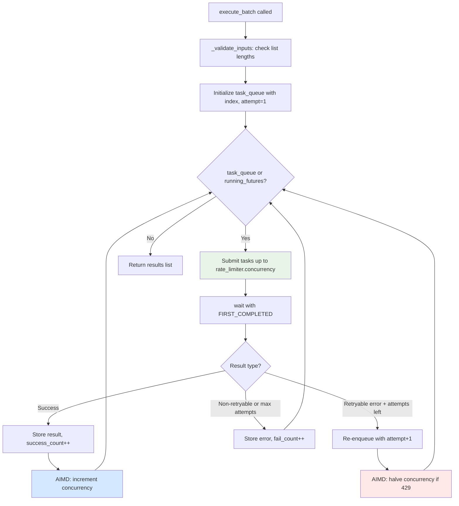

The ESM SDK provides two complementary pathways for running inference at scale beyond the Forge cloud API: **SageMaker clients** that connect directly to AWS-hosted model endpoints, and a **batch executor** that orchestrates concurrent requests with adaptive rate limiting. Together, these tools let you move from prototyping against the Forge API to production-grade, high-throughput inference on your own infrastructure.

## Architectural Overview: Forge vs. SageMaker

The SageMaker clients are **drop-in replacements** for the Forge clients. They inherit the same public API surface—`generate`, `encode`, `decode`, `logits`, `forward_and_sample`, `fold`, `inverse_fold`—but override the internal `_post` method to route requests through AWS SageMaker's `invoke_endpoint` API instead of HTTP calls to the Forge server. This means any code written against the Forge client works unchanged with the SageMaker client.



The key design principle is **inheritance-based substitution**: the SageMaker clients extend their Forge counterparts, call the parent constructor with dummy URL and token values, then swap out only the transport mechanism. All request serialization, response parsing, and retry logic from the Forge parent class is fully reused.

Sources: [sagemaker.py](/esm/sdk/sagemaker.py#L1-L120), [forge.py](/esm/sdk/forge.py#L1-L50)

## ESM3SageMakerClient

The `ESM3SageMakerClient` provides full ESM3 inference capabilities—generation, encoding, decoding, logits, and forward-and-sample—through a SageMaker real-time endpoint. It extends `ESM3ForgeInferenceClient` and overrides `_post` to serialize requests as JSON and dispatch them via `boto3.client("sagemaker-runtime").invoke_endpoint()`.

### Initialization

```python
from esm.sdk.sagemaker import ESM3SageMakerClient

client = ESM3SageMakerClient(
    endpoint_name="your-sagemaker-endpoint",
    model="esm3-sm-open-v1",
)
```

| Parameter | Type | Description |
|---|---|---|
| `endpoint_name` | `str` | **Required.** The name of your deployed SageMaker endpoint. |
| `model` | `str` | **Required.** The ESM3 model identifier (e.g., `"esm3-sm-open-v1"`). |
| `token` | `str` | Optional. Defaults to `"dummy"` — SageMaker endpoints use IAM authentication, not API tokens. |

> [!TIP]
> The `model` parameter is required (unlike in the Forge client where it has no default) because the SageMaker endpoint may serve multiple model variants. The model field is included in every request payload so the serving container can route to the correct model.

### Request Protocol

When `_post` is called, the SageMaker client wraps the request payload in a structure that mirrors the Forge API's expected format. This wrapper ensures compatibility with the same serving container that handles Forge traffic:

```python
# What the SageMaker _post sends to invoke_endpoint
invocations_request = {
    "model": request["model"],           # Duplicated at top level
    "request_id": "",                    # Forge-specific field (unused)
    "user_id": "",                       # Forge-specific field (unused)
    "api_ver": "v1",                     # Must be "v1"
    "endpoint": endpoint,                # e.g., "generate", "encode"
    endpoint: request,                   # Nested request under endpoint key
}
```

The `CustomAttributes` header carries the `return_bytes` flag (`"return_bytes=true"` or `"return_bytes=false"`), which the SageMaker serving container uses to decide whether to return tensor data as base64-encoded pickle bytes or plain JSON. This is critical for the `logits` endpoint where raw tensor data can be very large.

### Response Handling

After `invoke_endpoint` returns, the response body is parsed as JSON. The client asserts that the response's `endpoint` key matches the request's endpoint, then extracts the actual data from the nested `data[endpoint]` key. This mirrors the Forge response structure, ensuring that the parent class's `_process_*_response` methods work without modification.

Sources: [sagemaker.py](/esm/sdk/sagemaker.py#L84-L120), [forge.py](/esm/sdk/forge.py#L244-L268)

## SequenceStructureSageMakerClient

The `SequenceStructureSageMakerClient` handles the folding and inverse-folding endpoints through SageMaker. It extends `SequenceStructureForgeInferenceClient` and follows the same override pattern as the ESM3 client, with one key difference: **it does not support the `return_bytes` CustomAttributes header**.

### Initialization

```python
from esm.sdk.sagemaker import SequenceStructureSageMakerClient

fold_client = SequenceStructureSageMakerClient(
    endpoint_name="your-folding-endpoint",
    model="esm3-small-2024-03",  # Optional for this client
)
```

| Parameter | Type | Description |
|---|---|---|
| `endpoint_name` | `str` | **Required.** The SageMaker endpoint name. |
| `model` | `str \| None` | Optional. Model name, defaults to `None`. |

### Available Methods

Since this client inherits from `SequenceStructureForgeInferenceClient`, it exposes the **fold** and **inverse_fold** operations:

| Method | Input | Output | Description |
|---|---|---|---|
| `fold(sequence)` | Protein sequence string | `ESMProtein` with coordinates | Predict 3D structure from sequence |
| `inverse_fold(coordinates, config)` | Coordinate tensor + config | `ESMProtein` with sequence | Predict sequence from structure |
| `async_fold(sequence)` | Same as `fold` | Same as `fold` | Async variant |
| `async_inverse_fold(...)` | Same as `inverse_fold` | Same as `inverse_fold` | Async variant |
| `_fetch_msa(sequence)` | Sequence string | `MSA` object | Fetch multiple sequence alignment |

Sources: [sagemaker.py](/esm/sdk/sagemaker.py#L8-L82), [forge.py](/esm/sdk/forge.py#L131-L218)

## ForgeBatchExecutor: Concurrent Inference at Scale

When you need to run hundreds or thousands of inference calls—whether against Forge or SageMaker—the `ForgeBatchExecutor` provides a managed concurrency layer with **adaptive rate limiting** and **automatic retries**. It is exposed through the convenience function `esm.sdk.batch_executor()`.

### Basic Usage

```python
from esm.sdk import batch_executor
from esm.sdk.api import ESMProtein, GenerationConfig

proteins = [ESMProtein(sequence=s) for s in sequences]
configs = [GenerationConfig(track="sequence") for _ in sequences]

with batch_executor(max_attempts=10, show_progress=True) as executor:
    results = executor.execute_batch(
        esm3_client.generate,        # Any callable (Forge or SageMaker)
        input=proteins,               # List-valued args are sliced per task
        config=configs,
    )
```

The `execute_batch` method inspects all keyword arguments and positional arguments. Any argument that is a `list` is sliced element-by-element per task; scalar arguments are passed identically to every task. All list-valued arguments **must have the same length**.

### How It Works



### AIMD Rate Limiting

The `AIMDRateLimiter` implements **Additive Increase / Multiplicative Decrease** congestion control—the same algorithm used in TCP. This is critical when hitting rate-limited endpoints:

| Condition | Action | Rationale |
|---|---|---|
| Successful response | `concurrency += step_up` (default +1) | Gradually probe for more capacity |
| HTTP 429 (rate limit) | `concurrency //= 2` | Back off aggressively |
| Other retryable errors (500, 502, 504) | No concurrency change | These are server errors, not rate limits |

| Parameter | Default | Description |
|---|---|---|
| `initial_concurrency` | 32 | Starting parallelism level |
| `min_concurrency` | 1 | Floor after multiplicative decrease |
| `max_concurrency` | 64 | Ceiling for additive increase |
| `step_up` | 1 | Additive increment per success |

> [!TIP]
> The `ForgeBatchExecutor` disables per-call retries (via `skip_retries_var` context variable) and instead handles retries itself at the batch level. This avoids the "double retry" problem where both the `@retry_decorator` on individual methods and the batch executor would independently retry the same request. When using the batch executor, you get exactly one retry mechanism—the executor's own.

Sources: [forge_context_manager.py](/esm/utils/forge_context_manager.py#L1-L157), [__init__.py](/esm/sdk/__init__.py#L1-L37)

## Comparison: Forge vs. SageMaker vs. Batch

| Feature | Forge API Client | SageMaker Client | ForgeBatchExecutor |
|---|---|---|---|
| **Transport** | HTTPS (httpx) | AWS SageMaker Runtime (boto3) | Wraps either client |
| **Authentication** | API token (`Bearer`) | IAM role / AWS credentials | Inherits from wrapped client |
| **Full ESM3 API** | ✅ generate, encode, decode, logits, forward_and_sample | ✅ Same as Forge | ✅ Any callable |
| **Fold / Inverse Fold** | ✅ Via `SequenceStructureForgeInferenceClient` | ✅ Via `SequenceStructureSageMakerClient` | ✅ Any callable |
| **Auto-retry** | ✅ `@retry_decorator` (429, 500, 502, 504) | ✅ Inherits from Forge parent | ✅ Built-in retry + AIMD |
| **Async support** | ✅ All methods have `async_` variants | ✅ Inherits async methods | ❌ Thread-based only |
| **Concurrency control** | ❌ Single request | ❌ Single request | ✅ AIMD rate limiter |
| **Progress bar** | ❌ | ❌ | ✅ tqdm |
| **Infrastructure** | EvolutionaryScale cloud | Your AWS account | Either |
| **Data locality** | Data leaves your VPC | Data stays in your AWS VPC | Depends on wrapped client |

Sources: [sagemaker.py](/esm/sdk/sagemaker.py#L1-L120), [forge.py](/esm/sdk/forge.py#L1-L50), [forge_context_manager.py](/esm/utils/forge_context_manager.py#L1-L157)

## SageMaker Endpoint Prerequisites

Before using the SageMaker clients, you must deploy an ESM3 model to a SageMaker real-time endpoint. The serving container must accept the Forge-compatible request format (nested `endpoint` key structure with `api_ver: "v1"`). Key AWS-side requirements:

1. **IAM Permissions**: The calling identity needs `sagemaker-runtime:InvokeEndpoint` on the target endpoint.
2. **Endpoint Configuration**: The endpoint must be deployed and in `InService` status.
3. **Network**: If using a VPC endpoint, ensure connectivity from your compute environment to the SageMaker Runtime service.
4. **boto3 Configuration**: Standard boto3 credential resolution applies—environment variables, IAM instance profiles, or `~/.aws/credentials`.

## Combining SageMaker with Batch Execution

The real power comes from combining the SageMaker client with the batch executor. This gives you **VPC-isolated inference** with **adaptive concurrency control**:

```python
from esm.sdk.sagemaker import ESM3SageMakerClient
from esm.sdk import batch_executor
from esm.sdk.api import ESMProtein, GenerationConfig

# SageMaker client — traffic stays in your AWS account
sm_client = ESM3SageMakerClient(
    endpoint_name="esm3-production-endpoint",
    model="esm3-sm-open-v1",
)

# Batch executor — manages concurrency against your endpoint
with batch_executor(max_attempts=5, show_progress=True) as executor:
    proteins = [ESMProtein(sequence=s) for s in large_sequence_list]
    configs = [GenerationConfig(track="structure", num_steps=8)] * len(proteins)
    
    results = executor.execute_batch(
        sm_client.generate,
        input=proteins,
        config=configs,
    )
```

When running against a SageMaker endpoint you control, you can tune the `AIMDRateLimiter` parameters based on your endpoint's instance type and auto-scaling configuration. For example, an endpoint backed by a single `ml.g5.12xlarge` instance may tolerate 16–32 concurrent requests, while a multi-instance endpoint with auto-scaling can handle significantly more.

Sources: [sagemaker.py](/esm/sdk/sagemaker.py#L84-L120), [forge_context_manager.py](/esm/utils/forge_context_manager.py#L66-L157), [__init__.py](/esm/sdk/__init__.py#L21-L37)

## Error Handling and Retry Semantics

The SageMaker clients inherit the same error handling from the Forge layer. When `invoke_endpoint` raises a boto3 exception, it is caught and re-raised as a `RuntimeError`. The `@retry_decorator` on each method (inherited from the Forge parent class) then governs whether the call is retried based on the error type:

| Error Code | Retryable? | Meaning |
|---|---|---|
| 429 | ✅ | Rate limited — back off and retry |
| 500 | ✅ | Internal server error |
| 502 | ✅ | Bad gateway |
| 504 | ✅ | Gateway timeout |
| 400 | ❌ | Bad request — client error, retrying won't help |
| 403 | ❌ | Forbidden — authentication/authorization failure |
| 404 | ❌ | Not found — invalid endpoint or model |

When using `ForgeBatchExecutor`, the per-method `@retry_decorator` is disabled (via `skip_retries_var`), and retries are handled at the executor level instead. The executor retries only on the same error codes, up to `max_attempts` per task. On HTTP 429 errors specifically, it also triggers the AIMD multiplicative decrease to reduce concurrency.

Sources: [retry.py](/esm/sdk/retry.py#L1-L86), [sagemaker.py](/esm/sdk/sagemaker.py#L56-L67), [forge_context_manager.py](/esm/utils/forge_context_manager.py#L103-L157)

## Next Steps

- To understand the Forge API client that the SageMaker clients extend, see [Forge API Client](19-forge-api-client).
- For local inference without any remote calls, see [Local Inference Client](20-local-inference-client).
- To learn about the encode/decode pipeline shared across all clients, see [Encode-Decode Pipeline](22-encode-decode-pipeline).
- For the generation configuration options used with `generate()`, see [Generation Configuration Reference](18-generation-configuration-reference).