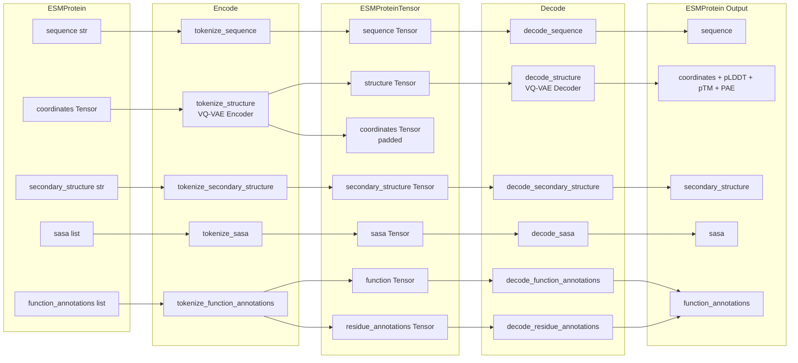

The ESM3 encode-decode pipeline is the bidirectional bridge between **human-interpretable protein representations** (`ESMProtein`) and **model-consumable token tensors** (`ESMProteinTensor`). Every interaction with ESM3 — whether generating a novel sequence, predicting structure, or decoding model outputs — passes through this pipeline. Understanding its mechanics is essential for controlling what the model sees, what it predicts, and how you interpret the results.

## Two Representations, One Protein

The pipeline operates on two data models defined in the SDK API. **`ESMProtein`** holds raw, domain-level data: an amino acid string, coordinate tensors, secondary structure labels, SASA values, and function annotations. **`ESMProteinTensor`** holds the same information after tokenization: integer tensors (and padded coordinate tensors) ready for the transformer. The `encode()` method converts `ESMProtein → ESMProteinTensor`; the `decode()` method inverts this as `ESMProteinTensor → ESMProtein`.

| Track | `ESMProtein` Field | `ESMProteinTensor` Field | Tokenizer | Vocab Size |
|---|---|---|---|---|
| Sequence | `sequence: str` | `sequence: Tensor` | `EsmSequenceTokenizer` | 64 |
| Structure | `coordinates: Tensor` | `structure: Tensor` | `StructureTokenizer` + VQ-VAE Encoder | 4096 + 5 special |
| Secondary Structure | `secondary_structure: str` | `secondary_structure: Tensor` | `SecondaryStructureTokenizer` (ss8) | 8 + 3 special |
| SASA | `sasa: list[float\|None]` | `sasa: Tensor` | `SASADiscretizingTokenizer` | 16 + 3 special |
| Function | `function_annotations: list[FunctionAnnotation]` | `function: Tensor` (depth=8) | `InterProQuantizedTokenizer` | 260 × 8 depth |
| Residue Annotations | *(merged into function_annotations)* | `residue_annotations: Tensor` (depth=16) | `ResidueAnnotationsTokenizer` | 1478 |
| Coordinates | `coordinates: Tensor` | `coordinates: Tensor` | *(passthrough with ∞-padding)* | — |

Sources: [api.py](esm/sdk/api.py#L26-L111), [api.py](esm/sdk/api.py#L201-L283), [__init__.py](esm/tokenization/__init__.py#L15-L46)

## Pipeline Architecture

The encode-decode pipeline is not a single function but a **coordinated dispatch** — each track follows its own encoding and decoding path, orchestrated by the top-level `encode()` / `decode()` methods on the inference client. The following diagram shows how a raw protein flows through tokenization into the transformer and back:



Sources: [encoding.py](esm/utils/encoding.py#L1-L230), [decoding.py](esm/utils/decoding.py#L1-L244)

## Encoding: From Raw Data to Tokens

The encoding path is exposed through the `encode()` method on any `ESM3InferenceClient` implementation (local model, Forge API, or SageMaker). Internally, it delegates to the module-level functions in `esm.utils.encoding`, each of which accepts the raw data for one track plus the appropriate tokenizer.

**Sequence encoding** is the simplest path: the raw string has its mask characters (`_`) replaced with the tokenizer's mask token, then the standard `encode()` call produces an integer tensor with BOS/EOS tokens wrapping the residue tokens. [encoding.py](esm/utils/encoding.py#L35-L45)

**Structure encoding** is the most complex: the coordinate tensor `(L, 37, 3)` is first converted to a `ProteinChain` object, which produces structure-encoder-ready inputs (coordinates, pLDDT, residue index). The `StructureTokenEncoder` (a VQ-VAE) then encodes these into discrete structure tokens. The original coordinates and pLDDT are preserved alongside the tokens — coordinates are ∞-padded at BOS/EOS positions, and pLDDT is zero-padded. This dual output is critical because the transformer's geometric attention layer uses the raw coordinates for SE(3)-invariant frame computation while the discrete tokens feed the standard embedding path. [encoding.py](esm/utils/encoding.py#L48-L97)

**Secondary structure and SASA encoding** follow the same pattern as sequence — string or float-to-discrete tokenization — with SASA using a discretizing tokenizer that bins continuous solvent-accessibility values into one of 16 bins. [encoding.py](esm/utils/encoding.py#L100-L135)

**Function annotation encoding** is split into two sub-tracks. The `encode_function_annotations()` helper in `esm.utils.function.encode_decode` first **classifies each annotation** by checking whether its label matches an InterPro accession (`IPR\d+`), a TF-IDF function keyword, or a residue annotation label. InterPro and keyword annotations are routed to `InterProQuantizedTokenizer` producing a `(L+2, 8)` depth tensor; residue-level annotations are routed to `ResidueAnnotationsTokenizer` producing a `(L+2, 16)` depth tensor. This split exists because function tokens represent a *categorical* distribution (softmax over vocabulary) while residue annotations are *multi-hot* (independent Bernoulli per label). [encode_decode.py](esm/utils/function/encode_decode.py#L13-L81)

### Default (Masked) Tokens

When a track in `ESMProtein` is `None`, the encoder fills it with **masked default tokens** — the mask token ID at every position, framed by BOS and EOS. This is what enables partial conditioning: you provide only the tracks you know (e.g., sequence) and leave the rest masked for the model to generate.

| Default Generator | Shape | Fill Value |
|---|---|---|
| `get_default_sequence_tokens` | `(L+2,)` | `mask_token_id` |
| `get_default_structure_tokens` | `(L+2,)` | `mask_token_id` |
| `get_default_secondary_structure_tokens` | `(L+2,)` | `mask_token_id` |
| `get_default_sasa_tokens` | `(L+2,)` | `mask_token_id` |
| `get_default_function_tokens` | `(L+2, 8)` | `pad_token_id` |
| `get_default_residue_annotation_tokens` | `(L+2, 16)` | `pad_token_id` |

The `ESMProteinTensor.empty()` class method uses these generators to create a fully-masked tensor representation of a given length — the starting point for unconditional generation. [api.py](esm/sdk/api.py#L251-L278), [encoding.py](esm/utils/encoding.py#L156-L229)

> [!TIP]
> Function tokens use `pad_token_id` as their default fill (not `mask_token_id`) because the InterPro quantized tokenizer's "no annotation" state is represented by padding. Structure and sequence tracks use `mask_token_id` because they represent "unknown, predict me" states. This distinction matters: padding means "no signal here" while masking means "model should fill this in."

## Decoding: From Tokens Back to Raw Data

The `decode()` method on an inference client calls `decode_protein_tensor()`, which orchestrates the reverse dispatch across all tracks. Decoding is not a perfect inverse of encoding — it produces **additional quality metrics** (pLDDT, pTM, PAE) from the structure decoder that have no encoding counterpart.

### Pre-decode Sanitization

Before decoding any track, `decode_protein_tensor()` performs a **pad-check**: it strips BOS/EOS tokens, flattens, and checks whether every remaining token equals the track's `pad_token_id`. If so, the track is set to `None` — it contained no real information. For the structure track specifically, if *any* token is a mask token, the entire structure is set to `None`, because partial structure decoding is not supported (structure tokens must be fully resolved before decoding coordinates). [decoding.py](esm/utils/decoding.py#L47-L61)

### Structure Decoding in Detail

Structure decoding is the most involved track. The `StructureTokenDecoder` (the VQ-VAE decoder) receives the structure tokens and produces backbone coordinate predictions along with confidence metrics:

1. **Token → Backbone**: The decoder outputs `bb_pred` of shape `(1, L+2, ...)` from which BOS/EOS positions are trimmed to yield `(L, 3, 3)` backbone atom coordinates (N, Cα, C).
2. **Confidence extraction**: pLDDT (per-residue confidence), pTM (predicted TM-score), and PAE (predicted aligned error) are extracted from the decoder output if present.
3. **Oxygen inference**: The `ProteinChain.from_backbone_atom_coordinates()` constructor builds a chain from the three backbone atoms, and `infer_oxygen()` reconstructs the carbonyl oxygen positions geometrically.
4. **Final coordinates**: The chain's `atom37_positions` are returned as a `(L, 37, 3)` tensor.

[decoding.py](esm/utils/decoding.py#L138-L169)

### Function Decoding and Annotation Merging

Function decoding reconstructs `FunctionAnnotation` objects from token predictions. The `decode_function_tokens()` helper calls `FunctionTokenDecoder.decode()` which produces both InterPro annotations and function keyword annotations, converting them to `FunctionAnnotation(label, start, end)` instances. Residue annotation decoding iterates over the 16 depth positions, mapping nonzero token IDs back to their vocabulary labels and constructing per-position annotations that are then **merged** via `merge_annotations()` — a function that combines adjacent or near-adjacent annotations of the same label. Annotations shorter than `annotation_min_length` (default 5) are dropped. [encode_decode.py](esm/utils/function/encode_decode.py#L84-L180)

### BOS/EOS Validation

Every track decoder (except function and residue annotations) calls `_bos_eos_warn()`, which emits a warning — not an error — if the first token is not BOS or the last is not EOS. This lenient approach allows decoding partially-trimmed tensors while still alerting the user to potential data corruption. SASA decoding is stricter: it raises `ValueError` if BOS/EOS tokens are missing. [decoding.py](esm/utils/decoding.py#L114-L122), [decoding.py](esm/utils/decoding.py#L184-L188)

## The Tokenizer Collection

All six tokenizers are bundled into a `TokenizerCollection` dataclass that implements `TokenizerCollectionProtocol`. The `get_esm3_model_tokenizers()` factory constructs the correct tokenizer instances for a given model variant. This collection is stored on the `ESM3` model object and passed through to encoding/decoding functions, ensuring that the same vocabulary is used consistently across both directions of the pipeline.

```python
# The protocol that every tokenizer collection must satisfy
class TokenizerCollectionProtocol(Protocol):
    sequence: EsmSequenceTokenizer
    structure: StructureTokenizer
    secondary_structure: SecondaryStructureTokenizer
    sasa: SASADiscretizingTokenizer
    function: InterProQuantizedTokenizer
    residue_annotations: ResidueAnnotationsTokenizer
```

Sources: [__init__.py](esm/tokenization/__init__.py#L15-L46)

> [!TIP]
> When using the local `ESM3` model, the tokenizers are automatically loaded via `from_pretrained()`. When using the Forge API client, encoding/decoding happens server-side — you never handle `ESMProteinTensor` directly. The `encode()`/`decode()` methods on the Forge client serialize `ESMProtein` to JSON and deserialize the response, abstracting away the entire tokenization layer.

## Encode-Decode in the Generation Loop

The encode-decode pipeline is not just a preprocessing step — it is woven into the core generation loop. The `generate()` method on `ESM3` follows this sequence:

1. **Encode**: If the input is `ESMProtein`, call `encode()` to produce `ESMProteinTensor` (with known tracks tokenized and unknown tracks masked).
2. **Iterative Sampling**: Run `iterative_sampling_tokens()`, which repeatedly calls `forward_and_sample()` to unmask tokens according to the `GenerationConfig` schedule and strategy.
3. **Decode**: Call `decode()` to convert the fully-resolved `ESMProteinTensor` back to `ESMProtein`.

If the input is already `ESMProteinTensor`, step 1 is skipped — and similarly, the output type matches the input type, so a tensor input yields a tensor output. This design lets advanced users inject custom token patterns between encode and decode. [esm3.py](esm/models/esm3.py#L377-L399)

## Track-by-Track Encoding Reference

| Function | Input | Output | Special Handling |
|---|---|---|---|
| `tokenize_sequence` | `str` + `EsmSequenceTokenizer` | `Tensor (L+2,)` | `_` → `mask_token` replacement |
| `tokenize_structure` | `Tensor (L,37,3)` + encoder + tokenizer | `(coords, plddt, structure_tokens)` | VQ-VAE encoding; ∞-pad coords at BOS/EOS |
| `tokenize_secondary_structure` | `str` or `list[str]` + `SecondaryStructureTokenizer` | `Tensor (L+2,)` | Per-char tokenization; `_` → mask |
| `tokenize_sasa` | `list[float\|None]` + `SASADiscretizingTokenizer` | `Tensor (L+2,)` | `None` → mask token; continuous → 16-bin discrete |
| `tokenize_function_annotations` | `list[FunctionAnnotation]` + both tokenizers | `(function_tokens, residue_annotation_tokens)` | Label classification → split into two sub-tracks |

Sources: [encoding.py](esm/utils/encoding.py#L35-L152)

## Track-by-Track Decoding Reference

| Function | Input | Output | Special Handling |
|---|---|---|---|
| `decode_sequence` | `Tensor` + `EsmSequenceTokenizer` | `str` | Strip spaces, cls, eos; mask_token → `_` |
| `decode_structure` | `Tensor` + `StructureTokenDecoder` + `StructureTokenizer` | `(atom37_coords, pLDDT, pTM, PAE)` | VQ-VAE decode → backbone → oxygen inference → atom37 |
| `decode_secondary_structure` | `Tensor` + `SecondaryStructureTokenizer` | `str` | Strip BOS/EOS, then decode |
| `decode_sasa` | `Tensor` + `SASADiscretizingTokenizer` | `list[float]` | Discrete → float; NaN → None |
| `decode_function_annotations` | `Tensor` + `FunctionTokenDecoder` + `InterProQuantizedTokenizer` | `list[FunctionAnnotation]` | InterPro + keyword annotations with merge + min-length filter |
| `decode_residue_annotations` | `Tensor` + `ResidueAnnotationsTokenizer` | `list[FunctionAnnotation]` | Per-depth nonzero extraction → merge → filter |

Sources: [decoding.py](esm/utils/decoding.py#L125-L233)

## Related Pages

- The individual tokenizers that power each track are detailed in [Sequence and Structure Tokenizers](10-sequence-and-structure-tokenizers) and [VQ-VAE Structure Encoding](11-vq-vae-structure-encoding).
- For function and residue annotation tokenization internals, see [Function and Residue Annotation Tokens](12-function-and-residue-annotation-tokens).
- The iterative sampling loop that operates between encode and decode is covered in [Iterative Masked Sampling](16-iterative-masked-sampling).
- For deployment-specific encode/decode behavior (Forge vs. local vs. SageMaker), see [Forge API Client](19-forge-api-client) and [Local Inference Client](20-local-inference-client).