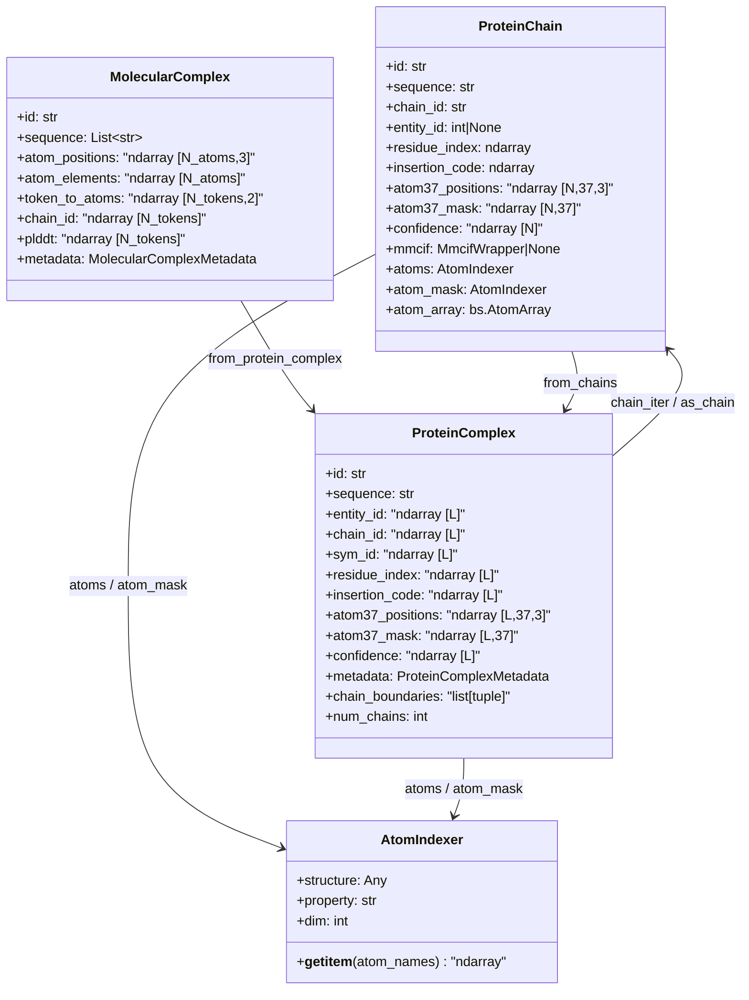
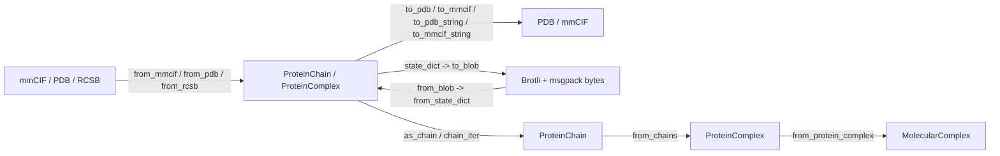

The ESM structure utilities provide a layered type system for representing protein structures at progressively richer levels of compositional granularity — from a single polypeptide chain, through multi-chain biological assemblies, to fully heterogeneous molecular complexes containing nucleic acids and small-molecule ligands. Each layer is a frozen dataclass backed by NumPy arrays in the **atom37** coordinate representation, with round-trip serialization through PDB, mmCIF, and a compressed binary blob format. This page covers the architectural contracts, construction patterns, metric computations, and interconversion pathways that bind these types together.

## Type Hierarchy and Data Model

The three core dataclasses form a strict hierarchy: `ProteinChain` captures one polypeptide, `ProteinComplex` composes multiple chains with chain-break tokens and assembly metadata, and `MolecularComplex` generalizes further to a flat-token representation supporting non-protein molecules. The `AtomIndexer` provides ergonomic atom-name access across all types.



The `L` dimension in `ProteinComplex` includes chain-break tokens (`|`) that separate individual chains within a concatenated sequence array. All per-residue arrays — `atom37_positions`, `atom37_mask`, `confidence`, `residue_index`, `entity_id`, `chain_id`, `sym_id` — share this same `L`-length first dimension, with separator rows filled using sentinel values (NaN positions, zero masks, `-1` residue indices).

Sources: [protein_chain.py](/esm/utils/structure/protein_chain.py#L101-L128), [protein_complex.py](/esm/utils/structure/protein_complex.py#L72-L107), [molecular_complex.py](/esm/utils/structure/molecular_complex.py#L42-L100), [atom_indexer.py](/esm/utils/structure/atom_indexer.py#L1-L16)

## ProteinChain: Single-Chain Representation

`ProteinChain` is a frozen dataclass that stores one polypeptide chain in the atom37 coordinate system — a `[N_residues, 37, 3]` position tensor where each of the 37 standard atom slots follows the ordering defined in `residue_constants.atom_order`. The boolean `atom37_mask` indicates which atoms carry valid coordinates; missing atoms (common for sidechains in low-resolution structures) have NaN positions.

### Construction Pathways

| Factory Method | Input Format | Key Behavior |
|---|---|---|
| `from_rcsb(pdb_id, chain_id, entity_id)` | RCSB PDB identifier | Fetches mmCIF from RCSB, delegates to `from_mmcif` |
| `from_mmcif(path, chain_id, entity_id, is_predicted)` | mmCIF file/buffer | Parses via `MmcifWrapper`, selects chain by ID or entity; defaults to first entity |
| `from_pdb(path, chain_id, id, is_predicted)` | PDB file/buffer | Parses via biotite; `chain_id="detect"` picks the first chain |
| `from_atom37(atom37_positions, sequence, ...)` | Raw `[N,37,3]` array | Infers mask from `isfinite`; fills defaults for missing metadata |
| `from_backbone_atom_coordinates(coords, ...)` | `[N,3,3]` N/CA/C array | Expands to full atom37 with `inf` padding on non-backbone atoms |
| `from_atomarray(atom_array, id, is_predicted)` | biotite `AtomArray` | Round-trips through PDB serialization |
| `from_blob(input)` | Compressed bytes | Brotli-decompresses → msgpack-deserializes → `from_state_dict` |
| `from_mds(data)` | Raw dict | Direct field assignment from dictionary |

When loading from mmCIF, the `chain_id` parameter selects by **author chain ID**, while `entity_id` selects by the mmCIF entity identifier. If neither is provided, the factory defaults to the entity with the smallest ID. For `is_predicted=True` structures, the CA atom's B-factor is read into the `confidence` field as a pLDDT proxy.

> [!TIP]
> The `CHAIN_ID_CONST = "A"` constant is hardcoded for single-chain output — methods like `to_pdb` and `to_mmcif` will label all atoms as chain "A" regardless of the original chain identifier. Use `ProteinComplex` when you need faithful multi-chain labeling.

### Coordinate Normalization and Atom Inference

Two critical reconstruction utilities complete partial backbone coordinates:

- **`infer_oxygen()`** — Computes the carbonyl oxygen position from the N-CA-C frame of the *next* residue using a fixed local-frame offset vector `[0.6240, -1.0613, 0.0103]` applied via `Affine3D.from_graham_schmidt(CA, C, N_next)`. Returns a new `ProteinChain` with O atoms filled in where they were previously missing.
- **`infer_cbeta(infer_cbeta_for_glycine=False)`** — Reconstructs Cβ positions from the N, C, CA triad using the trDesign-inspired geometric construction with bond length `L=1.522Å`, angle `A=1.927rad`, and dihedral `D=-2.143rad`. Glycine residues are excluded by default since they lack a Cβ.

The **coordinate normalization** pipeline — `get_normalization_frame()` → `apply_frame()` → `normalize_coordinates()` — centers a chain on the mean CA position and aligns it via Gram-Schmidt on the mean N/CA/C vectors. This produces a canonical SE(3) frame useful for feed-forward model input.

Sources: [protein_chain.py](/esm/utils/structure/protein_chain.py#L996-L1195), [protein_chain.py](/esm/utils/structure/protein_chain.py#L200-L399)

## ProteinComplex: Multi-Chain Assemblies

`ProteinComplex` extends the atom37 representation to biological assemblies by concatenating per-chain arrays with **chain-break tokens** (`|`) as delimiters. The sequence string becomes `"ACDEF...|GHIKL...|..."` where `|` marks the boundary between chains. Three additional per-residue arrays track multi-chain identity:

| Field | Shape | Semantics |
|---|---|---|
| `entity_id` | `[L]` | Maps residues to unique sequence entities — chains sharing the same amino acid sequence receive the same entity ID |
| `chain_id` | `[L]` | Numeric chain identifier — multiple copies of the same entity get distinct chain IDs |
| `sym_id` | `[L]` | Symmetry copy index — distinguishes symmetric copies within an assembly |

The `ProteinComplexMetadata` dataclass carries lookup dictionaries (`chain_lookup`, `entity_lookup`) mapping numeric IDs to their string labels, plus an `assembly_composition` dictionary mapping assembly IDs to their constituent chain IDs for biological assembly switching.

### Chain Access and Iteration

```python
# Iterate over individual chains as ProteinChain objects
for chain in complex.chain_iter():
    print(chain.chain_id, len(chain))

# Direct access by positional index
chain_0 = complex.get_chain_by_index(0)

# Access by author chain ID (randomly samples among duplicates)
chain_A = complex.get_chain_by_id("A")

# Convert single-chain complex back to ProteinChain
chain = complex.as_chain()          # asserts single chain
chain = complex.as_chain(force_conversion=True)  # flattens multi-chain
```

The `chain_boundaries` cached property computes `[(start, end), ...]` pairs by scanning for `|` tokens. When slicing a `ProteinComplex` with a boolean mask, the `__getitem__` implementation automatically preserves chain-break tokens and removes consecutive `||` artifacts, ensuring structural integrity of the result.

### Assembly Operations

`ProteinComplex` supports **biological assembly switching** for structures loaded from mmCIF. The `switch_assembly(id)` method re-parses the assembly transformations from the source mmCIF file and applies rotation/translation operators to generate the requested biological assembly. The `find_assembly_ids_with_chain(id)` method queries which assemblies contain a given chain.

The internal `get_assembly_fast()` function parses `pdbx_struct_assembly_gen` and `pdbx_struct_oper_list` categories from the mmCIF file, computes transformation matrices via `_get_transformations`, and applies them through `_apply_transformations_fast` — which iterates over the cartesian product of operation expressions to generate all symmetric copies.

> [!TIP]
> When computing RMSD or lDDT on a `ProteinComplex`, the methods default to `compute_chain_assignment=True`, which internally runs a full DockQ calculation to find the optimal chain mapping before alignment. This is accurate but expensive — set `compute_chain_assignment=False` if chains are already aligned.

Sources: [protein_complex.py](/esm/utils/structure/protein_complex.py#L72-L200), [protein_complex.py](/esm/utils/structure/protein_complex.py#L996-L1207)

## MolecularComplex: Heterogeneous Molecular Assemblies

`MolecularComplex` generalizes beyond purely protein structures to support **nucleic acids (RNA/DNA) and small-molecule ligands** alongside proteins. Instead of the fixed atom37 representation, it uses a **flat atom array** with token-to-atom index mapping:

| Field | Shape | Description |
|---|---|---|
| `atom_positions` | `[N_atoms, 3]` | Flat coordinate array for all atoms across all molecules |
| `atom_elements` | `[N_atoms]` | Element symbol for each atom |
| `token_to_atoms` | `[N_tokens, 2]` | Start/end indices into the flat atom array for each token |
| `atom_names` | `[N_atoms]` (optional) | PDB atom names, preserved from source structure |
| `atom_hetero` | `[N_atoms]` (optional) | HETATM flags from source structure |

Individual tokens are accessed via the `Molecule` dataclass returned by `__getitem__`, which carries `molecule_type` (PROTEIN=0, RNA=1, DNA=2, LIGAND=3) and `residue_type` fields. The `from_protein_complex()` class method provides the bridge from the protein-only world: it strips chain-break tokens, converts 1-letter codes to 3-letter residue names via `restype_1to3`, and flattens the atom37 arrays into the token-indexed flat representation.

The `MolecularComplexResult` dataclass wraps folding outputs with standard quality metrics — `plddt`, `ptm`, `iptm`, `pae`, `distogram`, and `pair_chains_iptm` — representing the full output of a complex folding prediction.

Sources: [molecular_complex.py](/esm/utils/structure/molecular_complex.py#L1-L200)

## Structural Metrics and Alignment

Both `ProteinChain` and `ProteinComplex` expose a consistent set of comparison metrics, all delegating to lower-level implementations in `metrics.py` and the `Aligner` class:

| Metric | Method | Algorithm | Notes |
|---|---|---|---|
| RMSD | `.rmsd(target, ...)` | Kabsch alignment via `Aligner` | `also_check_reflection` for chirality ambiguity |
| lDDT-CA | `.lddt_ca(native, ...)` | Distance-difference tolerance | **Not symmetric** — always call as `prediction.lddt_ca(native)` |
| GDT-TS | `.gdt_ts(target, ...)` | Threshold-based CA superposition | Uses 1Å, 2Å, 4Å, 8Å distance cutoffs |
| DockQ | `.dockq(native)` (Complex only) | External DockQ-v2 binary | Full interface scoring; returns `DockQResult` with per-interface breakdown |

For `ProteinComplex`, the `rmsd`, `lddt_ca`, and `gdt_ts` methods accept a `compute_chain_assignment` flag that, when True, first runs `dockq()` to determine the optimal chain mapping before computing the metric — accounting for the fact that chain ordering may differ between predicted and native structures.

### Alignment Workflow

The `Aligner` class (from `aligner.py`) performs Kabsch superposition. The `.align(target)` method on `ProteinChain` returns a new aligned chain, while the underlying `Aligner.apply()` method can align any structure given mobile and reference indices:

```python
aligned = chain.align(target, mobile_inds=[0,1,2], target_inds=[5,6,7], only_use_backbone=True)
rmsd_value = chain.rmsd(target, only_compute_backbone_rmsd=True)
```

### Chain-Level Biophysical Properties (ProteinChain only)

| Property | Method | Computation |
|---|---|---|
| SASA | `.sasa(by_residue=True)` | Biotite `bs.sasa()` per-atom, aggregated via `bincount` |
| SAP Score | `.sap_score(aggregation="residue")` | Spatial aggregation propensity within 5Å radius |
| Globularity | `.globularity()` | MVEE volume ratio × elongation metric |
| Radius of Gyration | `.radius_of_gyration()` | Biotite `bs.gyration_radius()` |
| Cβ Contacts | `.cbeta_contacts(distance_threshold=8.0)` | Pairwise distance matrix from (inferred) Cβ positions |

Sources: [protein_chain.py](/esm/utils/structure/protein_chain.py#L399-L796), [protein_complex.py](/esm/utils/structure/protein_complex.py#L598-L797), [metrics.py](/esm/utils/structure/metrics.py)

## Serialization and I/O

All three dataclasses support a layered serialization strategy optimized for different use cases:

### File Format I/O



### Blob Serialization Details

The `to_blob()` / `from_blob()` pipeline achieves substantial compression through three techniques applied in sequence: (1) **sparse coding** — `atom37_positions` are stored only for masked atoms, eliminating NaN padding; (2) **dtype reduction** — `int64` → `int32` for indices, `float64/float32` → `float16` for coordinates and confidence; (3) **Brotli compression** at quality level 5. This reduces storage from ~52GB per million chains to ~20GB. The `state_dict()` method also accepts `backbone_only=True` to strip sidechain atom masks, and `json_serializable=True` to convert arrays to nested lists.

### mmCIF Quality Annotation

The `to_mmcif()` method on `ProteinChain` writes `ma_qa_metric` and `ma_qa_metric_local` categories into the CIF file, enabling Molstar's "AlphaFold view" to render per-residue pLDDT coloring directly from the confidence array. The `to_mmcif_string()` method on `ProteinComplex` additionally generates `_entity`, `_entity_poly`, and `_struct_asym` categories by grouping chains with identical sequences into shared entities.

Sources: [protein_chain.py](/esm/utils/structure/protein_chain.py#L253-L398), [protein_complex.py](/esm/utils/structure/protein_complex.py#L399-L597), [molecular_complex.py](/esm/utils/structure/molecular_complex.py#L200-L400)

## Interconversion Patterns

The type system is designed for fluid interconversion. The `from_chains()` class method on `ProteinComplex` concatenates a list of `ProteinChain` objects, inserting `CHAIN_BREAK_TOKEN` separators and building the `entity_id`/`chain_id`/`sym_id` index arrays by detecting shared chain IDs and entity IDs. The reverse direction — `as_chain()` — flattens a single-entity complex back to a `ProteinChain`, asserting uniqueness unless `force_conversion=True`.

The utility function `protein_chain_to_protein_complex()` handles the edge case where a `ProteinChain` already contains chain-break tokens in its sequence (e.g., from a model output), splitting it into sub-chains at `|` positions and reconstructing a proper `ProteinComplex`.

For the generalized pathway, `MolecularComplex.from_protein_complex()` converts the atom37 representation to the flat-token model by iterating residues, extracting masked atoms, and building the `token_to_atoms` index mapping. This is the entry point for mixed-composition structures that need to go beyond the protein-only constraint.

Sources: [protein_complex.py](/esm/utils/structure/protein_complex.py#L449-L560), [molecular_complex.py](/esm/utils/structure/molecular_complex.py#L103-L200), [protein_complex.py](/esm/utils/structure/protein_complex.py#L1160-L1207)

## Next Steps

- For the tokenization pipeline that converts these structures into model inputs, see [Encode-Decode Pipeline](22-encode-decode-pipeline).
- For how VQ-VAE encodes atom37 coordinates into discrete structure tokens, see [VQ-VAE Structure Encoding](11-vq-vae-structure-encoding).
- For the geometric attention mechanism that operates on 3D coordinates during inference, see [Geometric Attention and SE(3) Invariance](13-geometric-attention-and-se-3-invariance).