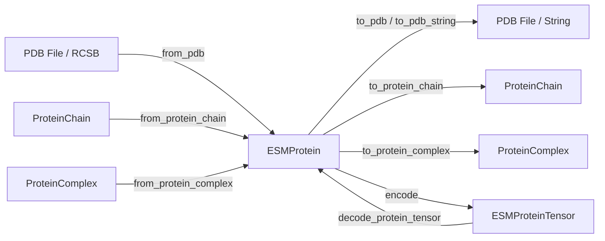

The **ESMProtein** class is the central data object you will encounter at every stage of working with ESM3. It is a container that holds multiple *tracks* — parallel representations of a single protein across sequence, structure, and function — and it serves as both the input you provide to the model and the output you receive back. Understanding what each track contains, how they relate to one another, and how to construct and convert an `ESMProtein` is the foundation for everything from simple embedding lookups to full generative design.

Sources: [api.py](/esm/sdk/api.py#L26-L55), [1_esmprotein.ipynb](/cookbook/tutorials/1_esmprotein.ipynb#L7-L31)

## The Five Input Tracks

ESM3 reasons jointly over three fundamental biological properties of proteins: sequence, structure, and function. These are decomposed into **five promptable tracks** inside `ESMProtein`. Each track is optional (`None` by default), and you can set any subset of them to be partially or fully unmasked when calling the model — this is the mechanism by which you *prompt* ESM3 for generation or inference.

| Track | Attribute | Python Type | Biological Meaning |
|---|---|---|---|
| **Sequence** | `sequence` | `str \| None` | 1-letter amino acid sequence (e.g. `"MKTLL..."`) |
| **Coordinates** | `coordinates` | `torch.Tensor \| None` | 3D atom positions in atom37 format, shape `(L, 37, 3)` |
| **Secondary Structure** | `secondary_structure` | `str \| None` | 8-class DSSP label per residue (e.g. `"HHHEEC..."`) |
| **SASA** | `sasa` | `list[float \| None] \| None` | Solvent-accessible surface area per residue |
| **Function Annotations** | `function_annotations` | `list[FunctionAnnotation] \| None` | InterPro-derived keyword annotations over residue ranges |

> [!TIP]
> All five tracks are optional and default to `None`. When a track is `None`, it is treated as fully masked during model input. Setting a track to a string with `_` characters (the mask short-hand) partially masks that track, giving you fine-grained control over which residues the model should predict.

Sources: [api.py](/esm/sdk/api.py#L26-L32), [1_esmprotein.ipynb](/cookbook/tutorials/1_esmprotein.ipynb#L23-L31)

### Sequence Track

The `sequence` attribute is the simplest track: a Python string of single-letter amino acid codes following the standard 20-residue alphabet plus special tokens. The underscore `_` character acts as the **mask token** in the raw string representation — any position marked `_` signals the model to predict that residue. The full vocabulary includes standard amino acids (`L, A, G, V, S, E, R, T, I, D, P, K, Q, N, F, Y, M, H, W, C`), non-standard codes (`X, B, U, Z, O`), gap (`.`), chain break (`|`), and mask (`<mask>` which maps from `_`).

```python
# A fully masked protein of length 10 (model will predict everything)
protein = ESMProtein(sequence="__________")

# A partially masked protein (model predicts positions 4-6)
protein = ESMProtein(sequence="MKT___VILP")

# A fully specified sequence (no prediction needed)
protein = ESMProtein(sequence="MKTLIVILPF")
```

Sources: [esm3.py](/esm/utils/constants/esm3.py#L46-L59), [encoding.py](/esm/utils/encoding.py#L22-L45)

### Coordinates Track

The `coordinates` attribute stores 3D atomic positions as a `torch.Tensor` of shape `(L, 37, 3)`, where `L` is the number of residues. The **atom37** representation encodes up to 37 heavy atoms per amino acid (a fixed superset that covers all standard residue types). Atoms not present in a given residue are filled with `NaN` values. The three values along the last dimension are the `(x, y, z)` Cartesian coordinates in Ångströms.

```python
# After loading from PDB, coordinates are populated automatically
protein = ESMProtein.from_pdb("1cm4.pdb", chain_id="A")
print(protein.coordinates.shape)  # torch.Size([L, 37, 3])
```

> [!TIP]
> When initializing an `ESMProtein` with only coordinates (no sequence), the model treats all residues as alanine during PDB conversion. Always pair coordinates with a sequence when you need the correct amino acid identity for downstream analysis or visualization.

Sources: [api.py](/esm/sdk/api.py#L28-L32), [1_esmprotein.ipynb](/cookbook/tutorials/1_esmprotein.ipynb#L120-L127)

### Secondary Structure Track

The `secondary_structure` attribute uses the **8-class DSSP classification** (SS8). Each residue is assigned one of eight characters representing its local structural motif:

| SS8 Code | Class | 3-Class Mapping | Description |
|---|---|---|---|
| `H` | α-helix | H | Standard alpha helix |
| `G` | 3₁₀-helix | H | Short helix (3 residues per turn) |
| `I` | π-helix | H | Wide helix (5 residues per turn) |
| `E` | Extended strand | E | Beta sheet (participating) |
| `B` | Isolated beta-bridge | E | Single beta bridge residue |
| `T` | Turn | C | Hydrogen-bonded turn |
| `S` | Bend | C | Non-helical bend |
| `C` | Coil | E → C | Loop / irregular |

The 8-class labels can be collapsed to a 3-class representation (`H`, `E`, `C`) using the built-in mapping. When you don't have DSSP installed locally, a 3-class approximation can be obtained from `biotite.structure.annotate_sse`.

```python
# SS8 string: one character per residue
protein.secondary_structure = "HHHHHHEEEESSSCCCCTTT"
```

Sources: [esm3.py](/esm/utils/constants/esm3.py#L61-L72), [1_esmprotein.ipynb](/cookbook/tutorials/1_esmprotein.ipynb#L215-L245)

### SASA Track

The **Solvent-Accessible Surface Area** (SASA) track quantifies how exposed each residue is to solvent, expressed as a continuous float value per residue. Internally, ESM3 discretizes SASA into bins defined by the boundaries `[0.8, 4.0, 9.6, 16.4, 24.5, 32.9, 42.0, 51.5, 61.2, 70.9, 81.6, 93.3, 107.2, 125.4, 151.4]`, producing 16 discrete tokens. As a user, you provide a list of floats (or `None` for masked positions), and the tokenizer handles discretization automatically.

```python
# SASA values per residue — computed from ProteinChain or model output
protein.sasa = protein_chain.sasa()  # list of floats
# Partially masked: [12.5, None, 33.1, ...] — None signals "predict here"
```

Residues buried in the protein core tend to have low SASA values (below ~10), while surface-exposed residues can exceed 100.

Sources: [esm3.py](/esm/utils/constants/esm3.py#L74-L90), [1_esmprotein.ipynb](/cookbook/tutorials/1_esmprotein.ipynb#L627-L643)

### Function Annotations Track

The `function_annotations` track is the most structurally complex, consisting of a list of `FunctionAnnotation` objects rather than a simple per-residue array. Each `FunctionAnnotation` spans a range of residues and carries a label:

```python
@dataclass
class FunctionAnnotation:
    label: str    # InterPro ID or keyword string
    start: int    # 1-indexed, inclusive
    end: int      # 1-indexed, inclusive
```

ESM3 supports two types of function annotations: **InterPro entry annotations** (e.g. `"IPR011992"`) and **keyword annotations** derived from InterPro entry descriptions and Gene Ontology mappings. The model is designed to work with keyword annotations, which expand each InterPro entry into multiple descriptive keywords covering the same residue range. You can convert between the two using the `InterProQuantizedTokenizer`:

```python
from esm.tokenization import InterProQuantizedTokenizer
from esm.utils.types import FunctionAnnotation

# Define InterPro annotations (1-indexed, inclusive)
interpro_annotations = [
    FunctionAnnotation(label="IPR011992", start=1, end=143),
    FunctionAnnotation(label="IPR018247", start=17, end=29),
]

# Convert to keyword annotations for ESM3 input
tokenizer = InterProQuantizedTokenizer()
keyword_annotations = []
for ann in interpro_annotations:
    keywords = tokenizer.interpro2keywords.get(ann.label, [])
    keyword_annotations.extend(
        FunctionAnnotation(label=kw, start=ann.start, end=ann.end)
        for kw in keywords
    )
protein.function_annotations = keyword_annotations
```

Sources: [types.py](/esm/utils/types.py#L14-L33), [1_esmprotein.ipynb](/cookbook/tutorials/1_esmprotein.ipynb#L456-L593)

## Confidence Metrics

Beyond the five promptable input tracks, `ESMProtein` carries three **read-only metric** fields that are populated by the model during structure prediction. These are not inputs — they are outputs that quantify the model's confidence in its generated coordinates.

| Metric | Attribute | Shape | Meaning |
|---|---|---|---|
| **pLDDT** | `plddt` | `(L,)` | Per-residue confidence score (0–100) |
| **pTM** | `ptm` | scalar | Predicted TM-score for the whole chain |
| **pAE** | `pae` | `(L, L)` | Predicted aligned error between all residue pairs |

Sources: [api.py](/esm/sdk/api.py#L34-L37)

## Construction and Conversion Methods

`ESMProtein` provides several class methods and instance methods for constructing proteins from external sources and converting them to other formats. The diagram below illustrates the full conversion surface:



### From External Sources

The most common way to create an `ESMProtein` is from a PDB file or an RCSB entry. The `from_pdb` class method loads a PDB file, parses it into a `ProteinChain`, and converts it to an `ESMProtein` with `sequence` and `coordinates` populated:

```python
from esm.sdk.api import ESMProtein
from esm.utils.structure.protein_chain import ProteinChain

# Option 1: Direct from PDB file
protein = ESMProtein.from_pdb("my_structure.pdb", chain_id="A")

# Option 2: From a ProteinChain (more control)
protein_chain = ProteinChain.from_rcsb("1cm4", "A")
protein = ESMProtein.from_protein_chain(protein_chain)

# Option 3: From ProteinChain with annotations (populates SASA too)
protein = ESMProtein.from_protein_chain(protein_chain, with_annotations=True)
```

When `with_annotations=True`, the factory method also populates the `sasa` track from the `ProteinChain`'s computed SASA values. Without it, only `sequence`, `coordinates`, and `plddt` are filled.

Sources: [api.py](/esm/sdk/api.py#L57-L90), [1_esmprotein.ipynb](/cookbook/tutorials/1_esmprotein.ipynb#L74-L94)

### To External Formats

Converting back to standard structural formats is equally straightforward:

```python
# Write to a PDB file
protein.to_pdb("output.pdb")

# Get PDB string directly (for visualization or streaming)
pdb_string = protein.to_pdb_string()

# Convert to ProteinChain for structural analysis
chain = protein.to_protein_chain()

# Convert to ProteinComplex (requires both sequence and coordinates)
complex_ = protein.to_protein_complex()
```

Note that `to_protein_chain` requires `coordinates` to be set, and `to_protein_complex` requires *both* `sequence` and `coordinates`. The `to_pdb` and `to_pdb_string` methods internally convert to a `ProteinComplex` and infer oxygen atom positions before serialization.

Sources: [api.py](/esm/sdk/api.py#L112-L194)

## The Tokenized Counterpart: ESMProteinTensor

When ESM3 actually processes a protein, the human-readable `ESMProtein` is **encoded** into `ESMProteinTensor` — a parallel structure where every track is represented as discrete integer tokens (PyTorch tensors) rather than raw strings or floats. This encoding step is handled by the tokenization pipeline, and you typically don't construct `ESMProteinTensor` manually. However, understanding the mapping between the two types is essential:

| ESMProtein Track | ESMProteinTensor Track | Token Type |
|---|---|---|
| `sequence` (str) | `sequence` (Tensor) | Amino acid token IDs with BOS/EOS |
| `coordinates` (Tensor) | `structure` (Tensor) | VQ-VAE codebook indices |
| `secondary_structure` (str) | `secondary_structure` (Tensor) | SS8 class token IDs |
| `sasa` (list[float]) | `sasa` (Tensor) | Discretized bin token IDs |
| `function_annotations` (list) | `function` (Tensor) | Quantized InterPro keyword IDs |
| *(no equivalent)* | `residue_annotations` (Tensor) | Per-residue annotation token IDs |

All tokenized tensors include BOS (begin-of-sequence) and EOS (end-of-sequence) special tokens, making their length `L + 2`. The `ESMProteinTensor.empty(length, tokenizers)` factory creates a fully masked tensor of the specified length, ready for generation.

Sources: [api.py](/esm/sdk/api.py#L201-L283), [encoding.py](/esm/utils/encoding.py#L156-L229)

## Length and Masking Semantics

The `__len__` method on `ESMProtein` determines the protein length from the first non-`None` track it finds, checking in order: `sequence` → `secondary_structure` → `sasa` → `coordinates`. If all tracks are `None`, it raises a `ValueError`. This design means you don't need to specify a length explicitly — it is always inferred from the data you provide.

Masking uses the `_` character in string tracks (`sequence`, `secondary_structure`) and `None` entries in list tracks (`sasa`). The mask short-hand `_` is translated to `<mask>` during tokenization. For `coordinates`, masking is handled at the `ESMProteinTensor` level through structure token masking.

```python
# Protein length is inferred automatically
protein = ESMProtein(sequence="MKTL_III__")
print(len(protein))  # 10

# Copy a protein for safe modification
protein_copy = protein.copy()
```

Sources: [api.py](/esm/sdk/api.py#L45-L55), [encoding.py](/esm/utils/encoding.py#L35-L44)

## Quick Reference: ESMProtein at a Glance

| Category | Attribute / Method | Type / Signature | Description |
|---|---|---|---|
| **Track** | `sequence` | `str \| None` | Amino acid string, `_` = mask |
| **Track** | `coordinates` | `Tensor \| None` | Shape `(L, 37, 3)`, atom37 format |
| **Track** | `secondary_structure` | `str \| None` | SS8 string, `_` = mask |
| **Track** | `sasa` | `list[float \| None] \| None` | Per-residue float, `None` = mask |
| **Track** | `function_annotations` | `list[FunctionAnnotation] \| None` | Labeled spans over residues |
| **Metric** | `plddt` | `Tensor \| None` | Per-residue confidence |
| **Metric** | `ptm` | `Tensor \| None` | Predicted TM-score |
| **Metric** | `pae` | `Tensor \| None` | Predicted aligned error matrix |
| **Factory** | `from_pdb(path, chain_id)` | `→ ESMProtein` | Load from PDB file |
| **Factory** | `from_protein_chain(chain)` | `→ ESMProtein` | Convert from ProteinChain |
| **Factory** | `from_protein_complex(cpx)` | `→ ESMProtein` | Convert from ProteinComplex |
| **Export** | `to_pdb(path)` | `→ None` | Write PDB file |
| **Export** | `to_pdb_string()` | `→ str` | PDB format string |
| **Export** | `to_protein_chain()` | `→ ProteinChain` | Convert to ProteinChain |
| **Export** | `to_protein_complex()` | `→ ProteinComplex` | Convert to ProteinComplex |
| **Utility** | `copy()` | `→ ESMProtein` | Deep copy |
| **Utility** | `__len__()` | `→ int` | Inferred from first non-None track |

Sources: [api.py](/esm/sdk/api.py#L26-L199)

## Where to Go Next

Now that you understand the `ESMProtein` data model, you're ready to use it with the model. The natural next steps are:

- **[Embed](2-quick-start)** — Learn how to pass an `ESMProtein` to the model to get embeddings and predictions
- **[Sequence and Structure Tokenizers](10-sequence-and-structure-tokenizers)** — Understand how each track is converted into discrete tokens
- **[Encode-Decode Pipeline](22-encode-decode-pipeline)** — Walk through the full round-trip from `ESMProtein` → `ESMProteinTensor` → model → `ESMProtein`
- **[Protein Chain and Complex Utilities](23-protein-chain-and-complex-utilities)** — Explore the `ProteinChain` and `ProteinComplex` classes that interoperate with `ESMProtein`
