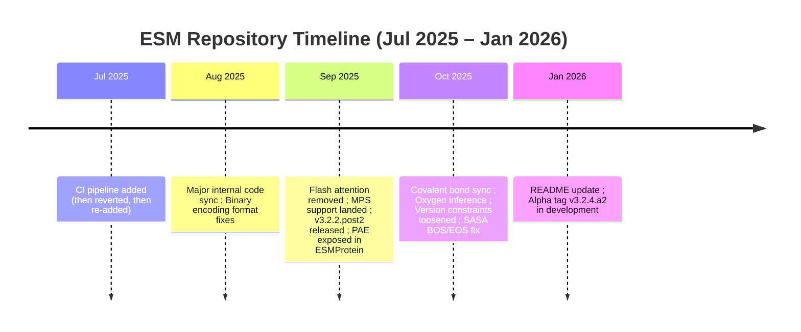
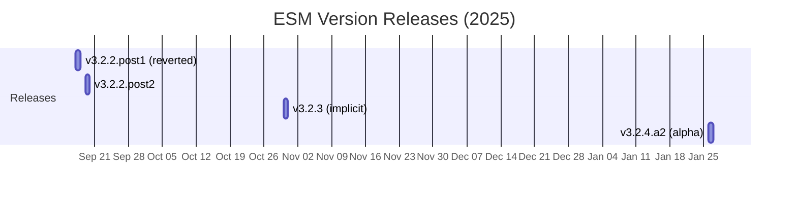

The ESM repository has been anything but quiet. Between mid-2025 and early 2026, the team at EvolutionaryScale shipped a steady stream of patches, architectural cleanups, and new features—while the community surfaced bugs that cut to the core of how the model processes protein data. Here's a structured look at what matters.

## The Big Picture: A Post-3.2 Maturation Phase

Since the [ESM Cambrian announcement](https://www.evolutionaryscale.ai/blog/esm-cambrian) in December 2024—which introduced the ESM C family at 300M, 600M, and 6B parameter scales—the open-source repository has been in a consolidation phase. The version history tells the story clearly:

The pattern is familiar to anyone who's maintained a fast-growing ML library: **sync internal code, fix what breaks, tighten the build, then repeat**. But beneath that routine cycle, several individual changes deserve scrutiny.

## Flash Attention: Removed, Not Replaced

In what is arguably the most architecturally significant commit, Zeming Lin [Remove flash attention (#269)](https://github.com/Biohub/esm/commit/7454c3d77bc731990c534936ef091db3851455a3) stripped out the `flash_attn` dependency entirely. This was followed immediately by [pyright ignore flash_attn import (#274)](https://github.com/Biohub/esm/commit/97eb26b2fe04386205bd8049033cc14f022d1fa3), which added type-checking ignores for the now-guarded import.

Why does this matter? Flash Attention has been a performance staple for transformer-based models, offering significant speedups on NVIDIA GPUs. Removing it signals one of two things: either the team found compatibility issues too painful (Flash Attention's CUDA kernel requirements are notoriously fragile across PyTorch versions), or they've substituted an alternative path that doesn't require it. The fact that `flash_attn` is still *guarded* rather than deleted entirely suggests they're keeping the door open—but the default path no longer depends on it. For users on non-NVIDIA hardware, this is unambiguously good news.

## Mac Silicon Support: Finally

One of the most-requested features landed in September: [Enable running ESM on Mac silicon using MPS (#99)](https://github.com/Biohub/esm/commit/c8969198c62129fd76eba5e450b091d2d3b012ac), authored by Imran Qureshi with co-authorship from Zeming Lin. This enables the Metal Performance Shaders (MPS) backend, letting researchers run inference on Apple M-series chips.

The timing is interesting. PyTorch's MPS backend [has had a rocky maintenance trajectory](https://docs.pytorch.org/serve/hardware_support/apple_silicon_support.html), with an official notice that it's "no longer actively maintained." ESM's decision to add MPS support *now* suggests the team sees enough researcher demand on Apple hardware to justify it—perhaps at the inference-only level rather than for training. Either way, it lowers the barrier to entry for a significant chunk of the academic community.

## Structural and Encoding Fixes: The Quietly Important Ones

A cluster of commits in September–October addressed encoding and structural correctness:

| Commit | Author | What Changed |
|--------|--------|--------------|
| [sasa BOS/EOS fix (#286)](https://github.com/Biohub/esm/commit/6e89bf7d127b06e95d8243c020936cd67d862229) | Ishaan Mathur | Fixed SASA tokens not starting/ending with proper BOS/EOS markers |
| [syncing covalent bonds (#280)](https://github.com/Biohub/esm/commit/23b084b94f3b5f6fd700ae41f46a2787a9a5c12b) | Ishaan Mathur | Synchronized covalent bond handling between internal and open-source |
| [Ishaan/infer oxygen (#283)](https://github.com/Biohub/esm/commit/232a1041d807cce2d58ab8501750e0bfda6c26c4) | Ishaan Mathur | Added oxygen atom inference in protein complexes |
| [sync (#278)](https://github.com/Biohub/esm/commit/e8117a2f68b264657eb9717308d55e5f8690588c) | Ishaan Mathur | General internal-to-external code sync |
| [Exposing pae in ESMProtein (#164)](https://github.com/Biohub/esm/commit/79c1208e96e84f9cce4479d243daf9865263c50e) | Ventura Rivera | Exposed Predicted Aligned Error (PAE) scores in the ESMProtein data model |

**The SASA BOS/EOS fix** is worth highlighting because it directly connects to [a user-reported issue](https://github.com/Biohub/esm/issues/258) where function prediction code crashed with `ValueError: SASA does not start with 0 corresponding to BOS token`. The root cause was that SASA tokens were being padded with `inf` instead of `0` at BOS/EOS positions—a subtle encoding bug that only manifested when decoding function annotations.

**The PAE exposure** is a developer-experience win. Predicted Aligned Error is critical for assessing confidence in predicted structures, and having it directly on `ESMProtein` rather than buried in the raw output tensor makes the API significantly more ergonomic.

**The oxygen inference** commit speaks to a real practical gap: PDB files generated by ESM3 were [missing O atoms](https://github.com/Biohub/esm/issues/279) in backbone carbonyl groups. Rather than requiring users to post-process their structures, the team added inference logic directly into the pipeline.

## Dependency and Build Hygiene

Several commits addressed the less glamorous but critical task of keeping the package buildable:

- [loosen version (#284)](https://github.com/Biohub/esm/commit/e103c9c1c4047c38e8c7f1215c91f8481268e366): Relaxed the `transformers` version cap from `<=4.48.2` to allow newer versions, directly responding to [a user request](https://github.com/Biohub/esm/issues/265) that pointed out ESM works fine with `transformers>=4.49.0`.
- [adding CI (#257)](https://github.com/Biohub/esm/commit/b237fe781ccd290bf458d9d4a7484a21ac00c7bc): Added a CI pipeline checking linting, type-checking, and running tests—after [an earlier attempt was reverted](https://github.com/Biohub/esm/commit/e0669a4a05a05395dde08d4ff2eb0219bcc2f79e).
- [various merge errors for the new binary encoding format (#261)](https://github.com/Biohub/esm/commit/2a19c4edde933c171dcb78baa304942338fbb23f): Fixed merge-related bugs in a new binary encoding format that was synced from internal code.

The version-constraint relaxation is particularly notable because **overly strict dependency pins are a chronic pain point in scientific Python**. They create dependency conflicts when users need to combine ESM with other ML libraries in the same environment. The fact that EvolutionaryScale responded to this within a couple of months of the issue being filed is a good sign.

## What's Coming: Alpha Tags and SAE Work

The GitHub activity feed reveals two active development branches that haven't landed on `main` yet:

1. **Sparse Autoencoder (SAE) support** — Branches `ishaan/sae` and `thomas-a-neil`'s contributions to it show work on integrating SAE feature extraction. This aligns with the growing research interest in mechanistic interpretability for protein language models, as demonstrated at [ICLR 2025's LMRL Workshop](https://iclr.cc/virtual/2025/35912). The branch includes examples for extracting SAE features and a 6B-scale SAE name, suggesting the team is scaling interpretability tools to their largest model.

2. **Folding examples** — The `ishaan/folding` branch adds protein folding examples with support for sequences longer than 800 residues and pLDDT output to mmCIF format.

3. **Version 3.2.4** — A tag `mga esm v3.2.4.a2` was created, indicating the next release is in alpha testing.

## The Bugs That Matter: What's Still Open

While the commit log shows progress, several open issues reveal structural problems that haven't been addressed yet:

| Issue | Severity | Core Problem |
|-------|----------|--------------|
| [Attention mask bug (#299)](https://github.com/Biohub/esm/issues/299) | **High** | Pad tokens attend to each other instead of nothing—incorrect hidden states for padding |
| [NaN coordinates vs None (#294)](https://github.com/Biohub/esm/issues/294) | **High** | Passing `coordinates=torch.full(..., nan)` produces dramatically worse pTM scores (0.096) than `coordinates=None` (0.426) |
| [cls_token setter error (#240)](https://github.com/Biohub/esm/issues/240) | **Medium** | `ESMC.from_pretrained` fails with `AttributeError: property 'cls_token' has no setter` on versions ≥3.1.5 |
| [Forge API 403 errors (#296)](https://github.com/Biohub/esm/issues/296) | **Medium** | Users with valid Forge credits still get "User does not have access to model" |
| [Unused dependencies (#303)](https://github.com/Biohub/esm/issues/303) | **Low** | `torchvision` and deprecated `torchtext` still listed in `pyproject.toml` |

The **attention mask bug** is the most concerning from a correctness standpoint. The issue provides a precise reproduction: the current implementation uses equality comparison on `seq_id` (`seq_id.unsqueeze(-1) == seq_id.unsqueeze(-2)`), which makes pad tokens form their own attention cluster. The correct behavior—using a logical AND (`seq_id[:, None, :, None] & seq_id[:, None, None, :]`)—would ensure pad tokens attend to *nothing*. The impact isn't just on correctness of pad hidden states; as the reporter notes, it also **wastes computation** on large batches with variable-length sequences.

The **NaN vs None coordinate discrepancy** is equally troubling because it's counterintuitive. A user would reasonably expect that explicitly passing NaN-filled coordinates should be equivalent to `coordinates=None`, yet the pTM score drops by over 4x. This suggests the model's coordinate handling has different code paths for explicit vs. implicit null coordinates, with the explicit NaN path silently degrading quality.

## Version Release Timeline

The post-release versioning (`.post1`, `.post2`) and the fact that `3.2.2.post1` was [immediately reverted](https://github.com/Biohub/esm/commit/cbaccc1693c033b5e7e9517c929d22b24370ddca) before being [re-released as `.post2`](https://github.com/Biohub/esm/commit/3e109e2d1bc1d25445c14b41706cf3eb6f313d7d) suggests the team is still finding its footing with release engineering. The addition of CI in July 2025 is a step in the right direction, but the revert-and-reapply pattern indicates the sync between internal and external codebases is still bumpy.

## Bottom Line

The ESM repository is in a **transition from fast iteration to stabilization**. The flash attention removal, MPS support, and version-constraint relaxation all point to a team trying to broaden hardware and software compatibility. The structural fixes (SASA, oxygen inference, covalent bonds) show they're paying attention to the details that make the difference between a demo and a production tool.

But the open bugs tell a parallel story: the attention mask issue, the NaN coordinate discrepancy, and the persistent Forge access problems are not edge cases—they affect anyone doing batch inference, structure prediction from partial coordinates, or cloud-based API calls. The incoming SAE and folding work is promising, but the team would do well to close out the correctness issues before piling on features. A protein language model that silently produces wrong hidden states for padded sequences isn't a model you can trust in production.