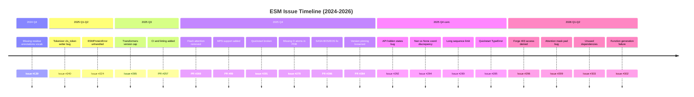
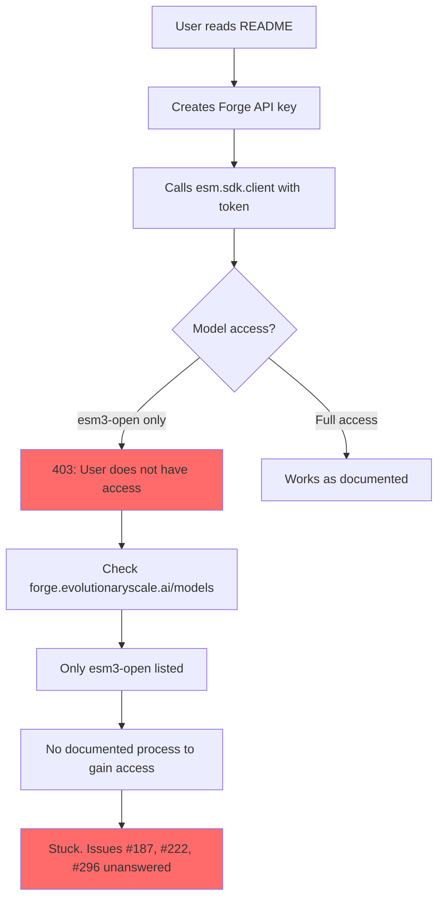

The ESM repository sits at an unusual intersection: a research-grade protein language model with production-level ambitions, backed by EvolutionaryScale and the Chan Zuckerberg Biohub. But as with any project straddling the research-to-production divide, the cracks show when real users start pushing on the edges. This page catalogs the most significant recurring issues, community frustrations, and the areas where the project's open-source ambitions collide with its closed-infrastructure reality.

## The Issue Landscape at a Glance

Before diving in, here's a high-level map of where the community's pain points cluster:

| Category | Open Issues | Closed Issues | Severity |
|---|---|---|---|
| Core Model Bugs | 3 | 2 | High |
| Dependency & Compatibility | 2 | 3 | Medium |
| Forge API Access | 1 | 0 | High |
| Generation Quality & Limitations | 2 | 1 | High |
| SDK & API Design | 2 | 1 | Medium |
| Documentation Gaps | 2 | 1 | Low |



---

## Core Model Bugs: The Ones That Matter Most

### Attention Mask: Pad Tokens Attend to Each Other

This is arguably the most technically significant open bug. [Issue #299](https://github.com/Biohub/esm/issues/299) demonstrates that the current attention mask implementation in ESM3 and ESMC allows pad tokens to attend to each other during batched inference.

The current mask calculation in [`esm/layers/attention.py`](https://github.com/evolutionaryscale/esm/blob/main/esm/layers/attention.py#L67):

```python
mask_BLL = seq_id.unsqueeze(-1) == seq_id.unsqueeze(-2)
mask_BHLL = mask_BLL.unsqueeze(1)
```

The problem: `seq_id` is derived from `batch != PAD_TOKEN`, which produces a boolean where pad tokens are `False`. The equality check `False == False` evaluates to `True`, meaning **pad positions attend to other pad positions**. The fix is straightforward -- use a logical AND instead of equality:

```python
correct_mask = seq_id[:, None, :, None] & seq_id[:, None, None, :]
```

The issue author provided a complete reproduction script showing the discrepancy. While non-pad token outputs are unaffected (their attention correctly excludes pad positions), this bug **wastes computation** on pad-to-pad attention and produces **incorrect hidden states for pad positions**. For anyone downstream who uses the full hidden state tensor -- not just the non-pad slice -- this is a silent correctness trap.

As of this writing, this issue remains open with no maintainer response.

### NaN Coordinates vs. coordinates=None: A 4x Performance Gap

[Issue #294](https://github.com/Biohub/esm/issues/294) reveals a startling performance discrepancy: passing `coordinates=torch.full((256, 3, 3), float("nan"))` versus `coordinates=None` produces drastically different generation quality.

| Input | Mean pTM (30 runs) |
|---|---|
| `coordinates=None` | **0.4264** |
| `coordinates=NaN tensor` | **0.0958** |

That's a ~4.5x degradation. The root cause appears to be in how the encoding pipeline handles null coordinates: when `coordinates=None`, the model internally fills with NaN values, but when explicitly passed as a NaN tensor, `torch.inf` padding is added for BOS/EOS tokens. This means the model sees fundamentally different coordinate inputs depending on whether you pass "nothing" or "explicit nothing."

For a model that claims to reason jointly across sequence, structure, and function, this is a particularly dangerous footgun. Users who reasonably expect `NaN` coordinates to be equivalent to `None` will get silently degraded results.

### SASA BOS/EOS Token Mismatch

[Issue #258](https://github.com/Biohub/esm/issues/258) (closed) exposed a related encoding/decoding inconsistency: when performing function prediction, the SASA decoding step would raise `ValueError: SASA does not start with 0 corresponding to BOS token` because `inf` values were being inserted at BOS/EOS positions instead of the expected `0`. This was fixed in [PR #286](https://github.com/Biohub/esm/commit/6e89bf7d127b06e95d8243c020936cd67d862229) ("sasa BOS/EOS fix"), but the pattern is consistent: **the encode-decode pipeline has fragile boundary conditions around special tokens**, and fixes tend to be band-aids rather than systematic corrections.

---

## The Tokenizer Versioning Trap

[Issue #240](https://github.com/Biohub/esm/issues/240) documents a particularly frustrating version regression: starting from ESM v3.1.5, calling `ESMC.from_pretrained("esmc_300m")` throws:

```
AttributeError: property 'cls_token' of 'EsmSequenceTokenizer' object has no setter
```

The issue affects ESMC models (esmc-300m and esmc-600m) and persists through the current version. The community-discovered workaround: **downgrade to ESM v3.1.4**. This is the kind of regression that suggests the internal codebase (which gets synced to open-source via bulk pushes like [PR #266](https://github.com/Biohub/esm/commit/95239e2d195f797bc224e2d07e38cec082c14bbe)) diverges from what's published on PyPI, and the sync process doesn't include adequate version-gated testing.

---

## Forge API: The Closed Door Problem

If there's a single theme that generates the most community frustration, it's access to EvolutionaryScale's Forge API. [Issue #296](https://github.com/Biohub/esm/issues/296) is the latest in a chain that includes issues #187 and #222, all asking the same question: **why can't I access models on Forge even with valid credits?**

The reporter followed the README instructions exactly, created an API key via [forge.evolutionaryscale.ai/apikeys](https://forge.evolutionaryscale.ai/apikeys), and received:

```
(403, 'Failure in generate: {"status":"error","message":"User does not have access to model"}')
```

When asked to check which models were available at [forge.evolutionaryscale.ai/models](https://forge.evolutionaryscale.ai/models), the answer was revealing: **only `esm3-open` was accessible**. No flagship, published, or experimental models.

This points to a fundamental tension in the project's architecture: the open-source repository is a gateway to a mostly-closed API. The README directs users to Forge, but Forge's access model is opaque -- there's no documented process for gaining access to models beyond the open-weight variant. The issue remains unresolved.



---

## Generation Quality: When Function Conditioning Doesn't

[Issue #302](https://github.com/Biohub/esm/issues/302) (closed, but telling) presents a rigorous empirical finding: **ESM3-open fails to generate sequences that adhere to provided functional domain annotations** for the majority of tested protein domains. Out of 20 distinct InterPro domains, only 2 produced sequences matching the target domain when verified via [InterPro Sequence Search](https://www.ebi.ac.uk/interpro/search/sequence/).

The author tested exhaustively:
- Multiple ESM3 versions (v3.0.8 through v3.2.3)
- Various prompting strategies (sequence lengths, annotation delimiters, temperatures, sampling strategies)
- Using ESM3's own function predictions from natural sequences as prompts

The pattern: **highly populated families like PF00072 work; less common families like PF00076 fail entirely**. This suggests the function conditioning mechanism is effectively memorizing high-frequency domains rather than generalizing from the annotation track -- a significant limitation for a model marketed as capable of "controllable protein generation."

Compared to the [ESM3 paper's claims](https://www.science.org/doi/10.1126/science.ads0018) about prompt consistency and function keyword recovery, real-world function-conditioned generation appears to be far less reliable than the benchmarks suggest.

---

## Dependency Hell and the Sync Problem

### Unused Dependencies

[Issue #303](https://github.com/Biohub/esm/issues/303) points out that both `torchvision` and `torchtext` are listed as dependencies in `pyproject.toml` but are never imported in the source or examples. Worse, **torchtext was deprecated in 2024**. These are not harmless extras -- they add installation overhead, potential version conflicts, and security surface area.

### The Transformers Version Cap

[Issue #265](https://github.com/Biohub/esm/issues/265) (closed) requested lifting the `transformers<=4.48.2` cap, which prevented users from combining ESM with newer libraries. This was resolved in [PR #284](https://github.com/Biohub/esm/commit/e103c9c1c4047c38e8c7f1215c91f8481268e366) ("loosen version"), but the underlying pattern is worth noting: **the version constraints tend to be overly conservative**, likely because the internal codebase isn't tested against newer dependency versions before sync.

### Flash Attention: Removed but Not Forgotten

[PR #269](https://github.com/Biohub/esm/commit/7454c3d77bc731990c534936ef091db3851455a3) removed flash attention entirely, followed by [PR #274](https://github.com/Biohub/esm/commit/97eb26b2fe04386205bd8049033cc14f022d1fa3) adding a `pyright` ignore for the now-guarded import. This was likely a pragmatic decision -- flash attention's hardware-specific requirements were a constant source of installation issues -- but it does mean ESM forgoes a significant inference speedup on compatible hardware.

### MPS Support: A Welcome Addition

On the positive side, [PR #99](https://github.com/Biohub/esm/commit/c8969198c62129fd76eba5e450b091d2d3b012ac) enabled running ESM on Apple Silicon via MPS, co-authored by Zeming Lin. This is a meaningful quality-of-life improvement for the many researchers working on Mac hardware.

---

## SDK Design Friction Points

### ESMProteinError: The Silent Failure

[Issue #224](https://github.com/Biohub/esm/issues/224) highlights that when Forge API calls fail, the return type is `ESMProteinError` rather than an exception. This means code like:

```python
all_mean_embeddings = [
    torch.mean(output.hidden_states, dim=-2).squeeze() for output in outputs
]
```

...crashes with `AttributeError: 'ESMProteinError' object has no attribute 'hidden_states'` instead of providing a clear error message. The [official quickstart notebook](https://virtualcellmodels.cziscience.com/quickstart/esmc-quickstart) even includes a defensive `try/except` wrapper for this exact reason, suggesting it's a known but unaddressed pattern. **Using error objects instead of exceptions is a design choice that pushes error-handling burden onto every caller** without providing the type-safety to match.

### API Returns All Hidden States When Mean Requested

[Issue #292](https://github.com/Biohub/esm/issues/292) reports that setting `LogitsConfig(return_mean_hidden_states=True)` for ESM-C-6B also returns full hidden states for all layers, making API calls unnecessarily slow. For the 6B model, full hidden states are enormous -- sending them over the wire when only mean-pooled states were requested is a clear backend bug that directly impacts user experience.

### The 2048-Token Wall

[Issue #289](https://github.com/Biohub/esm/issues/289) asks the inevitable question: can ESM handle proteins longer than 2048 amino acids? The answer is no -- both the API and local models enforce this context window. For a model trained on proteins up to 2048 residues, this is an architectural limit, but it's a meaningful one: many biologically important proteins (titin, dystrophin, mucins) exceed this length. There's currently no documented chunking or sliding-window workaround.

---

## Documentation and Usability Gaps

### Sequence Logit Mapping: Undocumented and Confusing

[Issue #252](https://github.com/Biohub/esm/issues/252) (closed) asked a straightforward question: how do the 64 dimensions of the sequence logit tensor map to amino acid tokens? The `SEQUENCE_VOCAB` constant lists 33 tokens, and the paper's Appendix A.1.3 specifies 29 meaningful tokens, but the logit tensor is 64-dimensional.

After community discussion, the answer emerged: **indices 0-28 map to the meaningful tokens in vocabulary order, and indices 29-63 should be ignored** (they're padded with large negative values like -18.625, acting as effective -inf). But this mapping is nowhere in the official documentation. Anyone porting code from ESM2 to ESM3/ESMC has to reverse-engineer it.

### The Two Extra Embedding Tokens

[Issue #241](https://github.com/Biohub/esm/issues/241) (closed) asked why ESMC embeddings have two more tokens than the input sequence length. The answer: BOS and EOS tokens are prepended/appended. Again, this is standard transformer practice but was not documented, forcing users to discover it experimentally and manually strip the first and last embeddings.

### Missing Vocabulary File

[Issue #139](https://github.com/Biohub/esm/issues/139) reports that `data/uniref90_and_mgnify90_residue_annotations_gt_1k_proteins.csv` -- required for residue annotation tokenization -- is not included in the repository. This issue has been open since November 2024 with no resolution, effectively making the residue annotation feature unusable for anyone who doesn't have access to the internal codebase.

---

## The Bigger Picture: A Sync-Driven Open Source Model

Many of these issues share a common root cause: **ESM's open-source repository is a downstream sync of an internal codebase**, not a community-first project. The evidence is in the commit history:

| Pattern | Evidence |
|---|---|
| Bulk code dumps | [PR #266](https://github.com/Biohub/esm/commit/95239e2d195f797bc224e2d07e38cec082c14bbe): "Sync over internal code to open source" |
| Revert-and-resync | [PR #272](https://github.com/Biohub/esm/commit/cbaccc1693c033b5e7e9517c929d22b24370ddca) reverted [PR #270](https://github.com/Biohub/esm/commit/f4f97929b2d0b278a32b4d953f0b838bd34b9682) due to merge errors |
| CI instability | [PR #257](https://github.com/Biohub/esm/commit/b237fe781ccd290bf458d9d4a7484a21ac00c7bc) added CI, was [immediately reverted](https://github.com/Biohub/esm/commit/e0669a4a05a05395dde08d4ff2eb0219bcc2f79e), then re-added later |
| Binary encoding format errors | [PR #261](https://github.com/Biohub/esm/commit/2a19c4edde933c171dcb78baa304942338fbb23f): "various merge errors for the new binary encoding format" |
| Missing files | Vocabulary files, model configs, and data that exist internally but aren't synced |

This sync-driven model explains why issues linger: the maintainers are primarily focused on the internal codebase, and the GitHub repository is a release channel rather than a development surface. It also explains why version regressions like the tokenizer bug (#240) slip through -- the internal codebase may have moved past the breaking change, but the published PyPI package hasn't been tested in isolation.

---

## What's Working

Fairness demands acknowledging what the team has done right:

- **MPS support** ([PR #99](https://github.com/Biohub/esm/commit/c8969198c62129fd76eba5e450b091d2d3b012ac)) opened ESM to the Mac research community
- **SASA BOS/EOS fix** ([PR #286](https://github.com/Biohub/esm/commit/6e89bf7d127b06e95d8243c020936cd67d862229)) addressed a real encoding bug
- **Version pin loosening** ([PR #284](https://github.com/Biohub/esm/commit/e103c9c1c4047c38e8c7f1215c91f8481268e366)) resolved dependency conflicts
- **Flash attention removal** ([PR #269](https://github.com/Biohub/esm/commit/7454c3d77bc731990c534936ef091db3851455a3)) eliminated a major installation pain point
- **PAE exposure** ([PR #164](https://github.com/Biohub/esm/commit/79c1208e96e84f9cce4479d243daf9865263c50e)) added predicted aligned error access
- **Oxygen atom fix** for PDB output ([Issue #279](https://github.com/Biohub/esm/issues/279), closed) restored backbone O atoms

---

## Summary of Open Questions for Users

If you're considering building on ESM, here are the unresolved issues that should inform your decision:

1. **Attention mask bug** (#299): Batched inference with padding produces incorrect pad hidden states. Use single-sample inference or patch the mask calculation yourself.
2. **NaN vs None coordinates** (#294): Always use `coordinates=None` for unconditional structure generation. Explicit NaN tensors produce severely degraded results.
3. **Tokenizer regression** (#240): Pin to ESM <=3.1.4 if using ESMC models, or patch the tokenizer.
4. **Forge access** (#296): Only `esm3-open` is reliably accessible. Don't depend on larger models via Forge for production work.
5. **Function-conditioned generation** (#302): Don't expect ESM3-open to reliably generate sequences matching specific InterPro domains, especially for less common families.
6. **Missing vocabulary file** (#139): Residue annotation features are non-functional without the absent CSV file.
7. **2048-token limit** (#289): No workaround for long proteins. Plan to truncate or split.

The ESM project represents genuinely impressive science. But the gap between the paper's claims and the SDK's reliability is wider than it should be -- and the sync-driven release model means that gap may persist until the team invests in treating the open-source repository as a first-class artifact rather than a downstream mirror.