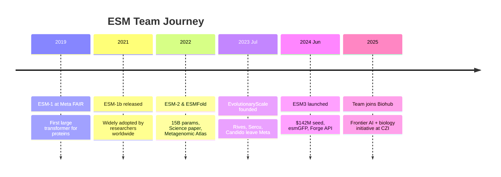
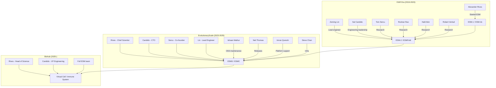

The ESM repository is not just a codebase -- it's the public artifact of one of the most consequential research lineages in AI-for-biology. The people behind these commits trace a path from Meta's FAIR lab through a $142M startup to Biohub, a nonprofit research institute backed by the Chan Zuckerberg Initiative. Understanding who they are and where they came from tells you a lot about why ESM looks and works the way it does.

## From Meta FAIR to EvolutionaryScale to Biohub

The ESM project was born at Meta's Fundamental AI Research (FAIR) lab. Alexander Rives started and led the Evolutionary Scale Modeling project there, building what is [widely recognized as the first large-scale transformer language model for proteins](https://press.aboutamazon.com/aws/2024/6/evolutionaryscale-launches-with-esm3-a-milestone-ai-model-for-biology) (ESM-1, in 2019). The original `facebookresearch/esm` repository housed ESM-1b, ESM-2, ESMFold, and the MSA Transformer -- models that collectively became foundational infrastructure for computational biology worldwide.

In April 2023, after their team at FAIR was disbanded, three key figures -- **Alexander Rives**, **Tom Sercu**, and **Salvatore Candido** -- left Meta to continue the work independently. They founded [EvolutionaryScale](https://www.evolutionaryscale.ai) in July 2023 as a public-benefit corporation, raising a [$142M seed round](https://techcrunch.com/2024/06/25/evolutionaryscale-backed-by-amazon-and-nvidia-raises-142m-for-protein-generating-ai) led by Nat Friedman, Daniel Gross, and Lux Capital, with participation from Amazon and NVentures (Nvidia's venture arm). The open-source repository migrated from `facebookresearch/esm` to `evolutionaryscale/esm` (now `Biohub/esm`).

Then came the next pivot. In 2025, the EvolutionaryScale team joined [Biohub](https://biohub.org/blog/frontier-ai-biology-initiative), the nonprofit research institute launched by the Chan Zuckerberg Initiative. Rives became Head of Science at CZI, leading an initiative to combine frontier AI with frontier biology. The Biohub announcement described it as "the first large scale scientific effort to combine frontier AI and frontier biology," with compute capacity scaling to 10,000 GPUs by 2028.

## The Core Contributors

### Alexander Rives -- The Architect

[Alex Rives](https://biohub.org/team/alex-rives) is the intellectual founder of the ESM project. He started and led ESM at Meta FAIR, co-founded EvolutionaryScale as Chief Scientist, and now serves as Head of Science at Biohub. He is also a **Core Institute Member at the Broad Institute** and an **Assistant Professor in EECS at MIT** -- unusual simultaneous affiliations that speak to the cross-institutional gravity of this work.

His academic path is itself noteworthy: a BA in **philosophy and biology** from Yale, followed by a PhD in **computer science** from NYU. That dual background -- philosophical reasoning about biological systems, formalized through computation -- is arguably the intellectual DNA of the entire ESM lineage. As he [told the press at the ESM3 launch](https://www.synbiobeta.com/read/evolutionaryscale-raises-142m-and-unveils-ai-model-esm3-to-transform-biology): "ESM3 takes a step toward a future of biology where AI is a tool to engineer from first principles, the way we engineer structures, machines, and microchips, and write computer programs."

Rives is not a frequent committer on the open-source repo -- his role has always been research leadership -- but his fingerprints are on every architectural decision, from the masked language modeling objective of ESM-1 through the multimodal generative design of ESM3.

### Zeming Lin -- The Lead Engineer

If Rives is the architect, **Zeming Lin** is the builder. Lin is the **lead author** of the landmark [ESM-2/ESMFold Science paper](https://pubmed.ncbi.nlm.nih.gov/36927031) ("Evolutionary-scale prediction of atomic-level protein structure with a language model," *Science*, 2023), which demonstrated that 15B-parameter protein language models learn atomic-resolution structure directly from sequence. The paper's footnote marks Lin and Rives as sharing "research and engineering leadership."

On the repository, Lin's commits reveal a focus on performance and infrastructure. He authored the [Remove flash attention](https://github.com/Biohub/esm/commit/7454c3d77bc731990c534936ef091db3851455a3) commit, the [version bump preparing for release](https://github.com/Biohub/esm/commit/35c2088b75ee606c03b6d6848f694e8d656f4537), and CI reverts that suggest he's the person who ultimately decides what ships and what doesn't. He was at Meta FAIR before EvolutionaryScale, and is now at Biohub.

### Salvatore Candido -- The Systems Thinker

[Sal Candido](https://biohub.org/team/salvatore-candido) is Engineering Fellow and VP at Biohub, and was previously co-founder and CTO of EvolutionaryScale. His career arc is the most unconventional of the trio: a **PhD in control systems and AI from the University of Illinois**, followed by distinguished engineering roles at Google and Meta. At Google[x], he was the **technical lead who created the AI navigation algorithms for Project Loon** -- the autonomous stratospheric balloon project. Before that, he worked on the Google Search algorithm.

At Meta FAIR, he co-led the AI for math and science pillar. His Biohub profile notes that he "spearheaded or made foundational technical contributions to all of the company's flagship research efforts" at EvolutionaryScale. Candido's background in control theory and autonomous systems likely shapes ESM's iterative masked sampling approach -- a feedback-driven generation process that, structurally, is closer to control systems than to the one-shot autoregressive generation familiar from LLMs.

### Tom Sercu -- The Co-Founder

**Tom Sercu** is the third co-founder of EvolutionaryScale, having also come from Meta FAIR. He is a co-author on the ESM-2 Science paper and a key member of the ESM3 research team. While less visible in the commit log than some other contributors, Sercu's role as a founding researcher places him at the center of every major design decision in the ESM lineage.

### Roshan Rao -- The Protein ML Researcher

**Roshan Rao** is another key researcher from the FAIR era who transitioned to EvolutionaryScale and then Biohub. His [personal page](https://rmrao.github.io) reads like a chronicle of the ESM project: ESM3, ESMFold and the Metagenomic Atlas, programmable protein design with language models, variant effect prediction, MSA Transformers, contact prediction, and the TAPE benchmark. He was a co-author on both the ESM-2 Science paper and the earlier factored attention / contact prediction work that established the theoretical foundations for why Transformers learn protein structure.

Rao's work on TAPE (Tasks Assessing Protein Embeddings) is particularly notable -- it created the evaluation framework that the entire protein language model community adopted, essentially defining how "good" a protein representation is. This is the kind of infrastructure work that doesn't make headlines but shapes an entire field.

### Halil Akin -- The Researcher-Engineer

**Halil Akin** is another co-author from the FAIR era, listed on the ESM-2 Science paper. He appears in the Zenodo release credits for ESM v3.2.3 as "halilakin," confirming his continued involvement through the EvolutionaryScale and Biohub transitions.

## The Open-Source Maintainers

While the founders set the research direction, the day-to-day work of maintaining the open-source repository falls to a smaller, more operationally focused group. These are the people whose names appear most frequently in the commit log and who respond to the issues that users file.

### Ishaan Mathur -- The Busiest Committer

**Ishaan Mathur** (`ishaan@evolutionaryscale.ai`) is, by commit volume, the most active contributor in the recent history of the repository. His commits reveal a maintainer doing the unglamorous but essential work of keeping the project alive:

| Commit | What it tells us |
|--------|-----------------|
| [sasa BOS/EOS fix](https://github.com/Biohub/esm/commit/6e89bf7d127b06e95d8243c020936cd67d862229) | Fixing the exact bug reported in [Issue #258](https://github.com/Biohub/esm/issues/258) |
| [loosen version](https://github.com/Biohub/esm/commit/e103c9c1c4047c38e8c7f1215c91f8481268e366) | Responding to [Issue #265](https://github.com/Biohub/esm/issues/265) on dependency pinning |
| [infer oxygen](https://github.com/Biohub/esm/commit/232a1041d807cce2d58ab8501750e0bfda6c26c4) | Fixing missing O atoms from PDB output, per [Issue #279](https://github.com/Biohub/esm/issues/279) |
| [syncing covalent bonds](https://github.com/Biohub/esm/commit/23b084b94f3b5f6fd700ae41f46a2787a9a5c12b) | Internal-to-external code sync |
| [adding CI](https://github.com/Biohub/esm/commit/b237fe781ccd290bf458d9d4a7484a21ac00c7bc) | Setting up linting, typechecking, and test CI |
| [Sync over internal code to open source](https://github.com/Biohub/esm/commit/95239e2d195f797bc224e2d07e38cec082c14bbe) | The critical "open-source mirror" commit |

Mathur is the bridge between EvolutionaryScale's internal development and the public repository. The "sync" commits are particularly revealing: they indicate that the open-source repo is a downstream mirror of an internal codebase, not the primary development surface. This explains why many issues linger -- the fix often exists internally but hasn't been synced.

### Neil Thomas -- The Release Manager

**Neil Thomas** (`neil@evolutionaryscale.ai`) appears primarily in version-bump and release commits: [3.2.2.post2](https://github.com/Biohub/esm/commit/3e109e2d1bc1d25445c14b41706cf3eb6f313d7d), the [revert of sync 3.2.2.post1](https://github.com/Biohub/esm/commit/cbaccc1693c033b5e7e9517c929d22b24370ddca), and the [README update](https://github.com/Biohub/esm/commit/453b2e2e713ee35a1dcbc684b11d03303a59294e). The revert-then-re-release pattern suggests he's the person responsible for package integrity -- when a release breaks, he's the one rolling it back.

### Steve Chan -- The CI and Encoding Fixer

**Steve Chan** handled critical infrastructure work: [fixing the CI](https://github.com/Biohub/esm/commit/7e0ebdb788b7c0d5de046d8d8c6aea2c97e8c7f9) for test requisites and [fixing merge errors in the binary encoding format](https://github.com/Biohub/esm/commit/2a19c4edde933c171dcb78baa304942338fbb23f). The encoding format fix is notable because it affected how structure tokens are serialized -- a core part of the ESM3 pipeline.

### Imran Qureshi -- The Platform Enabler

**Imran Qureshi** authored the [Enable running ESM on Mac silicon using MPS](https://github.com/Biohub/esm/commit/c8969198c62129fd76eba5e450b091d2d3b012ac) commit, co-authored with Zeming Lin. This is the kind of change that doesn't advance the research frontier but massively expands the user base -- suddenly, every researcher with an M-series MacBook can run ESM locally.

### Ventura Rivera -- The Community Contributor

**Ventura Rivera** (affiliated with [Albert Invent](https://zenodo.org/records/17353381) per the Zenodo metadata) contributed [Exposing pae in ESMProtein](https://github.com/Biohub/esm/commit/79c1208e96e84f9cce4479d243daf9865263c50e). This is interesting because PAE (Predicted Aligned Error) is a critical quality metric for structure prediction, and exposing it in the `ESMProtein` data model was an explicit request from the community. Rivera appears to be an external contributor rather than an EvolutionaryScale employee.

## The Full Team

The [Zenodo v3.2.3 release](https://zenodo.org/records/17353381) lists 18 contributors, giving us the most complete picture of the team:

| Contributor | Known Role / Affiliation |
|-------------|------------------------|
| Zeming Lin | Lead author, ESM-2; Research & engineering leadership |
| Chetan Mishra | Contributor |
| santiag0m | Contributor |
| Jun Gong | Contributor |
| Neil Thomas | Release management, EvolutionaryScale |
| Ishaan Mathur | Primary open-source maintainer, EvolutionaryScale |
| tina-z-jia | Contributor |
| Tom Sercu | Co-founder, EvolutionaryScale; FAIR alum |
| Steve Chan | CI and encoding infrastructure |
| Salvatore Candido | Co-founder/CTO, EvolutionaryScale; now VP at Biohub |
| Jenna MacCarley | Contributor (Regrow Ag) |
| Imran Qureshi | Platform support (MPS/Mac silicon) |
| Jordan Safer | Contributor |
| robert-verkuil | Co-author, ESM-2 Science paper; FAIR alum |
| Ventura Rivera | Community contributor (Albert Invent) |
| blenderwang | Contributor |
| carolynkim | Contributor |
| halilakin | Co-author, ESM-2 Science paper; FAIR alum |

## What the Commit Patterns Reveal

The commit history tells a structural story about how this project is run:

**The open-source repo is a downstream mirror.** The repeated "sync" commits from Ishaan Mathur -- [Sync over internal code to open source](https://github.com/Biohub/esm/commit/95239e2d195f797bc224e2d07e38cec082c14bbe), [sync](https://github.com/Biohub/esm/commit/e8117a2f68b264657eb9717308d55e5f8690588c), [syncing covalent bonds](https://github.com/Biohub/esm/commit/23b084b94f3b5f6fd700ae41f46a2787a9a5c12b) -- confirm that primary development happens internally and is periodically pushed to GitHub. This is why issue resolution can feel slow: the feedback loop is longer than it appears.

**The team is small and stretched thin.** With ~18 contributors on the Zenodo record and only a handful making regular commits, the ratio of users to maintainers is enormous. ESM has thousands of users in pharma and academia, but the open-source maintenance burden falls largely on Mathur and Thomas.

**Release discipline is high but error-prone.** The [revert of 3.2.2.post1](https://github.com/Biohub/esm/commit/cbaccc1693c033b5e7e9517c929d22b24370ddca) followed by [3.2.2.post2](https://github.com/Biohub/esm/commit/3e109e2d1bc1d25445c14b41706cf3eb6f313d7d) shows a team that ships fast but also rolls back quickly when things break. The `.postN` versioning pattern suggests they're using post-release patches rather than cutting full minor versions -- a pragmatic choice for a research codebase, but one that can confuse downstream dependency managers.

## Why It Matters

The ESM team is unusual in that they have persisted through three organizational homes while maintaining a coherent technical vision. Most research projects die when the team disperses after a paper; ESM evolved from ESM-1 through ESM-3 and ESMC across two corporate reorganizations and a transition to nonprofit status. The core team -- Rives, Lin, Candido, Sercu, Rao, Akin -- has stayed together for over six years, which is nearly unheard of in ML research.

This continuity has a technical consequence: **the ESM codebase carries fewer architectural U-turns than most projects of its age.** The fundamental design decisions (masked language modeling, iterative unmasking for generation, VQ-VAE structure tokens) have been refined rather than replaced. When Zeming Lin [removed flash attention](https://github.com/Biohub/esm/commit/7454c3d77bc731990c534936ef091db3851455a3), it wasn't because the team changed their mind about the attention mechanism -- it was a pragmatic infrastructure simplification.

The risk, looking forward, is organizational dilution. The Biohub mission is broader than protein language models -- it encompasses virtual cells, immune system modeling, and cryoET. Whether the ESM-specific team can maintain the same intensity of focus on the open-source repository while also pursuing these broader goals remains an open question. The commit frequency in recent months -- dominated by sync and patch commits rather than feature work -- suggests that the center of gravity may already be shifting.