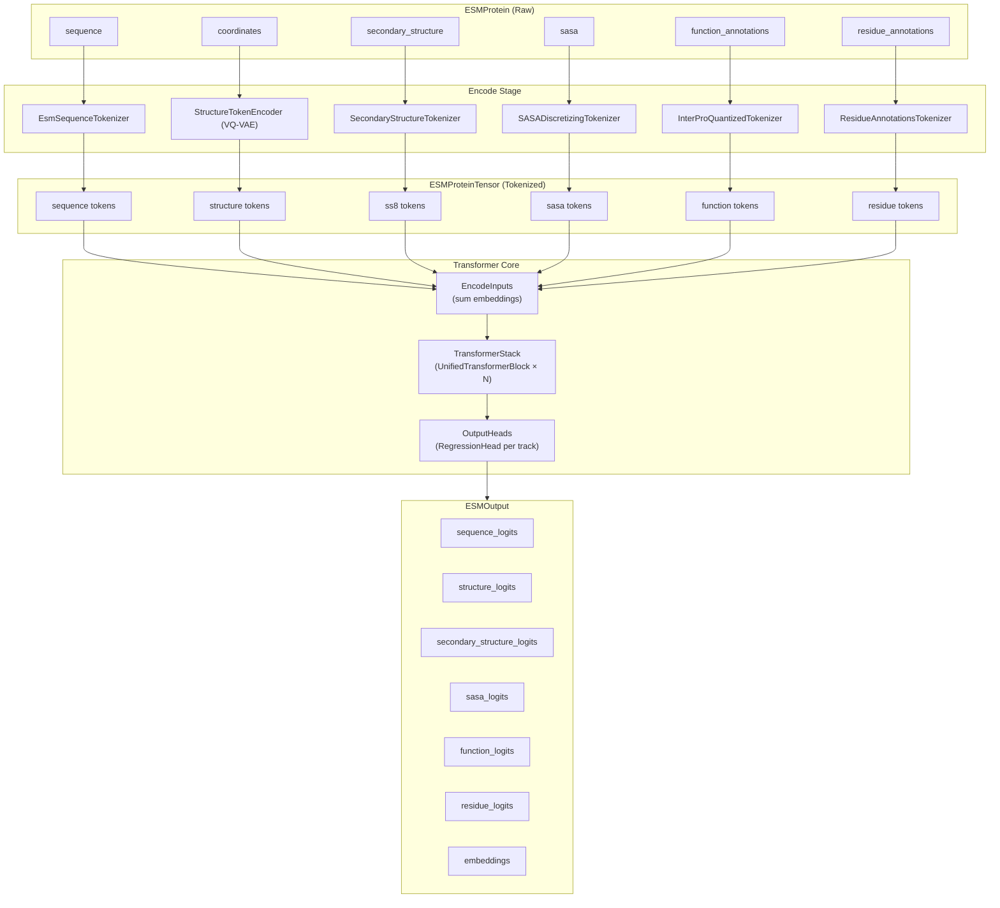
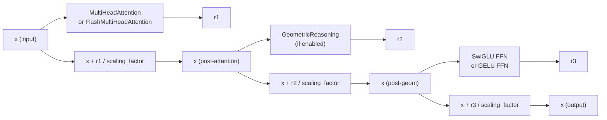
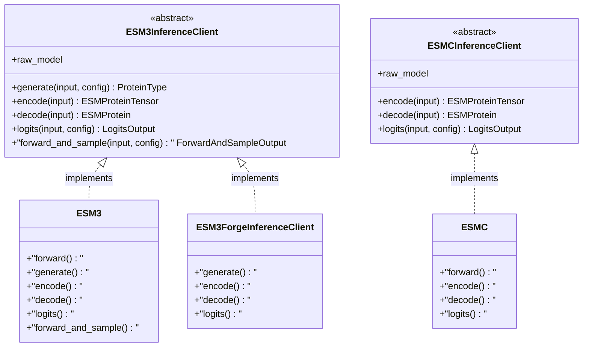

The ESM codebase is a **multitrack protein language model framework** built around two distinct model families—ESM3 and ESMC—unified under a shared transformer infrastructure, a composable tokenization pipeline, and a client-abstracted SDK layer. At its core, the architecture follows a **encode → transformer forward → decode** data flow where protein information (sequence, structure, secondary structure, solvent accessibility, function annotations, and residue annotations) travels through parallel token tracks, is embedded into a shared latent space, processed by a stack of transformer blocks with optional geometric reasoning, and then projected back out through independent output heads. This page maps the high-level structural topology of the repository so you can navigate the deeper dives that follow.


## System-Level Data Flow

The entire system can be understood as a three-stage pipeline. **Stage 1 (Encode)** converts raw protein representations (`ESMProtein`) into tokenized tensor representations (`ESMProteinTensor`) via per-track tokenizers and the VQ-VAE structure encoder. **Stage 2 (Forward)** passes the summed multi-track embeddings through a `TransformerStack` of `UnifiedTransformerBlock` instances—each optionally enriched with SE(3)-equivariant geometric attention—then applies a final `LayerNorm`. **Stage 3 (Decode)** projects the transformer output through independent `RegressionHead` modules to produce per-track logits, and for generation, iteratively samples and unmasks tokens until the specified track is fully resolved.



Sources: [esm3.py](/esm/models/esm3.py#L61-L178), [api.py](/esm/sdk/api.py#L26-L58), [api.py](/esm/sdk/api.py#L201-L278)

## Two Model Families

The repository implements two architecturally distinct model families, each designed for a different class of protein modeling tasks. **ESM3** is a full multimodal generative model that processes all six protein tracks and supports iterative masked generation across any combination of tracks. **ESM C** is a streamlined representation model that operates on sequence alone and is optimized for extracting high-quality embeddings and hidden states. Both share the same `TransformerStack` backbone but differ in their encoder complexity, attention mechanisms, and output capabilities.

| Dimension | ESM3 (Multimodal Generative) | ESM C (Representation) |
|---|---|---|
| **Input Tracks** | Sequence, Structure, SS8, SASA, Function, Residue | Sequence only |
| **Encoder** | `EncodeInputs` (8 embedding modules, summed) | `nn.Embedding(64, d_model)` |
| **Geometric Attention** | Yes (configurable `n_layers_geom`) | No (`n_layers_geom=0`) |
| **Output Heads** | 6 independent `RegressionHead` modules | 1 `RegressionHead` for sequence |
| **VQ-VAE Codec** | Structure encoder + decoder, Function decoder | None |
| **Generation** | Iterative masked sampling across tracks | Not supported |
| **Client Interface** | `ESM3InferenceClient` (7 methods) | `ESMCInferenceClient` (3 methods) |
| **Pretrained Sizes** | Small Open (d=1536, 48 layers) | 300M (d=960, 30 layers), 600M (d=1152, 36 layers) |
| **Flash Attention** | Not enabled by default | Enabled by default |
| **Hidden States** | Not returned by default | Stacked and returned as `[n_layers, B, L, D]` |

The ESM3 `EncodeInputs` module projects each track into a shared `d_model`-dimensional space and then **sums all embeddings element-wise**—this is the critical architectural decision that enables any-track conditioning, since missing tracks simply contribute zero-valued padding embeddings. The ESMC model, by contrast, dispenses with this multi-track machinery entirely, embedding only sequence tokens and routing them directly into a pure-attention transformer stack. Both models are loaded through the `LOCAL_MODEL_REGISTRY` in `pretrained.py`, which maps model name strings to builder functions that instantiate the model, load weights, and optionally cast to `bfloat16` on GPU.

Sources: [esm3.py](/esm/models/esm3.py#L181-L234), [esmc.py](/esm/models/esmc.py#L44-L98), [pretrained.py](/esm/pretrained.py#L95-L135)

## Transformer Core Architecture

The `TransformerStack` is the shared computational backbone for both model families. It consists of a sequence of `UnifiedTransformerBlock` instances followed by a final `LayerNorm`. Each block is a **dual-attention residual module** that can optionally include geometric attention alongside standard multi-head attention, making the same block architecture serve both the SE(3)-aware ESM3 and the pure-sequence ESM C.



Three architectural details deserve emphasis. First, the **residue scaling factor** (`math.sqrt(n_layers / 36)`) normalizes the residual stream by depth, preventing signal explosion in deep stacks—this is applied to both attention residuals and the FFN residual in ESM3, while ESM C disables it (`scale_residue=False` when `v_heads=None`). Second, the **SwiGLU FFN** is the default feed-forward variant, computing `Linear(SiLU(x1) * x2)` where the input is chunked in half, with the hidden dimension rounded to the nearest multiple of 256 for hardware efficiency. Third, the **geometric attention** layer computes attention weights as a learned combination of a rotation term (dot product of rotation-transformed queries and keys) and a negative distance term (L2 norm of translation-transformed query-key differences), ensuring SE(3) invariance of the attention pattern while preserving equivariance of the value stream.

> [!TIP]
> When `n_layers_geom > 0` in ESM3, only the first `n_layers_geom` blocks include geometric attention. The remaining blocks use standard multi-head attention only. This layered design means the model processes 3D structural information in early layers and refines representations through standard attention in deeper layers.

Sources: [transformer_stack.py](/esm/layers/transformer_stack.py#L10-L94), [blocks.py](/esm/layers/blocks.py#L51-L157), [geom_attention.py](/esm/layers/geom_attention.py#L9-L149)

## SDK Abstraction Layer

The SDK layer provides a **uniform inference interface** across different deployment backends through abstract client protocols. `ESM3InferenceClient` and `ESMCInferenceClient` define the contract that concrete implementations—local models, Forge API, and SageMaker—must satisfy. This means the same `encode → generate → decode` workflow works identically whether you are calling a remote API or running on a local GPU.



The **client factory function** `esm.sdk.client()` returns a `ESM3ForgeInferenceClient` configured with the Forge API URL and your API key. For local inference, `ESM3.from_pretrained()` and `ESMC.from_pretrained()` return model instances that directly implement the same client protocols, eliminating any code changes when switching between local and remote execution. The `ForgeBatchExecutor` context manager wraps batch API calls with retry logic and progress tracking.

> [!TIP]
> The `ESM3` model class inherits from both `nn.Module` and `ESM3InferenceClient`, making it simultaneously a PyTorch module and an inference client. This dual nature means you can call `model.generate(protein, config)` directly on a loaded model without wrapping it in any adapter—local models are first-class inference clients.

Sources: [api.py](/esm/sdk/api.py#L431-L531), [esm3.py](/esm/models/esm3.py#L181-L258), [esmc.py](/esm/models/esmc.py#L44-L76), [__init__.py](/esm/sdk/__init__.py#L1-L36)

## Project Directory Map

The codebase is organized into six top-level subsystems under `esm/`, each with a clear responsibility boundary:

```
esm/
├── models/              # Model architectures
│   ├── esm3.py          # ESM3: EncodeInputs + TransformerStack + OutputHeads
│   ├── esmc.py          # ESMC: Embed + TransformerStack + SequenceHead
│   ├── vqvae.py         # StructureTokenEncoder/Decoder (VQ-VAE codec)
│   └── function_decoder.py  # FunctionTokenDecoder
├── layers/              # Reusable neural network components
│   ├── blocks.py        # UnifiedTransformerBlock (dual-attention + FFN)
│   ├── transformer_stack.py  # Stack of blocks + LayerNorm
│   ├── attention.py     # MultiHeadAttention, FlashMultiHeadAttention
│   ├── geom_attention.py    # SE(3) geometric reasoning
│   ├── rotary.py        # Rotary position embeddings
│   ├── codebook.py      # EMA codebook for VQ-VAE
│   └── structure_proj.py    # 6D rotation structure head
├── tokenization/        # Per-track tokenizer implementations
│   ├── sequence_tokenizer.py     # Amino acid tokenizer (HuggingFace-based)
│   ├── structure_tokenizer.py    # Structure token mapping
│   ├── ss_tokenizer.py           # 8-class secondary structure
│   ├── sasa_tokenizer.py         # Discretized solvent accessibility
│   ├── function_tokenizer.py     # InterPro quantized function tokens
│   └── residue_tokenizer.py      # Residue annotation tokenizer
├── sdk/                 # Inference client abstractions
│   ├── api.py           # ESMProtein, ESMProteinTensor, client protocols
│   ├── forge.py         # Forge API client (fold, generate, encode, etc.)
│   ├── sagemaker.py     # SageMaker deployment client
│   └── retry.py         # Exponential backoff retry logic
├── utils/               # Shared utilities
│   ├── encoding.py      # Tokenize/detokenize helper functions
│   ├── decoding.py      # ESMProteinTensor → ESMProtein conversion
│   ├── generation.py    # Iterative sampling orchestration
│   ├── sampling.py      # Logit sampling (temperature, top-p, entropy)
│   ├── noise_schedules.py   # Cosine/linear unmask schedules
│   └── structure/       # Affine3D, ProteinChain, ProteinComplex
└── data/                # Static data files (InterPro mappings, keyword vocab)
```

Sources: [esm3.py](/esm/models/esm3.py#L1-L47), [vqvae.py](/esm/models/vqvae.py#L1-L10), [__init__.py](/esm/tokenization/__init__.py#L1-L22), [api.py](/esm/sdk/api.py#L1-L18), [generation.py](/esm/utils/generation.py#L1-L34)

## Reading Path

The architecture you've seen here is the foundation for understanding the specialized subsystems documented in the pages that follow. The recommended progression moves from model families inward to transformer internals, then outward to generation and deployment:

1. **Model Families** — Start with [ESM3 Multimodal Generative Model](8-esm3-multimodal-generative-model) and [ESM C Representation Model](9-esm-c-representation-model) to understand how each model configures the shared components
2. **Tokenization Pipeline** — Then explore [Sequence and Structure Tokenizers](10-sequence-and-structure-tokenizers) and [VQ-VAE Structure Encoding](11-vq-vae-structure-encoding) to understand how raw protein data enters the model
3. **Transformer Core** — Deep-dive into [Geometric Attention and SE(3) Invariance](13-geometric-attention-and-se-3-invariance) and [Transformer Stack Design](14-transformer-stack-design) for the computational heart of the system
4. **Generation and Sampling** — Understand the iterative decode loop via [Iterative Masked Sampling](16-iterative-masked-sampling) and [Noise Schedules and Unmasking Strategies](17-noise-schedules-and-unmasking-strategies)
5. **SDK and Deployment** — Finally, see how everything is exposed to users through [Forge API Client](19-forge-api-client) and [Local Inference Client](20-local-inference-client)