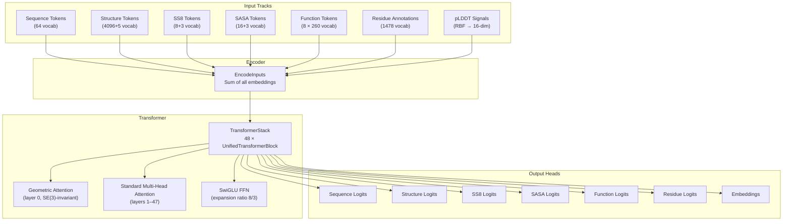
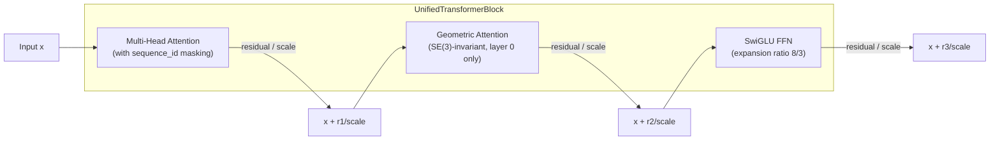
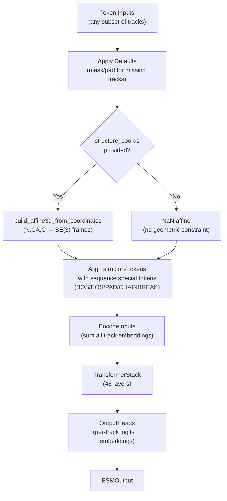

ESM3 is a generative language model for proteins that simultaneously reasons over **sequence**, **structure**, and **function** — the three fundamental modalities of protein biology. Unlike representation-only models (such as [ESM C](9-esm-c-representation-model)), ESM3 is a full **masked-language-model** architecture capable of conditional generation: given partial observations across any combination of tracks, it iteratively samples the missing information. The open-source release ships the `esm3_sm_open_v1` checkpoint (1.4B parameters, 48 transformer layers, d_model=1536), along with dedicated sub-models for structure encoding/decoding and function decoding.

Sources: [esm3.py](esm/models/esm3.py#L181-L217), [pretrained.py](esm/pretrained.py#L95-L111), [models.py](esm/utils/constants/models.py#L1-L8)

## Architecture Overview

The ESM3 architecture follows a **track-fusion encoder** pattern: every protein modality is independently tokenized and embedded, the embeddings are summed into a single hidden state, and a shared transformer stack processes the combined representation. Output heads then predict logits for each track independently. This design ensures that any subset of tracks can be provided as input — the model gracefully fills missing modalities with learned defaults (mask or pad tokens) and pLDDT conditioning signals.



The key insight of this architecture is that **modalities are fused additively at the embedding level** rather than through cross-attention or late-fusion strategies. This means each residue position carries a single `d_model`-dimensional vector that encodes information from *all* provided tracks simultaneously. The transformer's self-attention then propagates information across positions, allowing the model to resolve interdependencies between sequence, structure, and function during both forward passes and iterative generation.

Sources: [esm3.py](esm/models/esm3.py#L61-L147), [esm3.py](esm/models/esm3.py#L260-L374), [transformer_stack.py](esm/layers/transformer_stack.py#L10-L94)

## Multimodal Track Embedding

The `EncodeInputs` module is the entry point where all protein tracks are projected into the shared `d_model`-dimensional space. Each track uses an embedding strategy tailored to its data type:

| Track | Embedding Strategy | Vocabulary Size | Output Dim |
|-------|-------------------|-----------------|------------|
| Sequence | `nn.Embedding` | 64 (amino acids + special tokens) | d_model |
| Structure | `nn.Embedding` | 4096 + 5 (codebook + special) | d_model |
| Secondary Structure (SS8) | `nn.Embedding` | 8 + 3 (classes + special) | d_model |
| SASA | `nn.Embedding` | 16 + 3 (discretized bins + special) | d_model |
| Function | 8 × `nn.Embedding` (concatenated) | 260 per depth, depth=8 | d_model |
| Residue Annotations | `nn.EmbeddingBag` (sum mode) | 1478 | d_model |
| Average pLDDT | RBF(16 bins) → `nn.Linear` | 16 → d_model | d_model |
| Per-residue pLDDT | RBF(16 bins) → `nn.Linear` | 16 → d_model | d_model |

The **function track** uses a factored embedding: 8 separate `nn.Embedding(260, d_model // 8)` modules are applied to each of the 8 depth positions, and the resulting vectors are concatenated along the feature dimension to produce a full `d_model`-dimensional embedding. This reflects the fact that function tokens are quantized via locality-sensitive hashing (LSH), where each of the 8 depth dimensions independently encodes a different bit-slice of the hash.

The **residue annotation track** uses `nn.EmbeddingBag` with `mode="sum"` because each residue position can carry multiple annotation labels (up to 16). The bag collapses the variable-length annotation list into a single vector by summing the corresponding embeddings, which is then reshaped back to `(B, L, d_model)`.

**pLDDT conditioning** applies radial basis function (RBF) expansion to scalar confidence values, projecting them through a linear layer. The average pLDDT broadcasts a global confidence signal across all positions, while per-residue pLDDT provides position-specific conditioning. These signals tell the model how much to trust any provided coordinate information.

> [!TIP]
> When no coordinates are provided, `per_res_plddt` defaults to 0 and `average_plddt` defaults to 1 — this signals "no structural constraint" to the model. When coordinates *are* provided, `per_res_plddt` is automatically set to 1.0 for positions with valid (non-NaN) coordinates, anchoring the model's structural predictions to the observed data.

Sources: [esm3.py](esm/models/esm3.py#L61-L147), [esm3.py](esm/models/esm3.py#L299-L348)

## Transformer Stack and Unified Block Design

The `TransformerStack` is the computational core of ESM3, consisting of `n_layers` `UnifiedTransformerBlock` instances followed by a final `LayerNorm`. For the open-source small model, this is 48 layers with 24 attention heads and 256 voting heads.



Each `UnifiedTransformerBlock` contains up to three sub-layers applied sequentially with **scaled residual connections**:

1. **Standard Multi-Head Attention** — Applies rotary position embeddings and QK-LayerNorm. The `sequence_id` tensor creates a block-diagonal attention mask, ensuring residues from different chains or sequences don't attend to each other.

2. **Geometric Attention** (layer 0 only) — Implements SE(3)-invariant geometric reasoning via the `GeometricReasoningOriginalImpl` module, which conditions on 3D affine frames derived from backbone coordinates. The `mask_and_zero_frameless` flag ensures positions without valid coordinates are properly masked.

3. **SwiGLU Feed-Forward Network** — Uses the SwiGLU activation (`SiLU(x1) * x2`) with an expansion ratio of 8/3. The hidden dimension is rounded to the nearest multiple of 256 for hardware efficiency.

> [!TIP]
> The `residue_scaling_factor` in each block is `sqrt(n_layers / 36)`, which scales residual contributions to prevent magnitude explosion in deep stacks. For the 48-layer open model, this factor is `sqrt(48/36) ≈ 1.155`, meaning residual contributions are slightly *amplified* relative to a 36-layer baseline.

The transformer returns three outputs: the **post-norm** hidden states (used by output heads), the **pre-norm** hidden states (used as embeddings), and a list of **per-layer hidden states** (available for deeper analysis).

Sources: [transformer_stack.py](esm/layers/transformer_stack.py#L10-L94), [blocks.py](esm/layers/blocks.py#L51-L157)

## Output Heads and Logit Prediction

The `OutputHeads` module projects the transformer's output back to per-track logit spaces. Each head is a `RegressionHead` — a two-layer MLP with GELU activation and LayerNorm:

```
Linear(d_model → d_model) → GELU → LayerNorm → Linear(d_model → vocab_size)
```

| Output Head | Logit Dimensions | Notes |
|-------------|-----------------|-------|
| Sequence | `(B, L, 64)` | Amino acid vocabulary |
| Structure | `(B, L, 4096)` | VQ-VAE codebook entries |
| Secondary Structure | `(B, L, 11)` | 8 SS8 classes + 3 special |
| SASA | `(B, L, 19)` | 16 discretized bins + 3 special |
| Function | `(B, L, 8, 260)` | Reshaped from flat `(B, L, 2080)` |
| Residue Annotations | `(B, L, 1478)` | Annotation vocabulary |

The function logits undergo a reshape from `(B, L, 260*8)` to `(B, L, 8, 260)`, reflecting the 8-depth quantized structure of function tokens. The `ESMOutput` dataclass also carries the raw `embeddings` tensor from the transformer's pre-norm output.

Sources: [esm3.py](esm/models/esm3.py#L150-L178), [regression_head.py](esm/layers/regression_head.py#L1-L112)

## Forward Pass: Token-Level Data Flow

The `forward` method orchestrates the complete token-level pipeline. It accepts raw token tensors for each track, applies intelligent defaults for any missing inputs, processes coordinate data into SE(3) frames, and returns full `ESMOutput`:



A critical detail in the forward pass is the **structure token alignment** logic. After default filling, structure tokens are selectively replaced to match the sequence track's special token positions — BOS, EOS, PAD, and CHAINBREAK tokens in the sequence track force corresponding special tokens in the structure track. Additionally, any structure tokens with value `-1` (a pre-tokenization placeholder) are replaced with the structure mask token. This ensures the two tracks remain synchronized at special positions even when only partial data is provided.

When no tracks are provided at all, the method raises a `ValueError` — at least one input must be non-None so the model can infer the sequence length `L` and device.

Sources: [esm3.py](esm/models/esm3.py#L260-L374)

## ESM3 Inference Client Interface

The `ESM3` class implements the `ESM3InferenceClient` protocol, providing a high-level API with four core operations that mirror the SDK's client interface:

| Method | Input | Output | Description |
|--------|-------|--------|-------------|
| `encode` | `ESMProtein` | `ESMProteinTensor` | Tokenizes all raw tracks into integer tensors |
| `decode` | `ESMProteinTensor` | `ESMProtein` | Detokenizes tensor tracks back to raw data |
| `logits` | `ESMProteinTensor` + `LogitsConfig` | `LogitsOutput` | Single forward pass returning selected logits/embeddings |
| `generate` | `ESMProtein` + `GenerationConfig` | `ESMProtein` | Iterative masked sampling over multiple steps |

### Encode

The `encode` method converts an `ESMProtein` (raw string/float/tensor data) into an `ESMProteinTensor` (integer token tensors). It dispatches to specialized encoding functions for each track:

- **Sequence**: `tokenize_sequence` with the `EsmSequenceTokenizer`, adding BOS/EOS special tokens.
- **Structure**: `tokenize_structure` which first runs the `StructureTokenEncoder` (VQ-VAE) on 3D coordinates to produce discrete structure tokens, then wraps them with special tokens.
- **Secondary Structure / SASA**: Discretizing tokenizers that map continuous or categorical values to integer bins.
- **Function / Residue Annotations**: `tokenize_function_annotations` which maps InterPro labels and residue-level annotations to the quantized function token vocabulary.

The method infers the protein length from whichever track is first available (sequence → secondary_structure → sasa → structure). If no length can be inferred, it raises an error.

Sources: [esm3.py](esm/models/esm3.py#L414-L493), [api.py](esm/sdk/api.py#L26-L199)

### Decode

The `decode` method delegates to `decode_protein_tensor`, which reverses the tokenization for each track using the appropriate tokenizer and sub-model decoder:

- **Structure tokens → coordinates**: The `StructureTokenDecoder` (a 30-layer transformer with d_model=1280) reconstructs 3D backbone coordinates from discrete structure tokens, also producing pLDDT, PAE, and distance predictions.
- **Function tokens → annotations**: The `FunctionTokenDecoder` maps quantized function tokens back to InterPro annotations and keyword predictions.
- **Other tracks**: Standard tokenizer detokenization (SS8 class labels, SASA float values, amino acid letters).

Sources: [esm3.py](esm/models/esm3.py#L495-L501)

### Logits

The `logits` method performs a single forward pass and returns only the requested outputs as specified by `LogitsConfig`. Key behaviors:

- **Automatic pLDDT conditioning**: If coordinates are provided, `per_res_plddt` is set to 1.0 for positions with valid coordinates; otherwise it is `None`.
- **Automatic mixed precision**: On CUDA, the forward pass runs under `torch.autocast` with `bfloat16` dtype, then output logits are upcast to `float32`.
- **Selective output**: The `LogitsConfig` allows requesting only specific logit tracks and optional embeddings/hidden states, avoiding unnecessary computation and memory.

```python
# Example: Get only sequence logits and embeddings
config = LogitsConfig(sequence=True, return_embeddings=True)
output = model.logits(protein_tensor, config)
# output.logits.sequence → (B, L, 64) tensor
# output.embeddings → (B, L, d_model) tensor
```

Sources: [esm3.py](esm/models/esm3.py#L503-L559), [api.py](esm/sdk/api.py#L378-L398)

### Generate

The `generate` method is the primary entry point for protein design. It wraps `batch_generate` and dispatches to one of two iterative sampling paths:

- **`iterative_sampling_raw`**: Called when inputs are `ESMProtein` objects. Encodes to tokens, runs iterative sampling, then decodes back.
- **`iterative_sampling_tokens`**: Called when inputs are `ESMProteinTensor` objects. Operates entirely in token space, avoiding encode/decode overhead.

Both paths implement the same core algorithm: iterative masked sampling over multiple steps, controlled by `GenerationConfig`.

Sources: [esm3.py](esm/models/esm3.py#L377-L412)

## Iterative Masked Sampling

ESM3 generates protein data through an **iterative masked denoising** process. Starting from a fully or partially masked input, the model repeatedly (1) performs a forward pass to predict logits for all positions, (2) samples tokens at a subset of masked positions, and (3) fills those positions with the sampled tokens. This continues until all masks are resolved.

```mermaid
flowchart TD
    START["Partially Masked Input<br/>(some tracks have <mask> tokens)"] --> COUNT["Count total masked positions<br/>per track"]
    COUNT --> STEP["Step i / num_steps"]
    STEP --> FWD["Forward Pass<br/>(logits for all tracks)"]
    FWD --> SCHEDULE["Decoding Schedule<br/>(cosine or linear)"]
    SCHEDULE --> NUM["Compute # tokens to unmask<br/>this step"]
    NUM --> STRATEGY{"Unmasking Strategy"}
    STRATEGY -->|entropy|"Select lowest-entropy<br/>masked positions"
    STRATEGY -->|random|"Randomly select<br/>masked positions"
    STRATEGY --> SAMPLE["Sample tokens from logits<br/>(temperature, top-p)"]
    SAMPLE --> FILL["Fill sampled tokens<br/>into masked positions"]
    FILL --> DONE{"All masks<br/>resolved?"}
    DONE -->|No| STEP
    DONE -->|Yes| OUTPUT["Fully Decoded Output"]
```

The sampling loop is governed by the `GenerationConfig` parameters:

| Parameter | Default | Description |
|-----------|---------|-------------|
| `track` | `""` | Which track to generate (e.g., `"sequence"`, `"structure"`, `"sasa"`) |
| `schedule` | `"cosine"` | How many tokens to unmask per step — cosine reveals more early, linear is uniform |
| `strategy` | `"random"` | Which masked positions to unmask — `"entropy"` picks most confident, `"random"` picks randomly |
| `num_steps` | `20` | Total number of iterative forward-sample rounds |
| `temperature` | `1.0` | Sampling temperature for logit softmax |
| `temperature_annealing` | `True` | If enabled, temperature decreases quadratically from initial to 0.001 over steps |
| `top_p` | `1.0` | Nucleus sampling threshold |
| `condition_on_coordinates_only` | `True` | If true, clears structure tokens so the model generates from coordinate frames only |

The **temperature annealing** formula is `max(initial_temp - step_ratio, 0.001)²`, where `step_ratio = step / (num_steps - 1)`. This means sampling becomes increasingly deterministic in later steps, which helps the model refine its predictions without introducing noise at the final stage.

The **decoding schedule** determines what fraction of tokens remain masked after each step. For the cosine schedule, the fraction of still-masked tokens follows a cosine curve from 1 to 0, meaning more tokens are revealed in early steps and fewer in later steps — a coarse-to-fine generation strategy.

Sources: [generation.py](esm/utils/generation.py#L99-L398), [api.py](esm/sdk/api.py#L293-L326)

## Pretrained Models and Configuration

The open-source ESM3 release includes the following pretrained models, all registered in `LOCAL_MODEL_REGISTRY`:

| Model Name | Constant | Architecture | Parameters |
|------------|----------|-------------|------------|
| `esm3_sm_open_v1` | `ESM3_OPEN_SMALL` | ESM3 (d_model=1536, 24 heads, 48 layers) | ~1.4B |
| `esm3_structure_encoder_v0` | `ESM3_STRUCTURE_ENCODER_V0` | StructureTokenEncoder (d_model=1024, 2 layers) | — |
| `esm3_structure_decoder_v0` | `ESM3_STRUCTURE_DECODER_V0` | StructureTokenDecoder (d_model=1280, 30 layers) | — |
| `esm3_function_decoder_v0` | `ESM3_FUNCTION_DECODER_V0` | FunctionTokenDecoder (d_model=1024, 3 layers) | — |

The model name normalization system accepts several aliases for the same checkpoint — `"esm3-open-2024-03"`, `"esm3-sm-open-v1"`, and `"esm3-open"` all resolve to `ESM3_OPEN_SMALL`. Models are loaded via `ESM3.from_pretrained()`, which automatically selects CUDA if available and casts to `bfloat16` on GPU:

```python
model = ESM3.from_pretrained("esm3_sm_open_v1")
# Equivalent: ESM3.from_pretrained("esm3-open")
```

The structure encoder, structure decoder, and function decoder are **lazily instantiated** — they are stored as factory functions (`structure_encoder_fn`, `structure_decoder_fn`, `function_decoder_fn`) and only loaded to GPU when first accessed via `get_structure_encoder()`, `get_structure_decoder()`, or `get_function_decoder()`. This avoids loading ~1B additional decoder parameters until they are actually needed.

Sources: [pretrained.py](esm/pretrained.py#L24-L134), [models.py](esm/utils/constants/models.py#L1-L29), [esm3.py](esm/models/esm3.py#L220-L258)

## Track Tokenizer Collection

ESM3 relies on a coordinated set of six tokenizers, packaged as a `TokenizerCollection` that satisfies the `TokenizerCollectionProtocol`:

| Tokenizer | Class | Key Behavior |
|-----------|-------|-------------|
| `sequence` | `EsmSequenceTokenizer` | BPE tokenizer, 64 vocab, adds BOS/EOS |
| `structure` | `StructureTokenizer` | Wraps VQ-VAE encoder output, 4096 codebook |
| `secondary_structure` | `SecondaryStructureTokenizer` | 8-class SS8 discretization |
| `sasa` | `SASADiscretizingTokenizer` | 16-bin solvent accessibility |
| `function` | `InterProQuantizedTokenizer` | LSH-based 8-depth quantization, 260 vocab per depth |
| `residue_annotations` | `ResidueAnnotationsTokenizer` | 1478-label residue annotation vocabulary |

Each tokenizer provides `mask_token_id`, `pad_token_id`, `bos_token_id`, and `eos_token_id` — these special tokens are essential for the iterative sampling process, as they define which positions are "unknown" and need to be generated.

Sources: [tokenization/__init__.py](esm/tokenization/__init__.py#L15-L46)

## Sub-Models: Structure Encoder and Decoder

### StructureTokenEncoder

The structure encoder compresses 3D backbone coordinates (N, CA, C atoms) into discrete tokens via a VQ-VAE pipeline. It operates on **local structural neighborhoods**:

1. **KNN Graph Construction**: For each residue, find the 16 nearest neighbors in 3D space (by CA distance).
2. **Local Neighborhood Encoding**: Reshape to `(B*L, 16)` batches of local neighborhoods. Apply relative positional embeddings, then pass through a `GeometricEncoderStack` (2 geometric-only transformer layers with d_model=1024).
3. **Query Node Extraction**: Take the embedding of the query residue (always the first KNN neighbor since self-distance is 0).
4. **VQ-VAE Quantization**: Project through `pre_vq_proj` (1024→128), then quantize via `EMACodebook` (4096 codes, 128 dimensions).

This local receptive field design means each structure token captures the **local backbone geometry** around a residue, not global fold information. Global structural coherence emerges from the main ESM3 transformer's attention mechanism operating on the sequence of structure tokens.

### StructureTokenDecoder

The structure decoder reconstructs 3D coordinates from discrete structure tokens using a 30-layer `TransformerStack` (d_model=1280, 20 heads, no geometric attention). It produces:

- **Backbone coordinates** via `Dim6RotStructureHead` (6D rotation representation)
- **Pairwise predictions** (distogram, direction, predicted aligned error) via `PairwisePredictionHead`
- **Per-residue pLDDT** via a `RegressionHead`

Sources: [vqvae.py](esm/models/vqvae.py#L179-L322), [vqvae.py](esm/models/vqvae.py#L325-L398), [function_decoder.py](esm/models/function_decoder.py#L54-L176)

## Sub-Models: Function Token Decoder

The `FunctionTokenDecoder` translates quantized function tokens back into human-interpretable annotations. It uses a compact 3-layer transformer (d_model=1024, 8 heads, GELU FFN) that:

1. **Unpacks LSH bits**: Each of the 8 depth positions has 8 bits, yielding 64 binary features per residue. Each bit gets its own embedding offset so they receive distinct representations.
2. **Pools across positions**: Mean-pools the transformer output across the sequence dimension.
3. **Predicts three heads**: `keyword_logits` (58,641 keywords), `keyword_tfidf` (regressed TF-IDF values), and `interpro_logits` (29,026 InterPro classes).

The decode method supports thresholding (`annotation_threshold`, `keywords_threshold`) and merging of nearby annotations (`annotation_gap_merge_max`) to produce clean `FunctionAnnotation` objects with label, start, and end positions.

Sources: [function_decoder.py](esm/models/function_decoder.py#L21-L176)

## Where to Go Next

- For a deep understanding of how raw protein data becomes tokens, read [Sequence and Structure Tokenizers](10-sequence-and-structure-tokenizers) and [VQ-VAE Structure Encoding](11-vq-vae-structure-encoding).
- For the geometric attention mechanism that gives ESM3 its 3D reasoning capability, see [Geometric Attention and SE(3) Invariance](13-geometric-attention-and-se-3-invariance).
- For the iterative sampling algorithm in full detail, see [Iterative Masked Sampling](16-iterative-masked-sampling) and [Noise Schedules and Unmasking Strategies](17-noise-schedules-and-unmasking-strategies).
- For deployment options (Forge API, local inference, SageMaker), see [Forge API Client](19-forge-api-client) and [Local Inference Client](20-local-inference-client).
- For the lighter-weight representation-only alternative, see [ESM C Representation Model](9-esm-c-representation-model).