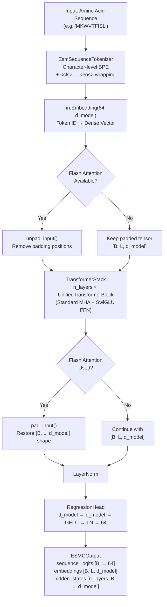

ESM C is EvolutionaryScale's **sequence-only representation model** — a streamlined transformer designed for extracting high-quality protein embeddings without the overhead of multi-track generative infrastructure. Where [ESM3](8-esm3-multimodal-generative-model) processes sequence, structure, secondary structure, SASA, and function tokens through geometric attention layers, ESM C strips the architecture down to its essence: a deep transformer stack operating on amino acid tokens alone, producing per-residue embeddings and hidden states that power downstream tasks from enzyme activity prediction to remote homology detection. This design philosophy yields a model that is simpler to deploy, faster to infer, and whose representations often outperform multimodal alternatives on tasks that do not require structure conditioning.

## Architectural Philosophy: Sequence-Only by Design

The central insight behind ESM C is that **not every protein understanding task requires structural or functional token tracks**. Many downstream applications — predicting solubility, classifying enzyme class, or computing similarity between sequences — benefit primarily from rich contextual embeddings rather than full generative capabilities. ESM C exploits this by removing all auxiliary tokenization pipelines (structure VQ-VAE, SASA discretization, secondary structure classification, InterPro function tokens) and all geometric attention blocks, leaving a pure sequence-to-embedding transformer.

This architectural decision has three concrete implications. First, the `encode` step accepts only an `ESMProtein.sequence` string and tokenizes it with the standard `EsmSequenceTokenizer` — no structure encoder, no coordinate processing. Second, the transformer stack is constructed with `n_layers_geom=0`, meaning every block uses standard multi-head attention with rotary embeddings rather than the SE(3)-equivariant geometric attention used in ESM3. Third, the output head produces only `sequence_logits` over the 64-token vocabulary; there are no structure, SASA, or function prediction heads.

Sources: [esmc.py](/esm/models/esmc.py#L56-L95), [esmc.py](/esm/models/esmc.py#L108-L138), [pretrained.py](/esm/pretrained.py#L69-L88)

## Model Architecture

The ESM C model is implemented as the `ESMC` class, which inherits from both `nn.Module` and `ESMCInferenceClient`. Its forward pass follows a clean three-stage pipeline: **token embedding → transformer stack → sequence head**.



The embedding layer maps 64 possible token IDs (33 standard amino acid tokens plus special tokens including `<cls>`, `<pad>`, `<eos>`, `<unk>`, `<mask>`, and chain break `|`) into a `d_model`-dimensional space. The transformer stack then processes these embeddings through `n_layers` identical `UnifiedTransformerBlock` instances — each comprising LayerNorm → QK-Normed Multi-Head Attention with Rotary Embeddings → residual → LayerNorm → SwiGLU FFN → residual. The final LayerNorm produces the output embeddings, while a `RegressionHead` (a two-layer MLP with GELU activation and intermediate LayerNorm) projects them to sequence logits.

> [!TIP]
> When Flash Attention is available, ESM C uses the **unpad/pad pattern**: before entering the transformer, padding tokens are removed via `unpad_input`, the transformer processes only real tokens, and `pad_input` restores the original batch shape afterward. This eliminates wasted computation on pad positions and can significantly speed up inference on variable-length batches.

Sources: [esmc.py](/esm/models/esmc.py#L56-L95), [transformer_stack.py](/esm/layers/transformer_stack.py#L23-L95), [blocks.py](/esm/layers/blocks.py#L65-L158), [regression_head.py](/esm/layers/regression_head.py#L1-L23), [attention.py](/esm/layers/attention.py#L16-L59)

## Model Variants and Hyperparameters

Two ESM C checkpoints are available for local inference, differing in depth, width, and head count. A larger 6B-parameter variant exists on the Forge API platform but is not distributed for local use.

| Property | ESMC 300M | ESMC 600M |
|---|---|---|
| **Model Name** | `esmc_300m` | `esmc_600m` |
| **Forge Name** | `esmc-300m-2024-12` | `esmc-600m-2024-12` |
| **d_model** | 960 | 1152 |
| **n_heads** | 15 | 18 |
| **n_layers** | 30 | 36 |
| **d_head** | 64 | 64 |
| **FFN Type** | SwiGLU (8/3× expansion) | SwiGLU (8/3× expansion) |
| **Geometric Attention** | None (`n_layers_geom=0`) | None (`n_layers_geom=0`) |
| **Vocab Size** | 64 | 64 |
| **HuggingFace Repo** | `EvolutionaryScale/esmc-300m-2024-12` | `EvolutionaryScale/esmc-600m-2024-12` |

Both models are loaded via `ESMC.from_pretrained(model_name)`, which downloads weights from HuggingFace, applies them to the model, and automatically casts to `bfloat16` on CUDA devices. The `from_pretrained` class method delegates to `load_local_model`, which looks up the model name in the `LOCAL_MODEL_REGISTRY` dictionary and calls the corresponding builder function.

Sources: [pretrained.py](/esm/pretrained.py#L69-L105), [models.py](/esm/utils/constants/models.py#L1-L12), [esm3.py](/esm/utils/constants/esm3.py#L108-L118)

## Tokenization Pipeline

ESM C uses a single tokenizer — the `EsmSequenceTokenizer` — which is a character-level BPE tokenizer (with no merge operations, making it effectively a per-character vocabulary lookup). The tokenizer wraps each input sequence with `<cls>` at the start and `<eos>` at the end, and supports `<mask>` tokens for masked positions and `|` for chain breaks. The vocabulary consists of 33 amino acid characters (20 standard + 5 ambiguous + special tokens) plus control tokens, totaling 64 entries.

The `encode` method on the `ESMC` class takes an `ESMProtein` with a `sequence` field, runs it through `_tokenize` (which internally calls `encoding.tokenize_sequence` with `add_special_tokens=True`), and returns an `ESMProteinTensor` containing only the `sequence` tensor — all other tracks (structure, sasa, etc.) are `None`. Conversely, `decode` takes an `ESMProteinTensor`, strips padding and special tokens, and maps token IDs back to amino acid characters.

> [!TIP]
> Because ESM C's `encode` only processes the `sequence` field, any structural coordinates or functional annotations provided in the `ESMProtein` input are silently ignored. If you need structure-aware representations, use [ESM3](8-esm3-multimodal-generative-model) instead.

Sources: [sequence_tokenizer.py](/esm/tokenization/sequence_tokenizer.py#L10-L72), [encoding.py](/esm/utils/encoding.py#L37-L49), [esmc.py](/esm/models/esmc.py#L140-L162), [__init__.py](/esm/tokenization/__init__.py#L57-L58)

## The Inference API: ESMCInferenceClient

ESM C implements the `ESMCInferenceClient` abstract base class, which defines a focused subset of the full `ESM3InferenceClient` interface. This stripped-down contract reflects ESM C's representation-only purpose — there are no `generate`, `forward_and_sample`, or `batch_generate` methods, because ESM C is not a generative model.

| Method | Purpose | Input | Output |
|---|---|---|---|
| `encode` | Tokenize raw sequence | `ESMProtein` | `ESMProteinTensor` |
| `decode` | Detokenize back to sequence | `ESMProteinTensor` | `ESMProtein` |
| `logits` | Forward pass with configurable output | `ESMProteinTensor` + `LogitsConfig` | `LogitsOutput` |
| `raw_model` | Access underlying `nn.Module` | — | `ESMC` instance |

The `logits` method is the primary entry point for extracting representations. It accepts a `LogitsConfig` that controls what the model returns:

- **`sequence=True`**: Returns per-position logits over the 64-token vocabulary via `ForwardTrackData.sequence` — useful for masked token prediction or pseudo-likelihood scoring.
- **`return_embeddings=True`**: Returns the final-layer embeddings (post-LayerNorm) as a `[B, L, d_model]` tensor — the most commonly used output for downstream tasks.
- **`return_hidden_states=True`**: Returns all intermediate layer outputs as a `[n_layers, B, L, d_model]` tensor — essential for probing layer-wise behavior or selecting task-optimal layers.
- **`ith_hidden_layer`**: When set to a non-negative integer, returns only that specific layer's hidden states instead of all layers — critical for memory-efficient inference with large models (especially the 6B variant on Forge).

The `logits` method automatically wraps the forward pass in `torch.no_grad()` and `torch.autocast(dtype=torch.bfloat16)` on CUDA, ensuring efficient inference without manual context management.

Sources: [api.py](/esm/sdk/api.py#L503-L532), [api.py](/esm/sdk/api.py#L378-L411), [esmc.py](/esm/models/esmc.py#L196-L226)

## Output Data Structures

The raw `forward` method returns an `ESMCOutput` dataclass containing three tensors, while the SDK-level `logits` method wraps these into a `LogitsOutput` with configurable availability:

| Field | Shape | Description |
|---|---|---|
| `sequence_logits` | `[B, L, 64]` | Per-position logits over the amino acid vocabulary |
| `embeddings` | `[B, L, d_model]` | Final-layer output after LayerNorm (per-residue embeddings) |
| `hidden_states` | `[n_layers, B, L, d_model]` | All intermediate layer outputs (or single layer if `ith_hidden_layer` specified) |

The `hidden_states` tensor is constructed by stacking each `UnifiedTransformerBlock`'s output (the pre-norm residual stream) across all layers. Note that `embeddings` differs from the last entry of `hidden_states`: `embeddings` is the post-LayerNorm output of the full transformer stack, while `hidden_states[-1]` is the pre-norm residual. For most downstream use cases, `embeddings` is the correct choice.

Sources: [esmc.py](/esm/models/esmc.py#L28-L32), [esmc.py](/esm/models/esmc.py#L108-L138), [transformer_stack.py](/esm/layers/transformer_stack.py#L76-L95)

## Usage Patterns

### Local Inference

Loading and running ESM C locally requires only the `esm` package and a GPU (CPU works but is significantly slower):

```python
from esm.models.esmc import ESMC
from esm.sdk.api import ESMProtein, LogitsConfig

model = ESMC.from_pretrained("esmc_300m")  # or "esmc_600m"

protein = ESMProtein(sequence="MKWVTFISLLFLFSSAYSRGVFRR")
protein_tensor = model.encode(protein)

output = model.logits(
    protein_tensor,
    LogitsConfig(
        sequence=True,
        return_embeddings=True,
        return_hidden_states=True,
    ),
)

# Access results
embeddings = output.embeddings          # [1, L, d_model]
logits = output.logits.sequence         # [1, L, 64]
hiddens = output.hidden_states          # [n_layers, 1, L, d_model]
```

### Forge API Inference

For the larger 6B model or cloud-based inference, the Forge API client follows the same `ESMCInferenceClient` interface:

```python
from esm.sdk import client
from esm.sdk.api import ESMProtein, LogitsConfig

model = client(model="esmc-300m-2024-12", url="https://forge.evolutionaryscale.ai", token=token)
protein = ESMProtein(sequence="MKWVTFISLLFLFSSAYSRGVFRR")
protein_tensor = model.encode(protein)
output = model.logits(protein_tensor, LogitsConfig(return_embeddings=True))
```

### Raw Forward (Bypassing SDK)

For maximum control, you can call `model.forward` directly with pre-tokenized inputs:

```python
sequences = ["MKWVTFISLLFLFSSAYSRGVFRR", "AQVINTFDGVADYLQTYHKLPDNYIT"]
input_ids = model._tokenize(sequences)  # [B, L] token IDs
output = model(input_ids)               # ESMCOutput directly
```

### Selecting a Specific Hidden Layer

For memory-efficient extraction of intermediate representations (particularly important for the 6B model on Forge), use `ith_hidden_layer`:

```python
# Get only layer 20's hidden states instead of all 30+ layers
output = model.logits(
    protein_tensor,
    LogitsConfig(return_hidden_states=True, ith_hidden_layer=20),
)
# output.hidden_states shape: [1, B, L, d_model] (single layer)
```

Sources: [esmc.py](/esm/models/esmc.py#L96-L106), [esmc.py](/esm/models/esmc.py#L196-L226), [esmc.py](/cookbook/snippets/esmc.py#L1-L86)

## ESM C vs ESM3: Architectural Comparison

Understanding when to choose ESM C over ESM3 requires a clear picture of their architectural differences and the resulting trade-offs:

| Dimension | ESM C | ESM3 |
|---|---|---|
| **Input Modalities** | Sequence only | Sequence, Structure, SS, SASA, Function |
| **Attention Type** | Standard MHA (all layers) | Geometric MHA (first `n_layers_geom`) + Standard MHA |
| **Output Heads** | Sequence logits only | Sequence, Structure, SS, SASA, Function logits |
| **Tokenizers Required** | `EsmSequenceTokenizer` only | Full `TokenizerCollection` (6 tokenizers) |
| **Structure Encoder/Decoder** | None | VQ-VAE encoder + decoder |
| **Generative Capability** | None (representation only) | Iterative masked sampling across all tracks |
| **Inference Client** | `ESMCInferenceClient` (3 methods) | `ESM3InferenceClient` (7+ methods) |
| **Embedding Focus** | Primary design goal | Secondary to generation |
| **Deployment Complexity** | Single model file | Model + structure encoder + structure decoder + function decoder |

Choose ESM C when your task requires **high-quality sequence embeddings** for downstream prediction, similarity search, or transfer learning. Choose [ESM3](8-esm3-multimodal-generative-model) when you need to **condition on or generate structural or functional information**, or when iterative masked generation is required.

Sources: [esmc.py](/esm/models/esmc.py#L56-L95), [esm3.py](/esm/models/esm3.py#L50-L80), [api.py](/esm/sdk/api.py#L431-L532)

## Transformer Block Internals

Each of ESM C's `UnifiedTransformerBlock` instances (with `use_geom_attn=False`) executes the following computation per layer:

1. **LayerNorm → QKV Projection**: Input `x` is layer-normalized and linearly projected to query, key, and value via a fused `layernorm_qkv` operation.
2. **QK LayerNorm**: Query and key tensors are independently layer-normalized (controlled by `qk_layernorm=True`), stabilizing attention magnitude.
3. **Rotary Position Embedding**: Applied to queries and keys, encoding relative position information directly into the attention computation.
4. **Multi-Head Attention**: Standard scaled dot-product attention with `n_heads` heads, each with `d_head = d_model // n_heads` dimensions. Sequence identity masks prevent cross-attention between different sequences in a batch.
5. **Residual Connection**: The attention output is divided by a `residue_scaling_factor` (proportional to `sqrt(n_layers / 36)`) before being added to the input — this prevents residual magnitude explosion in deep stacks.
6. **SwiGLU FFN**: The post-attention residual passes through a LayerNorm → Linear(up-project with 8/3× expansion, rounded to 256 multiples) → SwiGLU activation (SiLU gate × value) → Linear(down-project) → residual addition, again with scaling.

The `residue_scaling_factor` is computed as `sqrt(n_layers / 36)`, meaning the 30-layer 300M model uses `sqrt(30/36) ≈ 0.913` and the 36-layer 600M model uses `sqrt(36/36) = 1.0`. This normalization ensures that the variance of the residual stream remains stable regardless of model depth.

Sources: [blocks.py](/esm/layers/blocks.py#L95-L158), [attention.py](/esm/layers/attention.py#L16-L59), [transformer_stack.py](/esm/layers/transformer_stack.py#L43-L60)

## Practical Guidance on Layer Selection

When extracting embeddings for downstream tasks, the choice of which layer to use matters significantly. The `return_embeddings` flag returns the final post-LayerNorm output, which is a strong default for most applications. However, research on transformer representations consistently shows that **different layers encode different levels of abstraction**: early layers capture local biochemical properties (hydrophobicity, charge), middle layers capture structural motifs (secondary structure propensities), and later layers capture global functional and evolutionary signals.

For a blind choice without task-specific probing, the **second-to-last hidden layer** is often a robust pick. An alternative heuristic is to extract the layer approximately **two-thirds through the network** (layer 20 for the 300M model, layer 24 for the 600M model). For the Forge-hosted 6B model with 80 layers, requesting a single layer at a time via `ith_hidden_layer` is not just a recommendation but a practical necessity due to the memory cost of materializing all 80 layers simultaneously.

Sources: [api.py](/esm/sdk/api.py#L378-L398), [2_embed.ipynb](/cookbook/tutorials/2_embed.ipynb)

## Next Steps

- To understand the full multimodal architecture that ESM C simplifies, see [ESM3 Multimodal Generative Model](8-esm3-multimodal-generative-model).
- For details on the sequence tokenizer shared by both models, see [Sequence and Structure Tokenizers](10-sequence-and-structure-tokenizers).
- For the transformer components that ESM C uses, see [Transformer Stack Design](14-transformer-stack-design) and [Rotary Embeddings and SwiGLU](15-rotary-embeddings-and-swiglu).
- To deploy ESM C at scale, see [Forge API Client](19-forge-api-client) or [Local Inference Client](20-local-inference-client).