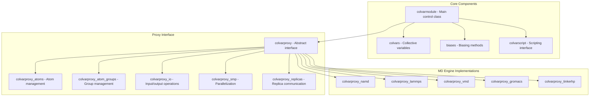
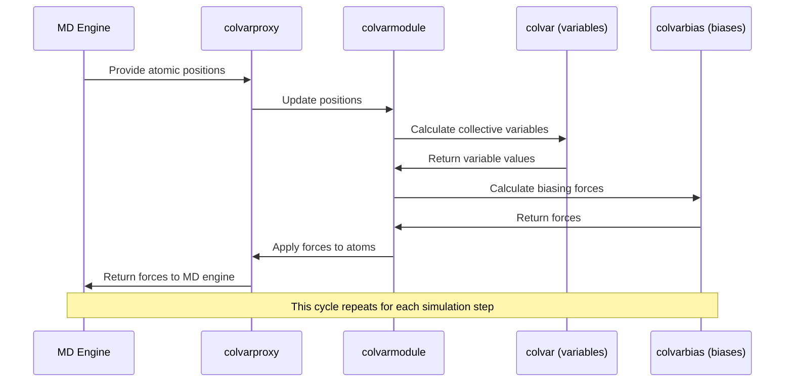
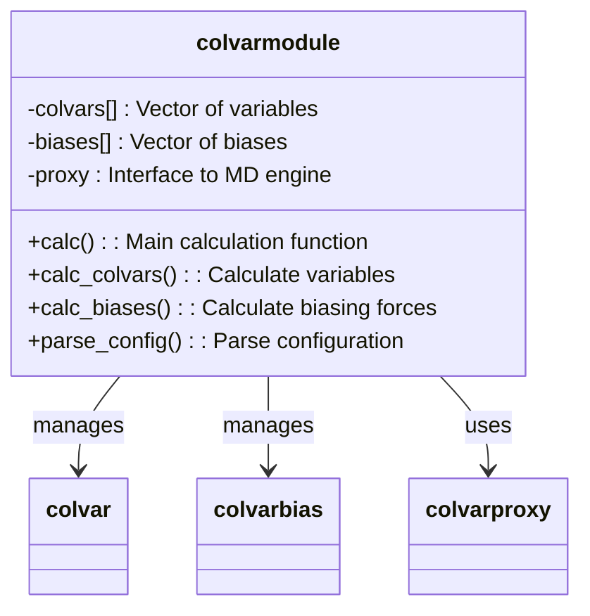

# Overview

<details>
<summary>Relevant source files</summary>

The following files were used as context for generating this wiki page:

- [README-versions.md](README-versions.md)
- [README.md](README.md)
- [devel-tools/create_gromacs-colvars-releases.md](devel-tools/create_gromacs-colvars-releases.md)
- [doc/.gitignore](doc/.gitignore)
- [doc/Makefile](doc/Makefile)
- [doc/colvars-code-refs.bib](doc/colvars-code-refs.bib)
- [doc/colvars-engine-flags.tex](doc/colvars-engine-flags.tex)
- [doc/colvars-refman-gromacs.tex](doc/colvars-refman-gromacs.tex)
- [doc/colvars-refman-lammps.tex](doc/colvars-refman-lammps.tex)
- [doc/colvars-refman-main.tex](doc/colvars-refman-main.tex)
- [doc/colvars-refman-namd.tex](doc/colvars-refman-namd.tex)
- [doc/colvars-refman-tinkerhp.tex](doc/colvars-refman-tinkerhp.tex)
- [doc/colvars-refman-vmd.tex](doc/colvars-refman-vmd.tex)
- [doc/colvars-refman.bib](doc/colvars-refman.bib)
- [doc/colvars-refman.tex](doc/colvars-refman.tex)
- [doc/extract_code_refs.py](doc/extract_code_refs.py)
- [doc/print_engine_versions.sh](doc/print_engine_versions.sh)
- [namd/src/colvarproxy_namd.C](namd/src/colvarproxy_namd.C)
- [namd/src/colvarproxy_namd.h](namd/src/colvarproxy_namd.h)
- [namd/ug/ug_colvars.tex](namd/ug/ug_colvars.tex)
- [src/colvarmodule.cpp](src/colvarmodule.cpp)
- [src/colvarmodule.h](src/colvarmodule.h)
- [src/colvarmodule_refs.h](src/colvarmodule_refs.h)
- [src/colvarparse.cpp](src/colvarparse.cpp)
- [src/colvarparse.h](src/colvarparse.h)
- [src/colvarproxy.cpp](src/colvarproxy.cpp)
- [src/colvarproxy.h](src/colvarproxy.h)
- [vmd/cv_dashboard/README.md](vmd/cv_dashboard/README.md)
- [vmd/doc/ug_colvars.tex](vmd/doc/ug_colvars.tex)
- [vmd/src/colvarproxy_vmd.C](vmd/src/colvarproxy_vmd.C)
- [vmd/src/colvarproxy_vmd.h](vmd/src/colvarproxy_vmd.h)

</details>


The Collective Variables module (Colvars) is a software library for molecular simulation and analysis that provides enhanced sampling and free energy calculation capabilities. Colvars works with a reduced space of continuously differentiable functions (collective variables) that represent the most relevant degrees of freedom in a molecular system. This modular library is integrated into multiple molecular dynamics engines, including NAMD, LAMMPS, VMD, GROMACS, and Tinker-HP.

For information about specific collective variable types, see [Collective Variables Implementation](#3); for information about biasing methods, see [Biasing Methods](#4); for details on engine integrations, see [MD Engine Integration](#5).

## Architecture Overview

The Colvars module uses a modular architecture with clear separation between the core functionality and the interfaces to different MD engines. This design enables consistent functionality across multiple platforms while allowing each platform's specific features to be leveraged.



Sources: [src/colvarmodule.h:35-64](), [src/colvarproxy.h:535-549]()

## Computation Workflow

The diagram below illustrates the data flow during a computation step in Colvars:



Sources: [src/colvarmodule.cpp:850-868]()

## Key Components

### 1. colvarmodule

The `colvarmodule` class is the primary controller that manages all aspects of the collective variables calculation. This singleton class (only one instance exists at a time) handles:

- Creation and destruction of collective variables and biases
- Parsing of configuration files and strings
- Coordination of calculation steps
- Handling of I/O operations through the proxy



Sources: [src/colvarmodule.h:55-900](), [src/colvarmodule.cpp:76-178]()

### 2. colvarproxy

The `colvarproxy` class serves as an abstract interface between the Colvars module and the MD engine. This design allows Colvars to work with multiple MD engines without changing its core functionality.

Each MD engine provides its own implementation of the proxy interface, handling:

- Access to atomic positions, velocities, and forces
- Application of forces calculated by Colvars
- Input/output operations specific to the MD engine
- Unit conversions between Colvars and the MD engine

The proxy system is composed of multiple specialized classes:

| Class | Responsibility |
|-------|----------------|
| colvarproxy_atoms | Manages atomic data (positions, forces, masses, charges) |
| colvarproxy_atom_groups | Handles collections of atoms (centers of mass, etc.) |
| colvarproxy_smp | Provides parallelization capabilities |
| colvarproxy_io | Handles file input/output operations |
| colvarproxy_replicas | Facilitates communication between simulation replicas |
| colvarproxy_script | Enables scripting interface capabilities |
| colvarproxy_volmaps | Manages volumetric maps (e.g., electron density) |

Sources: [src/colvarproxy.h:23-36](), [src/colvarproxy.h:536-549](), [namd/src/colvarproxy_namd.h:37-291](), [vmd/src/colvarproxy_vmd.h:30-226]()

### 3. colvar

The `colvar` class represents a single collective variable, which is a function of atomic coordinates that captures a relevant aspect of the molecular system. Colvars can be simple geometric properties (distances, angles) or complex functions (RMSD, eigenvectors).

Each colvar can have multiple components that contribute to its calculation, providing a flexible way to define complex variables.

### 4. colvarbias

The `colvarbias` class is the base class for all biasing methods, which modify the potential energy surface to enhance sampling or calculate free energies. Supported methods include:

- Harmonic restraints and walls
- Metadynamics
- Adaptive Biasing Force (ABF)
- Optimized Potential Energy Surface (OPES)
- Histogram collection

Each bias method applies forces to the atoms through the collective variables, influencing the dynamics of the simulation.

## Integration with MD Engines

The Colvars module is integrated with several MD engines through specific proxy implementations:

| Engine | Proxy Class | Features |
|--------|-------------|----------|
| NAMD | colvarproxy_namd | Full integration with all Colvars features |
| LAMMPS | colvarproxy_lammps | Full integration with all Colvars features |
| VMD | colvarproxy_vmd | Analysis, visualization, and interactive exploration |
| GROMACS | colvarproxy_gromacs | Full integration starting from GROMACS 2024 |
| Tinker-HP | colvarproxy_tinkerhp | Integration of core Colvars functionality |

Sources: [namd/src/colvarproxy_namd.C:46-620](), [vmd/src/colvarproxy_vmd.C:71-295]()

## Configuration and Usage

Colvars is configured through a text-based configuration file or string, using a simple syntax with nested blocks for defining complex objects. The basic structure includes:

1. Definition of collective variables
2. Definition of biasing methods that act on those variables
3. General parameters for controlling output and behavior

Example of a minimal configuration:

```
colvar {
  name distance
  distance {
    group1 { atomNumbers 1 2 3 }
    group2 { atomNumbers 4 5 6 }
  }
}

harmonic {
  colvars distance
  centers 10.0
  forceConstant 5.0
}
```

This configuration defines a distance-based collective variable between two atom groups and applies a harmonic restraint to keep that distance near 10.0 (in the current length unit).

Sources: [doc/colvars-refman-main.tex:48-80]()

## Summary

The Colvars module provides a powerful and flexible framework for enhanced sampling and free energy calculations in molecular dynamics simulations. Its modular design allows it to work seamlessly with multiple MD engines while maintaining a consistent interface for users. The key components work together to provide a rich set of tools for exploring complex molecular systems through the lens of collective variables.

Sources: [README.md:1-17](), [src/colvarmodule.h:26-33]()

---