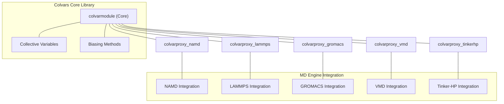
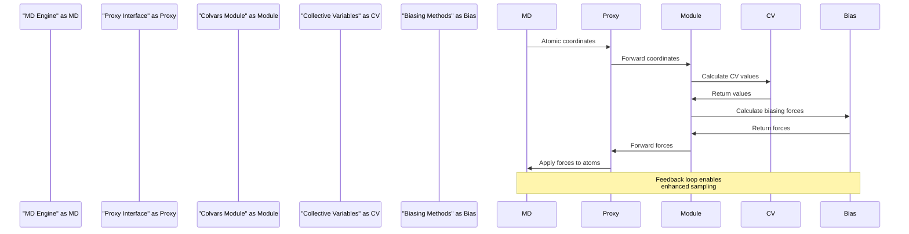
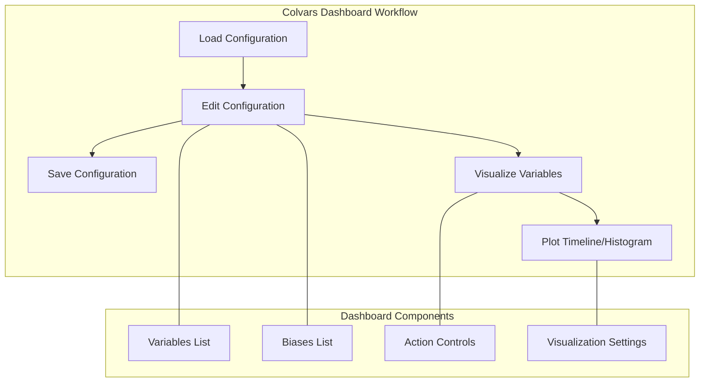

# Installation and Basic Usage

<details>
<summary>Relevant source files</summary>

The following files were used as context for generating this wiki page:

- [README-versions.md](README-versions.md)
- [README.md](README.md)
- [devel-tools/compile-gromacs.sh](devel-tools/compile-gromacs.sh)
- [devel-tools/create_gromacs-colvars-releases.md](devel-tools/create_gromacs-colvars-releases.md)
- [doc/.gitignore](doc/.gitignore)
- [doc/Makefile](doc/Makefile)
- [doc/colvars-code-refs.bib](doc/colvars-code-refs.bib)
- [doc/colvars-engine-flags.tex](doc/colvars-engine-flags.tex)
- [doc/colvars-refman-gromacs.tex](doc/colvars-refman-gromacs.tex)
- [doc/colvars-refman-lammps.tex](doc/colvars-refman-lammps.tex)
- [doc/colvars-refman-main.tex](doc/colvars-refman-main.tex)
- [doc/colvars-refman-namd.tex](doc/colvars-refman-namd.tex)
- [doc/colvars-refman-tinkerhp.tex](doc/colvars-refman-tinkerhp.tex)
- [doc/colvars-refman-vmd.tex](doc/colvars-refman-vmd.tex)
- [doc/colvars-refman.bib](doc/colvars-refman.bib)
- [doc/colvars-refman.tex](doc/colvars-refman.tex)
- [doc/extract_code_refs.py](doc/extract_code_refs.py)
- [doc/print_engine_versions.sh](doc/print_engine_versions.sh)
- [namd/ug/ug_colvars.tex](namd/ug/ug_colvars.tex)
- [src/colvarmodule_refs.h](src/colvarmodule_refs.h)
- [update-colvars-code.sh](update-colvars-code.sh)
- [vmd/cv_dashboard/README.md](vmd/cv_dashboard/README.md)
- [vmd/doc/ug_colvars.tex](vmd/doc/ug_colvars.tex)

</details>


This page covers how to install and set up the Colvars module with different molecular dynamics engines and provides an introduction to its basic usage. This document focuses on the practical aspects of getting started with Colvars, rather than the scientific details of collective variables and enhanced sampling.

For information about the core architecture of Colvars, see [Core Architecture](#2). For detailed explanations of collective variables implementation, see [Collective Variables Implementation](#3).

## Installing Colvars

Colvars is distributed and integrated with multiple molecular dynamics packages. There are three main ways to obtain and install Colvars:

1. Using pre-compiled versions within MD packages
2. Building MD packages with the included Colvars library 
3. Updating an existing MD installation with the latest Colvars version

### Pre-compiled versions

The simplest way to obtain a working Colvars installation is through the pre-compiled versions of the following software packages:

| MD Package | Latest Stable Version with Colvars | Installation Notes |
|------------|-----------------------------------|-------------------|
| GROMACS | 2024 | Native support since version 2024 |
| LAMMPS | stable_29Aug2024 | Included in standard distribution |
| NAMD | 3.0 | Included in standard distribution |
| Tinker-HP | Recent versions | Included in standard distribution |
| VMD | 1.9.4a58 | Included in standard distribution |

Sources: [README.md:11-16](), [README-versions.md:9-56]()

### Updating existing MD packages to the latest Colvars version

To update an existing MD package installation with the most recent version of Colvars:

1. Download or clone the Colvars repository:
   ```
   git clone https://github.com/Colvars/colvars.git
   ```

2. Run the provided update script against your MD engine source tree:
   ```
   ./update-colvars-code.sh /path/to/md-engine-source
   ```

3. Recompile the MD engine following its standard build instructions

This process works with the latest development versions of all supported MD engines.

Sources: [README.md:90-108](), [update-colvars-code.sh:1-577]()

## Colvars Integration with MD Engines

The diagram below illustrates how Colvars integrates with different molecular dynamics engines through proxy interfaces:



Sources: [update-colvars-code.sh:75-109]()

## Enabling Colvars in MD Engines

Each molecular dynamics engine has its own syntax for enabling and configuring Colvars:

### NAMD

Add to your NAMD configuration script:

```
colvars on
cv configfile <Colvars configuration file>
```

Sources: [doc/colvars-refman-main.tex:415-421]()

### LAMMPS

Add to your LAMMPS input file:

```
fix Colvars all colvars configfile <Colvars configuration file>
```

Optional parameters include `output`, `input`, `unwrap`, `seed`, and `tstat`.

Sources: [doc/colvars-refman-main.tex:457-526]()

### GROMACS (version 2024 and later)

Add to your `.mdp` file:

```
colvars-active = yes
colvars-configfile = my_config.colvars
```

When using `gmx grompp`, the Colvars configuration is bundled into the TPR file.

Sources: [doc/colvars-refman-main.tex:539-596]()

### VMD

In VMD's Tcl console:

```
cv molid top
cv configfile <Colvars configuration file>
```

Alternatively, use the graphical Colvars Dashboard interface via the menu item `Extensions/Analysis/Colvars Dashboard`.

Sources: [doc/colvars-refman-main.tex:39-46](), [vmd/cv_dashboard/README.md:5-13]()

### Tinker-HP

Create a Colvars configuration file with the same prefix as your `.key` file but with the extension `.colvars`.

Sources: [README.md:59-60]()

## Data Flow During Simulation

The diagram below illustrates how Colvars interacts with the MD engine during a simulation:



Sources: [doc/colvars-refman-main.tex:12-36]()

## Writing a Colvars Configuration

The Colvars configuration file is a plain text file that defines:
1. Collective variables
2. Biasing methods
3. General parameters

### Example: Simple Distance Restraint

This minimal example creates a harmonic restraint on the distance between two groups of atoms:

```
colvar {
  name dist
  distance {
    group1 { atomNumbers 42-55 }
    group2 { atomNumbers 100-110 }
  }
}

harmonic {
  colvars dist
  forceConstant 20.0  # Energy units per length unit squared
  centers 4.0         # Target distance in length units
}
```

This defines a variable named "dist" that measures the distance between atoms 42-55 and atoms 100-110, then applies a harmonic restraint to keep this distance near 4.0 (in the MD engine's length units).

Sources: [doc/colvars-refman-main.tex:65-84]()

### Example: Multiple Variables and Biases

More complex configurations can use multiple variables and biases simultaneously:

```
colvar {
  name d
  width 0.2           # Estimated fluctuation width
  distance {
    componentCoeff  1.0
    group1 { atomNumbers 1 2 }
    group2 { atomNumbers 3 4 5 }
  }
  distance {
    componentCoeff -1.0
    group1 { atomNumbers 7 }
    group2 { atomNumbers 8 9 10 }
  }
}

colvar {
  name c
  coordNum {
    cutoff 6.0
    group1 { atomNumbersRange 1-10 }
    group2 { atomNumbersRange 11-20 }
  }
}

harmonic {
  colvars d c
  centers 3.0 4.0
  forceConstant 5.0
}

histogram {
  colvars c
}
```

In this example, "d" is calculated as the difference between two distances, "c" is a coordination number, both are restrained with a harmonic potential, and a histogram of "c" is recorded.

Sources: [doc/colvars-refman-main.tex:99-144]()

## Units in Colvars

Colvars uses the same units as the MD engine it's running with, except in VMD where different unit sets are supported. The unit system can be specified within the Colvars configuration:

```
units real  # Use real units (Å, kcal/mol) in all colvars
```

Note that angles are always expressed in degrees, and derived quantities such as force constants are based on degrees as well.

Sources: [doc/colvars-refman-main.tex:376-411]()

## Loading and Saving Configuration Files

### Dashboard in VMD

The Colvars Dashboard in VMD provides a graphical interface for creating, loading, and saving configurations:



Sources: [doc/colvars-refman-main.tex:147-289](), [vmd/cv_dashboard/README.md:7-368]()

## Continuing and Restarting Simulations

Colvars states can be saved and restored to continue simulations:

### NAMD
```
colvarsInput input.colvars.state
```

### LAMMPS
```
fix Colvars all colvars input input.colvars.state
```

### GROMACS
Use the standard checkpoint mechanism (`-cpi` flag with `gmx mdrun`).

### VMD
```
cv load state.colvars.state
```

Sources: [doc/colvars-refman-main.tex:444-450](), [doc/colvars-refman-main.tex:491-496](), [doc/colvars-refman-main.tex:594-597]()

## Troubleshooting Common Installation Issues

### GROMACS Integration
- Versions prior to GROMACS 2024 are no longer supported with current Colvars
- When updating manually, ensure you're using the correct branch that supports your GROMACS version

### LAMMPS Integration
- Ensure you have the COLVARS package enabled when building LAMMPS
- If updating manually, check if any patch files need to be applied

### NAMD Integration
- After updating, run `make depends` in the NAMD tree
- If using NAMD 3 development versions, the update script will handle version compatibility issues

Sources: [update-colvars-code.sh:111-116](), [update-colvars-code.sh:394-425](), [devel-tools/create_gromacs-colvars-releases.md:1-58]()

## Citation Information

When using Colvars in your research, please cite:

- G. Fiorin, M. L. Klein, and J. Hénin, Mol. Phys. **111** (22-23), 3345-3362 (2013)
- G. Fiorin, F. Marinelli, L. R. Forrest, H. Chen, C. Chipot, A. Kohlmeyer, H. Santuz, J. Hénin, J. Phys. Chem. B **128** (45), 11108-11123 (2024)

Additional feature-specific citations will be listed in the usage summary printed at runtime.

Sources: [README.md:28-35](), [doc/colvars-refman-main.tex:36]()

---