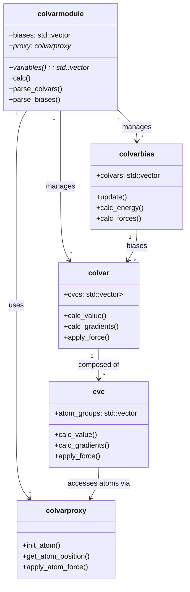
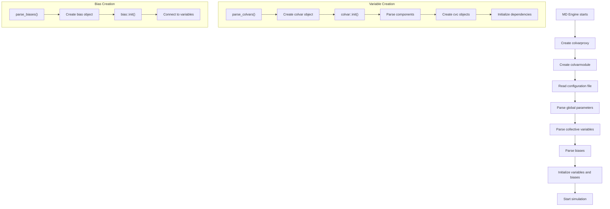
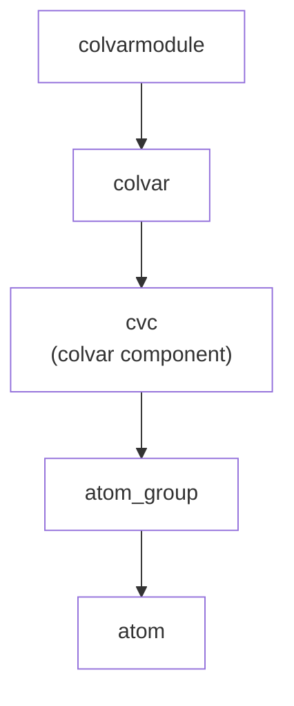
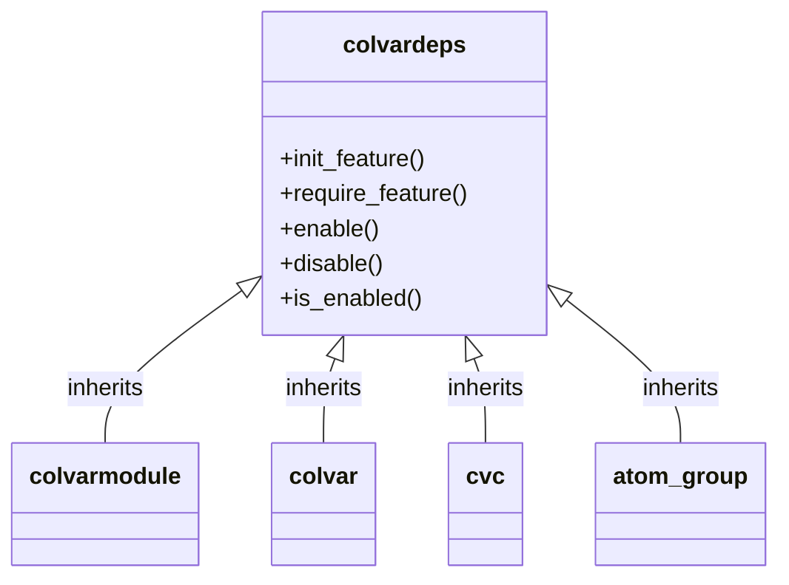
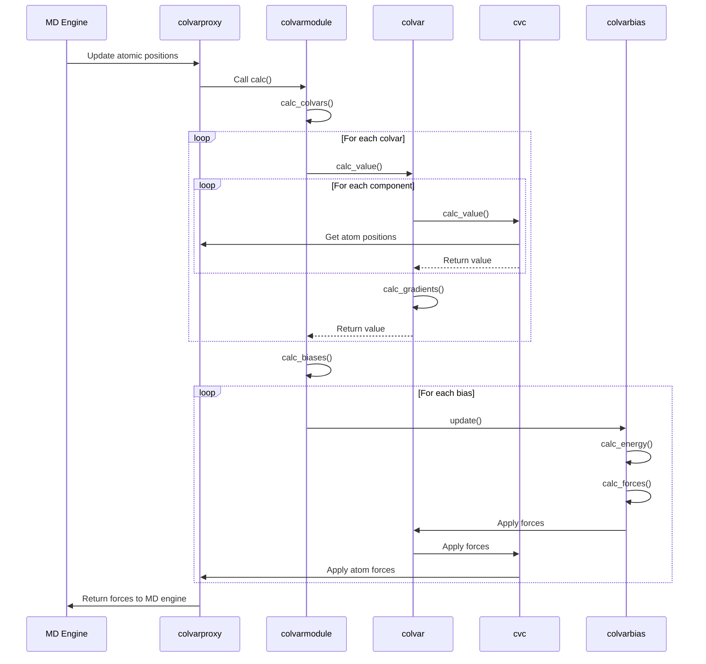
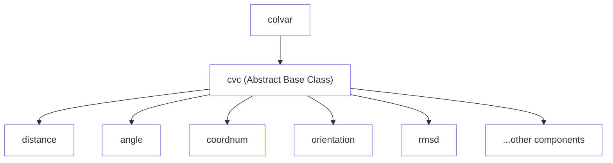
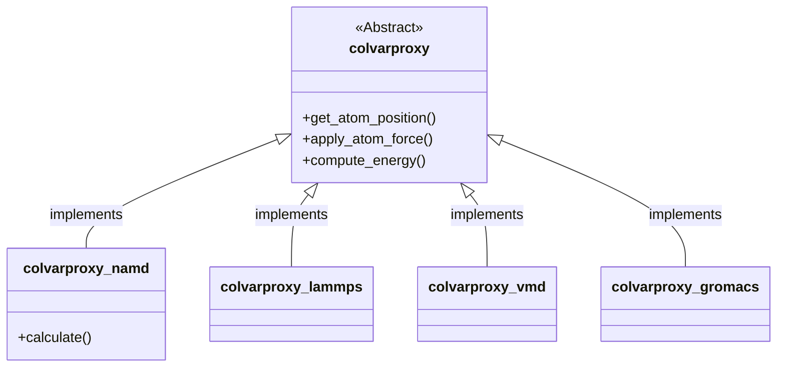
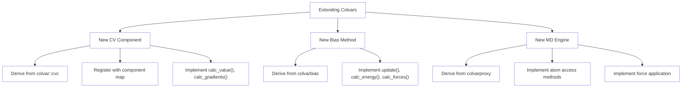

# Core Architecture

Relevant source files

The following files were used as context for generating this wiki page:

- [README-versions.md](README-versions.md)
- [doc/.gitignore](doc/.gitignore)
- [doc/Makefile](doc/Makefile)
- [doc/colvars-code-refs.bib](doc/colvars-code-refs.bib)
- [doc/colvars-engine-flags.tex](doc/colvars-engine-flags.tex)
- [doc/colvars-refman-gromacs.tex](doc/colvars-refman-gromacs.tex)
- [doc/colvars-refman-lammps.tex](doc/colvars-refman-lammps.tex)
- [doc/colvars-refman-main.tex](doc/colvars-refman-main.tex)
- [doc/colvars-refman-namd.tex](doc/colvars-refman-namd.tex)
- [doc/colvars-refman-tinkerhp.tex](doc/colvars-refman-tinkerhp.tex)
- [doc/colvars-refman-vmd.tex](doc/colvars-refman-vmd.tex)
- [doc/colvars-refman.bib](doc/colvars-refman.bib)
- [doc/colvars-refman.tex](doc/colvars-refman.tex)
- [doc/extract_code_refs.py](doc/extract_code_refs.py)
- [doc/print_engine_versions.sh](doc/print_engine_versions.sh)
- [namd/src/colvarproxy_namd.C](namd/src/colvarproxy_namd.C)
- [namd/src/colvarproxy_namd.h](namd/src/colvarproxy_namd.h)
- [namd/ug/ug_colvars.tex](namd/ug/ug_colvars.tex)
- [src/colvar.cpp](src/colvar.cpp)
- [src/colvar.h](src/colvar.h)
- [src/colvar_rotation_derivative.h](src/colvar_rotation_derivative.h)
- [src/colvaratoms.cpp](src/colvaratoms.cpp)
- [src/colvaratoms.h](src/colvaratoms.h)
- [src/colvarcomp.cpp](src/colvarcomp.cpp)
- [src/colvarcomp.h](src/colvarcomp.h)
- [src/colvarcomp_angles.cpp](src/colvarcomp_angles.cpp)
- [src/colvarcomp_coordnums.cpp](src/colvarcomp_coordnums.cpp)
- [src/colvarcomp_distances.cpp](src/colvarcomp_distances.cpp)
- [src/colvarcomp_protein.cpp](src/colvarcomp_protein.cpp)
- [src/colvarcomp_rotations.cpp](src/colvarcomp_rotations.cpp)
- [src/colvardeps.cpp](src/colvardeps.cpp)
- [src/colvardeps.h](src/colvardeps.h)
- [src/colvarmodule.cpp](src/colvarmodule.cpp)
- [src/colvarmodule.h](src/colvarmodule.h)
- [src/colvarmodule_refs.h](src/colvarmodule_refs.h)
- [src/colvarparse.cpp](src/colvarparse.cpp)
- [src/colvarparse.h](src/colvarparse.h)
- [src/colvarproxy.cpp](src/colvarproxy.cpp)
- [src/colvarproxy.h](src/colvarproxy.h)
- [src/colvartypes.cpp](src/colvartypes.cpp)
- [src/colvartypes.h](src/colvartypes.h)
- [src/colvarvalue.cpp](src/colvarvalue.cpp)
- [src/colvarvalue.h](src/colvarvalue.h)
- [src/nr_jacobi.cpp](src/nr_jacobi.cpp)
- [src/nr_jacobi.h](src/nr_jacobi.h)
- [vmd/doc/ug_colvars.tex](vmd/doc/ug_colvars.tex)
- [vmd/src/colvarproxy_vmd.C](vmd/src/colvarproxy_vmd.C)
- [vmd/src/colvarproxy_vmd.h](vmd/src/colvarproxy_vmd.h)

The Core Architecture of the Colvars module provides the foundation for defining, calculating, and biasing collective variables in molecular dynamics simulations. This document describes the central components, their relationships, and how they work together to enable enhanced sampling methods across multiple MD engines.

This page focuses on the internal structure of the Colvars module itself. For information about specific collective variables, see [Collective Variables Implementation](#3). For information about biasing methods, see [Biasing Methods](#4). For details on MD engine integration, see [MD Engine Integration](#5).

## Key Components

The Colvars module consists of five key components that work together:

1. **colvarmodule** - The central controller that manages the entire collective variables system
2. **colvar** - Individual collective variable objects that calculate values from atomic data
3. **cvc** (colvar components) - Building blocks used to construct collective variables
4. **colvarbias** - Bias methods that apply forces based on collective variable values
5. **colvarproxy** - Interface between Colvars and the MD engine

Sources: [src/colvarmodule.h:55-736](), [src/colvar.h:53-826](), [src/colvarcomp.h:68-2313](), [src/colvarproxy.h:43-246]()

## Module Initialization and Configuration Flow

The following diagram shows how the Colvars module is initialized and how the configuration flows through the system:

Sources: [src/colvarmodule.cpp:76-172](), [src/colvarmodule.cpp:305-587](), [src/colvar.cpp:62-347]()

## Data Structure Hierarchy

The Colvars module uses a hierarchical structure to organize atomic data and calculate collective variables:

Sources: [src/colvarmodule.h:55-66](), [src/colvar.h:53-66](), [src/colvarcomp.h:68-86](), [src/colvaratoms.h:90-159](), [src/colvaratoms.h:31-49]()

## Dependency Management System

The Colvars module uses a sophisticated dependency management system through the `colvardeps` class. This allows features to be enabled/disabled with proper handling of dependencies between features.

Sources: [src/colvardeps.h:16-78](), [src/colvardeps.cpp:16-40](), [src/colvar.h:53](), [src/colvarcomp.h:69](), [src/colvaratoms.h:90]()

## Runtime Calculation Flow

This diagram illustrates the flow of data and control during a single timestep of a simulation:

Sources: [src/colvarmodule.cpp:586-654](), [namd/src/colvarproxy_namd.C:383-466](), [src/colvar.cpp:1387-1459]()

## Central Module: colvarmodule

The `colvarmodule` class serves as the central controller for the entire Colvars system. It:

1. Manages the lifecycle of collective variables and biases
2. Parses configuration files
3. Coordinates calculations during the simulation
4. Handles I/O operations through the proxy

Key methods include:
- `parse_colvars()` - Creates and initializes collective variables
- `parse_biases()` - Creates and initializes biasing methods
- `calc()` - Main calculation function called at each timestep
- `write_output_files()` - Writes output data to files

Sources: [src/colvarmodule.h:55-736](), [src/colvarmodule.cpp:76-172](), [src/colvarmodule.cpp:586-654]()

## Collective Variables: colvar and cvc

The `colvar` class represents a single collective variable. Each colvar can be composed of multiple components (`cvc` objects), which are combined according to their coefficients. The `cvc` class is an abstract base class with many derived classes implementing specific types of collective variables.

Key responsibilities:
- Calculate the current value of the collective variable
- Compute gradients with respect to atomic positions
- Apply forces to atoms based on biases

Sources: [src/colvar.h:53-826](), [src/colvarcomp.h:68-2313](), [src/colvarcomp_distances.cpp:19-52](), [src/colvarcomp.cpp:19-59]()

## Proxy System for MD Integration

The `colvarproxy` class serves as an abstract interface between the Colvars module and the MD engine. Specific implementations (e.g., `colvarproxy_namd`, `colvarproxy_lammps`) provide the actual connection to each MD program.

The proxy system is composed of multiple interface classes that handle different aspects of the MD integration:

| Interface Class | Responsibility |
|-----------------|----------------|
| `colvarproxy_atoms` | Managing atomic data (positions, forces) |
| `colvarproxy_atom_groups` | Managing groups of atoms |
| `colvarproxy_system` | System-wide properties (PBC, temperature) |
| `colvarproxy_io` | Input/output operations |
| `colvarproxy_tcl` | Tcl scripting interface |
| `colvarproxy_replicas` | Multi-replica simulations |

Sources: [src/colvarproxy.h:22-31](), [src/colvarproxy.h:43-246](), [namd/src/colvarproxy_namd.h:39-246](), [vmd/src/colvarproxy_vmd.h:1-123]()

## Memory Management and Object Ownership

The Colvars module uses a clear ownership hierarchy for memory management:

1. `colvarmodule` owns all `colvar` and `colvarbias` objects
2. `colvar` owns its `cvc` components (using `std::shared_ptr`)
3. `cvc` references `atom_group` objects but doesn't own them
4. `atom_group` owns its internal data but shares `atom` objects

Recent versions of the code have transitioned to using smart pointers (particularly `std::shared_ptr`) for improved memory management.

Sources: [src/colvar.h:125-126](), [src/colvarmodule.h:302-347]()

## Extensibility Points

The Colvars module is designed to be extensible at several points:

1. **New collective variable components**: Derive from `colvar::cvc` and implement required methods
2. **New biasing methods**: Derive from `colvarbias` and implement required methods
3. **New MD engine integration**: Implement a new `colvarproxy` derived class

Sources: [src/colvar.cpp:823-881](), [src/colvarcomp.h:57-66](), [src/colvarproxy.h:22-31]()

## Configuration and Input Parsing

The Colvars module uses a sophisticated parsing system based on the `colvarparse` class. This system:

1. Parses configuration files or strings
2. Handles different data types (scalar, vector, matrix)
3. Supports default values and silent parsing modes
4. Provides error checking and reporting

All major components (`colvarmodule`, `colvar`, `cvc`, `colvarbias`) inherit from `colvarparse` to leverage this parsing system.

Sources: [src/colvarparse.h:1-446](), [src/colvarparse.cpp:1-938](), [src/colvarmodule.cpp:239-359]()

## Conclusion

The core architecture of the Colvars module provides a flexible, extensible framework for implementing collective variables and biasing methods in molecular dynamics simulations. Through its modular design and proxy-based MD engine integration, it achieves compatibility with multiple simulation packages while maintaining a consistent internal structure.

The dependency management system allows features to be enabled or disabled as needed, and the component-based approach to collective variables enables complex variables to be constructed from simpler building blocks. This architecture has evolved to support increasingly sophisticated enhanced sampling methods while maintaining backward compatibility with existing workflows.

---