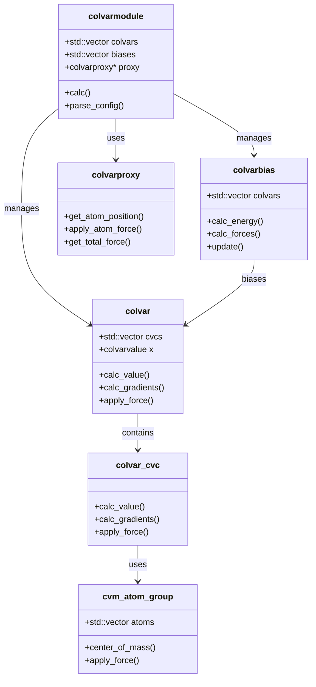
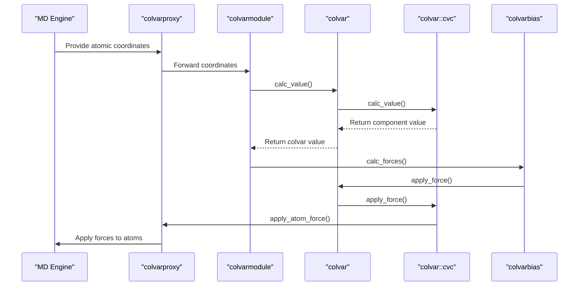
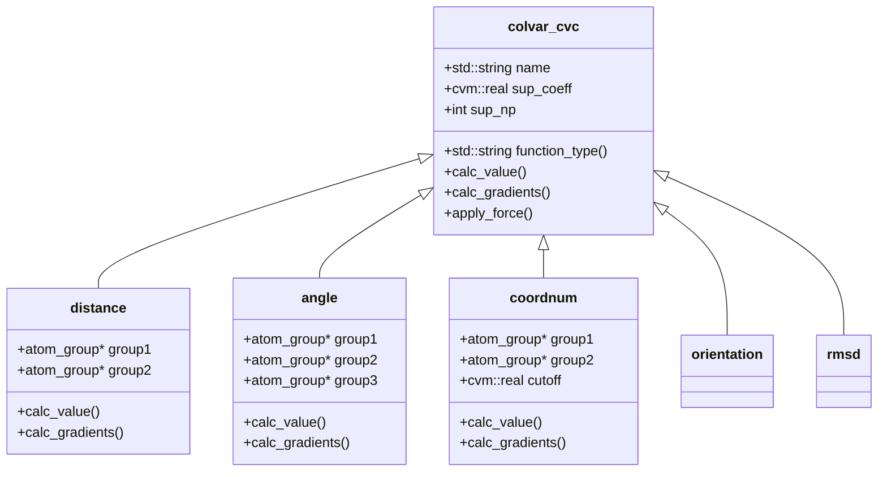
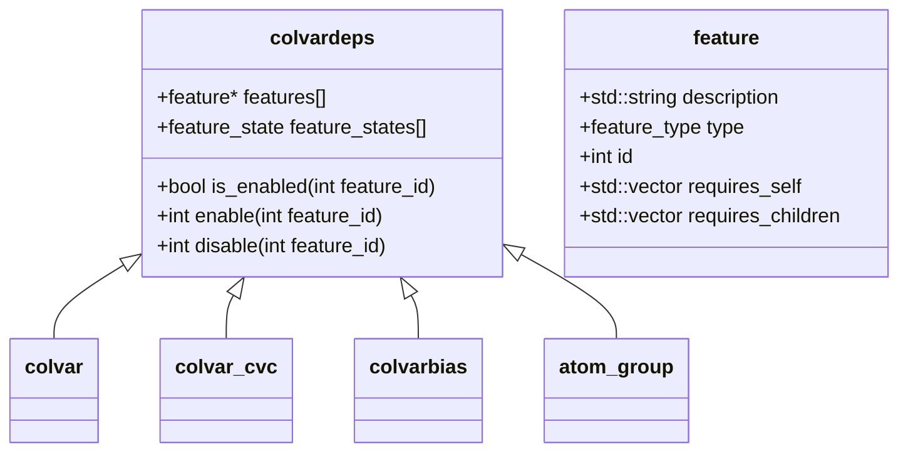
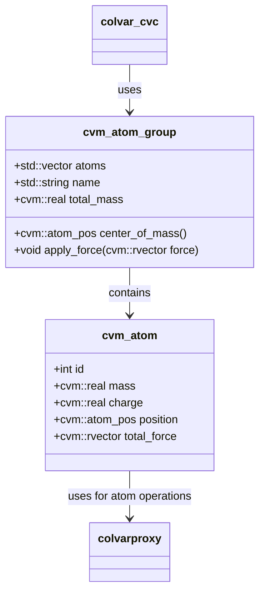

# Collective Variables System

Relevant source files

The following files were used as context for generating this wiki page:

- [README-versions.md](README-versions.md)
- [doc/.gitignore](doc/.gitignore)
- [doc/Makefile](doc/Makefile)
- [doc/colvars-code-refs.bib](doc/colvars-code-refs.bib)
- [doc/colvars-engine-flags.tex](doc/colvars-engine-flags.tex)
- [doc/colvars-refman-gromacs.tex](doc/colvars-refman-gromacs.tex)
- [doc/colvars-refman-lammps.tex](doc/colvars-refman-lammps.tex)
- [doc/colvars-refman-main.tex](doc/colvars-refman-main.tex)
- [doc/colvars-refman-namd.tex](doc/colvars-refman-namd.tex)
- [doc/colvars-refman-tinkerhp.tex](doc/colvars-refman-tinkerhp.tex)
- [doc/colvars-refman-vmd.tex](doc/colvars-refman-vmd.tex)
- [doc/colvars-refman.bib](doc/colvars-refman.bib)
- [doc/colvars-refman.tex](doc/colvars-refman.tex)
- [doc/extract_code_refs.py](doc/extract_code_refs.py)
- [doc/print_engine_versions.sh](doc/print_engine_versions.sh)
- [namd/src/colvarproxy_namd.C](namd/src/colvarproxy_namd.C)
- [namd/src/colvarproxy_namd.h](namd/src/colvarproxy_namd.h)
- [namd/ug/ug_colvars.tex](namd/ug/ug_colvars.tex)
- [src/colvar.cpp](src/colvar.cpp)
- [src/colvar.h](src/colvar.h)
- [src/colvaratoms.cpp](src/colvaratoms.cpp)
- [src/colvaratoms.h](src/colvaratoms.h)
- [src/colvarcomp.cpp](src/colvarcomp.cpp)
- [src/colvarcomp.h](src/colvarcomp.h)
- [src/colvarcomp_angles.cpp](src/colvarcomp_angles.cpp)
- [src/colvarcomp_coordnums.cpp](src/colvarcomp_coordnums.cpp)
- [src/colvarcomp_distances.cpp](src/colvarcomp_distances.cpp)
- [src/colvarcomp_protein.cpp](src/colvarcomp_protein.cpp)
- [src/colvarcomp_rotations.cpp](src/colvarcomp_rotations.cpp)
- [src/colvardeps.cpp](src/colvardeps.cpp)
- [src/colvardeps.h](src/colvardeps.h)
- [src/colvarmodule.cpp](src/colvarmodule.cpp)
- [src/colvarmodule.h](src/colvarmodule.h)
- [src/colvarmodule_refs.h](src/colvarmodule_refs.h)
- [src/colvarparse.cpp](src/colvarparse.cpp)
- [src/colvarparse.h](src/colvarparse.h)
- [src/colvarproxy.cpp](src/colvarproxy.cpp)
- [src/colvarproxy.h](src/colvarproxy.h)
- [vmd/doc/ug_colvars.tex](vmd/doc/ug_colvars.tex)
- [vmd/src/colvarproxy_vmd.C](vmd/src/colvarproxy_vmd.C)
- [vmd/src/colvarproxy_vmd.h](vmd/src/colvarproxy_vmd.h)

The Collective Variables System (Colvars) is the core component of the Colvars module, providing a framework for defining, calculating, and manipulating collective variables in molecular dynamics simulations. Collective variables are functions of atomic coordinates that reduce the high-dimensional space of atomic positions to a lower-dimensional space, making it possible to study complex molecular processes and apply enhanced sampling techniques.

For information about specific biasing methods applied to collective variables, see [Biasing Methods](#4). For details on how Colvars integrates with specific MD engines, see [MD Engine Integration](#5).

## Core Architecture

The Colvars system is built around a hierarchical architecture of classes that handle different aspects of collective variable calculation and manipulation.

Sources: [src/colvarmodule.h:54-97](), [src/colvar.h:53-106](), [src/colvarcomp.h:68-130](), [src/colvarproxy.h:42-220](), [src/colvaratoms.h:90-129]()

### colvarmodule

The `colvarmodule` is the main controller class that manages the entire collective variables calculation. It creates and manages instances of `colvar` and `colvarbias`, handles input/output operations, and interfaces with the MD engine through a `colvarproxy` object.

Key functions:
- `calc()`: Main calculation function called at each MD step
- `parse_config()`: Parse configuration from a file or string
- `variables()`: Return vector of defined collective variables
- `biases()`: Return vector of active biases

Sources: [src/colvarmodule.cpp:75-172](), [src/colvarmodule.h:64-123]()

### colvar

The `colvar` class represents a collective variable. It calculates a value based on atomic coordinates using one or more components (`colvar::cvc`). The design allows complex variables to be constructed from simpler components.

Key characteristics:
- Stores current value, velocity, and forces
- Manages multiple components and their combination
- Handles calculation of gradients and application of forces
- Supports periodic/non-periodic variables
- Can have extended Lagrangian dynamics

Sources: [src/colvar.cpp:33-347](), [src/colvar.h:53-106]()

### colvar::cvc (Collective Variable Component)

The `colvar::cvc` class is the base class for all collective variable components. It defines the interface for calculating values, gradients, and forces for specific types of collective variables.

Key features:
- Abstract base class with derived implementations for different types
- Handles calculation of a specific type of collective variable
- Computes gradients with respect to atomic positions 
- Maps gradients to forces on atoms

Sources: [src/colvarcomp.cpp:19-104](), [src/colvarcomp.h:68-130]()

## Data Flow and Calculation Process

The calculation process in the Colvars system involves a flow of data from atomic coordinates to collective variable values and back to atomic forces.

Sources: [src/colvarmodule.cpp:585-601](), [src/colvar.cpp:33-347](), [src/colvarcomp.cpp:19-104]()

### Value Calculation

1. The MD engine provides atomic coordinates to `colvarproxy`
2. `colvarmodule` calls `calc_value()` on each `colvar`
3. Each `colvar` passes coordinates to its components (`colvar::cvc`)
4. Components calculate their individual values
5. `colvar` combines the component values (e.g., linear combination)

Sources: [src/colvar.cpp:33-347](), [src/colvarmodule.cpp:585-601]()

### Force Application

1. `colvarbias` objects calculate forces on collective variables
2. Forces are passed to `colvar` objects via `apply_force()`
3. Each `colvar` distributes force to its components
4. Components calculate atomic forces based on gradients
5. Atomic forces are applied through `colvarproxy`

Sources: [src/colvarmodule.cpp:595-603](), [src/colvar.cpp:33-347](), [src/colvarcomp.cpp:19-104]()

## Component System

The component system is a key architectural feature of Colvars, allowing complex collective variables to be built from basic building blocks.

Sources: [src/colvarcomp.h:68-130](), [src/colvarcomp_distances.cpp:19-104](), [src/colvarcomp_angles.cpp](), [src/colvarcomp_coordnums.cpp]()

### Component Types

The Colvars system includes many types of components, each derived from `colvar::cvc`:

- **Distances**: Distance between centers of mass of two atom groups (`distance`), distance vector (`distance_vec`), z-component of distance (`distance_z`)
- **Angles**: Angle between three groups (`angle`), dihedral angle (`dihedral`), spinAngle (`spin_angle`)
- **Coordination Numbers**: Number of contacts between two groups (`coordnum`)
- **Orientations**: Orientation as a quaternion (`orientation`), orientation angle (`orientation_angle`)
- **RMSD**: Root mean square deviation from reference structure (`rmsd`)
- **Others**: Eigenvector projections, gyration radius, interfacial water, and more

Sources: [src/colvarcomp.h:68-130](), [src/colvarcomp_distances.cpp](), [src/colvarcomp_angles.cpp](), [src/colvarcomp_coordnums.cpp](), [src/colvarcomp_rotations.cpp]()

### Component Combination

Components can be combined in different ways to create complex variables:
- **Linear combination**: `colvar` with multiple components with coefficients
- **Scripted functions**: Custom functions can be defined using Tcl or Lepton expression parser
- **Non-linear combinations**: Components can be raised to powers

Sources: [src/colvar.cpp:171-212](), [src/colvar.cpp:351-510]()

## Dependency Management System

The Colvars module includes a sophisticated dependency management system implemented through the `colvardeps` class. This allows features to be enabled or disabled based on dependencies, ensuring consistency and preventing invalid configurations.

Sources: [src/colvardeps.h](), [src/colvardeps.cpp]()

### Feature System

Features in the dependency system represent capabilities that can be enabled or disabled:

- Dynamic features can be enabled/disabled during runtime
- Static features are set at initialization and cannot change
- User features are controlled by user input

The dependency system ensures that when a feature is enabled, all its dependencies are also enabled. Conversely, when a feature is disabled, all features that depend on it are also disabled.

Sources: [src/colvardeps.h:218-286](), [src/colvardeps.cpp:174-235]()

## Atom Management

The Colvars system manages atoms through the `cvm::atom` and `cvm::atom_group` classes. These handle atomic positions, forces, and related calculations.

Sources: [src/colvaratoms.h:31-47](), [src/colvaratoms.h:90-129](), [src/colvaratoms.cpp:24-85](), [src/colvaratoms.cpp:90-133]()

### atom

The `cvm::atom` class represents a single atom in the Colvars system. It stores:
- Unique identifier
- Mass and charge
- Current position
- Forces applied by collective variables

Sources: [src/colvaratoms.h:31-47](), [src/colvaratoms.cpp:24-85]()

### atom_group

The `cvm::atom_group` class represents a group of atoms, providing operations such as:
- Calculating center of mass
- Rotating and translating the group
- Applying forces to all atoms in the group
- Fitting to a reference structure

Sources: [src/colvaratoms.h:90-129](), [src/colvaratoms.cpp:90-133]()

## Value System

The Colvars module uses the `colvarvalue` class to represent values of collective variables. This class handles different types of values (scalar, vector, quaternion) in a unified way.

Key features:
- Support for different value types
- Operations like addition, subtraction, scaling
- Type-specific distance functions
- Handling of periodic/non-periodic variables

Sources: [src/colvar.cpp:33-347](), [src/colvar.h:53-106]()

## Integration with External Systems

The Colvars system integrates with external systems primarily through the `colvarproxy` class, which provides an abstract interface for:

- Obtaining atomic positions and forces
- Applying forces to atoms
- Handling periodic boundary conditions
- File input/output operations
- Random number generation

Engine-specific implementations (`colvarproxy_namd`, `colvarproxy_lammps`, etc.) handle the actual interface with specific MD engines.

Sources: [src/colvarproxy.h:42-220](), [src/colvarproxy.cpp:23-75](), [namd/src/colvarproxy_namd.h:39-268](), [namd/src/colvarproxy_namd.C:46-158](), [vmd/src/colvarproxy_vmd.h](), [vmd/src/colvarproxy_vmd.C:71-126]()

## Summary

The Collective Variables System provides a flexible framework for defining, calculating, and manipulating collective variables in molecular dynamics simulations. Its modular design, with separate classes for variables, components, and atom management, enables the implementation of complex variables and sophisticated biasing methods.

The key strengths of the system include:
- Hierarchical architecture with clear separation of concerns
- Extensible component system for building complex variables
- Robust dependency management through the feature system
- Flexible atom selection and grouping mechanisms
- Abstract interface to MD engines via the proxy system

These design choices make the Colvars system a powerful tool for enhanced sampling and free energy calculations in molecular simulations across multiple simulation platforms.

Sources: [src/colvarmodule.h](), [src/colvar.h](), [src/colvarcomp.h](), [src/colvaratoms.h](), [src/colvarproxy.h]()

---