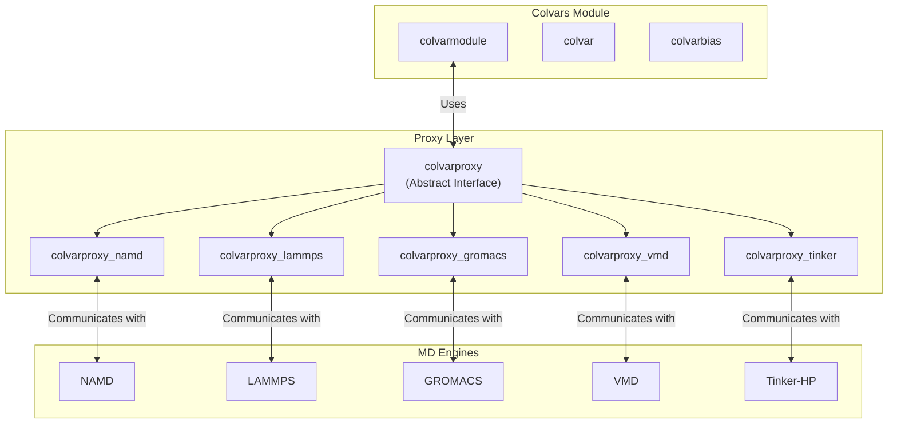
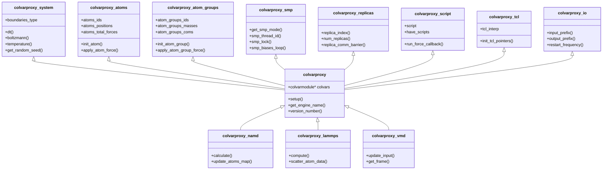
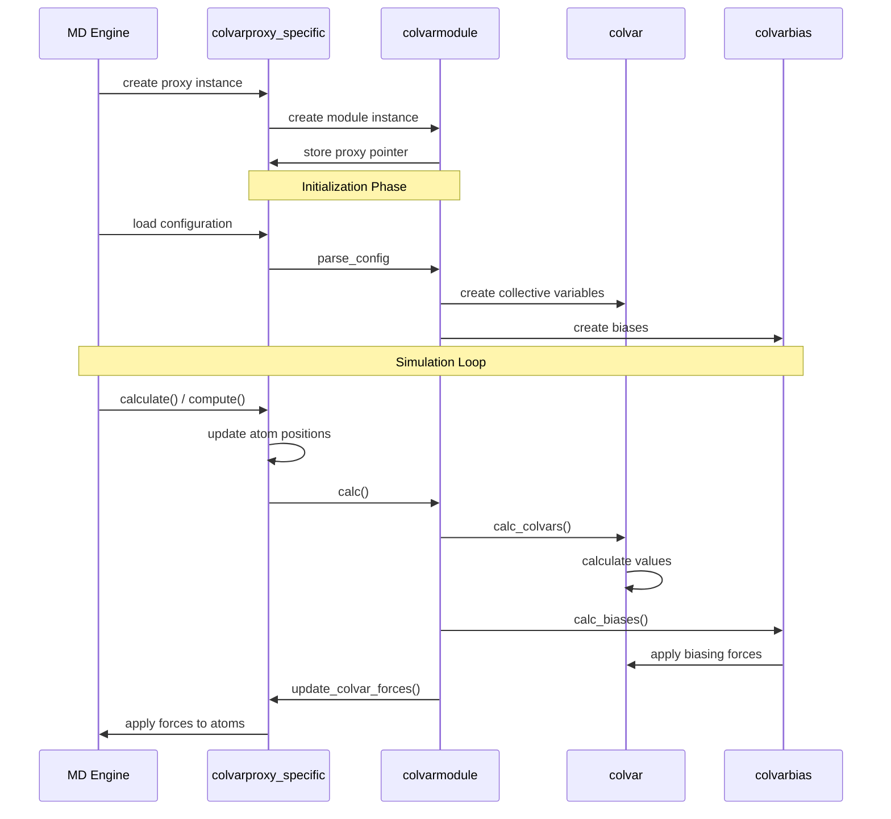
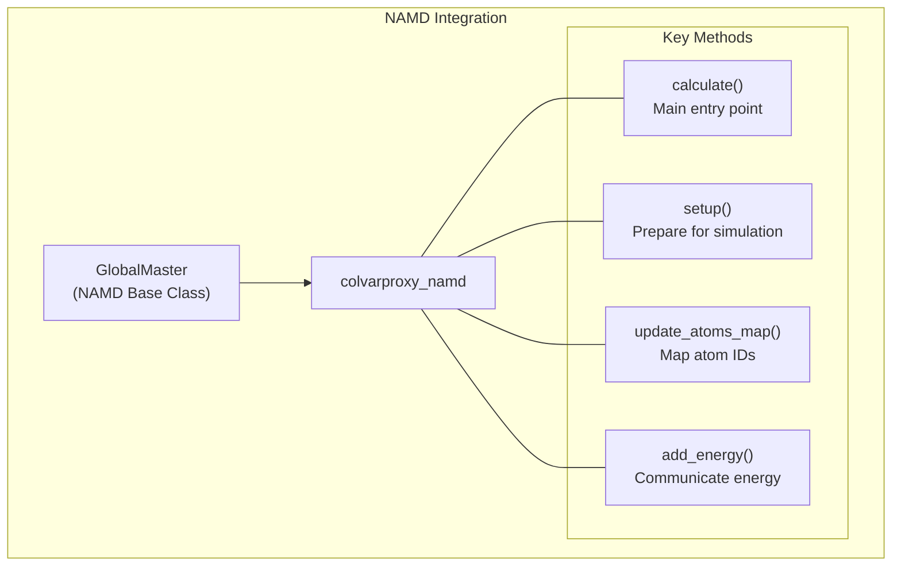
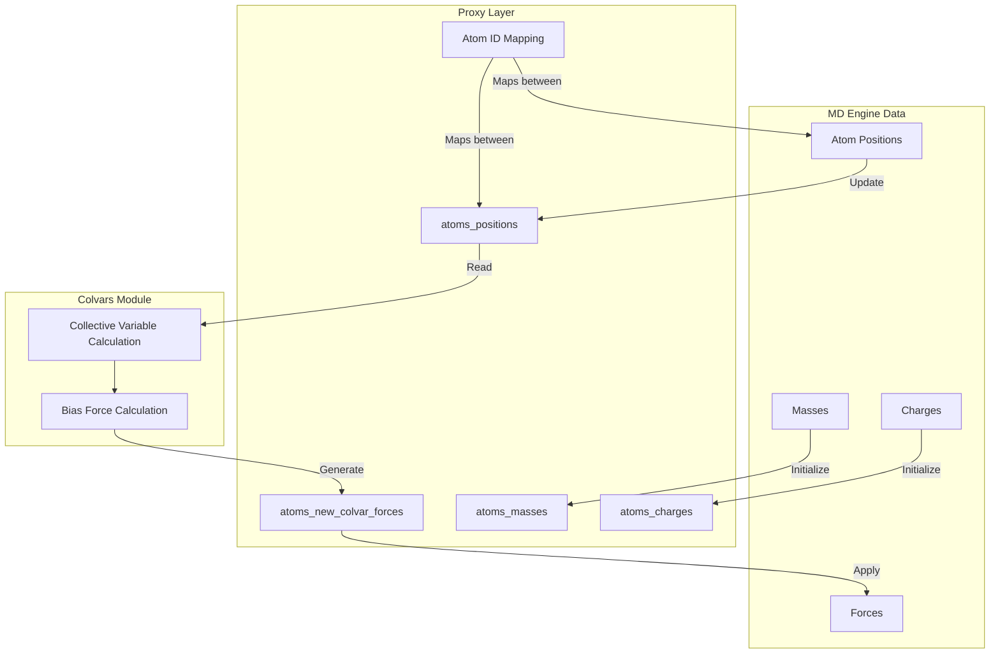
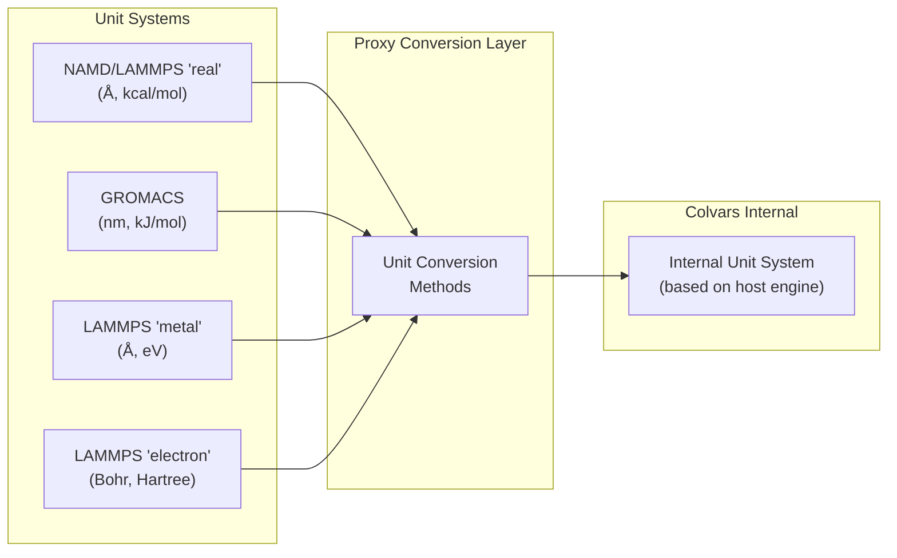
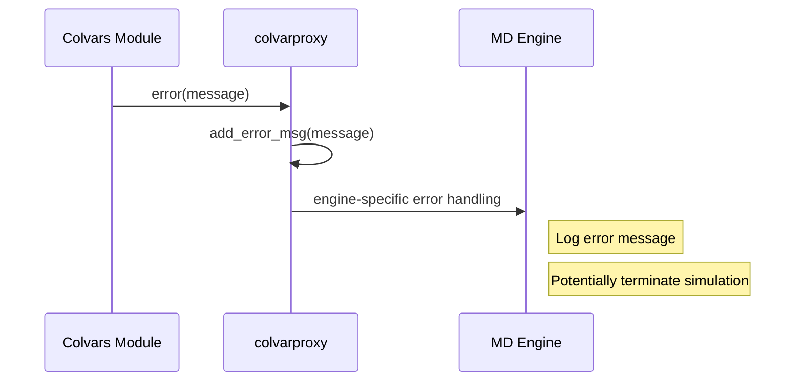

# Proxy System for MD Integration

Relevant source files

The following files were used as context for generating this wiki page:

- [README-versions.md](README-versions.md)
- [doc/.gitignore](doc/.gitignore)
- [doc/Makefile](doc/Makefile)
- [doc/colvars-code-refs.bib](doc/colvars-code-refs.bib)
- [doc/colvars-engine-flags.tex](doc/colvars-engine-flags.tex)
- [doc/colvars-refman-gromacs.tex](doc/colvars-refman-gromacs.tex)
- [doc/colvars-refman-lammps.tex](doc/colvars-refman-lammps.tex)
- [doc/colvars-refman-main.tex](doc/colvars-refman-main.tex)
- [doc/colvars-refman-namd.tex](doc/colvars-refman-namd.tex)
- [doc/colvars-refman-tinkerhp.tex](doc/colvars-refman-tinkerhp.tex)
- [doc/colvars-refman-vmd.tex](doc/colvars-refman-vmd.tex)
- [doc/colvars-refman.bib](doc/colvars-refman.bib)
- [doc/colvars-refman.tex](doc/colvars-refman.tex)
- [doc/extract_code_refs.py](doc/extract_code_refs.py)
- [doc/print_engine_versions.sh](doc/print_engine_versions.sh)
- [lammps/doc/src/fix_colvars.rst](lammps/doc/src/fix_colvars.rst)
- [lammps/src/COLVARS/colvarproxy_lammps.cpp](lammps/src/COLVARS/colvarproxy_lammps.cpp)
- [lammps/src/COLVARS/colvarproxy_lammps.h](lammps/src/COLVARS/colvarproxy_lammps.h)
- [lammps/src/COLVARS/fix_colvars.cpp](lammps/src/COLVARS/fix_colvars.cpp)
- [lammps/src/COLVARS/fix_colvars.h](lammps/src/COLVARS/fix_colvars.h)
- [lammps/src/COLVARS/inthash.cpp](lammps/src/COLVARS/inthash.cpp)
- [lammps/src/COLVARS/inthash.h](lammps/src/COLVARS/inthash.h)
- [namd/src/colvarproxy_namd.C](namd/src/colvarproxy_namd.C)
- [namd/src/colvarproxy_namd.h](namd/src/colvarproxy_namd.h)
- [namd/ug/ug_colvars.tex](namd/ug/ug_colvars.tex)
- [src/colvarmodule.cpp](src/colvarmodule.cpp)
- [src/colvarmodule.h](src/colvarmodule.h)
- [src/colvarmodule_refs.h](src/colvarmodule_refs.h)
- [src/colvarparse.cpp](src/colvarparse.cpp)
- [src/colvarparse.h](src/colvarparse.h)
- [src/colvarproxy.cpp](src/colvarproxy.cpp)
- [src/colvarproxy.h](src/colvarproxy.h)
- [src/colvarproxy_system.cpp](src/colvarproxy_system.cpp)
- [src/colvarproxy_system.h](src/colvarproxy_system.h)
- [vmd/doc/ug_colvars.tex](vmd/doc/ug_colvars.tex)
- [vmd/src/colvarproxy_vmd.C](vmd/src/colvarproxy_vmd.C)
- [vmd/src/colvarproxy_vmd.h](vmd/src/colvarproxy_vmd.h)

The Colvars Proxy System is a fundamental architecture that enables the Colvars module to integrate with different molecular dynamics (MD) engines. It provides a clean abstraction layer between the collective variables calculations and the specific implementation details of each supported MD engine (NAMD, LAMMPS, GROMACS, Tinker-HP, and VMD).

For information about specific engine integrations, see [MD Engine Integration](#5).

## Core Design Principles

The proxy system follows several key design principles:

1. **Single interface, multiple implementations**: A common interface for all engines with engine-specific implementations
2. **Separation of concerns**: Isolate engine-specific code from the collective variables logic
3. **Feature modularity**: Divide functionality into specialized components
4. **Minimal dependency**: Limit dependencies on the host engine's internal structures

Sources: [src/colvarmodule.h:894-896](), [src/colvarproxy.h:537-549](), [namd/src/colvarproxy_namd.h:39](), [lammps/src/COLVARS/colvarproxy_lammps.h:28](), [vmd/src/colvarproxy_vmd.h:32]()

## Proxy Class Hierarchy

The `colvarproxy` class is the central component of the proxy system. It inherits from multiple specialized interfaces, each responsible for a specific aspect of MD integration:

Sources: [src/colvarproxy.h:539-549](), [src/colvarproxy_atoms.h:43-289](), [src/colvarproxy_system.h](), [namd/src/colvarproxy_namd.h:39-291](), [vmd/src/colvarproxy_vmd.h:32-133](), [lammps/src/COLVARS/colvarproxy_lammps.h:28-51]()

## Functionality Components

The proxy system is divided into several components, each handling a specific aspect of the integration:

| Component | Description | Key Methods |
|-----------|-------------|------------|
| `colvarproxy_system` | System properties and parameters | `dt()`, `boltzmann()`, `temperature()` |
| `colvarproxy_atoms` | Individual atom data | `init_atom()`, `get_atom_position()`, `apply_atom_force()` |
| `colvarproxy_atom_groups` | Groups of atoms | `init_atom_group()`, `get_atom_group_com()`, `apply_atom_group_force()` |
| `colvarproxy_smp` | Shared-memory parallelism | `smp_thread_id()`, `smp_lock()`, `smp_biases_loop()` |
| `colvarproxy_replicas` | Replica exchange | `replica_index()`, `num_replicas()`, `replica_comm_barrier()` |
| `colvarproxy_script` | Scripting interface | `run_force_callback()`, `run_colvar_callback()` |
| `colvarproxy_tcl` | Tcl-specific scripting | `init_tcl_pointers()`, `tcl_eval()` |
| `colvarproxy_io` | Input/output operations | `input_prefix()`, `output_prefix()`, `restart_frequency()` |

Sources: [src/colvarproxy.h:42-499]()

## Initialization and Communication Flow

The following diagram illustrates the initialization process and communication flow between Colvars and an MD engine:

Sources: [namd/src/colvarproxy_namd.C:125-127](), [namd/src/colvarproxy_namd.C:353-363](), [src/colvarmodule.cpp:585-602]()

## Engine-Specific Proxy Implementation

Each MD engine requires a specific proxy implementation that translates between Colvars concepts and the engine's data structures and methods.

### Key Responsibilities of Engine-Specific Proxies

1. **Data Translation**: Convert between Colvars internal representation and engine-specific formats
2. **Memory Management**: Handle allocation and deallocation of memory for atom data
3. **Force Application**: Apply calculated forces back to the MD engine
4. **Boundary Conditions**: Handle periodic boundary conditions specific to the engine
5. **Parallelism**: Manage any engine-specific parallelism schemes

### Example Implementation: NAMD Proxy

Sources: [namd/src/colvarproxy_namd.h:39-94](), [namd/src/colvarproxy_namd.C:345-620]()

## Memory Management and Data Flow

The proxy system manages the memory for atom data and ensures proper communication of positions, forces, and other properties between Colvars and the MD engine.

Sources: [src/colvarproxy_atoms.h:254-268](), [namd/src/colvarproxy_namd.C:460-465](), [namd/src/colvarproxy_namd.C:570-575]()

## Implementation Patterns

### Common Patterns Across Engine-Specific Proxies

1. **Initialization Sequence**:
   - Create engine-specific proxy instance
   - Create colvarmodule with proxy pointer
   - Load configuration
   - Initialize variables and biases

2. **Simulation Step Sequence**:
   - Update atom positions in proxy
   - Calculate collective variables
   - Calculate bias forces
   - Apply forces back to MD engine

3. **Atom ID Mapping**:
   - Each engine has its own atom indexing scheme
   - Proxy maintains a mapping between Colvars indices and engine indices

4. **State Management**:
   - Save/restore state for checkpointing
   - Consistent handling of periodic boundary conditions

Sources: [namd/src/colvarproxy_namd.C:76-124](), [namd/src/colvarproxy_namd.C:345-461](), [vmd/src/colvarproxy_vmd.C:71-126]()

## Extending to New MD Engines

To add support for a new MD engine, you need to:

1. Create a new class derived from `colvarproxy`
2. Implement all required virtual methods
3. Provide engine-specific implementations for:
   - Atom selection and manipulation
   - Force application
   - Boundary condition handling
   - Input/output operations
   - Any engine-specific features (parallelism, etc.)

The minimum requirements include implementing methods for:
- Retrieving atom positions
- Applying forces to atoms
- Accessing system properties (temperature, time step, etc.)
- Managing input/output operations

Sources: [src/colvarproxy.h:539-549](), [src/colvarproxy.cpp:23-112]()

## Cross-Engine Design Considerations

### Unit System Handling

Each MD engine may use different unit systems. The proxy is responsible for converting between these unit systems and Colvars' internal units.

Sources: [src/colvarproxy.h:377-411](), [vmd/src/colvarproxy_vmd.C:158-191]()

### Error Handling

The proxy system provides uniform error handling across different engines, ensuring consistent behavior regardless of the host program.

Sources: [src/colvarproxy.cpp:800-805](), [namd/src/colvarproxy_namd.C:686-697](), [vmd/src/colvarproxy_vmd.C:309-323]()

## Conclusion

The Colvars Proxy System is a flexible and extensible architecture that enables seamless integration with multiple MD engines. By providing a common interface with engine-specific implementations, it allows the Colvars module to function consistently across different simulation environments while taking advantage of each engine's specific features and optimizations.

---