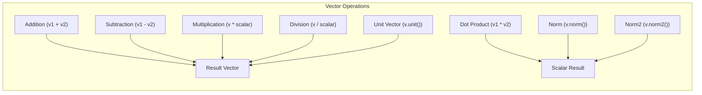
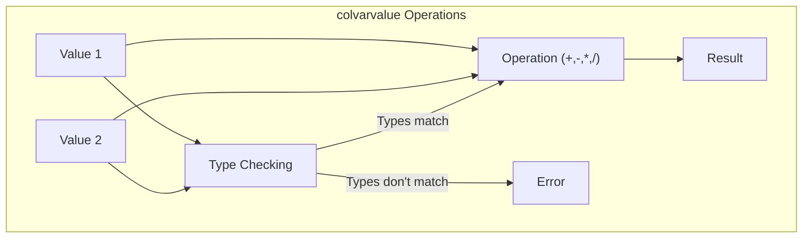
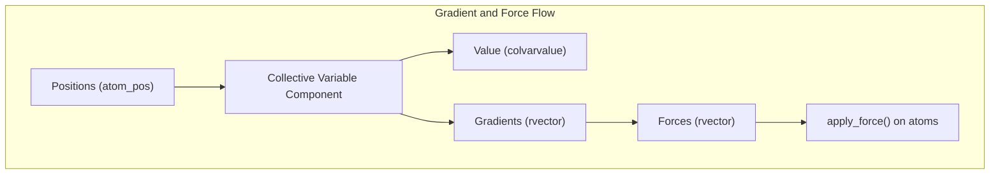
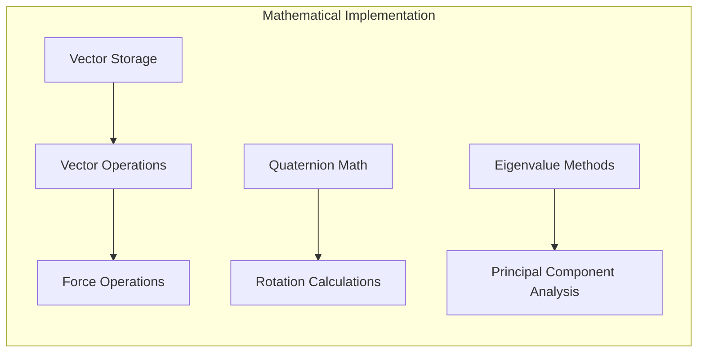
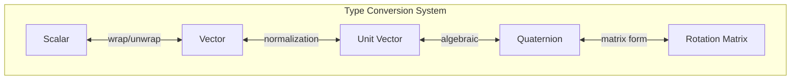

# Linear Algebra and Data Types

<details>
<summary>Relevant source files</summary>

The following files were used as context for generating this wiki page:

- [README-versions.md](README-versions.md)
- [doc/.gitignore](doc/.gitignore)
- [doc/Makefile](doc/Makefile)
- [doc/colvars-code-refs.bib](doc/colvars-code-refs.bib)
- [doc/colvars-engine-flags.tex](doc/colvars-engine-flags.tex)
- [doc/colvars-refman-gromacs.tex](doc/colvars-refman-gromacs.tex)
- [doc/colvars-refman-lammps.tex](doc/colvars-refman-lammps.tex)
- [doc/colvars-refman-main.tex](doc/colvars-refman-main.tex)
- [doc/colvars-refman-namd.tex](doc/colvars-refman-namd.tex)
- [doc/colvars-refman-tinkerhp.tex](doc/colvars-refman-tinkerhp.tex)
- [doc/colvars-refman-vmd.tex](doc/colvars-refman-vmd.tex)
- [doc/colvars-refman.bib](doc/colvars-refman.bib)
- [doc/colvars-refman.tex](doc/colvars-refman.tex)
- [doc/extract_code_refs.py](doc/extract_code_refs.py)
- [doc/print_engine_versions.sh](doc/print_engine_versions.sh)
- [namd/ug/ug_colvars.tex](namd/ug/ug_colvars.tex)
- [src/colvar.cpp](src/colvar.cpp)
- [src/colvar.h](src/colvar.h)
- [src/colvar_rotation_derivative.h](src/colvar_rotation_derivative.h)
- [src/colvaratoms.cpp](src/colvaratoms.cpp)
- [src/colvaratoms.h](src/colvaratoms.h)
- [src/colvarcomp.cpp](src/colvarcomp.cpp)
- [src/colvarcomp.h](src/colvarcomp.h)
- [src/colvarcomp_angles.cpp](src/colvarcomp_angles.cpp)
- [src/colvarcomp_coordnums.cpp](src/colvarcomp_coordnums.cpp)
- [src/colvarcomp_distances.cpp](src/colvarcomp_distances.cpp)
- [src/colvarcomp_protein.cpp](src/colvarcomp_protein.cpp)
- [src/colvarcomp_rotations.cpp](src/colvarcomp_rotations.cpp)
- [src/colvardeps.cpp](src/colvardeps.cpp)
- [src/colvardeps.h](src/colvardeps.h)
- [src/colvarmodule_refs.h](src/colvarmodule_refs.h)
- [src/colvartypes.cpp](src/colvartypes.cpp)
- [src/colvartypes.h](src/colvartypes.h)
- [src/colvarvalue.cpp](src/colvarvalue.cpp)
- [src/colvarvalue.h](src/colvarvalue.h)
- [src/nr_jacobi.cpp](src/nr_jacobi.cpp)
- [src/nr_jacobi.h](src/nr_jacobi.h)
- [vmd/doc/ug_colvars.tex](vmd/doc/ug_colvars.tex)

</details>


This page documents the linear algebra data structures and operations used throughout the Colvars module. It covers the core vector and matrix types, quaternion mathematics, specialized types for molecular dynamics applications, and the value abstraction system. If you're looking for information about collective variable functions, see [Collective Variables Implementation](#3).

## Core Linear Algebra Types

The Colvars module implements a variety of custom linear algebra data structures that serve as the foundation for all calculations. These types are optimized for the specific needs of molecular simulations while providing a clean interface for higher-level components.

### Vector Types

The module provides several vector types with different characteristics:

```mermaid
classDiagram
    class "vector1d~T~" {
        +std::vector~T~ data
        +reset()
        +operator[]
        +operator+,-,*,/
        +norm2()
        +norm()
        +sum()
    }
    
    class "rvector" {
        +real x, y, z
        +operator+,-,*,/
        +operator*
        +norm2()
        +norm()
        +unit()
        +is_zero()
    }
    
    class "atom_pos" {
        // Alias of rvector
    }
    
    "rvector" --|> "vector1d~T~" : specialization
    "atom_pos" --|> "rvector" : typedef
```

- `vector1d<T>`: A templated class providing a generic one-dimensional array with linear algebra operations
- `rvector`: A specialized 3D vector (x,y,z components) optimized for atomic positions and forces
- `atom_pos`: A type alias for `rvector` used specifically for atomic positions

Sources: [src/colvartypes.h:32-249](). [src/colvartypes.h:267-377]().

#### Vector Operations

The vector types support standard mathematical operations:



Vector operations include:
- Addition and subtraction of vectors
- Scalar multiplication and division
- Dot product calculation
- Normalization and unit vector calculation
- Squared norm and vector length calculation

Sources: [src/colvartypes.h:128-246](). [src/colvartypes.cpp:28-64]().

### Matrix Types

The `rmatrix` class provides 3×3 matrix support for transformations:

```mermaid
classDiagram
    class "rmatrix" {
        +real xx, xy, xz
        +real yx, yy, yz
        +real zx, zy, zz
        +reset()
        +operator*
        +trace()
        +transpose()
        +determinant()
    }
```

The matrix class supports:
- Matrix-vector multiplication
- Matrix-matrix multiplication
- Trace, transpose, and determinant calculation
- Special matrices (zero, identity)

Sources: [src/colvartypes.h:377-466]().

### Quaternions

Quaternions are used to represent rotations in 3D space:

```mermaid
classDiagram
    class "quaternion" {
        +real q0
        +real q1
        +real q2
        +real q3
        +reset()
        +operator*
        +rotate()
        +conjugate()
        +invert()
    }
```

Quaternions provide:
- Efficient rotation representation
- Stable interpolation of rotations
- Conversions to/from rotation matrices
- Composition of rotations via multiplication

Sources: [src/colvartypes.h:471-556](). [src/colvartypes.cpp:421-689]().

## Value Representation System

The `colvarvalue` class serves as a versatile container that can represent different types of values used in collective variables.

```mermaid
classDiagram
    class "colvarvalue" {
        +Type value_type
        +real real_value
        +rvector rvector_value
        +quaternion quaternion_value
        +vector1d~real~ vector1d_value
        +reset()
        +type()
        +operator+,-,*,/
        +is_scalar()
        +is_vector()
        +size()
    }
    
    class "Type" {
        <<enumeration>>
        type_notset
        type_scalar
        type_3vector
        type_unit3vector
        type_unit3vectorderiv
        type_quaternion
        type_quaternionderiv
        type_vector
    }
    
    "colvarvalue" o-- "Type"
```

Value types supported:
- Scalar values (single real number)
- 3D vectors (position, distance)
- Unit vectors (orientation, direction)
- Quaternions (rotation)
- General vectors (arbitrary dimension)

Sources: [src/colvarvalue.h:19-335](). [src/colvarvalue.cpp:18-101]().

### Type Conversion and Operations

The `colvarvalue` class handles type conversion and value operations automatically:



Key features:
- Type checking before operations
- Automatic handling of different value types
- Specialized operations for each type
- Distance metrics and gradients
- Handling of periodic values

Sources: [src/colvarvalue.h:345-640](). [src/colvarvalue.cpp:104-400]().

## Atoms and Atom Groups

The linear algebra types are used extensively in representing atomic positions and forces:

```mermaid
classDiagram
    class "atom" {
        +int id
        +real mass
        +real charge
        +atom_pos pos
        +rvector vel
        +rvector total_force
        +rvector grad
        +read_position()
        +apply_force()
    }
    
    class "atom_group" {
        +std::vector~atom~ atoms
        +std::vector~int~ atoms_ids
        +atom_pos center_of_mass()
        +rvector total_force()
        +real total_mass
        +real total_charge
        +set_weighted_gradient()
    }
    
    "atom_group" o-- "atom" : contains
```

Atoms and atom groups use:
- `atom_pos` (alias for `rvector`) for atomic positions
- `rvector` for velocities, forces, and gradients
- Vector operations for center of mass calculations
- Matrix operations for coordinate transformations
- Quaternions for rotational fitting

Sources: [src/colvaratoms.h:32-150](). [src/colvaratoms.h:157-295]().

## Gradient and Force Calculations

The linear algebra types support gradient and force calculations:



Key operations:
- Calculating spatial derivatives
- Converting gradients to forces
- Propagating forces through complex expressions
- Handling rotation derivatives using quaternions

Sources: [src/colvar.cpp:350-370](). [src/colvarcomp.h:138-170]().

## Rotation Representation and Derivatives

Rotations are handled through quaternions with special support for calculating derivatives:

```mermaid
classDiagram
    class "rotation_derivative~T1, T2~" {
        +calc_gradients()
        +calc_rotation_derivatives()
        +atom_deriv_vec
    }
    
    class "rotation" {
        +quaternion q
        +rmatrix matrix
        +calc_optimal_rotation()
        +monitor_crossings
    }
    
    "rotation_derivative~T1, T2~" --> "rotation"
```

This system handles:
- Optimal rotation calculation between coordinate sets
- Calculation of rotation derivatives
- Proper handling of rotation singularities
- Efficient storage of derivative data

Sources: [src/colvar_rotation_derivative.h:1-32](). [src/colvartypes.cpp:566-689]().

## Implementation of Mathematical Operations

Mathematical operations are implemented with a focus on numerical stability and performance:



Key implementation aspects:
- Efficient vector and matrix storage
- Quaternion normalization for stability
- Specialized routines for common operations
- Jacobi eigenvalue solver for principal component analysis
- Fast atomic position updates for common cases

Sources: [src/colvartypes.cpp:15-23](). [src/colvartypes.h:20-31]().

## Data Type Conversions and Compatibility

The module provides a flexible system for converting between different representations:



Key conversion capabilities:
- Converting between vector types
- Wrapping scalar values (periodic boundaries)
- Quaternion-matrix conversions
- Type checking for operations
- Proper handling of boundary conditions

Sources: [src/colvarvalue.cpp:406-650](). [src/colvartypes.cpp:421-478]().

## Integration with Collective Variables

These linear algebra types form the foundation for all collective variable components:

```mermaid
classDiagram
    class "colvar::cvc" {
        +calc_value()
        +calc_gradients()
        +apply_force()
        +dist2()
    }
    
    class "colvar::distance" {
        +calc_value()
        +calc_gradients()
        +rvector dist_v
    }
    
    class "colvar::orientation" {
        +calc_value()
        +calc_gradients()
        +quaternion rot
    }
    
    "colvar::cvc" <|-- "colvar::distance"
    "colvar::cvc" <|-- "colvar::orientation"
```

The linear algebra types enable:
- Calculation of distances between positions
- Measurement of angles using vector operations
- Representation of orientations using quaternions
- Efficient gradient and force calculations
- Handling of periodic boundaries

Sources: [src/colvarcomp.h:31-302](). [src/colvarcomp_distances.cpp:19-56]().

## Performance Considerations

The linear algebra types are designed with performance in mind:

- Fixed-size small vectors (3D) avoid dynamic memory allocation
- Efficient quaternion operations for rotations
- Minimal branching in critical operations
- Optimized memory layout for common operations
- Support for parallel computation when possible

Sources: [src/colvartypes.h:267-288](). [src/colvaratoms.h:241-307]().

---