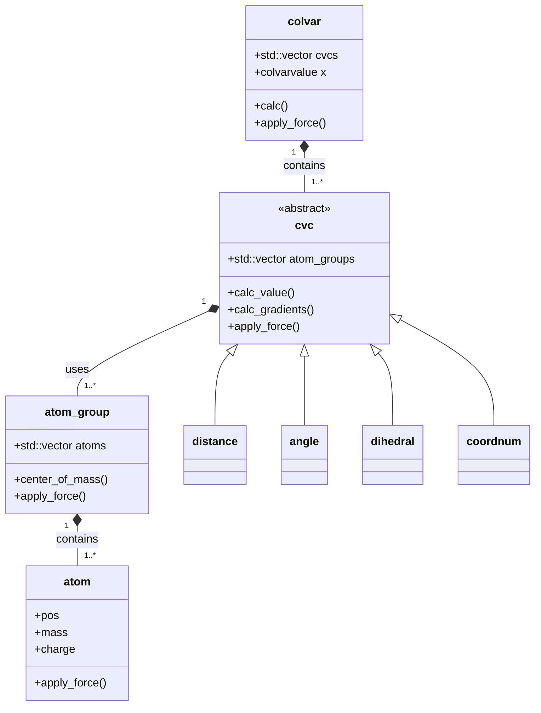
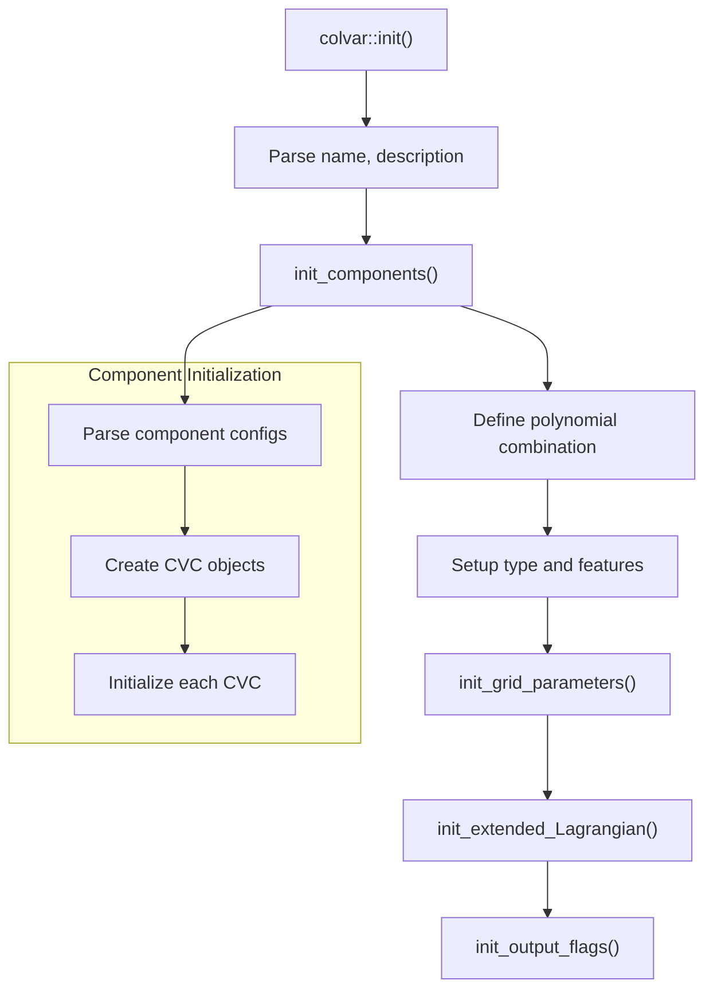
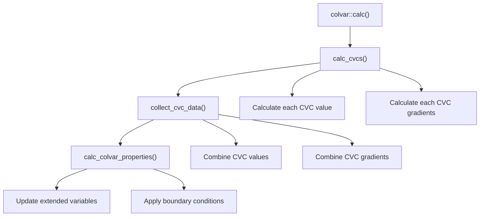
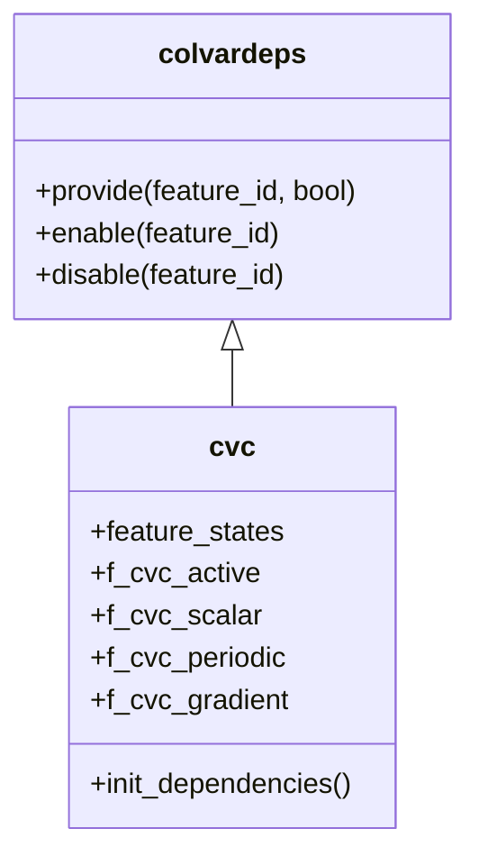
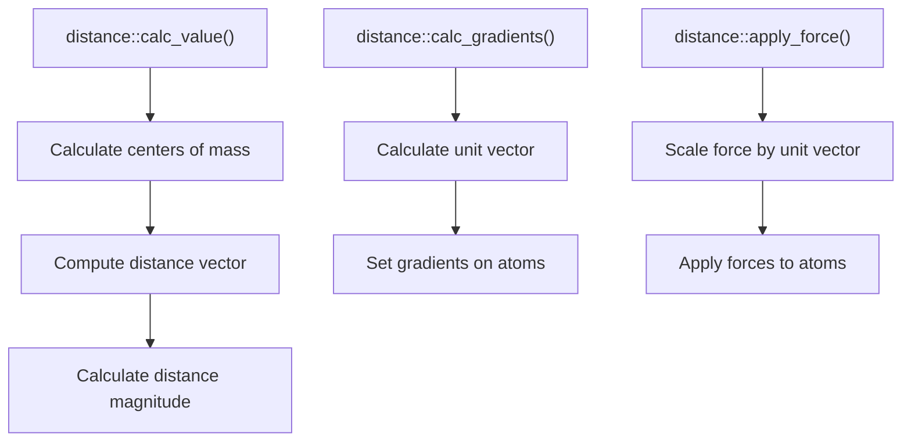
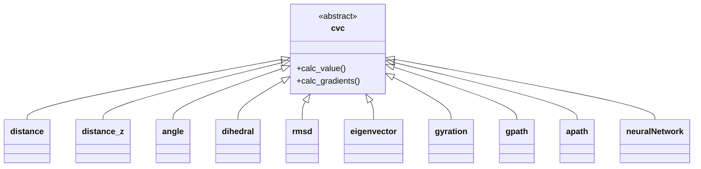
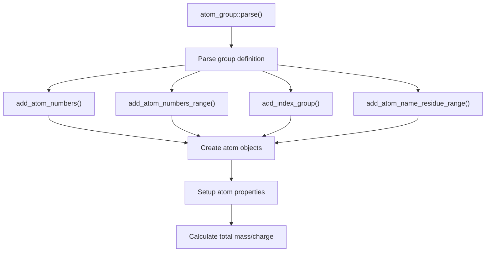
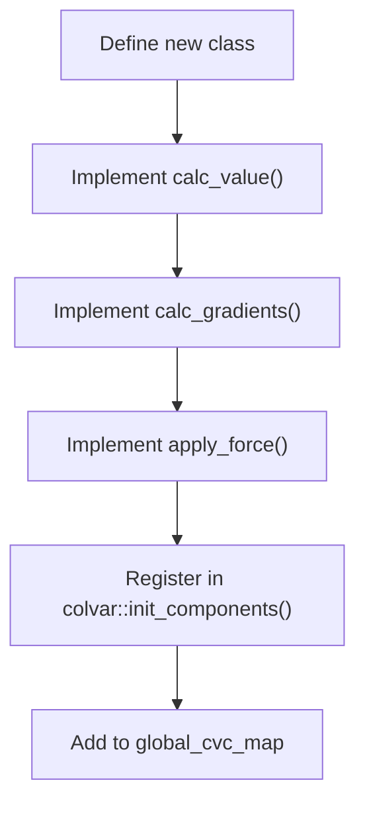
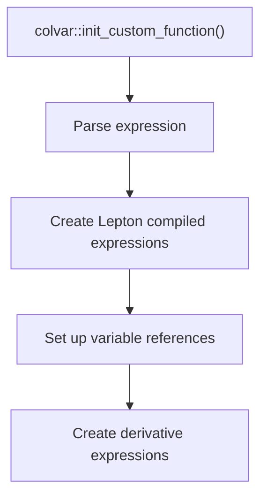
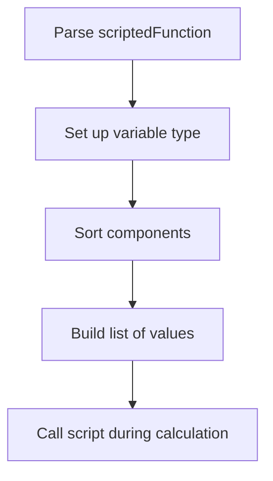

# Collective Variables Implementation

Relevant source files

The following files were used as context for generating this wiki page:

- [README-versions.md](README-versions.md)
- [doc/.gitignore](doc/.gitignore)
- [doc/Makefile](doc/Makefile)
- [doc/colvars-code-refs.bib](doc/colvars-code-refs.bib)
- [doc/colvars-engine-flags.tex](doc/colvars-engine-flags.tex)
- [doc/colvars-refman-gromacs.tex](doc/colvars-refman-gromacs.tex)
- [doc/colvars-refman-lammps.tex](doc/colvars-refman-lammps.tex)
- [doc/colvars-refman-main.tex](doc/colvars-refman-main.tex)
- [doc/colvars-refman-namd.tex](doc/colvars-refman-namd.tex)
- [doc/colvars-refman-tinkerhp.tex](doc/colvars-refman-tinkerhp.tex)
- [doc/colvars-refman-vmd.tex](doc/colvars-refman-vmd.tex)
- [doc/colvars-refman.bib](doc/colvars-refman.bib)
- [doc/colvars-refman.tex](doc/colvars-refman.tex)
- [doc/extract_code_refs.py](doc/extract_code_refs.py)
- [doc/print_engine_versions.sh](doc/print_engine_versions.sh)
- [namd/ug/ug_colvars.tex](namd/ug/ug_colvars.tex)
- [src/colvar.cpp](src/colvar.cpp)
- [src/colvar.h](src/colvar.h)
- [src/colvar_arithmeticpath.h](src/colvar_arithmeticpath.h)
- [src/colvar_geometricpath.h](src/colvar_geometricpath.h)
- [src/colvar_neuralnetworkcompute.cpp](src/colvar_neuralnetworkcompute.cpp)
- [src/colvar_neuralnetworkcompute.h](src/colvar_neuralnetworkcompute.h)
- [src/colvaratoms.cpp](src/colvaratoms.cpp)
- [src/colvaratoms.h](src/colvaratoms.h)
- [src/colvarcomp.cpp](src/colvarcomp.cpp)
- [src/colvarcomp.h](src/colvarcomp.h)
- [src/colvarcomp_alchlambda.cpp](src/colvarcomp_alchlambda.cpp)
- [src/colvarcomp_angles.cpp](src/colvarcomp_angles.cpp)
- [src/colvarcomp_apath.cpp](src/colvarcomp_apath.cpp)
- [src/colvarcomp_combination.cpp](src/colvarcomp_combination.cpp)
- [src/colvarcomp_coordnums.cpp](src/colvarcomp_coordnums.cpp)
- [src/colvarcomp_distances.cpp](src/colvarcomp_distances.cpp)
- [src/colvarcomp_gpath.cpp](src/colvarcomp_gpath.cpp)
- [src/colvarcomp_neuralnetwork.cpp](src/colvarcomp_neuralnetwork.cpp)
- [src/colvarcomp_protein.cpp](src/colvarcomp_protein.cpp)
- [src/colvarcomp_rotations.cpp](src/colvarcomp_rotations.cpp)
- [src/colvardeps.cpp](src/colvardeps.cpp)
- [src/colvardeps.h](src/colvardeps.h)
- [src/colvarmodule_refs.h](src/colvarmodule_refs.h)
- [src/replace_stl_math.sh](src/replace_stl_math.sh)
- [vmd/doc/ug_colvars.tex](vmd/doc/ug_colvars.tex)

This document explains the detailed implementation of collective variables in the Colvars module. It covers the core classes, their relationships, and how different types of collective variables are implemented. For an introduction to collective variables from a user perspective, see [Overview](#1).

## Core Architecture

The implementation of collective variables follows a modular design that allows for extensibility and composability. At the heart of the implementation are three key abstractions:

1. **Colvar**: A collective variable object that can combine one or more components
2. **CVC (Colvar Component)**: Individual calculation methods that implement specific measures
3. **Atom Groups**: Collections of atoms that CVCs operate on

Sources: [src/colvar.h:31-706](), [src/colvarcomp.h:31-303](), [src/colvaratoms.h:22-151](), [src/colvaratoms.h:157-613]()

## Colvar Class Implementation

The `colvar` class represents a single collective variable, which can be a simple function of atomic coordinates or a complex combination of multiple components.

### Key Properties

- **Value**: The current value of the collective variable (`x`)
- **Components (CVCs)**: One or more calculation methods that contribute to this colvar
- **Features**: Properties like periodicity, boundaries, and extended Lagrangian dynamics

### Initialization Process

The initialization of a colvar follows these steps:

1. Parse configuration and set basic properties
2. Initialize components based on the configuration
3. Configure extended Lagrangian dynamics if requested
4. Set up grid parameters, boundaries, and output options

Sources: [src/colvar.cpp:62-347](), [src/colvar.cpp:513-694](), [src/colvar.cpp:693-774](), [src/colvar.cpp:777-809]()

### Calculation Workflow

The calculation of a colvar value involves:

1. Computing the values of all active components
2. Combining them according to the polynomial combination rule
3. Calculating gradients, forces, and other derived quantities

Sources: [src/colvar.cpp:300-342]()

## CVC (Colvar Component) Base Class

The `colvar::cvc` class is the abstract base class for all collective variable components. It defines the interface that all components must implement.

### Key Methods

- **`calc_value()`**: Calculate the value of the component
- **`calc_gradients()`**: Calculate the gradients (derivatives) with respect to atomic positions
- **`apply_force()`**: Apply forces to the atoms based on the gradients

### Component Feature System

The CVC implementation includes a sophisticated feature system that manages dependencies between different capabilities:

- **Available Features**: Features that the component can support (e.g., periodicity)
- **Enabled Features**: Features that are currently active
- **Feature Dependencies**: Relationships that ensure consistent behavior

Sources: [src/colvarcomp.h:31-303](), [src/colvarcomp.cpp:19-336](), [src/colvardeps.h:34-434](), [src/colvardeps.cpp:16-465]()

## Specialized CVC Implementations

The Colvars module implements a wide variety of collective variable components, each designed to measure a specific structural property.

### Geometric Components

These components calculate basic geometric properties between atoms:

- **`distance`**: Distance between centers of mass of two groups
- **`distance_z`**: Projection of distance along an axis
- **`angle`**: Angle formed by three groups
- **`dihedral`**: Dihedral angle formed by four groups

### Example: Distance Component Implementation

The `distance` component calculates the distance between the centers of mass of two atom groups.

Sources: [src/colvarcomp_distances.cpp:19-83]()

### Structural Components

These components measure more complex structural properties:

- **`rmsd`**: Root mean square deviation from a reference structure
- **`eigenvector`**: Projection onto eigenvectors (e.g., from PCA)
- **`gyration`**: Radius of gyration of a group of atoms

### Path-based Components

These components measure progress along predefined paths:

- **`gpath`**, **`gspathCV`**: Geometric path collective variables
- **`apath`**: Arithmetic path collective variable

### Machine Learning Components

- **`neuralNetwork`**: Neural network-based collective variables

Sources: [src/colvarcomp.h:328-1320](), [src/colvarcomp_distances.cpp](), [src/colvarcomp_angles.cpp](), [src/colvarcomp_coordnums.cpp](), [src/colvarcomp_gpath.cpp](), [src/colvarcomp_neuralnetwork.cpp]()

## Atom Groups and Atomic Data

The `atom_group` class manages collections of atoms used by CVCs for their calculations.

### Key Capabilities

- **Center of Mass**: Calculate the center of mass of the group
- **Rotational Fitting**: Align the group to a reference structure
- **Force Application**: Distribute forces to individual atoms
- **Parallel Computation**: Support for scalable calculations

### Atom Selection and Management

Atom groups can be defined by:

- Atom numbers
- Residue names and numbers
- Index groups (from external files)
- PDB files with atom selection columns

Sources: [src/colvaratoms.cpp:90-604]()

## Extensibility: Adding New Collective Variables

The Colvars module is designed to be extended with new types of collective variables. The process for adding a new CVC involves:

1. Declaring a new class deriving from `colvar::cvc`
2. Implementing the required methods (`calc_value()`, `calc_gradients()`, etc.)
3. Registering the new class in the component map

Sources: [src/colvar.cpp:813-881](), [src/colvarcomp.h:31-303]()

## Custom Functions and Scripting

The Colvars module supports two ways to create custom collective variables without writing C++ code:

### Custom Functions (Lepton)

Users can define mathematical expressions that combine existing CVCs using the Lepton expression library.

Sources: [src/colvar.cpp:350-510]()

### Scripted Functions

Users can define Tcl scripts that compute collective variable values based on component values.

Sources: [src/colvar.cpp:107-169]()

## Value Types and Mathematical Operations

The `colvarvalue` class provides a flexible representation for different types of collective variables:

- **Scalar**: Simple numerical values
- **Vector**: 3D vectors
- **Unit vector**: Normalized 3D vectors
- **Quaternion**: Orientation quaternions

For each type, specialized operations are defined for:
- Distance calculations
- Gradient computations
- Boundary conditions

Sources: [src/colvarvalue.h]()

## Summary

The collective variables implementation in the Colvars module provides a flexible and extensible framework for defining and computing a wide range of structural properties in molecular simulations. The modular design, with a clear separation between collective variables, their components, and atom groups, allows for easy composition of complex variables and extension with new types of calculations.

The implementation supports advanced features such as extended Lagrangian dynamics, custom mathematical expressions, and various boundary conditions, making it suitable for a wide range of enhanced sampling applications.

---