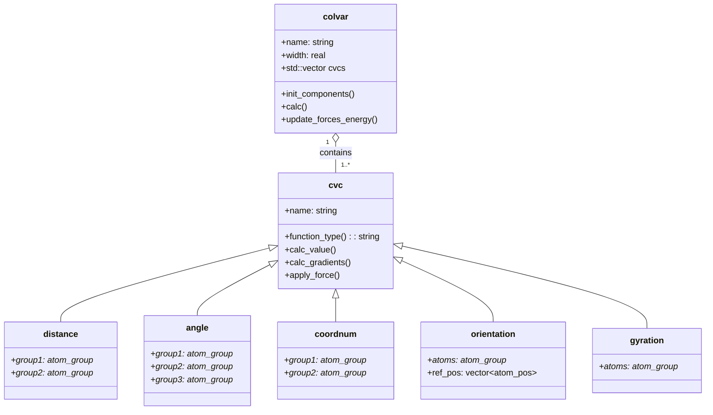
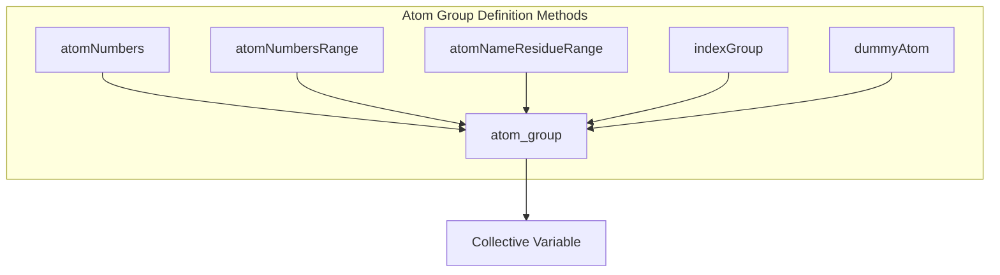
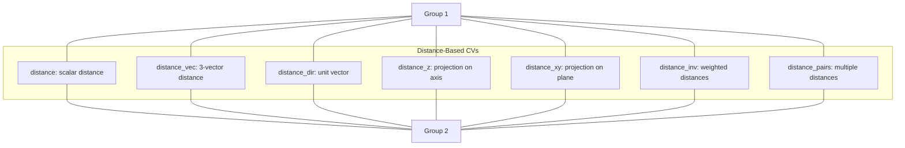
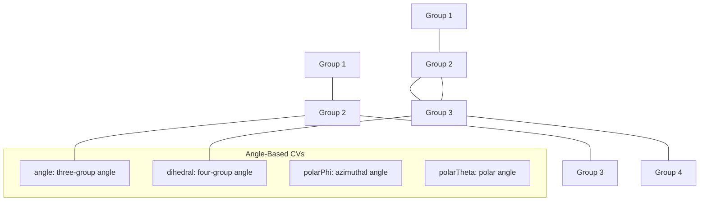
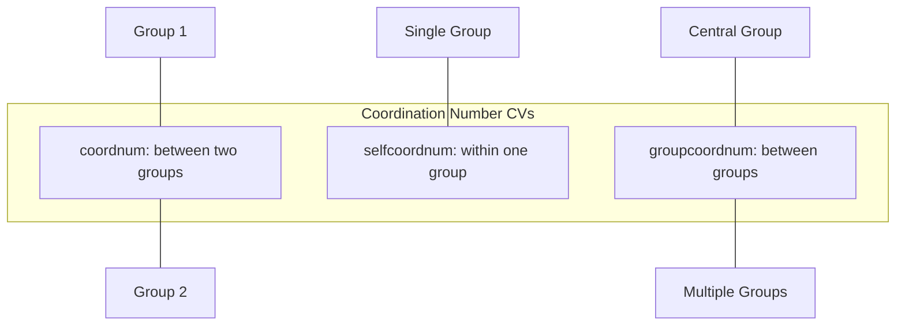
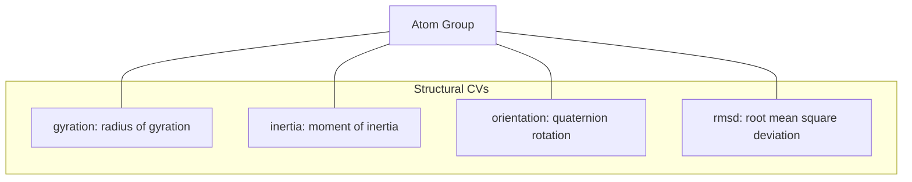
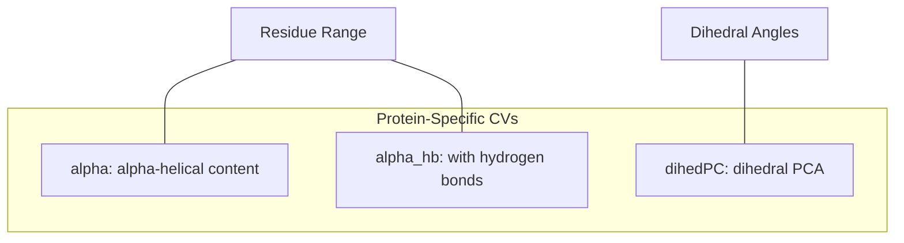
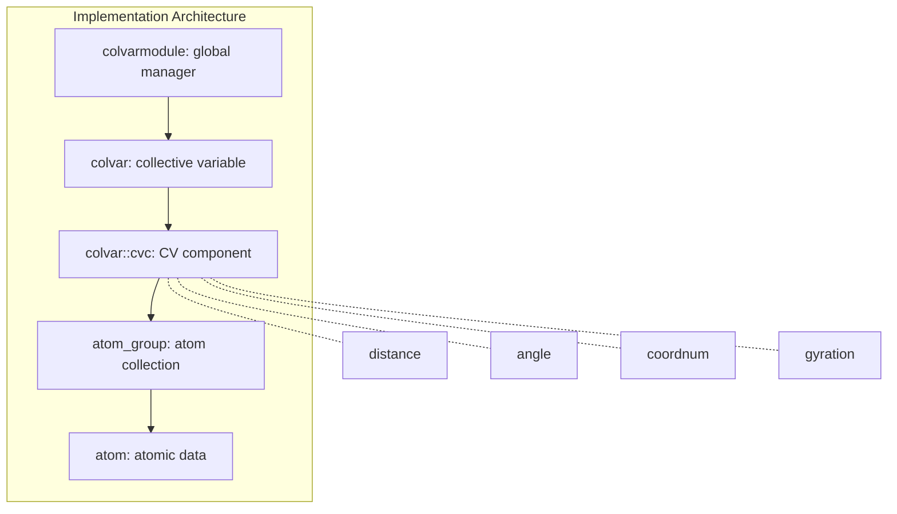

# Basic Collective Variables

<details>
<summary>Relevant source files</summary>

The following files were used as context for generating this wiki page:

- [README-versions.md](README-versions.md)
- [doc/.gitignore](doc/.gitignore)
- [doc/Makefile](doc/Makefile)
- [doc/colvars-code-refs.bib](doc/colvars-code-refs.bib)
- [doc/colvars-engine-flags.tex](doc/colvars-engine-flags.tex)
- [doc/colvars-refman-gromacs.tex](doc/colvars-refman-gromacs.tex)
- [doc/colvars-refman-lammps.tex](doc/colvars-refman-lammps.tex)
- [doc/colvars-refman-main.tex](doc/colvars-refman-main.tex)
- [doc/colvars-refman-namd.tex](doc/colvars-refman-namd.tex)
- [doc/colvars-refman-tinkerhp.tex](doc/colvars-refman-tinkerhp.tex)
- [doc/colvars-refman-vmd.tex](doc/colvars-refman-vmd.tex)
- [doc/colvars-refman.bib](doc/colvars-refman.bib)
- [doc/colvars-refman.tex](doc/colvars-refman.tex)
- [doc/extract_code_refs.py](doc/extract_code_refs.py)
- [doc/print_engine_versions.sh](doc/print_engine_versions.sh)
- [namd/ug/ug_colvars.tex](namd/ug/ug_colvars.tex)
- [src/colvar.cpp](src/colvar.cpp)
- [src/colvar.h](src/colvar.h)
- [src/colvaratoms.cpp](src/colvaratoms.cpp)
- [src/colvaratoms.h](src/colvaratoms.h)
- [src/colvarcomp.cpp](src/colvarcomp.cpp)
- [src/colvarcomp.h](src/colvarcomp.h)
- [src/colvarcomp_angles.cpp](src/colvarcomp_angles.cpp)
- [src/colvarcomp_coordnums.cpp](src/colvarcomp_coordnums.cpp)
- [src/colvarcomp_distances.cpp](src/colvarcomp_distances.cpp)
- [src/colvarcomp_protein.cpp](src/colvarcomp_protein.cpp)
- [src/colvarcomp_rotations.cpp](src/colvarcomp_rotations.cpp)
- [src/colvardeps.cpp](src/colvardeps.cpp)
- [src/colvardeps.h](src/colvardeps.h)
- [src/colvarmodule_refs.h](src/colvarmodule_refs.h)
- [vmd/doc/ug_colvars.tex](vmd/doc/ug_colvars.tex)

</details>


This page documents the fundamental collective variables (CVs) available in the Colvars module. Collective variables are functions of atomic coordinates that provide a reduced description of a molecular system. These basic CVs form the building blocks for defining complex reaction coordinates used in enhanced sampling methods, restraints, and analysis. For more advanced collective variables, such as path-based variables, see [Path-based Variables](#3.2), and for neural network based variables, see [Neural Network Variables](#3.3).

## Overview

In the Colvars framework, a collective variable is implemented as a C++ object of the `colvar` class, which contains one or more components derived from the `colvar::cvc` (collective variable component) base class. Each component calculates a specific geometric feature of the molecular system, such as distances, angles, or coordination numbers.



Sources: [src/colvar.h:53-1059](), [src/colvar.cpp:33-347](), [src/colvarcomp.h:68-303]()

## Defining Atom Groups

Most collective variables operate on one or more groups of atoms. Atom groups are specified using the `atom_group` class and can be defined in several ways:



Sources: [src/colvaratoms.h:154-380](), [src/colvaratoms.cpp:391-604]()

Example atom group definitions:

```
group1 {
  # List individual atoms by number
  atomNumbers 1 5 10
}

group2 {
  # Define a range of atom numbers
  atomNumbersRange 20-35
}

group3 {
  # Use atoms from a specified segment and residue range
  psfSegID PROT
  atomNameResidueRange CA 10-30
}
```

## Distance-Based Collective Variables

Distance-based CVs calculate various measures of distance between atom groups.



Sources: [src/colvarcomp.h:328-532](), [src/colvarcomp_distances.cpp:19-414]()

### `distance`

Measures the scalar distance between the centers of mass of two atom groups.

```
colvar {
  name d
  distance {
    group1 { atomNumbers 1 2 3 }
    group2 { atomNumbers 10 11 12 }
  }
}
```

### `distance_vec`

Returns the 3D vector connecting the centers of mass of two groups, useful for describing relative positions.

```
colvar {
  name d_vec
  distanceVec {
    group1 { atomNumbers 1 2 3 }
    group2 { atomNumbers 10 11 12 }
  }
}
```

### `distance_z`

Calculates the projection of the distance vector onto a defined axis. Useful for measuring progress along a channel or pore.

```
colvar {
  name d_z
  distanceZ {
    main { atomNumbers 1 2 3 }
    ref { atomNumbers 10 11 12 }
    axis (0.0, 0.0, 1.0)
  }
}
```

## Angle-Based Collective Variables

Angle-based CVs measure various angular relationships between atom groups.



Sources: [src/colvarcomp.h:854-943](), [src/colvarcomp_angles.cpp:15-387]()

### `angle`

Calculates the angle formed by the centers of mass of three atom groups.

```
colvar {
  name theta
  angle {
    group1 { atomNumbers 1 2 }
    group2 { atomNumbers 5 6 }
    group3 { atomNumbers 9 10 }
  }
}
```

### `dihedral`

Measures the dihedral angle defined by four atom groups, commonly used for torsion angles in molecules.

```
colvar {
  name phi
  dihedral {
    group1 { atomNumbers 5 }
    group2 { atomNumbers 7 }
    group3 { atomNumbers 9 }
    group4 { atomNumbers 15 }
  }
}
```

## Coordination Numbers

Coordination numbers measure the number of atoms of a certain type around another atom or group, using a continuous switching function.



Sources: [src/colvarcomp.h:1132-1207](), [src/colvarcomp_coordnums.cpp:19-604]()

### `coordnum`

Calculates a continuous coordination number between two atom groups.

```
colvar {
  name cn
  coordnum {
    group1 { atomNumbers 1 2 3 }
    group2 { atomNumbers 5 6 7 8 9 }
    cutoff 6.0
  }
}
```

## Structural Collective Variables

These CVs measure various structural properties related to molecular shape and orientation.



Sources: [src/colvarcomp.h:553-716](), [src/colvarcomp_rotations.cpp:26-140]()

### `gyration`

Calculates the radius of gyration of an atom group, a measure of its size and compactness.

```
colvar {
  name rg
  gyration {
    atoms { atomNumbersRange 1-50 }
  }
}
```

### `orientation`

Calculates the optimal rotation (as a quaternion) that superimposes a group onto a reference structure.

```
colvar {
  name orient
  orientation {
    atoms { atomNumbersRange 1-50 }
    refPositions positions.pdb
  }
}
```

## Protein-Specific Collective Variables

These CVs are designed specifically for analyzing protein structures.



Sources: [src/colvarcomp.h:943-984](), [src/colvarcomp_protein.cpp:18-142]()

### `alpha_angles`

Calculates the alpha-helical content of a protein segment based on dihedral angles.

```
colvar {
  name alpha
  alpha {
    psfSegID PROT
    residueRange 10-30
  }
}
```

## Common Features and Options

Most collective variables support several common options:

1. **Width**: Sets the typical fluctuation scale for the variable
   ```
   width 3.0  # Typical fluctuation of the CV
   ```

2. **Boundaries**: Define the range of the CV (useful for grid-based methods)
   ```
   lowerBoundary 0.0
   upperBoundary 10.0
   ```

3. **Extended Lagrangian**: Enable collective variable dynamics for enhanced sampling
   ```
   extendedLagrangian yes
   extendedTemp 300.0
   extendedFluctuation 0.1
   ```

4. **Output options**: Control what gets written to output files
   ```
   outputValue on
   outputVelocity off
   outputTotalForce on
   ```

Sources: [src/colvar.cpp:514-809]()

## Implementation Architecture

The Colvars module implements collective variables through a hierarchical class structure:



Sources: [src/colvar.h:53-150](), [src/colvarcomp.h:68-303](), [src/colvaratoms.h:154-313]()

The calculation of a collective variable typically follows these steps:

1. Atom positions are obtained from the MD engine via the proxy interface
2. Each CVC component calculates its value using these positions
3. The colvar combines the component values according to their coefficients
4. Gradients and forces are calculated when needed
5. Forces are applied back to the atoms via the proxy interface

## Example Configuration

Here's a complete example defining multiple collective variables:

```
# Distance between two groups
colvar {
  name distance
  distance {
    group1 { atomNumbers 1 2 3 }
    group2 { atomNumbers 10 11 12 }
  }
}

# Angle between three groups
colvar {
  name angle
  angle {
    group1 { atomNumbers 1 2 }
    group2 { atomNumbers 5 6 }
    group3 { atomNumbers 9 10 }
  }
}

# Coordination number 
colvar {
  name coordination
  coordnum {
    group1 { atomNumbers 1 }
    group2 { atomNumbersRange 10-20 }
    cutoff 6.0
  }
}
```

Sources: [doc/colvars-refman-main.tex:56-145]()

This page covers the most commonly used basic collective variables in the Colvars module. These components can be combined to create complex reaction coordinates or used individually for various types of biasing and analysis methods.

---